Cette section décrit quelques erreurs de construction courantes et propose des moyens de les éviter et de les corriger.

#### Raccorder un recoupe à une galerie rectiligne

Dans cet exemple, le recoupe se construit facilement en accrochant ses sommets au bord de la galerie d'accès. Utilisez le mode d'accrochage « arête la plus proche » pour sélectionner les points indiqués

#### CAD > Snap > Nearest Edge

Les fonctions d'intersection booléenne intégrées à Map3D créent automatiquement l'intersection entre les deux blocs pendant l'étape 2 de l'analyse. Cette construction fonctionne correctement.

Si cela fonctionne bien pour des géométries simples, ce raccordement est souvent moins évident.

Prenons une géométrie plus complexe, où les segments de la galerie d'accès au mur ne correspondent pas aux emplacements souhaités des recoupes.

#### Raccorder un recoupe à une galerie complexe

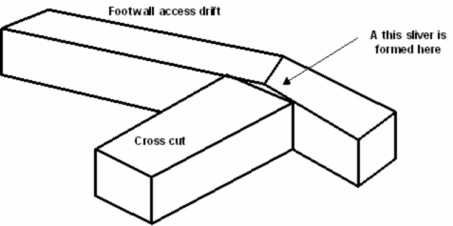

Dans cet exemple, le recoupe ne se raccorde pas correctement à la galerie d'accès au mur. Un pilier mince se forme à l'extrémité du recoupe. Map3D détecte ce pilier et tente de l'analyser, probablement sans succès. Tout comme cette structure serait physiquement instable dans la réalité, elle est aussi numériquement instable. Map3D peut en réalité l'analyser avec succès, mais seulement si les faces adjacentes du pilier sont discrétisées avec des éléments de frontière d'une taille comparable à l'épaisseur du pilier. Cette approche n'est toutefois pas souhaitable, car elle exige un grand nombre d'éléments alors que ce pilier n'existe pas réellement.

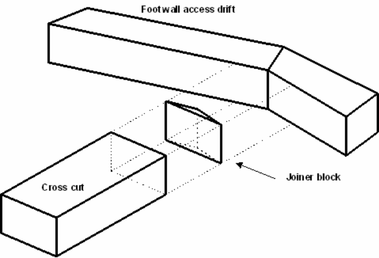

Pour éviter ce problème, vous pouvez construire un bloc de jonction supplémentaire, comme le montre la vue éclatée ci-contre. Utilisez le mode d'accrochage « sommet le plus proche » pour que ce nouveau bloc se raccorde correctement à la galerie et au recoupe. Ce bloc de jonction excave en fait le pilier indésirable et raccorde ainsi correctement le recoupe à la galerie d'accès au mur.

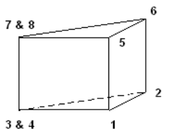

Notez que le bloc de jonction ne comporte que trois points sur ses faces supérieure et inférieure. Il se construit facilement en sélectionnant deux fois l'un des sommets au même endroit (par exemple les points 3 et 4, et 7 et 8).

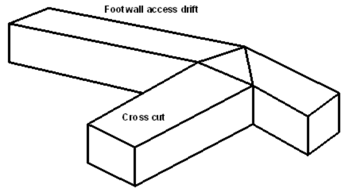

Ce problème peut être entièrement évité si l'on construit les segments de la galerie d'accès au mur de manière à ce qu'ils correspondent aux emplacements souhaités des recoupes. Il suffit pour cela de subdiviser la galerie d'accès comme indiqué. Un peu de réflexion préalable facilite souvent la construction.

#### Raccorder des blocs de chantier mal ajustés

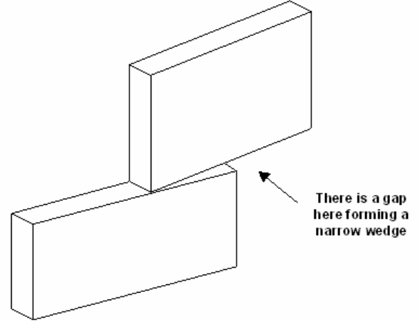

Il arrive souvent que plusieurs blocs de chantier doivent être raccordés le long de leurs arêtes communes.

Dans cet exemple, si la base du bloc supérieur et le toit du bloc inférieur étaient à la même cote, les fonctions d'intersection booléenne intégrées à Map3D créeraient automatiquement l'intersection entre les deux blocs pendant l'étape 2 de l'analyse. Cette construction fonctionne correctement.

Le problème survient lors de la construction, lorsqu'on tente d'accrocher les sommets d'un bloc pour les raccorder au côté de l'autre. Dans cet exemple, le bloc supérieur a été accroché à l'arête supérieure du bloc inférieur, ce qui laisse un espace.

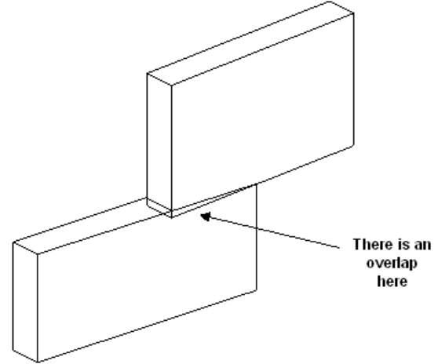

Pour supprimer cet espace, on pourrait accrocher les sommets du bloc inférieur à l'arête inférieure du bloc supérieur avec la fonction d'étirement. Mais cela crée un chevauchement et ne résout donc pas le problème.

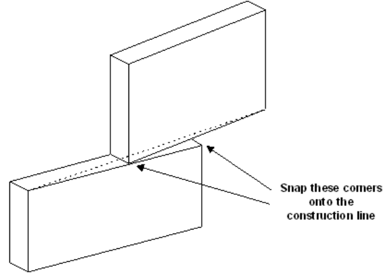

Une solution consiste à créer un bloc de jonction comme décrit ci-dessus. Une solution plus simple consiste cependant à créer des lignes de construction couvrant la zone problématique et à y accrocher les sommets des blocs supérieur et inférieur. Cette opération doit être effectuée sur les faces arrière et avant des blocs de chantier.

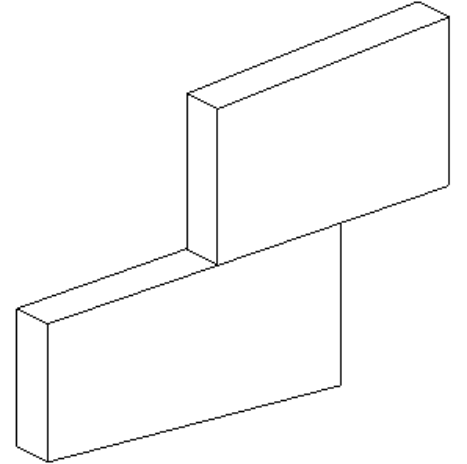

Cette méthode a l'inconvénient de modifier la forme des blocs de chantier, parfois de façon indésirable.

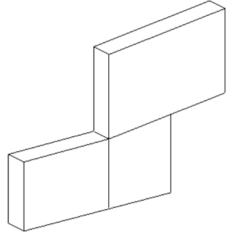

La meilleure solution est probablement de subdiviser l'un des blocs de chantier, ou les deux. C'est la technique la plus efficace pour supprimer les espaces et raccorder des blocs mal ajustés.

#### Raccorder des blocs de chantier décalés

Il arrive souvent que la forme d'un bloc de chantier ne corresponde pas à celle du bloc adjacent.

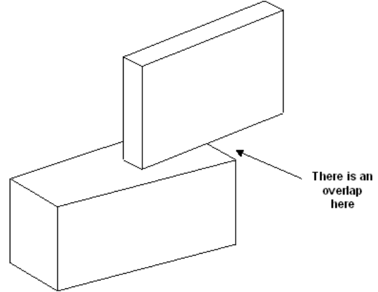

Cette situation est facilement gérée par les fonctions d'intersection booléenne intégrées à Map3D. Le programme crée automatiquement l'intersection entre les deux blocs pendant l'étape 2 de l'analyse.

Ces routines fonctionnent au mieux lorsque tous les points de la face inférieure du bloc supérieur et tous les points de la face supérieure du bloc inférieur sont à la même cote. Vous pouvez y parvenir avec

#### CAD > Edit > Move Vertices to Z

Les routines fonctionnent même si la face inférieure du bloc supérieur et la face supérieure du bloc inférieur ne sont pas planes et se trouvent à des cotes différentes, pourvu qu'elles se recoupent effectivement. Dans ce cas, toutefois, l'intersection obtenue peut comporter de nombreux éléments complexes. Ces formes fonctionnent, mais elles peuvent ralentir l'analyse en raison de leur nombre et du fait qu'elles doivent souvent être finement discrétisées.

#### Raccorder une galerie à un bloc de chantier

Il arrive souvent que l'on veuille faire recouper une galerie et un bloc de chantier.

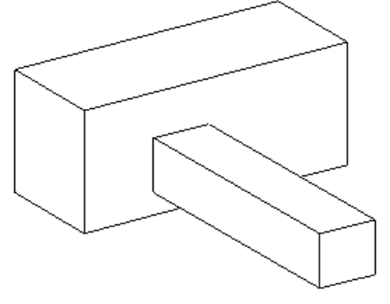

Comme ci-dessus, cette situation est facilement gérée par les fonctions d'intersection booléenne intégrées à Map3D. Le programme crée automatiquement l'intersection entre la galerie et le bloc de chantier pendant l'étape 2 de l'analyse.

Ces routines fonctionnent au mieux lorsque les faces sécantes sont planes et parallèles. Elles fonctionnent même si ces faces ne sont ni planes ni parallèles, pourvu qu'elles se recoupent effectivement. Dans ce cas, toutefois, l'intersection obtenue peut comporter de nombreux éléments complexes. Ces formes fonctionnent, mais elles peuvent ralentir considérablement l'analyse en raison de leur nombre et du fait qu'elles doivent souvent être finement discrétisées.
