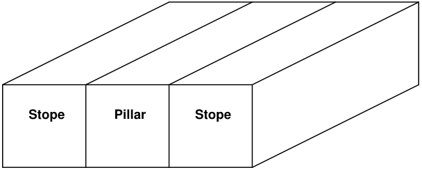
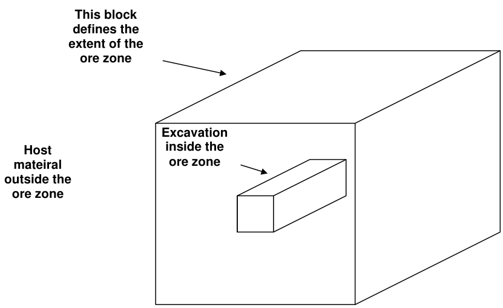
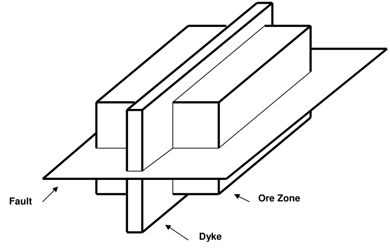

Les modèles comportant plusieurs matériaux se construisent selon des principes semblables à ceux des modèles d'excavation classiques. Au lieu de définir l'intérieur d'un bloc comme excavé (code de matériau nul), il suffit d'indiquer le numéro du matériau présent à l'intérieur du bloc.

Par défaut, le matériau encaissant porte le numéro 1. Toute région dont les propriétés (contrainte initiale, réponse élastique ou résistance) diffèrent doit être définie exactement comme une excavation, avec des éléments de frontière à force fictive. Au lieu d'attribuer à ces blocs un code de matériau nul (contraintes de surface nulles) ou négatif (état de contrainte prescrit), on leur attribue simplement un code de matériau positif indiquant les propriétés associées à chaque groupe de blocs.

Rappelons que les formes d'excavation complexes sont construites en combinant plusieurs blocs portant le même numéro de bloc. Exactement de la même manière, des régions distinctes, chacune dotée de propriétés de matériau différentes, sont formées en construisant la forme voulue à partir de nombreux blocs portant le même numéro de bloc.

Un point important est d'utiliser le moins de numéros de bloc possible, car toutes les surfaces situées entre des groupes de blocs de numéros différents sont conservées dans la base de données.

Il existe deux méthodes pour définir des régions auxquelles attribuer le matériau numéro 2 ou supérieur (c'est-à-dire un numéro différent de celui du matériau encaissant).

Dans la première méthode, les régions de numéros de matériau différents sont construites à partir de blocs qui se présentent exactement comme des excavations.

Cette technique est utile pour définir des détails tels que des zones de faible module en périphérie des excavations. C'est aussi la meilleure méthode pour définir des structures isolées comme des dykes rigides ou des piliers endommagés par le tir.

La seconde méthode est une approche plus globale : tout un réseau d'excavations (ou une partie) est enveloppé dans un ensemble de blocs qui définit par exemple la zone minéralisée. Il est permis d'emboîter les enveloppes les unes dans les autres (comme les couches d'un oignon) et de les faire se chevaucher. Les galeries, par exemple, peuvent traverser la zone minéralisée et pénétrer dans le massif encaissant. Map3D construit les intersections nécessaires.

Ces deux méthodes peuvent être utilisées simultanément. Des blocs définissant une région globale selon la seconde méthode peuvent envelopper totalement ou partiellement d'autres excavations définies selon la première.

La seule règle à respecter strictement lors de la définition de plusieurs zones de matériaux est la convention selon laquelle les numéros de matériau les plus élevés l'emportent sur les plus faibles. Cette convention lève l'ambiguïté lorsque deux structures se recoupent, comme une faille et un dyke. Lorsqu'une faille et un dyke se recoupent, on ne sait pas si la faille doit traverser le dyke ou l'inverse. Autre exemple : un dyke qui recoupe une zone minéralisée. Faut-il considérer que le dyke est continu et traverse le minerai, ou que le minerai est continu et interrompt le dyke ?

Dans tous ces cas, c'est la structure qui porte le numéro de matériau le plus élevé qui est continue. Si la faille avait le numéro 4, le dyke le numéro 3 et le minerai le numéro 2, la faille serait continue partout. Ayant le numéro le plus élevé, elle traverserait le minerai et le dyke, mais bien sûr pas les excavations. Le minerai ayant le numéro le plus faible, il ne traverserait pas le dyke ; c'est au contraire le dyke qui traverserait le minerai.

Les fonctions de masquage suivantes vous aident à déterminer quel matériau traverse les autres :

#### View > Hide > Solids

#### View > Hide > Unused

Une logique intégrée permet de gérer l'intersection simultanée de cinq structures au plus (c'est-à-dire de blocs portant cinq numéros de bloc différents). Un nombre illimité de blocs peut se recouper, mais au maximum cinq au même endroit. On peut ainsi définir par exemple des zones minéralisées multicouches, avec des excavations de part et d'autre du contact et une faille le long de celui-ci. Map3D détecte automatiquement les blocs partiellement ou totalement contenus dans d'autres blocs, ainsi que les blocs adjacents à d'autres blocs, ce qui permet de prendre en compte dans toute analyse un nombre pratiquement illimité de régions de matériaux différents.

Lorsque vous affichez la géométrie des excavations en mode graphique, vous pouvez placer le curseur de la souris sur un bloc. En appuyant sur un bouton de la souris, le numéro et le nom du bloc s'affichent, ainsi que le code de matériau attribué à ce bloc et celui de la région adjacente ou enveloppant la surface du bloc. Par exemple, pour les surfaces de bloc adjacentes au matériau encaissant, le « code de matériau adjacent » vaut un (le matériau un représentant le massif encaissant). Si la surface du bloc est adjacente à une excavation à laquelle le code de matériau 2 a été attribué, le « code de matériau adjacent » vaut 2.

Pendant l'analyse, les résultats sont calculés sur des grilles de points de champ. Map3D détecte automatiquement si les points de grille se trouvent dans des excavations ou dans des régions de propriétés différentes. Lorsque les contours sont affichés, vous pouvez placer le curseur sur le point de champ voulu. En appuyant sur un bouton de la souris, le code de matériau de la région où se trouve ce point s'affiche, avec les coordonnées, les déplacements et l'état de contrainte. Notez que les facteurs de résistance sont calculés avec les propriétés de matériau définies pour cette région. Cette fonction permet d'évaluer une résistance qui peut varier d'une région à l'autre.
