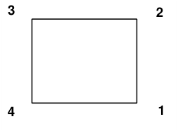
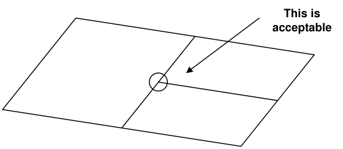
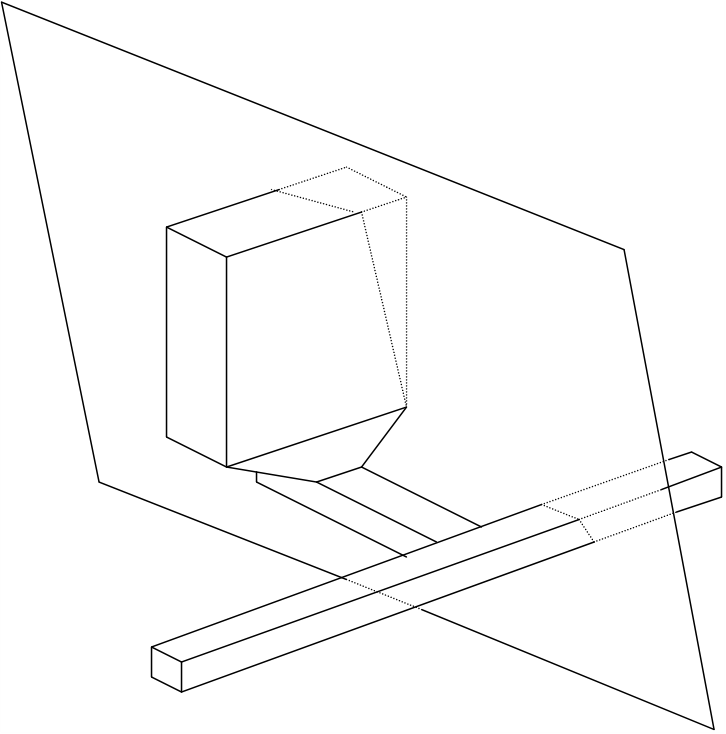
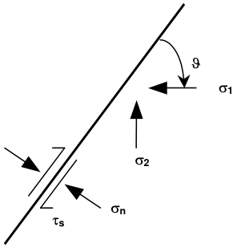

Les modèles peuvent être construits à partir de facettes de surface individuelles. Celles-ci sont définies par des polygones à 3 ou 4 côtés qui n'ont pas besoin d'être plans. Les sommets peuvent être saisis dans le sens horaire ou antihoraire. N'importe quel sommet peut être répété pour définir des formes à 3 côtés et des coins.

#### CAD > Build > DD Loop

Ces formes peuvent être construites avec les fonctions de CAO intégrées à Map3D ou importées depuis d'autres logiciels de CAO dans l'un des formats suivants :

- Format AutoCAD-DXF. Il s'agit d'un format d'échange de dessins courant, d'extension « .DXF ».

- Le format de fichier de points est un fichier de données ASCII universel d'extension « .PNT ».

Contrairement à d'autres programmes d'analyse (méthodes isoparamétriques des éléments de frontière et méthodes des éléments finis ou des différences finies), ces plaques n'ont pas besoin de partager des sommets communs. Vous pouvez définir des éléments subdivisés au milieu de leurs arêtes, à condition qu'il n'y ait aucun espace.

Les plans de faille et l'exploitation tabulaire se construisent selon les mêmes principes que les modèles d'excavation classiques. Ces structures sont simplement définies avec les autres excavations et les différentes zones de matériaux, et peuvent être utilisées en même temps que toutes les autres fonctions de Map3D.

Les plans de faille et les zones d'exploitation tabulaire sont définis par des éléments à discontinuité de déplacement. Ceux-ci ne peuvent être définis que sous forme de plaques. Les quatre sommets de la plaque définissent les extrémités de la discontinuité de déplacement. Les discontinuités de déplacement peuvent recouper les excavations à n'importe quel endroit, car Map3D construit les intersections d'arêtes en interne.

Comme dans la section précédente, la seule règle à respecter strictement lors de la définition des plans de faille est la convention selon laquelle les numéros de matériau les plus élevés l'emportent sur les plus faibles. Lorsque deux structures se recoupent, comme une faille et un dyke, c'est celle qui porte le numéro de matériau le plus élevé qui se prolonge à travers l'autre.

Un point à surveiller lors de la modélisation non linéaire (glissement de faille ou plastification généralisée dans Map3D Non-Linear) est que la contrainte en champ lointain ne doit pas dépasser la résistance. Si les contraintes en champ lointain dépassent la résistance du massif rocheux, le massif lui-même est instable. Si cela peut être admissible pour certains problèmes de fluage, ce n'est généralement pas acceptable, et aucune solution en régime permanent (c'est-à-dire sans fluage) n'est possible.

Cette limite est plus contraignante pour la simulation des failles. Toute faille peut se trouver à l'équilibre statique, ou très près de celui-ci (contraintes égales à la résistance), avec l'état de contrainte en champ lointain. Pour des failles de faible résistance soumises à des rapports de contraintes élevés, les contraintes principales doivent être orientées presque perpendiculairement ou parallèlement au plan de faille ; sinon, la faille est instable et glisse même sans exploitation. Cette condition n'est généralement pas acceptable, car aucune solution en régime permanent (c'est-à-dire sans fluage) n'est possible.

Lorsque s1 forme l'angle J avec le plan de faille, la contrainte de cisaillement et la contrainte normale qui s'exercent sur la faille sont données par

ts = ( s1 - s2 ) sin(J) cos(J)

sn = s1 sin² (J) +  s2 cos² (J)

en les substituant dans la relation de résistance au cisaillement

|ts| = Cohesion + sn tan(j)

on obtient que l'état de contrainte doit satisfaire

|( s1 - s2 ) sin(J) cos(J)| = Cohesion + [ s1 sin² (J) +  s2 cos² (J) ] tan(j)

Par exemple, avec

s1 = 32 MPa s2 = 16 MPa Cohesion = 0 j = 10°

J doit être inférieur à 11° ou compris entre 69° et 90°.

Avec

s1 = 60 MPa s2 = 16 MPa Cohesion = 0 j = 30°

J doit être inférieur à 15° ou compris entre 45° et 90°.
