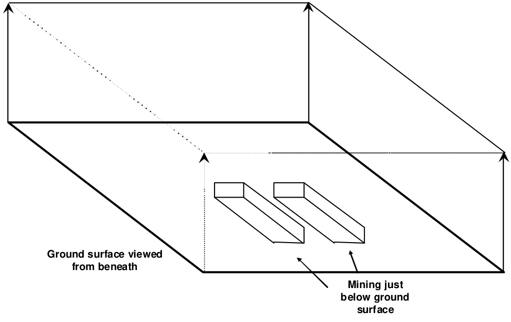

La meilleure façon de définir la surface du sol consiste à utiliser une grande zone FF dont la face inférieure correspond à la surface du sol. En attribuant un code de matériau nul à ces éléments, Map3D garantit des contraintes normales et de cisaillement nulles le long de ces surfaces, ce qui simule une surface libre.

Il n'est nécessaire de définir la surface du sol que lorsque les excavations sont assez peu profondes (c'est-à-dire lorsque la profondeur d'exploitation est inférieure à environ deux fois l'étendue latérale de l'exploitation). Dans ce cas, la surface libre doit s'étendre au moins sur deux fois l'étendue latérale de l'exploitation dans toutes les directions.

Évitez d'étendre des grilles de points de champ près de la surface libre ou à travers celle-ci, sauf en cas d'absolue nécessité, car la surface libre serait alors discrétisée en un grand nombre d'éléments de frontière.
