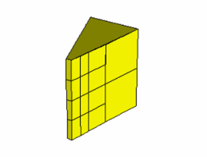
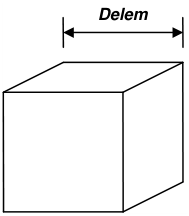
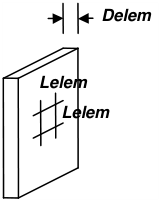
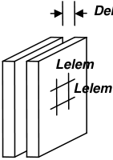
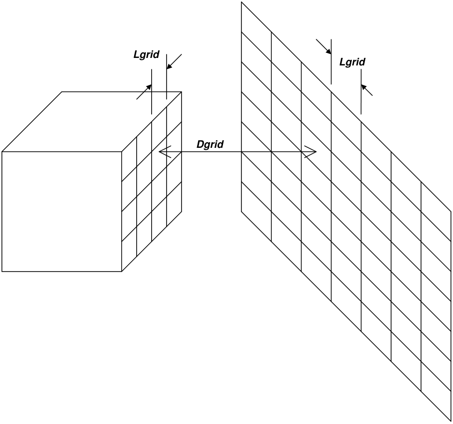
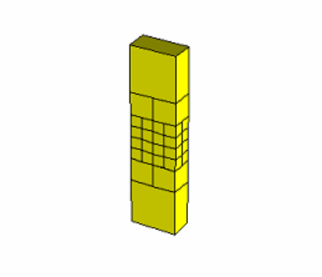
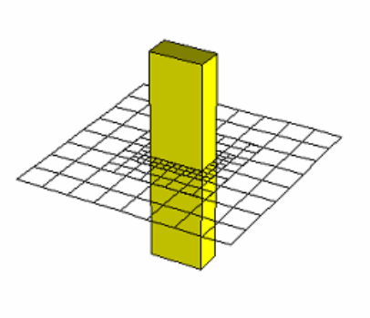
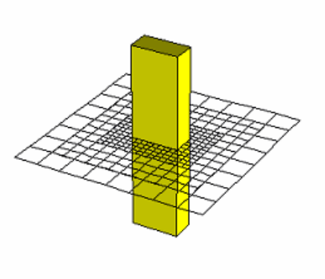
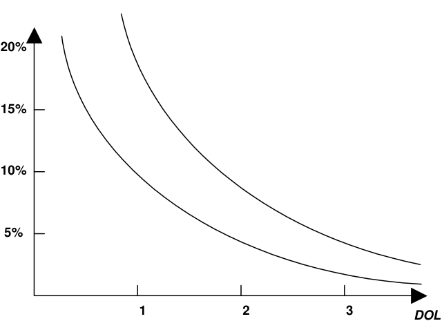
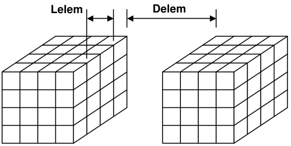

Map3D utilise plusieurs stratégies différentes mais complémentaires pour permettre l'analyse de problèmes de très grande taille. La discrétisation est contrôlée de façon à n'utiliser des éléments de frontière que là où ils sont nécessaires. Plusieurs formes de regroupement réduisent ensuite le temps d'analyse et l'espace disque requis. Ensemble, ces fonctions permettent à Map3D de traiter des problèmes de très grande taille (plus de 2 000 000 d'éléments) sur PC.

Sans regroupement, un problème de 64000 éléments occuperait 147 Go d'espace disque. Avec le regroupement, ce volume peut être ramené à moins de 1 Go. Le temps d'analyse diminue à peu près dans la même proportion. Vous pouvez ainsi définir en détail la géométrie minière existante et ajouter de nouvelles exploitations au besoin. L'effort nécessaire pour préparer et exécuter les analyses s'en trouve fortement réduit, et la mine entière peut être prise en compte si nécessaire.

Tous les paramètres de discrétisation et de regroupement s'expriment sous forme d'un rapport distance/longueur. Dans tous les cas, la distance est mesurée entre deux points d'intérêt (par exemple d'un élément à un autre, ou d'un élément au point de grille le plus proche). Dans ce rapport, la longueur est la taille de l'élément ou l'espacement de la grille en l'un des points d'intérêt.

Les valeurs suggérées pour les paramètres de discrétisation et de regroupement sont les suivantes :

- _AL_ doit être égal à deux fois la largeur du plus petit pilier ou chantier. Utilisez les mêmes unités que pour les coordonnées (par exemple mètres ou pieds).

- _AG_ doit être égal à la plus petite dimension d'intérêt. Utilisez les mêmes unités que pour les coordonnées (par exemple mètres ou pieds).

- _DON_ =0.5, _DOL_ = _DOC_ =1, _DOE_ = _DOG_ =2 pour une erreur de 10 à 20 %

- _DON_ =0.5, _DOL_ = _DOC_ =2, _DOE_ = _DOG_ =4 pour une erreur de 5 à 10 %

- _DON_ =1.0, _DOL_ = _DOC_ =4, _DOE_ = _DOG_ =8 pour une erreur &lt; 5 %

Ces paramètres se règlent dans la boîte de dialogue CAD > Properties > Control Parameters.

L'utilisation de ces paramètres pour contrôler la discrétisation et le regroupement est détaillée ci-dessous.

**_DON_ et** **_AL_ : conditionnement de la matrice**

Lors de la discrétisation, toutes les surfaces du modèle (surfaces des blocs FF et des plans DD) sont subdivisées en éléments de frontière de longueur de côté

_Lelem_ = _Delem_ / _DON_

où _Delem_ est la plus petite distance entre surfaces adjacentes du modèle, déterminée par Map3D. Comme la distance _Delem_ peut être nulle à certains endroits, il faut définir une longueur de côté minimale _AL_.

_AL_ doit être égal à deux fois la largeur du plus petit pilier ou chantier. Utilisez les mêmes unités que pour les coordonnées (par exemple mètres ou pieds).

Une valeur de _DON_ de 0,5 convient généralement à tous les problèmes, sauf ceux comportant des excavations ou des piliers très étroits. Dans ce cas, une valeur de _DON_ de 1,0 est recommandée.

Si des valeurs plus élevées de _DON_ génèrent davantage d'éléments de frontière et donc des temps de calcul plus longs, elles sont nécessaires pour obtenir un problème bien conditionné et soluble lorsque les excavations ou les piliers sont très étroits.

_DON_ contrôle la manière dont les surfaces des blocs sont discrétisées en éléments de frontière. Avec _AL_, ce paramètre garantit que l'analyse par éléments de frontière génère une matrice de coefficients bien conditionnée et soluble.

Le conditionnement de la matrice dépend directement de la valeur de _DON_. Des valeurs élevées de _DON_ (proches de un) garantissent une matrice bien conditionnée et facile à résoudre.

_DON_ = 0.5

#### _DON_ = 1.0

Ces paramètres contrôlent la finesse de la discrétisation des surfaces proches les unes des autres. Par exemple, en comparant les cas avec _DON_ égal à 0,5 et 1,0, on constate que des valeurs plus élevées de _DON_ produisent des éléments de frontière plus petits à l'emplacement du chantier.

Du point de vue de l'analyse, il existe trois types de problèmes. Les plus faciles à résoudre sont ceux qui utilisent des formes tridimensionnelles massives, dont les surfaces sont bien espacées.

Pour ce type de problème, une matrice de coefficients bien conditionnée est toujours générée, et l'effet de _DON_ et d'_AL_ est négligeable.

Le type de problème suivant, plus difficile, est celui où des chantiers étroits sont définis. Dans ce cas, la distance _Delem_ (la plus petite distance d'un élément à un autre) correspond simplement à la largeur du chantier. Comme la longueur de côté de l'élément _Lelem_ peut être calculée à partir du rapport _DON_ par

#### _Lelem_ = _Delem_ / _DON_

sans que _Lelem_ soit inférieur à _AL_, de faibles valeurs de _DON_ ne génèrent de petits éléments qu'à proximité des endroits où les chantiers sont étroits. En s'éloignant de ces zones, la taille des éléments augmente très rapidement. L'utilisation d'éléments à force fictive pour créer ce type d'excavation tabulaire peut produire une matrice mal conditionnée, à moins d'utiliser une valeur de _DON_ d'environ un demi. Il faut bien sûr associer à ce réglage une valeur d'_AL_ suffisamment petite pour permettre la génération de petits éléments.

_AL_ doit normalement être égal à la largeur du pilier ou du chantier le plus étroit, ou à la plus petite distance entre éponte supérieure et éponte inférieure. La routine de discrétisation peut ainsi utiliser des éléments aussi petits que nécessaire pour assurer un bon conditionnement de la matrice.

Le type de problème le plus difficile est celui où des piliers étroits sont définis ou des joints rapprochés utilisés. Comme ci-dessus, _Delem_ est la largeur du chantier ou du pilier. La longueur de côté de l'élément peut aussi être calculée à partir du rapport _DON_. Toutefois, pour ce type de problème, où les excavations sont très proches les unes des autres et forment des piliers étroits, une matrice mal conditionnée et insoluble sera créée à moins d'utiliser une valeur de _DON_ d'environ un. Il faut bien sûr associer à ce réglage une valeur d'_AL_ suffisamment petite pour permettre la génération de petits éléments.

La valeur recommandée de _DON_ est de 0,5 pour les problèmes de chantiers étroits et de 1 pour les problèmes de piliers étroits.

_AL_ doit normalement être égal à la largeur du pilier le plus étroit ou à la plus petite distance entre éponte supérieure et éponte inférieure. La routine de discrétisation peut ainsi utiliser des éléments aussi petits que nécessaire pour assurer un bon conditionnement de la matrice.

En résumé, _AL_ doit être égal à la largeur du pilier le plus étroit ou à la plus petite distance entre éponte supérieure et éponte inférieure. Des valeurs plus grandes peuvent être nécessaires si trop d'éléments sont générés. _DON_ doit valoir 0,5 pour les problèmes courants et 1,0 pour les problèmes comportant des piliers étroits.

Lors de la discrétisation, Map3D tente de respecter le rapport _DON_ spécifié pour tous les éléments. Le nombre maximal d'éléments de frontière en lesquels une arête de bloc ou de plaque peut être divisée est de 256. Si ce nombre de subdivisions est atteint sans que le rapport _DON_ spécifié soit respecté, Map3D affiche un avertissement invitant l'utilisateur à subdiviser le bloc ou la plaque en parties plus petites.

Une fois la discrétisation terminée, la distance _Delem_ peut être tracée avec

Plot > Miscellaneous > Delem Distance to nearest element on surfaces

Le rapport _Delem/Lelem_ peut être tracé avec

Plot > Miscellaneous > Delem/Lelem _DON_ ratio on surfaces

Les endroits où _DON_ est faible (inférieur à 0,5) peuvent empêcher la convergence de la solution.

Notez que vous pouvez, si nécessaire, modifier ce comportement élément par élément en définissant la largeur maximale de chaque élément

#### CAD > Edit > Entity Properties > Maximum Width

#### _DOL_ et _AG_ : précision de la solution

Lors de la discrétisation, les blocs et les plans DD sont subdivisés en éléments de frontière de longueur de côté _Lgrid_. La taille des éléments est déterminée à partir de la distance minimale _Dgrid_ au plan de grille de points de champ le plus proche, selon la relation

_Lgrid_ = _Dgrid_ / _DOL_

Comme la distance _Dgrid_ peut être nulle à certains endroits, il faut aussi définir une longueur de côté minimale _AG_.

La même relation sert également à subdiviser les plans de grille en points où sont calculés les contraintes, les déformations et les déplacements. L'espacement minimal de la grille est égal à la moitié d'_AG_.

Le paramètre _AG_ doit être égal à la plus petite dimension d'intérêt. Pour obtenir des résultats raisonnablement précis, _AG_ doit valoir environ un quart de la largeur du chantier ou du pilier. Par exemple, pour visualiser la répartition des contraintes dans un pilier de 2 m de large, une valeur d'_AG_ de 0,5 fournit suffisamment de points de champ pour un tracé de contours précis.

Utilisez les mêmes unités que pour les coordonnées (par exemple mètres ou pieds).

Une valeur de _DOL_ de 1,0 est recommandée pour tous les problèmes, sauf ceux nécessitant une précision accrue. Avec une valeur de 1,0, on peut s'attendre à une erreur de 10 à 20 %. Une valeur de 2,0 devrait donner une erreur de 5 à 10 %, et une valeur de 4,0 une erreur inférieure à 2 %.

Si des valeurs plus élevées de _DOL_ génèrent davantage d'éléments, elles sont nécessaires pour gagner en précision.

_DOL_ contrôle la manière dont les grilles et les surfaces des blocs sont subdivisées. Avec _AG_, ce paramètre permet de régler le niveau de détail et de précision souhaité dans les résultats.

_AG_ doit refléter la taille d'intérêt. Par exemple, si le détail de la répartition des contraintes n'est nécessaire qu'à un mètre près des surfaces d'excavation, _AG_ doit être égal à un mètre.

L'espacement des points de champ et la longueur de côté des éléments _Lgrid_ sont déterminés à partir du rapport _DOL_ spécifié. _Dgrid_ est la distance minimale entre un élément donné et la grille la plus proche. Comme _Lgrid_ peut être calculé à partir du rapport _DOL_ par

_Lgrid_ = _Dgrid_ / _DOL_

sans que _Lgrid_ soit inférieur à _AG_, de faibles valeurs de _DOL_ ne génèrent de petits éléments et un faible espacement de grille qu'à proximité des endroits où les grilles passent près des chantiers. En s'éloignant de ces zones, la taille des éléments augmente très rapidement.

_DOL_ = 1

_DOL_ = 2

_DOL_ = 1

#### _DOL_ = 2

De faibles valeurs de _DOL_ (un ou moins) ne génèrent un faible espacement des points de champ et de petits éléments qu'à proximité des endroits où la grille recoupe le bloc ou passe très près de celui-ci. En s'éloignant de ces zones, l'espacement des points de champ et la longueur de côté des éléments augmentent très rapidement. Des valeurs plus élevées de _DOL_ (deux ou plus) augmentent la distance sur laquelle l'espacement des points de champ et la longueur de côté des éléments restent faibles.

#### Erreur

La précision des résultats dépend directement de la valeur de _DOL_. Les erreurs sont limitées à environ 10 à 20 % pour _DOL_ proche de un, et à 5 à 10 % pour _DOL_ proche de deux. Ces valeurs ne sont qu'approximatives ; il est donc recommandé d'utiliser des valeurs de _DOL_ proches de quatre lorsqu'une grande précision est requise. Lorsqu'une faible précision suffit, un _DOL_ proche de un convient. Il est déconseillé de fixer _DOL_ en dessous de un.

Notez que des valeurs élevées de _DOL_ et de faibles valeurs d'_AG_ augmentent le nombre d'éléments et les temps de calcul, mais améliorent la précision.

En résumé, _AG_ doit correspondre à la résolution souhaitée (une fraction de la largeur du chantier). _DOL_ doit valoir 1 pour des résultats approximatifs, 2 pour des résultats détaillés et 4 lorsqu'une très grande précision est requise.

Lors de la discrétisation, Map3D tente de respecter le rapport _DOL_ spécifié pour tous les éléments et toutes les grilles. Le nombre maximal d'éléments de frontière en lesquels une arête de bloc ou de plaque peut être divisée est de 256. Le nombre maximal de points de champ en lesquels une arête de grille peut être divisée est également de 256. Si ce nombre de subdivisions est atteint sans que le rapport _DOL_ spécifié soit respecté, Map3D affiche un avertissement invitant l'utilisateur à subdiviser le bloc, la plaque ou la grille en parties plus petites.

Une fois la discrétisation terminée, la distance _Dgrid_ peut être tracée sur les surfaces du modèle avec

Plot > Miscellaneous > Dgird Distance to nearest grid on surfaces

ou sur les grilles avec

Plot > Miscellaneous > Dgrid Distance to nearest element on grids

Le rapport _Dgrid_ / _Lgrid_ peut être tracé sur les surfaces du modèle avec

Plot > Miscellaneous > Dgrid/Lgrid _DOL_ ratio on surfaces

ou sur les grilles avec

Plot > Miscellaneous > Dgrid/Lgrid _DOL_ ratio on grids

Notez que vous pouvez, si nécessaire, modifier ce comportement grille par grille en définissant la largeur maximale de chaque grille

CAD > Edit > Entity Properties > Maximum Width

#### _DOR_ : rapport d'aspect des éléments

_DOR_ contrôle le rapport d'aspect maximal des éléments. Si le rapport entre les longueurs de côté d'un élément dépasse _DOR_, cet élément est subdivisé. La valeur recommandée de _DOR_ est de 5. Si des résultats irréguliers sont constatés, _DOR_ doit être ramené à 2. Notez que de plus faibles valeurs de _DOR_ génèrent davantage d'éléments et des temps de calcul plus longs, mais améliorent la précision.

Lors de la discrétisation, Map3D tente de respecter le rapport _DOR_ spécifié pour tous les éléments. Le nombre maximal d'éléments de frontière en lesquels une arête de bloc ou de plaque peut être divisée est de 256. Si ce nombre de subdivisions est atteint sans que le rapport _DOR_ spécifié soit respecté, Map3D affiche un avertissement invitant l'utilisateur à subdiviser le bloc ou la plaque en parties plus petites.

#### _DOC_ : regroupement matriciel

Lors de l'assemblage de la matrice, la distance _Delem_ entre groupes de blocs et de plans DD est examinée pour déterminer s'ils peuvent être regroupés pour le calcul et le stockage. Le degré de regroupement dépend du nombre d'éléments pouvant tenir dans une zone de longueur de côté _Lelem_, déterminée par la relation

#### _Lelem_ = _Delem_ / _DOC_

Une valeur de _DOC_ de 1,0 est recommandée pour tous les problèmes, sauf ceux nécessitant une précision accrue. Avec une valeur de 1,0, on peut s'attendre à une erreur de 10 à 20 %. Une valeur de 2,0 devrait donner une erreur de 5 à 10 %, et une valeur de 4,0 une erreur inférieure à 5 %.

Si des valeurs plus élevées de _DOC_ augmentent la taille du problème, elles sont nécessaires pour gagner en précision.

_DOC_ contrôle la manière dont les éléments sont regroupés lors de l'assemblage de la matrice. Des éléments de longueur de côté combinée _Lelem_ sont regroupés si la distance _Delem_ à l'élément concerné dépasse le rapport _DOC_ requis. Si les distances entre chantiers sont grandes, de nombreux éléments peuvent être regroupés.

De faibles valeurs de _DOC_ (un ou moins) maximisent le regroupement, mais la précision des contraintes près des surfaces d'excavation se dégrade et le conditionnement de la matrice diminue. Des valeurs plus élevées de _DOC_ (deux ou plus) réduisent le regroupement, mais préservent la précision et un bon conditionnement de la matrice.

_DOC_ doit valoir 1 pour des résultats approximatifs, 2 pour des résultats détaillés et 4 lorsqu'une très grande précision est requise. Notez que des valeurs élevées de _DOC_ augmentent la taille de la matrice et les temps de calcul, mais améliorent la précision.

#### _DOE_ : regroupement des éléments

Lors du calcul des points de champ (c'est-à-dire l'assemblage des grilles), la distance _Dgrid_ entre ces points et les groupes de blocs et de plans DD est examinée pour déterminer si ces groupes peuvent être regroupés pour le calcul. Le degré de regroupement dépend du nombre d'éléments pouvant tenir dans une zone de longueur de côté _Lgrid_, déterminée par la relation

#### _Lgrid_ = _Dgrid_ / _DOE_

Une valeur de _DOE_ de 2,0 est recommandée pour tous les problèmes, sauf ceux nécessitant une précision accrue. Avec une valeur de 2,0, on peut s'attendre à une erreur de 10 à 20 %. Une valeur de 4,0 devrait donner une erreur de 5 à 10 %, et une valeur de 8,0 une erreur inférieure à 5 %.

Si des valeurs plus élevées de _DOE_ allongent les temps d'analyse, elles sont nécessaires pour gagner en précision.

_DOE_ contrôle la manière dont les éléments sont regroupés lors du calcul des points de champ. Des éléments de longueur de côté combinée _Lgrid_ sont regroupés si la distance _Dgrid_ au point de champ dépasse le rapport _DOE_ requis. De faibles valeurs de _DOE_ (deux ou moins) maximisent le regroupement, mais la précision des répartitions de contraintes près des surfaces d'excavation se dégrade et celles-ci deviennent irrégulières. Des valeurs plus élevées de _DOE_ (quatre ou plus) réduisent le regroupement, mais garantissent la précision et des répartitions de contraintes régulières.

_DOE_ doit valoir 2 pour des résultats approximatifs, 4 pour des résultats détaillés et 8 lorsqu'une très grande précision est requise. Notez que des valeurs élevées de _DOE_ augmentent la taille de la matrice et les temps de calcul, mais améliorent la précision.

#### _DOG_ : regroupement des grilles

Lors du calcul des points de champ (c'est-à-dire l'assemblage des grilles), la distance _Dgrid_ entre ces points et les groupes de blocs et de plans DD est examinée pour déterminer si ces points de champ peuvent être regroupés pour le calcul. Le degré de regroupement dépend du nombre de points de champ pouvant tenir dans une zone de longueur de côté _Lgrid_, déterminée par la relation

_Lgrid_ = _Dgrid_ / _DOG_

Une valeur de _DOG_ de 2,0 est recommandée pour tous les problèmes, sauf ceux nécessitant une précision accrue. Avec une valeur de 2,0, on peut s'attendre à une erreur de 10 à 20 %. Une valeur de 4,0 devrait donner une erreur de 5 à 10 %, et une valeur de 8,0 une erreur inférieure à 5 %.

Si des valeurs plus élevées de _DOG_ allongent les temps d'analyse, elles sont nécessaires pour gagner en précision.

_DOG_ contrôle la manière dont les points de champ sont regroupés lors de leur calcul. Des points de champ d'espacement combiné _Lgrid_ sont regroupés si la distance _DOG_ à l'élément qui les influence dépasse le rapport _DOG_ requis. De faibles valeurs de _DOG_ (deux ou moins) maximisent le regroupement, mais la précision des répartitions de contraintes près des surfaces d'excavation se dégrade et celles-ci deviennent irrégulières. Des valeurs plus élevées de _DOG_ (quatre ou plus) réduisent le regroupement, mais garantissent la précision et des répartitions de contraintes régulières.

_DOG_ doit valoir 2 pour des résultats approximatifs, 4 pour des résultats détaillés et 8 lorsqu'une très grande précision est requise. Notez que des valeurs élevées de _DOG_ augmentent la taille de la matrice et les temps de calcul, mais améliorent la précision.
