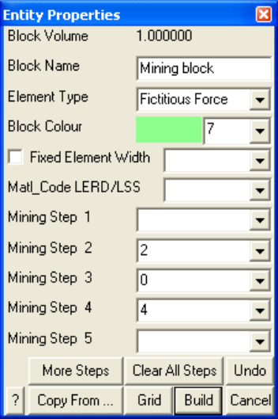

La séquence des étapes d'exploitation se définit simplement en attribuant les codes de matériau appropriés à l'étape d'exploitation voulue. Le code de matériau représente le numéro du matériau présent à l'intérieur du bloc. Par défaut, le matériau encaissant porte le numéro 1. Toute région dont les propriétés (contrainte initiale, réponse élastique ou résistance) diffèrent de celles de l'encaissant doit simplement recevoir un code de matériau positif indiquant les propriétés associées à chaque groupe de blocs.

Le code de matériau 0 indique que l'élément aura des contraintes de surface nulles. C'est la valeur par défaut, utilisée normalement pour les surfaces d'excavation, la surface du sol et les parois de fosse.

Le code de matériau -M (par exemple -2) indique que l'élément aura des contraintes de surface égales à l'état de contrainte associé au matériau numéro M. Cela permet de modéliser des ouvertures sous pression ou des contraintes variant avec la profondeur (par exemple du remblai).

Le code de matériau +M (par exemple 2) indique que la région délimitée aura les propriétés associées au matériau numéro M. Ce code sert à définir des régions dont les propriétés diffèrent de celles du matériau encaissant (minerai, dyke, remblai, etc.).

Les codes de matériau sont attribués pendant la construction du modèle à l'aide de

CAD > Build > Block CAD > Build > DD Loop CAD > Build > FF Loop

Les codes de matériau peuvent être attribués à tout moment à l'aide de

CAD > Edit > Entity Properties

L'invite suivante s'affiche

Dans cet exemple, le bloc sélectionné n'est pas utilisé à l'étape 1. À l'étape d'exploitation 2, il reçoit les propriétés du matériau numéro 2. À l'étape 3, le bloc est excavé. Enfin, à l'étape 4, le bloc est remblayé avec le matériau numéro 4.

Cette procédure peut être utilisée avec des éléments à force fictive pour définir des zones tridimensionnelles ayant des contraintes et des propriétés différentes (dykes rigides, zones minéralisées tendres ou zones plastifiantes, par exemple). Elle peut aussi être utilisée avec des éléments à discontinuité de déplacement pour définir des zones planes ayant des contraintes et des propriétés différentes (failles remplies de gouge, piliers plastifiants en exploitation tabulaire, par exemple).

Le code de matériau peut prendre une valeur différente à chaque étape d'exploitation. Si aucun code n'est attribué (champ laissé vide), le bloc reste inactif.

Il est important de retenir la convention selon laquelle les numéros de matériau (codes de matériau) les plus élevés l'emportent sur les plus faibles. Cette convention lève l'ambiguïté lorsque plusieurs structures se recoupent, comme une faille et un dyke, ou du remblai placé dans une partie d'un chantier. Pour éviter tout problème, il est conseillé d'utiliser les numéros de matériau les plus élevés pour le remblai.

Pour simuler des systèmes de soutènement rigides tels que des cintres, des cadres en acier, des étais, des revêtements épais, des piles de bois, du remblai résistant, etc., il faut modéliser le mouvement du terrain jusqu'au moment de la mise en place du soutènement, puis insérer les éléments de soutènement soit dans un état libre de contrainte et de déformation, soit avec une précontrainte prescrite. Pour cela, vous devez d'abord excaver l'élément de soutènement souhaité (bloc FF 3D ou plan DD) jusqu'à l'état précontraint voulu (code de matériau nul pour des contraintes nulles, ou numéro de matériau négatif pour un état de contrainte prescrit), puis, lors d'une étape d'exploitation ultérieure, insérer le matériau de soutènement (avec un numéro de matériau positif). Lorsque l'option Analysis > Options > Zero Strain Support Placement est cochée, Map3D effectue les calculs nécessaires pour mettre en place les éléments de soutènement dans un état libre de contrainte et de déformation, ou avec une précontrainte prescrite, à l'étape d'exploitation en cours. L'excavation jusqu'à un état de contrainte nul ou prescrit, suivie de l'insertion d'un autre matériau, indique à Map3D qu'il doit effectuer ces calculs.

Cette procédure est particulièrement utile pour simuler des éléments de soutènement structurels et permet leur mise en place, la modification de leurs propriétés et leur retrait ultérieur si nécessaire. Cette option est disponible pour les blocs FF 3D et/ou les plans DD.

Sans cette option, tous les matériaux sont mis en place dans l'état de déformation initial (avant exploitation). Cela peut produire des contraintes anormalement élevées, en particulier dans les éléments de soutènement rigides.

La séquence d'exploitation obtenue peut être visualisée en mode graphique de Map3D en passant simplement d'une étape d'exploitation à l'autre avec

File > Mining Step
