Pour illustrer la construction d'un modèle à partir de plans de mine numérisés, construisons une géométrie simple d'exploitation en masse par VRM.

Les lignes de construction servent à définir l'emplacement détaillé des éléments souterrains tels que les excavations, les contacts, les structures, etc. Un modèle Map3D est normalement construit sur ces données de lignes de construction.

Les plans de mine ont été numérisés au préalable avec Map3D

#### CAD > Digitizer Setup

ou avec un autre logiciel de CAO. Ces plans peuvent être enregistrés dans l'un des formats suivants :

Le format de fichier de points est un fichier de données ASCII universel d'extension « .PNT ». Ce format est utile pour échanger des données brutes de lignes de construction avec d'autres logiciels de CAO.

Le format AutoCAD-DXF est un format d'échange de dessins courant, d'extension « .DXF ». Ce format est utile pour échanger des données de lignes de construction avec d'autres logiciels de CAO.

Nous voulons partir de zéro ; nous sélectionnons donc

#### File > New (Model)

Avant de commencer, notez que vous pouvez survoler n'importe quel bouton pour afficher une info-bulle indiquant sa fonction. Vous pouvez aussi cliquer avec le bouton droit sur n'importe quel élément pour obtenir une aide détaillée sur cette fonction.

#### Importer des plans de mine numérisés

Nous devons d'abord ouvrir un fichier contenant les plans de mine numérisés, avec

#### File > Open (Construction Lines)

Ici, les lignes de construction ont été enregistrées au format DXF ; réglez donc « Files of Type » sur *.dxf

Le fichier « BULK.dxf » est fourni avec l'installation de Map3D et devrait être disponible pour l'importation.

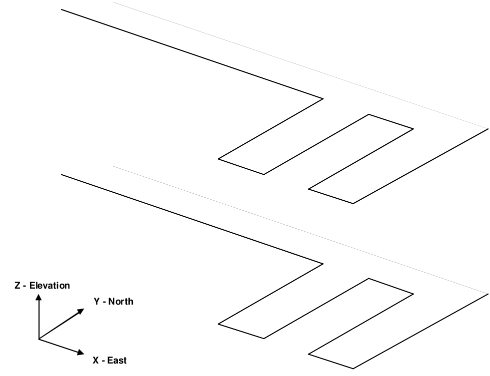

Les galeries d'accès mesurent environ 5 m de large sur 5 m de haut, et la distance entre niveaux est de 25 m.

#### Repositionner la vue

Pendant la construction des blocs, ou à tout autre moment, vous pouvez repositionner la géométrie (translation, rotation ou zoom) pour faciliter la visualisation. Plusieurs moyens permettent de le faire (voir Rotation du modèle et Translation du modèle). Le plus simple pour faire pivoter est de maintenir le bouton gauche de la souris enfoncé tout en faisant glisser le curseur sur l'écran. La translation s'obtient en maintenant le bouton droit enfoncé. Pour zoomer en avant ou en arrière, maintenez les deux boutons enfoncés.

Positionnez la vue de façon à bien voir les lignes de construction.

#### Construire les galeries d'accès au mur et les recoupes

Il existe de nombreuses méthodes pour construire ces entités. Ce tutoriel en présente quelques-unes.

#### Construire les blocs un par un

L'approche la plus simple (mais aussi la plus longue) consiste à construire une série de blocs à 8 sommets, un par un.

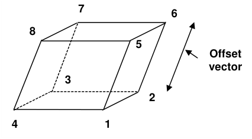

Pour construire le premier bloc, utilisez CAD > Build > FFLoop. Cette fonction peut être sélectionnée dans la barre d'outils CAD comme suit (si la barre d'outils CAD n'est pas visible, activez-la avec Tools > CAD Toolbar) :

Sélectionnez CAD > Build dans la barre d'outils CAD

Le sous-menu des fonctions de construction s'affiche

Sélectionnez ensuite

#### CAD > Build > FFLoop

Comme nous voulons nous accrocher aux lignes de construction, nous devons définir le mode d'accrochage, avec CAD > Snap > Nearest Edge. Cette fonction peut être sélectionnée dans la barre d'outils Build Entity

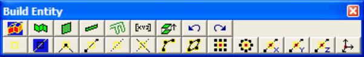

Pour activer l'accrochage à l'arête la plus proche, sélectionnez

#### CAD > Snap > Nearest Edge

(uniquement si le bouton d'accrochage à l'arête la plus proche n'est pas déjà en surbrillance).

Dans ce mode, une zone de sélection s'affiche à l'intersection du réticule.

**Le point le plus proche de cette arête sera sélectionné**

Les coordonnées de la position actuelle du curseur sont indiquées dans la barre d'état. Si la zone de sélection se trouve sur le sommet d'une ligne de construction, ce sommet est sélectionné ; sinon, c'est le point le plus proche de l'arête de la ligne de construction située sous la zone de sélection qui est sélectionné. Dans les deux cas, les 3 coordonnées (x, y et z) sont définies de manière unique.

La routine de construction FFLoop vous invite, dans la barre d'état, à saisir le premier sommet du bloc

Input: Select Point 1

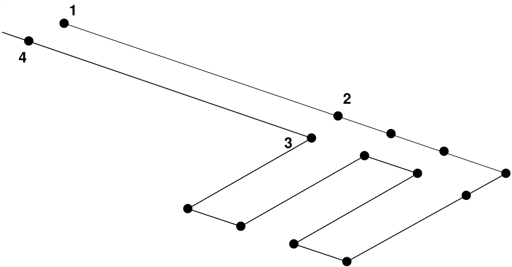

Déplacez le curseur jusqu'au point n° 1. Sélectionnez ce point d'un clic gauche.

Le sommet suivant du bloc vous est alors demandé

#### Input: Select Point 2

En déplaçant le curseur, vous verrez que le coin inférieur gauche de l'écran indique non seulement la position actuelle du curseur, mais aussi le décalage du point actuel par rapport au dernier point sélectionné (c'est-à-dire le vecteur de décalage du point 1 au point 2). Sélectionnez le point n° 2. Répétez la sélection pour les points n° 3 et n° 4.

Si vous sélectionnez un mauvais emplacement, annulez simplement cette sélection avec le bouton d'annulation

CAD > Build > Undo Point, puis réessayez.

Enfin, sélectionnez à nouveau le premier point (le point n° 1).

Une fois le premier point resélectionné, la base du bloc est entièrement formée. Le message suivant s'affiche

Loop complete: Start next loop.

Pour terminer le bloc, nous générons les 4 points restants à partir des 4 premiers sommets en leur ajoutant un décalage. Pour cela, sélectionnez la fonction de décalage dans la barre d'outils Build Entity

#### CAD > Build > Extrude/Offset Remaining

Le vecteur de décalage vous est demandé comme suit

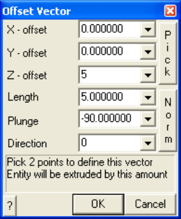

Saisissez le décalage :

X-offset > 0 Y-offset > 0 Z-offset > 5

Les points 5, 6, 7 et 8 sont générés respectivement à partir des points 1, 2, 3 et 4 en ajoutant les valeurs de décalage à leurs coordonnées.

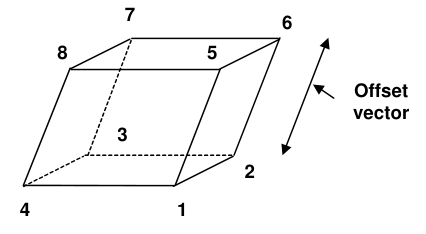

Une fois le bloc construit, ses propriétés vous sont automatiquement demandées (CAD > Build > FFLoop)

Saisissez :

Block Name: Intersection Element Type: Fictitious Force Block Colour: 1

Ce bloc d'intersection doit être excavé à l'étape d'exploitation 1, ce qui s'indique par Mining Step 1: 0

Nous avons terminé et pouvons construire ce bloc en appuyant sur le

bouton.

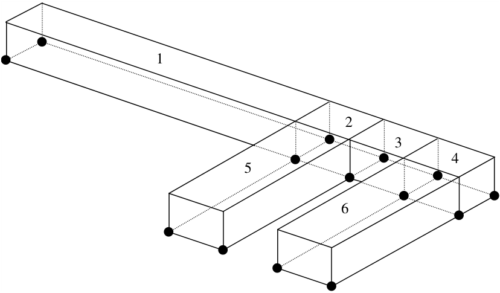

En répétant cette procédure de construction FFLoop, vous pouvez construire tout le niveau sous forme d'une série de blocs.

#### Construire des blocs complexes

Construisons maintenant des blocs de forme plus complexe.

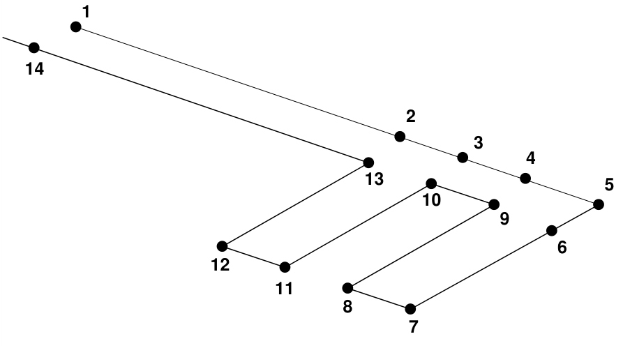

On utilise la même technique FFLoop que ci-dessus, mais en sélectionnant les 14 points du plan. Une fois le point n° 14 sélectionné, resélectionnez le point n° 1 pour terminer la base du bloc. Le message suivant s'affiche

#### Loop complete: Start next loop.

Pour terminer le bloc, sélectionnez comme précédemment la fonction de décalage dans la barre d'outils Build Entity.

#### CAD > Build > Extrude/Offset Remaining

Cette procédure crée un grand bloc continu couvrant tout le plan. Si vous le souhaitez, vous pouvez construire un bloc avec la séquence de points 1-2-3-4-5-6-9-10-13-14-1 pour la galerie à l'éponte supérieure, puis 13-10-11-12 et 9-6-7-8 pour construire les recoupes comme blocs distincts. Cette seconde méthode est préférable si les recoupes doivent être excavés à une autre étape d'exploitation que la galerie à l'éponte supérieure.

Construisez maintenant les galeries d'accès du niveau inférieur avec la même procédure.

#### Construire les panneaux VRM

Les panneaux VRM peuvent maintenant être construits, sous forme de blocs FFLoop à 8 sommets.

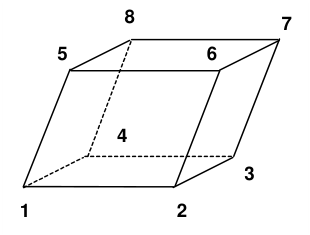

Pour commencer, sélectionnez

#### CAD > Build > FFLoop

Comme nous voulons nous accrocher aux sommets des blocs déjà construits, nous devons régler le mode d'accrochage sur CAD > Snap > Nearest Corner. Cette fonction peut être sélectionnée dans la barre d'outils Build Entity

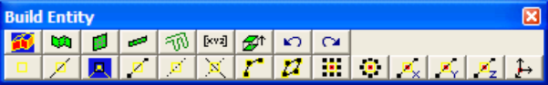

Pour activer l'accrochage au sommet le plus proche, sélectionnez

#### CAD > Snap > Nearest Corner

(uniquement si le bouton correspondant n'est pas déjà en surbrillance).

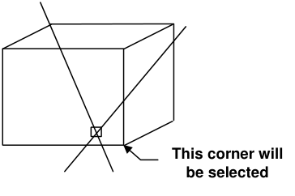

En mode d'accrochage aux sommets, une zone de sélection s'affiche à l'intersection du réticule. Le sommet le plus proche de l'entité ou de la ligne de construction située sous la zone de sélection est sélectionné (accroché), de sorte que les 3 coordonnées (x, y et z) sont définies de manière unique.

Nous pourrions en fait utiliser ici le mode d'accrochage aux arêtes

#### CAD > Snap > Nearest Edge

puisque les sommets des blocs seraient de toute façon sélectionnés (tant que le sommet se trouve dans la zone de sélection). L'accrochage aux sommets permet toutefois d'être moins précis lors de la sélection, puisque seuls les sommets sont retenus.

Sélectionnez les 4 premiers points comme indiqué ci-dessous. N'oubliez pas de resélectionner le point n° 1 pour fermer la boucle du plan inférieur.

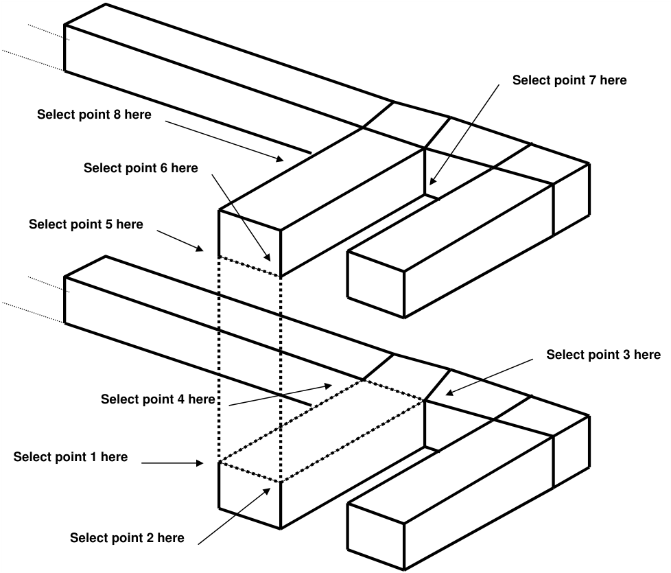

Pour sélectionner les points 5 à 8, faites pivoter le modèle de façon à le voir par en dessous. Il suffit de maintenir le bouton gauche de la souris enfoncé en faisant glisser le curseur vers le haut de l'écran.

Sélectionnez les points 5 à 8 comme indiqué ci-dessous. N'oubliez pas de resélectionner le point n° 5 pour fermer la boucle du plan supérieur.

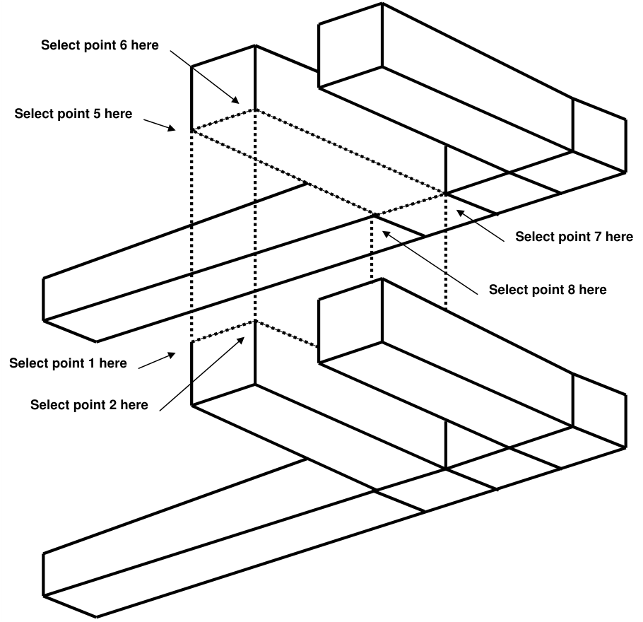

Comme précédemment, le message suivant s'affiche

Loop complete: Start next loop.

Pour terminer le bloc, sélectionnez le bouton de construction dans la barre d'outils Build Entity

Une fois le bloc construit, ses propriétés vous sont automatiquement demandées (CAD > Build > FFLoop)

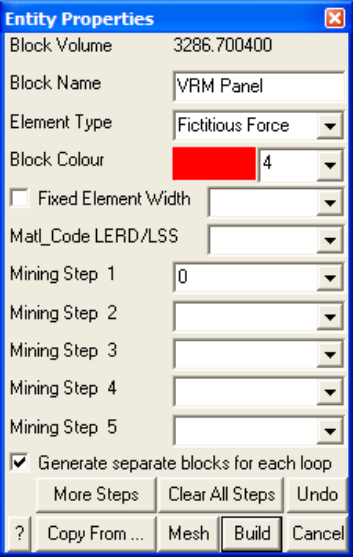

Saisissez :

Block Name: VRM Panel Element Type: Fictitious Force Block Colour: 4

Ce bloc ne sera pas excavé à l'étape 1, mais à l'étape 2, ce qui s'indique ainsi

Mining Step 1: (laissez ce champ vide) Mining Step 2: 0

Nous avons terminé et pouvons construire ce bloc. Le panneau adjacent se construit selon la même procédure, ce qui donne la géométrie finale.

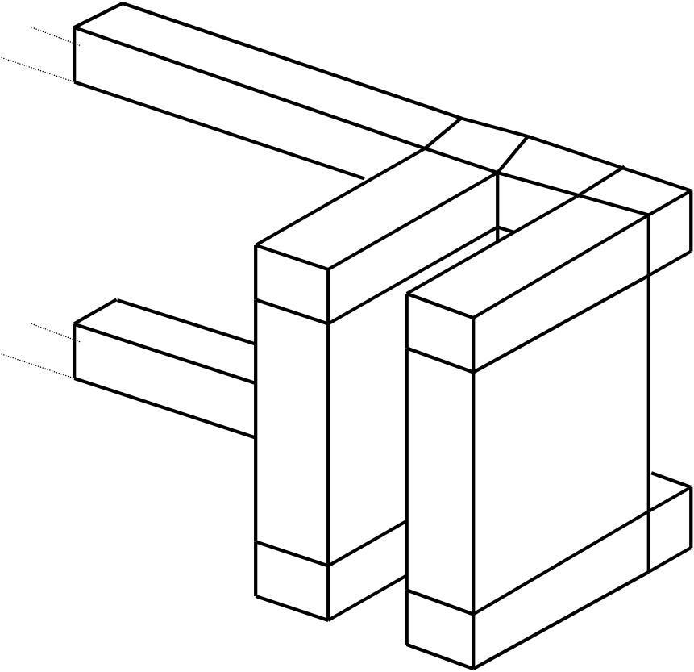

#### Enregistrer la géométrie

Nous avons maintenant construit les galeries d'accès au mur et deux panneaux VRM. Avant d'aller plus loin, il est prudent d'enregistrer le modèle. Pour cela, sélectionnez

File > Save Model As

Enregistrons-le sous le nom « VRM.INP »

#### Construire des plans de grille

Nous devons maintenant décider où les résultats seront calculés. Dans cet exemple, nous nous intéressons à la contrainte dans le pilier formé entre les deux panneaux VRM. Nous allons donc définir un plan de grille horizontal passant à mi-hauteur du pilier.

Nous utiliserons la fonction de grille d'accrochage. Elle peut être configurée maintenant ou après le lancement de la fonction de construction du plan de grille. Pour la configurer maintenant, sélectionnez le bouton dans la barre d'outils CAD

Comme nous allons dessiner à main levée, nous devons configurer la grille d'accrochage avec CAD > Snap > Rectangular Grid Snap. Cette fonction peut être sélectionnée dans la barre d'outils Snap

Pour activer la grille d'accrochage, sélectionnez

#### CAD > Snap > Rectangular Grid Snap

(uniquement si le bouton d'accrochage à la grille n'est pas déjà en surbrillance).

Les coordonnées de la position actuelle du curseur sont indiquées dans la barre d'état. Vous remarquerez que les valeurs x et y changent lorsque vous déplacez le curseur, mais pas la valeur z. Pour définir la valeur z actuelle, cliquez sur CAD > Snap > Cursor/Grid Setup ; la boîte de dialogue suivante s'affiche :

Choisissons cet emplacement graphiquement avec la fonction Pick.

Comme nous voulons placer la base d'accrochage à mi-hauteur des panneaux VRM, réglez le mode d'accrochage sur le milieu de ligne

#### CAD > Snap > Midpoint of Line

Avant de continuer, vérifiez que le bon mode d'accrochage est défini : l'élément de menu CAD > Snap > Midpoint of Line doit être coché, ou le bouton d'accrochage au milieu en surbrillance

Sélectionnez l'origine de la base d'accrochage du curseur (Cursor/Snap Base Origin) sur l'arête verticale du panneau VRM.

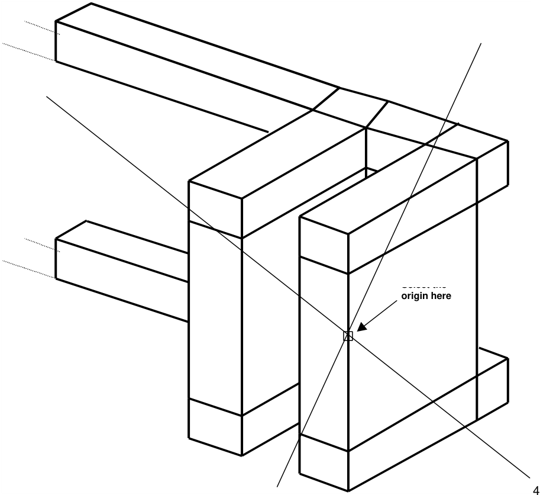

Le point situé à mi-hauteur de cette arête est sélectionné. La valeur z doit être

Z Origin: 1012.5

Il convient aussi de définir

Snap Spacing: 10

pour faciliter la sélection des points.

Si le réticule du curseur ne se déplace pas dans le plan x-y, sélectionnez le

bouton.

Avant de construire le plan de grille, réorientons la géométrie en vue en plan avec

#### View > View XY Plane

Construisons maintenant le plan de grille.

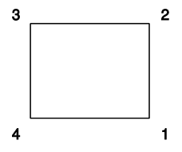

Il sera construit sous forme d'un plan à 4 sommets. Pour le construire, sélectionnez la fonction de menu de construction de grille

#### CAD > Build > Grid Plane

Cette fonction peut aussi être sélectionnée dans la barre d'outils CAD comme suit :

Sélectionnez CAD > Build dans la barre d'outils CAD

Le sous-menu des fonctions de construction s'affiche

Sélectionnez ensuite

#### CAD > Build > Grid Plane

Comme nous allons dessiner à main levée, vérifiez que CAD > Snap > Rectangular Grid Snap est activé. Cette fonction peut être sélectionnée dans la barre d'outils Build Entity

Pour activer la grille d'accrochage, sélectionnez

#### CAD > Snap > Rectangular Grid Snap

(uniquement si le bouton d'accrochage à la grille n'est pas déjà en surbrillance).

La routine de construction du plan de grille vous invite à saisir le premier sommet du plan

Input: Select Point 1

Sélectionnez les quatre sommets du plan.

**3**

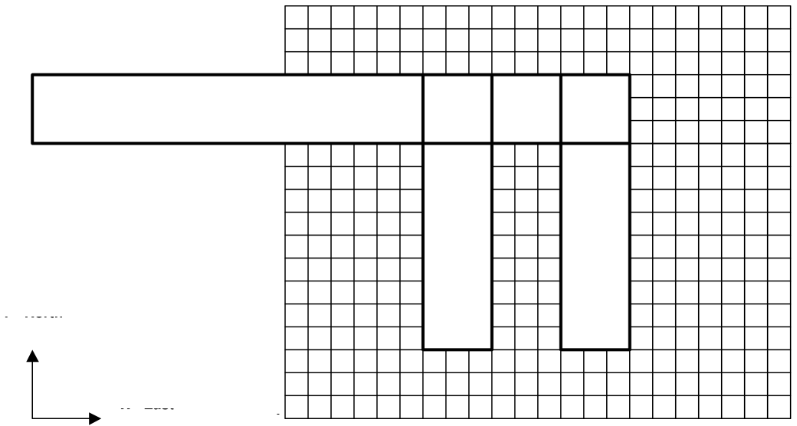

Après la sélection du 4e point, les propriétés du plan de grille vous sont automatiquement demandées (

#### CAD > Build > Grid Plane).

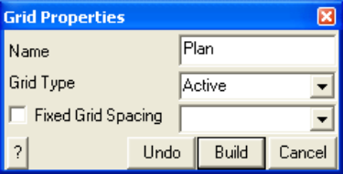

Saisissez un nom descriptif (Name) pour le plan de grille, vérifiez que Grid Type est réglé sur Active et laissez la case Fixed Grid Spacing décochée.

#### Définir les propriétés du massif rocheux encaissant

Nous devons maintenant définir les propriétés du matériau encaissant, avec la fonction des propriétés de matériau

#### CAD > Properties > Material Properties

Cet élément ouvre un sous-menu consacré à la modification des propriétés de matériau. Notez que le matériau numéro 1 est par définition le matériau encaissant. Les autres numéros servent à définir des zones de matériaux alternatifs comme le minerai, la gouge de faille, le remblai, etc. Le numéro du matériau à modifier vous est d'abord demandé. Commençons par définir les propriétés du matériau encaissant

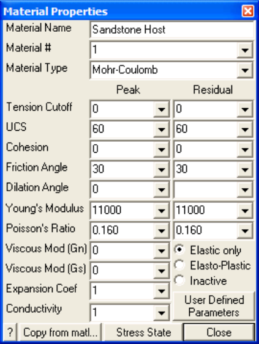

Saisissez :

Material Name: Sandstone Host Material # : 1 Young's (deformation) Modulus: 60000 MPa Poisson's Ratio: 0.25

Les modules visqueux peuvent être mis à zéro, car ils ne servent qu'à simuler le fluage en analyse non linéaire.

Nous voulons utiliser ici le critère de Mohr-Coulomb. Pour cela, définissez

Material Type: Mohr-Coulomb UCS: 60 MPa

Le paramètre de cohésion n'est pas utilisé ici et peut donc être mis à zéro.

Friction Angle: 30°

L'angle de dilatance n'est pas utilisé ici et peut donc être mis à zéro.

L'état de contrainte initial (avant exploitation) peut maintenant être défini

CAD > Properties > Material Properties > Stress State

L'état de contrainte en champ lointain approprié pour ce modèle est

sa constant:  30 MPa sb constant:  20 MPa sc constant:  20 MPa

Nous fixons la variation des contraintes avec la profondeur à

Dsa variation:  -0.027 MPa/m Dsb variation:  -0.013 MPa/m Dsc variation:  -0.013 MPa/m

Les orientations des contraintes (direction et plongement) doivent aussi être mises à zéro, ce qui définit sa et sb comme horizontales et sc comme verticale.

Le niveau de référence (Datum) peut être fixé à 1000 mètres pour définir la variation avec la profondeur par

s + Ds ( _z_ - _Datum_ )

Ainsi défini, la contrainte sa vaut 30 MPa à la profondeur z de 1000 m et augmente de 0,027 MPa par mètre de profondeur.

#### Définir les paramètres de contrôle

Nous devons maintenant définir les paramètres qui contrôlent la discrétisation et la résolution du modèle, avec la fonction des paramètres de contrôle

#### CAD > Properties > Control Parameters

Cet élément ouvre une boîte de dialogue regroupant les paramètres de contrôle

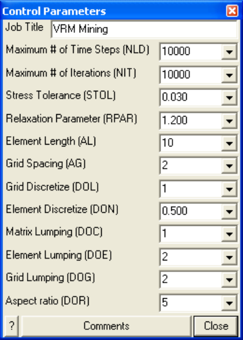

Saisissez :

Job Title: VRM Mining

Tous les paramètres peuvent garder leurs valeurs par défaut, sauf la tolérance sur les contraintes, la longueur d'élément et l'espacement de grille.

Stress Tolerance: 0.03 MPa

doit valoir environ 0,1 % de l'état de contrainte en champ lointain. Cela garantit que, pendant la résolution, les contraintes de surface sont calculées avec une précision numérique de 0,03 MPa.

#### Element Length: 10

doit être égal à deux fois la hauteur de la galerie ou deux fois la largeur du pilier. Ce paramètre fixe la taille minimale des éléments de frontière utilisés aux endroits où se trouvent des couches ou des piliers étroits. Il garantit la formulation d'un problème bien conditionné et facile à résoudre.

#### Grid Spacing: 2

doit valoir environ la moitié de la largeur du pilier. Ce paramètre fixe la taille minimale des éléments de frontière et l'espacement minimal sur le plan de grille aux endroits où celui-ci passe près du modèle ou le recoupe. Des résultats précis peuvent être obtenus jusqu'à une distance égale à la moitié de cet espacement des surfaces du modèle. Ce paramètre garantit aussi qu'un nombre suffisant de points de contrainte est calculé dans le pilier pour obtenir des contours réguliers.

Vous pouvez choisir un espacement de grille plus grand. Le problème sera alors plus petit et les temps de calcul plus courts. Toutefois, avec des éléments de frontière plus grands, les résultats seront moins précis, surtout près des surfaces du modèle ; de plus, avec un espacement de grille plus large, il n'est pas possible d'obtenir des contours réguliers.

Les valeurs suggérées pour les paramètres de discrétisation et de regroupement sont les suivantes :

_DON_ =0.5, _DOL_ = _DOC_ =1, _DOE_ = _DOG_ =2 pour une erreur de 10 à 20 %

_DON_ =0.5, _DOL_ = _DOC_ =2, _DOE_ = _DOG_ =4 pour une erreur de 5 à 10 % _DON_ =1.0, _DOL_ =DOC=4, _DOE_ = _DOG_ =8 pour une erreur &lt; 5 %

Les réglages pour résultats approximatifs sont recommandés pour tous les problèmes, sauf ceux nécessitant une précision accrue. Avec ce réglage, on peut s'attendre à des erreurs numériques de 10 à 20 % sur les contraintes prédites. Les réglages pour résultats détaillés donnent une erreur numérique de 5 à 10 %, et les réglages de haute précision une erreur inférieure à 5 %. Vous pouvez choisir des réglages plus précis, mais le problème sera plus grand et les temps de calcul plus longs.

#### Lancer une analyse Map3D

La construction du modèle est terminée et nous pouvons lancer une analyse. Avec Map3D Fault-Slip, vous obtiendrez une solution élastique de ce problème. Avec Map3D NonLinear, une analyse non linéaire complète sera effectuée.

L'analyse se lance depuis le menu principal.

Vous pouvez exécuter l'analyse complète en sélectionnant

#### BEM Analysis

Ici, nous procéderons par étapes. Sélectionnez d'abord

#### Discretization

Si vous avez modifié le modèle depuis le dernier enregistrement, vous serez invité à enregistrer ces modifications.

Une fois les analyses d'intersection et de discrétisation terminées, sélectionnez

#### Analysis > Graphics

En mode graphique, sélectionnez l'option de vue discrétisée

#### View > Render > Discretize

Vous verrez ainsi comment les surfaces des blocs ont été discrétisées en éléments de frontière. Les contours de blocs doivent être activés pour voir chaque élément

#### View > Render > Block Outlines

Pour voir comment la grille a été discrétisée (si la barre d'outils des contours n'est pas visible, activez-la avec Tools > CAD Toolbar), sélectionnez

#### Plot > Grid Selection > Grid #1

dans la barre d'outils des contours

L'analyse de discrétisation peut être répétée autant de fois que nécessaire avec différentes valeurs d'espacement de grille et de paramètres de discrétisation et de regroupement, jusqu'à obtenir la densité souhaitée d'éléments de frontière et de points de grille.

Une fois satisfait, passez à l'analyse BEM (assemblage et résolution de la matrice) en sélectionnant

#### Analysis

dans le menu principal, puis

#### BEM Analysis

Une fois l'analyse terminée, sélectionnez

#### Analysis > Graphics

En mode graphique, vous pouvez tracer les contours de n'importe quel paramètre. Par exemple, pour afficher les contours de la contrainte principale majeure, sélectionnez

#### Plot > Stress > S1 Major Principal Stress

Un tracé de contours est alors généré sur le plan de grille.

L'interprétation des résultats n'est pas abordée ici.
