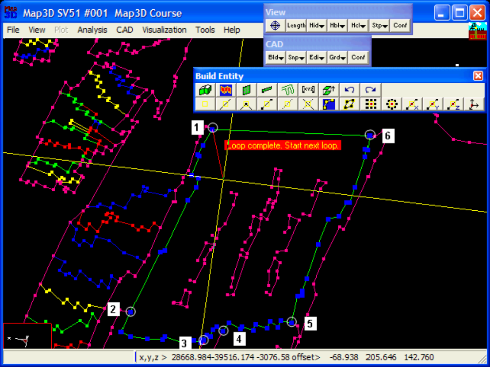
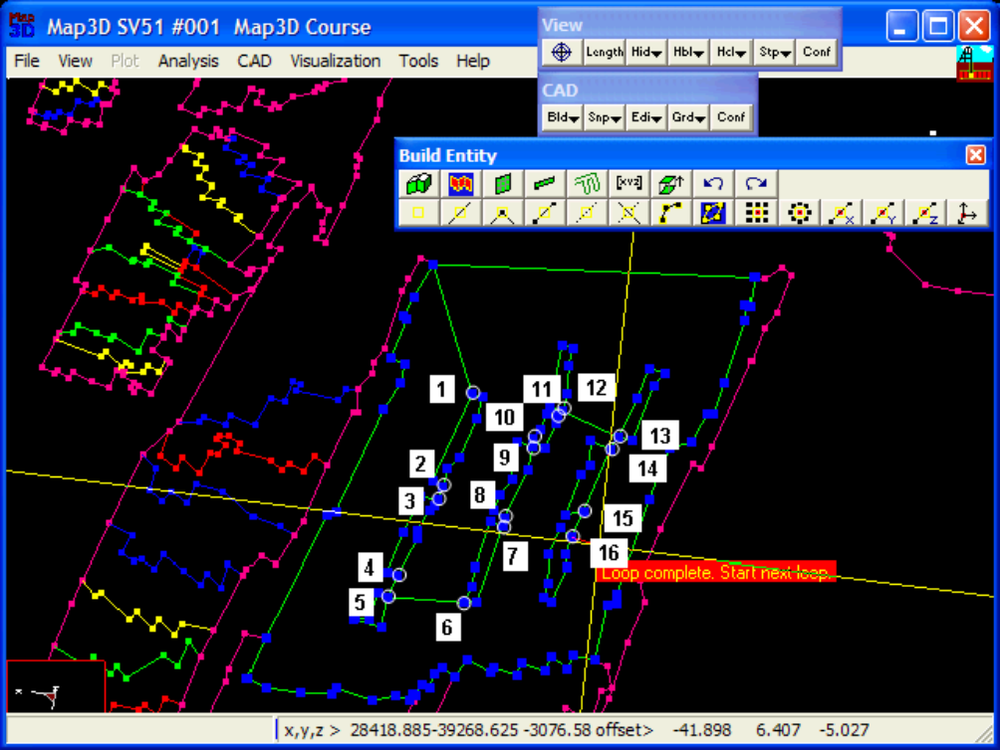
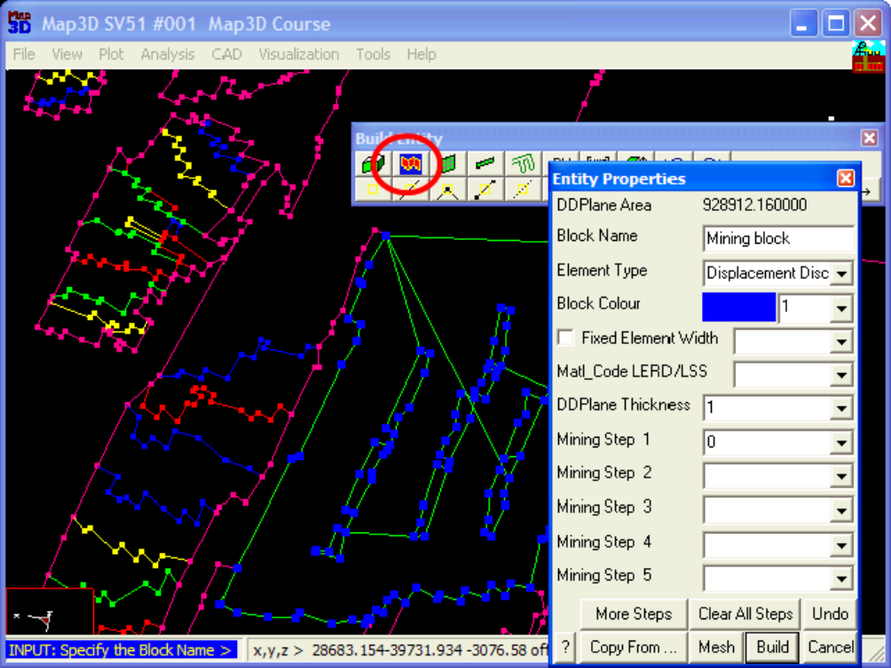
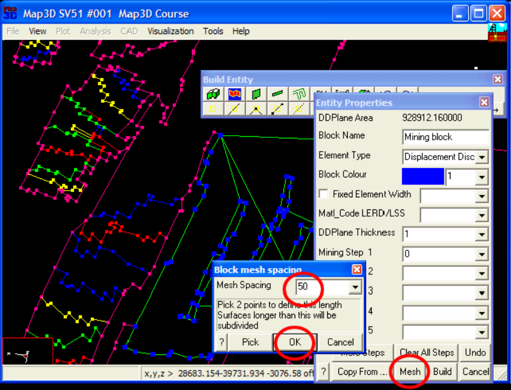
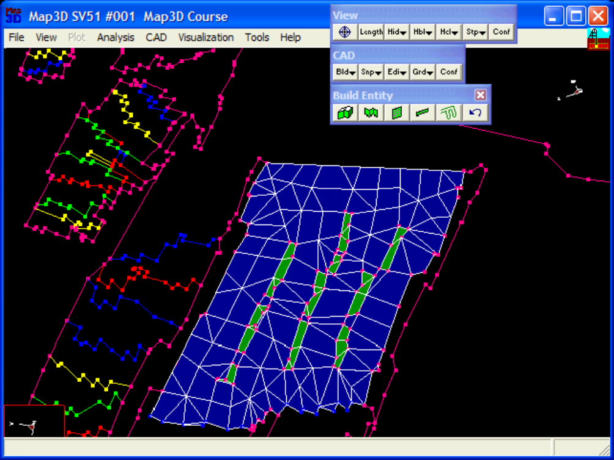

**Étape 1 : importer les plans de mine numérisés.**

- Les plans de cet exemple se trouvent dans un fichier nommé « t.pnt ».

- Ils sont importés avec la commande File > Open Construction Lines.

**Étape 2 : lancer la routine DDLoop et définir le mode d'accrochage Cline.**

- Lancez DDLoop en sélectionnant (CAD > Build > DDLoop).

- Définissez le mode d'accrochage Cline en sélectionnant (CAD > Snap > Trace Cline).

**Étape 3 : construire la boucle extérieure.**

- La boucle extérieure se construit en sélectionnant les extrémités des segments de lignes de construction voulus.

- Ici, nous sélectionnons les points 1-2-3-4-5-6-1

- Le point 1 est sélectionné à la fin de cette séquence pour fermer la boucle, ce qui termine la construction de la boucle extérieure.

**Étape 4 : définir le mode d'accrochage CLoop, puis construire les boucles intérieures.**

- Définissez le mode d'accrochage CLoop en sélectionnant (CAD > Snap > Trace CLoop).

- Les boucles intérieures sont définies en sélectionnant les points d'entrée et de sortie de chaque boucle.

- La 1re boucle est définie par les points 1 et 2.

- La 2e boucle est définie par les points 3 et 4.

- La 3e boucle est définie par le point 5.

- La 4e boucle est définie par les points 6 et 7.

- La 5e boucle est définie par les points 8 et 9.

- La 6e boucle est définie par les points 10 et 11.

- La 7e boucle est définie par le point 12.

- La 8e boucle est définie par le point 13.

- La 9e boucle est définie par les points 14 et 15.

- La 10e boucle est définie par le point 16.

**Étape 5 : signaler la fin de la construction.**

- Une fois toutes les boucles définies, sélectionnez à nouveau (CAD > Build > DDLoop) pour signaler la fin de la construction.

- Vous pouvez aussi la signaler en sélectionnant une seconde fois le dernier point (le point 16).

**Étape 6 : construire les DDLoops.**

- Bien que nous puissions construire les DDLoops avec la fonction, nous utiliserons ici la fonction.

- Cette dernière fonction produit des éléments de meilleure forme.

- L'espacement de maillage souhaité vous est demandé.

- Réglez-le à 50 mètres.

#### Étape 7 : construction terminée.

- La construction de l'exploitation tabulaire avec ses piliers est terminée.

- Vous voudrez probablement modifier les propriétés d'entité des piliers pour leur attribuer les propriétés et la séquence d'exploitation appropriées.

