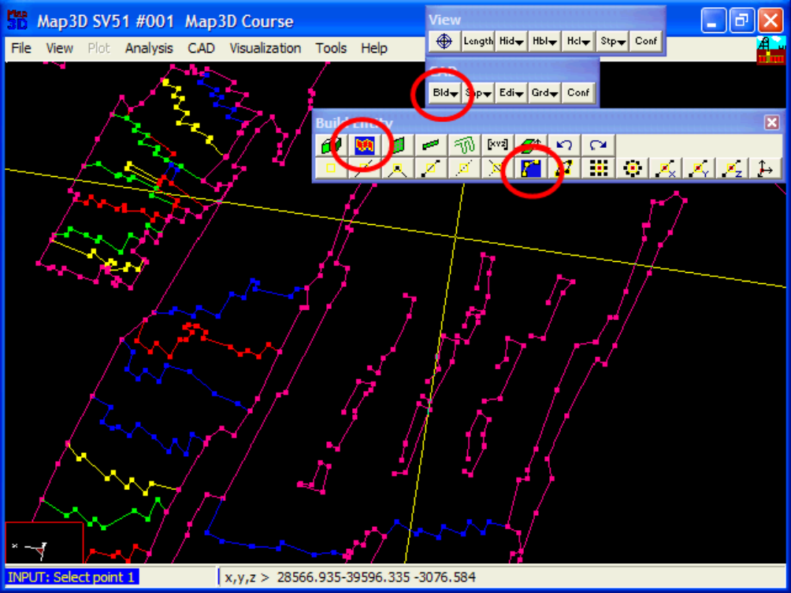
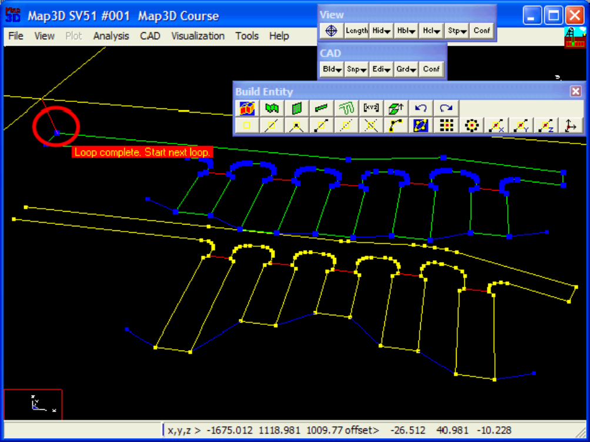
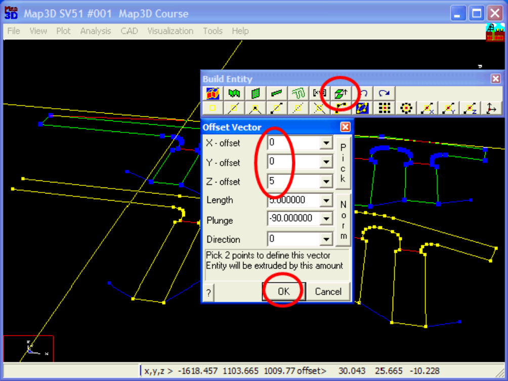
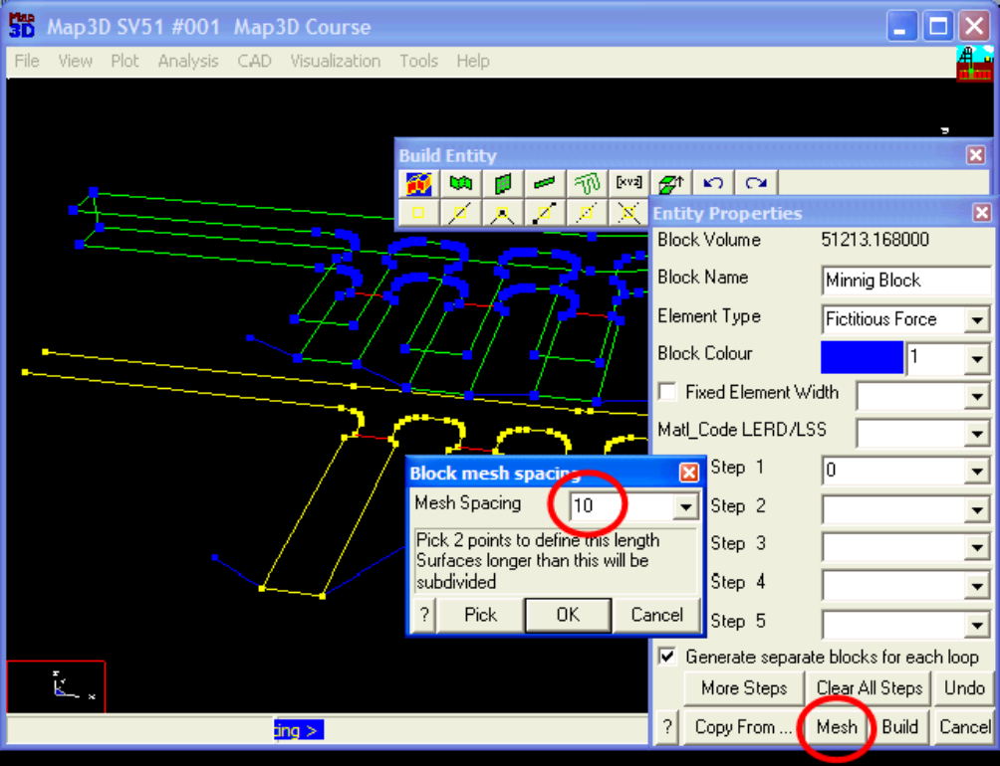
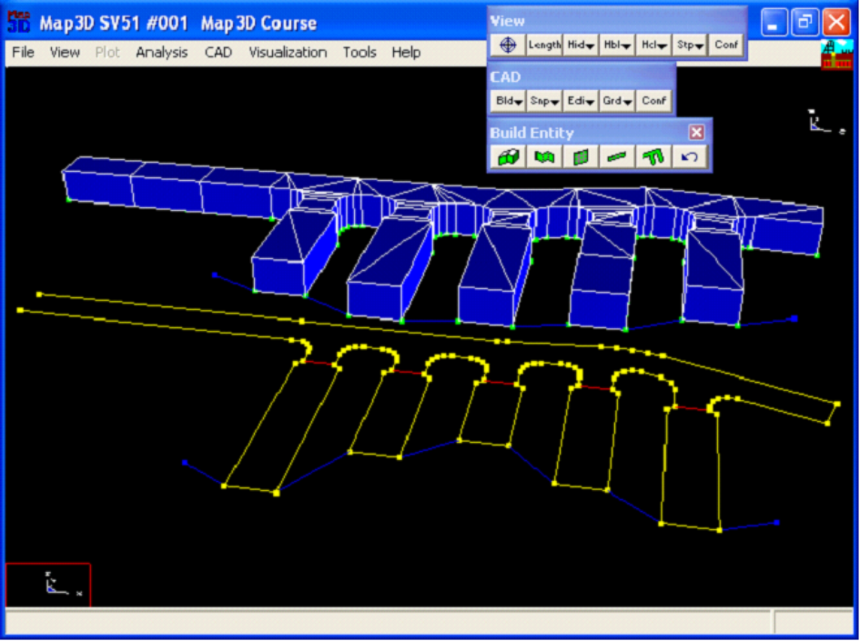

#### Étape 1 : importer les plans de mine numérisés.

- Les plans de cet exemple se trouvent dans un fichier nommé « bulk.dxf ».

- Ils sont importés avec la commande File > Open Construction Lines.

#### Étape 2 : lancer la routine FFLoop et définir le mode d'accrochage CLoop.

- Lancez FFLoop en sélectionnant (CAD > Build > FFLoop).

- Définissez le mode d'accrochage CLoop en sélectionnant (CAD > Snap > Trace CLoop).

**Étape 3 : construire le FFLoop.**

- Le FFLoop se construit en sélectionnant l'un des points de la ligne de construction voulue.

**Étape 4 : extruder le plan de niveau en galerie 3D.**

- À ce stade, nous avons construit le plan de la galerie.

- Il peut maintenant être extrudé en forme 3D en sélectionnant (CAD > Build > Offset/Extrude).

- Réglez le vecteur de décalage à (0 0 5).

**Étape 5 : construire la galerie.**

- Le FFLoop peut maintenant être construit avec la fonction.

- Indiquez 10 comme espacement de maillage (Mesh Spacing), puis appuyez sur OK.

**Étape 6 : construction terminée.**

- La construction de la galerie est terminée.

