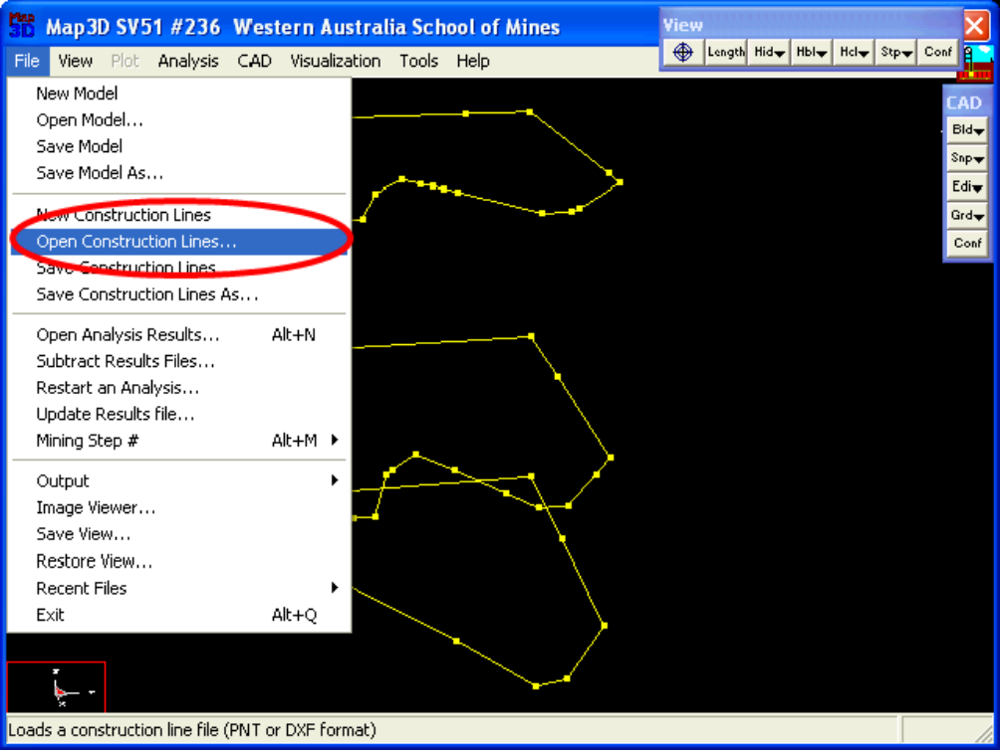
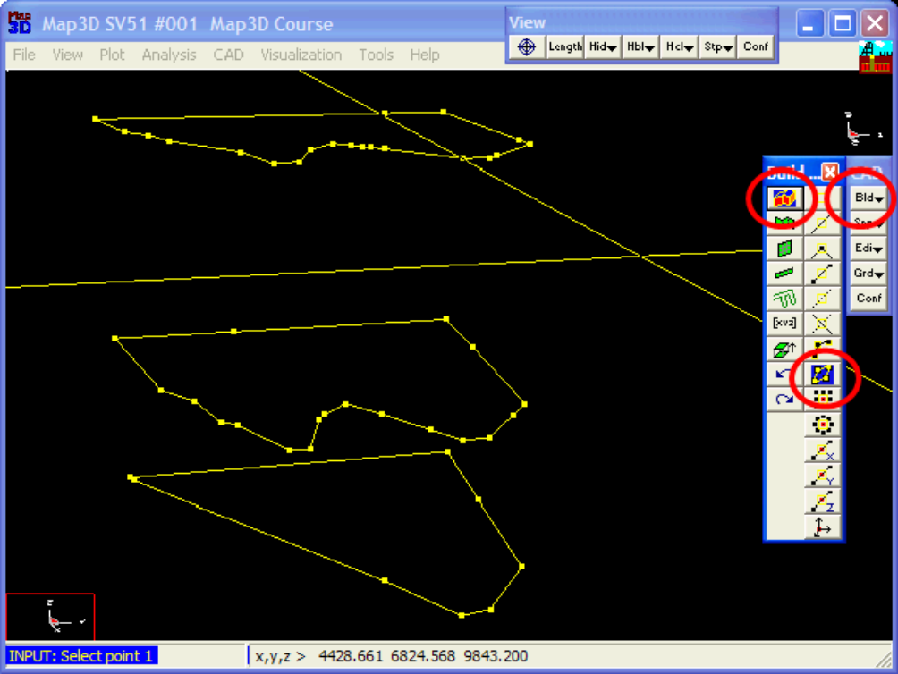
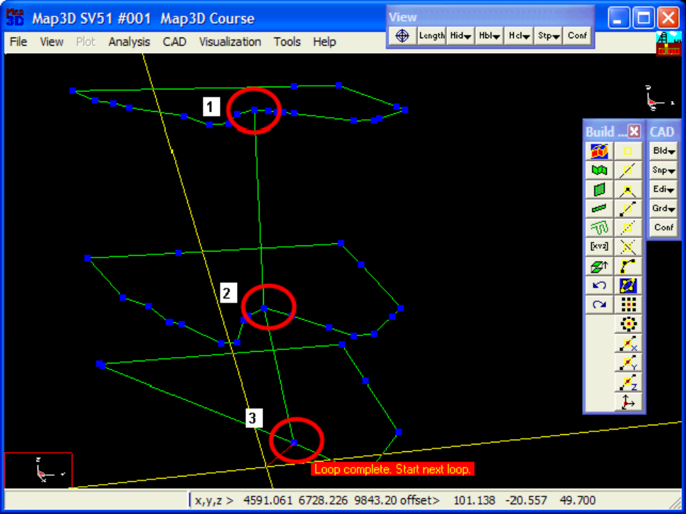
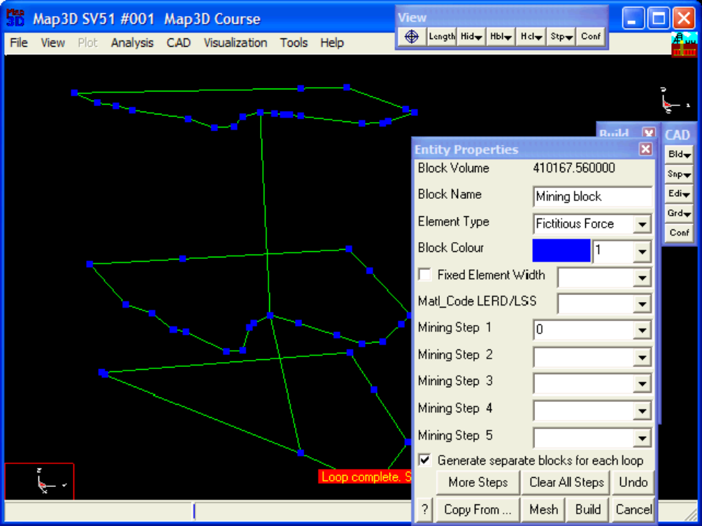
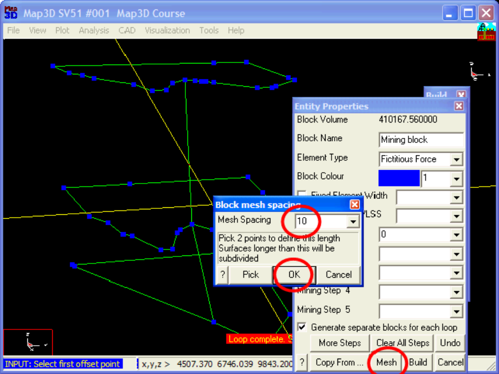
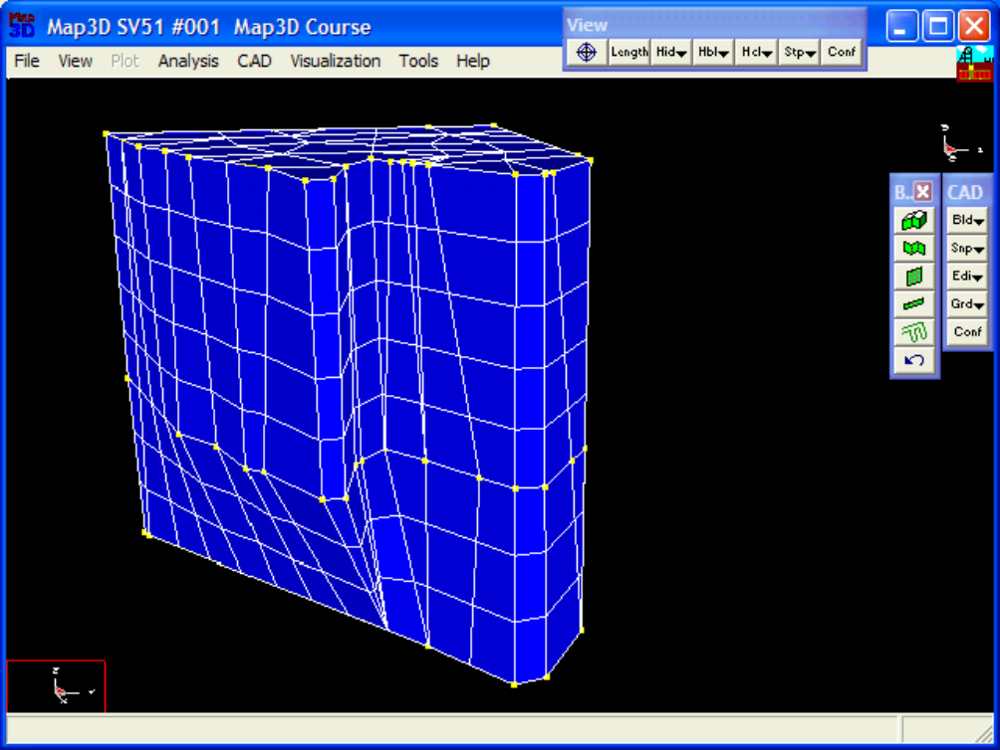

#### Étape 1 : importer les plans de mine numérisés.

- Les plans de cet exemple se trouvent dans un fichier nommé « bulk.dxf ».

- Ils sont importés avec la commande File > Open Construction Lines.

**Étape 2 : lancer la routine FFLoop et définir le mode d'accrochage CLoop.**

- Lancez FFLoop en sélectionnant (CAD > Build > FFLoop).

- Définissez le mode d'accrochage CLoop en sélectionnant (CAD > Snap > Trace CLoop).

#### Étape 3 : construire le FFLoop.

- Le FFLoop se construit en sélectionnant un point sur chaque ligne de construction.

- Notez que des points sont générés automatiquement tous les 10 m le long des grands côtés

- Il est préférable de sélectionner des points situés aux angles vifs ou aux coudes, car la ligne entre les boucles guide le processus de construction.

#### Étape 4 : signaler la fin de la construction.

- Une fois toutes les boucles définies, sélectionnez à nouveau (CAD > Build > FFLoop) pour signaler la fin de la construction.

- Vous pouvez aussi la signaler en sélectionnant une seconde fois le dernier point (le point 3).

**Étape 5 : construire le chantier.**

- Le FFLoop peut maintenant être construit avec la fonction.

- Indiquez 10 comme espacement de maillage (Mesh Spacing), puis sélectionnez OK.

**Étape 6 : construction terminée.**

- La construction du chantier est terminée.

