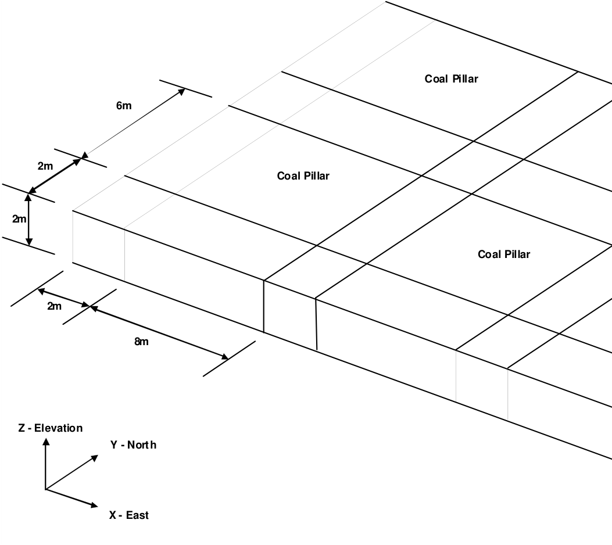

Pour illustrer la technique du dessin à main levée, commençons par construire une géométrie simple d'exploitation de charbon par chambres et piliers. Les galeries mesurent 2 m de large sur 2 m de haut, et les piliers de charbon mesurent 6 m vers l'est et 4 m vers l'ouest.

Nous voulons partir de zéro ; nous sélectionnons donc

File > New Model

Avant de commencer, notez que vous pouvez survoler n'importe quel bouton pour afficher une info-bulle indiquant sa fonction. Vous pouvez aussi cliquer avec le bouton droit sur n'importe quel élément pour obtenir une aide détaillée sur cette fonction.

#### Construire le carrefour

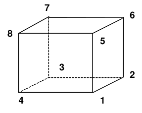

Construisons d'abord un carrefour, à l'aide de blocs à 8 sommets. Pour construire le premier bloc, utilisez CAD > Build > FFLoop. Cette fonction peut être sélectionnée dans la barre d'outils CAD comme suit (si la barre d'outils CAD n'est pas visible, activez-la avec Tools > CAD Toolbar) :

#### Sélectionnez CAD > Build dans la barre d'outils CAD

Le sous-menu des fonctions de construction s'affiche

Sélectionnez ensuite

#### CAD > Build > FFLoop

Comme nous allons dessiner à main levée, nous devons configurer la grille d'accrochage avec CAD > Snap > Rectangular Grid Snap. Cette fonction peut être sélectionnée dans la barre d'outils Build Entity

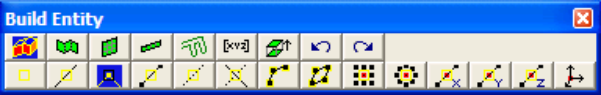

Pour activer la grille d'accrochage, sélectionnez

#### CAD > Snap > Rectangular Grid Snap

(uniquement si le bouton d'accrochage à la grille n'est pas déjà en surbrillance).

Les coordonnées de la position actuelle du curseur sont indiquées dans la barre d'état. Vous remarquerez que les valeurs x et y changent lorsque vous déplacez le curseur, mais pas la valeur z. Pour définir la valeur z actuelle, cliquez sur CAD > Snap > Cursor/Grid Setup ; la boîte de dialogue suivante s'affiche :

Définissez l'origine et l'espacement d'accrochage comme suit :

X-Origin > 0 Y-Origin > 0 Z-Origin > 0 Snap spacing > 1

Si le réticule du curseur ne se déplace pas dans le plan x-y, sélectionnez le

bouton.

Le mode d'accrochage est alors réglé sur la grille. Dans ce mode, aucune zone de sélection n'est affichée à l'intersection du réticule et le déplacement du curseur est limité à l'espacement de grille spécifié. En déplaçant le curseur à l'écran, celui-ci saute d'une position à l'autre selon l'espacement de grille (1 mètre ici).

La routine de construction FFLoop vous invite, dans la barre d'état, à saisir le premier sommet du bloc

Input: Select Point 1

Déplacez le curseur jusqu'au premier point

x,y,z >  0  0  0

Sélectionnez ce point d'un clic gauche.

Le sommet suivant du bloc vous est alors demandé

Input: Select Point 2

En déplaçant le curseur, vous verrez que le coin inférieur gauche de l'écran indique non seulement la position actuelle du curseur, mais aussi le décalage du point actuel par rapport au dernier point sélectionné (c'est-à-dire le vecteur de décalage du point 1 au point 2). Sélectionnez le point 2 en

x,y,z >  2  0  0

Répétez la sélection pour le point 3

x,y,z >  2  2  0

et le point 4

x,y,z >  0  2  0

Si vous sélectionnez un mauvais emplacement, annulez simplement cette sélection avec le bouton d'annulation

#### CAD > Build > Undo Point, puis réessayez.

Enfin, sélectionnez à nouveau le premier point

x,y,z >  0  0  0

Une fois le premier point resélectionné, la base du bloc est entièrement formée. Le message suivant s'affiche

Loop complete: Start next loop.

Pour terminer le bloc, vous pouvez soit changer d'altitude et sélectionner les 4 points restants (les points 5, 6, 7 et 8), soit les générer à partir des 4 premiers sommets en leur ajoutant un décalage. Pour cette seconde méthode, sélectionnez la fonction de décalage dans la barre d'outils Build Entity

#### CAD > Build > Extrude/Offset Remaining

Le vecteur de décalage vous est demandé comme suit

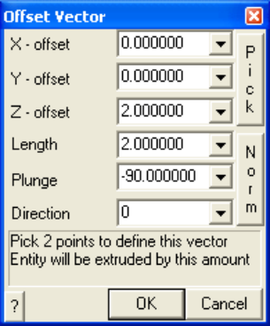

Saisissez le décalage :

X-offset > 0 Y-offset > 0 Z-offset > 2

Les points 5, 6, 7 et 8 sont générés respectivement à partir des points 1, 2, 3 et 4 en ajoutant les valeurs de décalage à leurs coordonnées.

Une fois le bloc construit, ses propriétés vous sont automatiquement demandées (CAD > Build > FFLoop)

Saisissez :

Block Name: Intersection Element Type: Fictitious Force Block Colour: 1

Ce bloc de carrefour doit être excavé à l'étape d'exploitation 1, ce qui s'indique par

Mining Step 1: 0

Nous avons terminé et pouvons construire ce bloc en appuyant sur le

bouton.

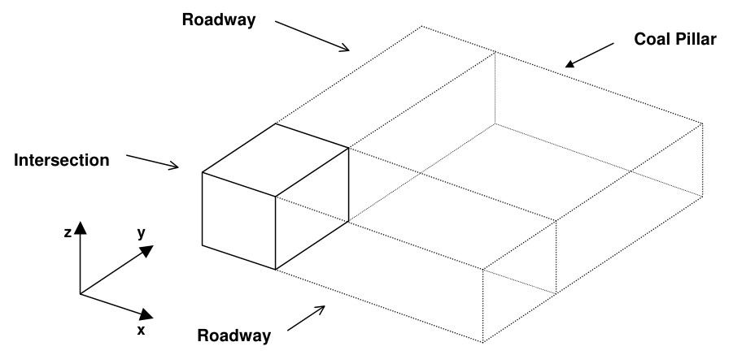

#### Repositionner la vue

Pendant la construction des blocs, ou à tout autre moment, vous pouvez repositionner la géométrie (translation, rotation ou zoom) pour faciliter la visualisation. Plusieurs moyens permettent de le faire (voir Rotation du modèle et Translation du modèle).

#### Construire la galerie 1

D'autres blocs peuvent maintenant être construits en sélectionnant à nouveau la fonction de construction FFLoop

#### CAD > Build > FFLoop

Construisons le bloc suivant à côté du premier. Sélectionnez le point 1 en

x,y,z >  2  0  0

Nous voudrions sélectionner le point 2 en

x,y,z >  8  0  0

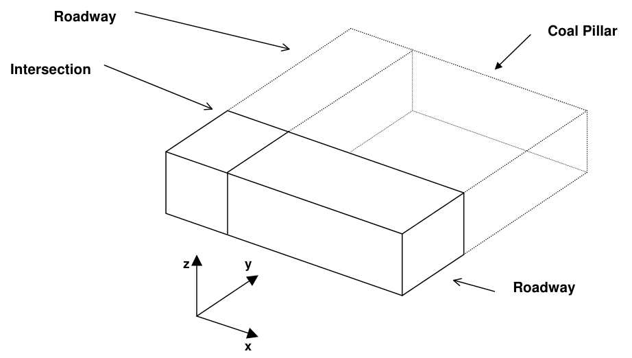

mais cet emplacement est hors des limites de l'affichage. Pour y remédier, il suffit de faire un zoom arrière (Translation du modèle).

Le point 2 peut maintenant être sélectionné facilement.

Sélectionnez le point 3 en

x,y,z >  8  2  0

Sélectionnez le point 4 en

x,y,z >  2  2  0

Enfin, sélectionnez à nouveau le premier point

x,y,z >  2  0  0

Une fois le premier point resélectionné, la base du bloc est entièrement formée. Comme précédemment, le message suivant s'affiche

Loop complete: Start next loop.

Décalez maintenant les points restants de ce bloc avec la fonction de décalage

#### CAD > Build > Extrude/Offset Remaining

Le vecteur de décalage vous est demandé comme suit

Saisissez le décalage :

X-offset > 0 Y-offset > 0 Z-offset > 2

Une fois le bloc construit, les propriétés de l'entité vous sont automatiquement demandées (CAD > Build > FFLoop)

Saisissez :

Block Name: Roadway

Element Type: Fictitious Force Block Colour: 1

Ce bloc de galerie doit être excavé à l'étape d'exploitation 1, ce qui s'indique par Mining Step 1: 0

Nous avons terminé et pouvons construire ce bloc en appuyant sur le bouton.

#### Construire la galerie 2

Construisons un troisième bloc

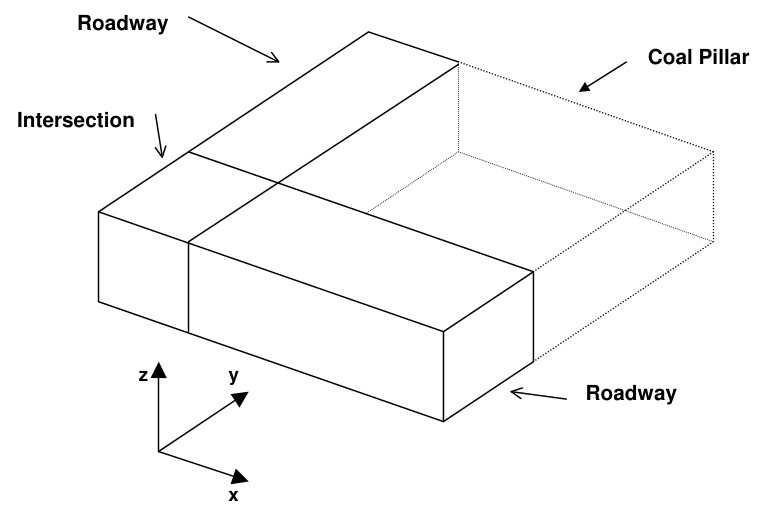

en sélectionnant le point 1 en

x,y,z >  2  2  0

Sélectionnez le point 2 en

x,y,z >  2  6  0

Sélectionnez le point 3 en

x,y,z >  0  6  0

Sélectionnez le point 4 en

x,y,z >  0  2  0

Resélectionnez le premier point pour terminer la base

x,y,z >  2  0  0

puis décalez les points restants comme précédemment

CAD > Build > Extrude/Offset Remaining

La construction de la galerie est terminée.

#### Construire le pilier de charbon

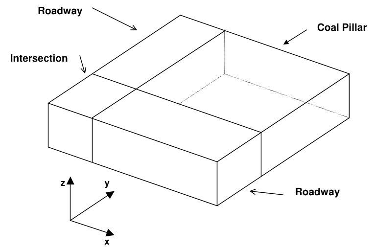

Vous avez maintenant construit un carrefour et deux galeries. Construisons à présent un pilier de charbon.

#### CAD > Build > FFLoop

en sélectionnant le point 1 en

x,y,z >  2  2  0

Sélectionnez le point 2 en

x,y,z >  8  2  0

Sélectionnez le point 3 en

x,y,z >  8  6  0

Sélectionnez le point 4 en

x,y,z >  2  6  0

Resélectionnez le premier point pour terminer la base

x,y,z >  2  2  0

puis décalez les points restants comme précédemment

CAD > Build > Extrude/Offset Remaining

La construction du pilier de charbon est terminée.

Une fois le bloc construit, ses propriétés vous sont automatiquement demandées (CAD > Build > FFLoop). Nous devons indiquer que ce bloc est un pilier de charbon et non une excavation (valeur par défaut). La boîte de dialogue suivante s'affiche :

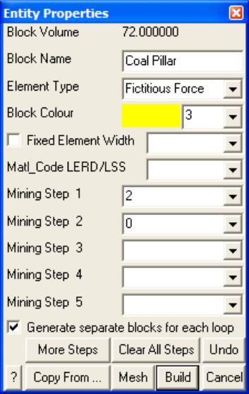

Saisissez :

Block Name: Coal Pillar Element Type: Fictitious Force Block Colour: 3

Nous devons indiquer que ce bloc a les propriétés de matériau du charbon, en définissant le matériau numéro 2 pour le charbon à l'étape d'exploitation 1. Cela s'indique par

Mining Step 1: 2

Ce même pilier pourrait être excavé à l'étape 2 en indiquant le code de matériau

Mining Step 2: 0

Nous avons terminé et pouvons construire ce bloc.

#### Enregistrer la géométrie

Nous avons maintenant construit un petit coin de la géométrie d'exploitation souhaitée. Avant d'aller plus loin, il est prudent d'enregistrer le modèle. Pour cela, sélectionnez

#### File > Save Model As

Enregistrons-le sous le nom « COAL.INP »

#### Étendre la géométrie

Le modèle construit ne représente qu'une petite partie du modèle final. Il est facile de reproduire ce motif en le copiant plusieurs fois. Pour cela, sélectionnez la fonction de copie

CAD > Edit > Copy Entities

Cette fonction peut aussi être sélectionnée dans la barre d'outils CAD comme suit :

Sélectionnez CAD > Edit dans la barre d'outils CAD

Le sous-menu des fonctions de modification s'affiche

Pour activer la fonction de copie, sélectionnez

#### CAD > Edit > Copy Entities

Vous êtes alors invité à constituer une liste d'entités à copier

Maintenez la touche Maj enfoncée et tracez une fenêtre de sélection (vous pouvez aussi utiliser la fonction de fenêtre de capture).

**Second sommet de la fenêtre**

Toutes les entités situées dans la fenêtre de sélection (le carrefour, les galeries et le pilier de charbon) doivent être en surbrillance.

Vous pouvez maintenant copier les entités sélectionnées en cliquant sur le bouton de copie

Le vecteur de décalage de la copie vous est demandé comme suit :

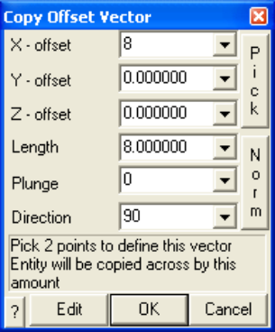

Il existe de nombreuses façons de définir ce vecteur. Vous pouvez saisir le décalage souhaité, soit (8  0 0).

Vous pouvez aussi le faire graphiquement en sélectionnant deux points qui définissent le vecteur. Réglez d'abord le mode d'accrochage sur

#### CAD > Snap > Rectangular Grid Snap

(uniquement si le bouton d'accrochage à la grille n'est pas déjà en surbrillance).

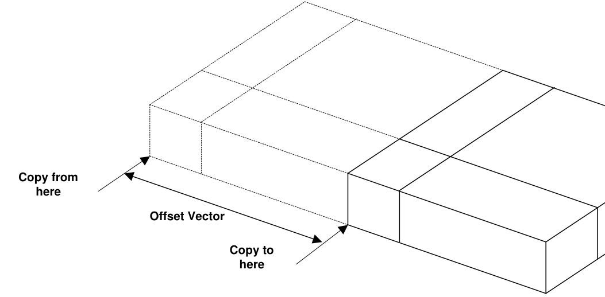

Vous êtes invité (en haut de l'écran) à sélectionner la première extrémité du vecteur de décalage

INPUT: Select first offset point

Sélectionnez ce point en

x,y,z >  0  0  0

Vous êtes ensuite invité à sélectionner l'autre extrémité du vecteur

INPUT: Select second offset point

Sélectionnez ce point en

x,y,z >  8  0  0

Le décalage (8  0  0) s'affiche alors dans la boîte de dialogue.

Appuyez sur OK : les entités sélectionnées sont copiées en ajoutant le vecteur de décalage à toutes leurs coordonnées.

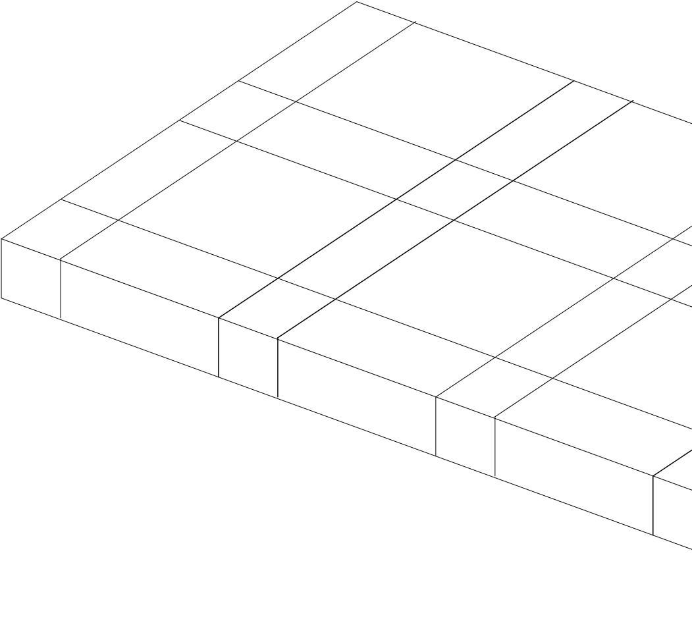

Pour répéter cette copie, reconstituez la sélection ou restaurez la sélection précédente, puis copiez les entités sélectionnées en sélectionnant à nouveau la fonction de copie

#### CAD > Edit > Copy Entities

Si vous le souhaitez, cette procédure peut être répétée autant de fois que nécessaire pour dupliquer le motif d'exploitation dans les directions x et y.

La géométrie peut maintenant être considérée comme terminée. Nous devons encore définir l'emplacement des plans de grille où seront calculés les résultats et préciser les propriétés des matériaux.

#### Construire des plans de grille

**3 2 4 1**

Nous devons maintenant décider où les résultats seront calculés. Dans cet exemple, nous nous intéressons à la contrainte dans les piliers de charbon. Nous allons donc définir un plan de grille en coupe passant par le centre de l'un des piliers. Il sera construit sous forme d'un plan à 4 sommets. Pour le construire, sélectionnez la fonction de menu de construction de grille

#### CAD > Build > Grid Plane

Cette fonction peut aussi être sélectionnée dans la barre d'outils CAD comme suit :

Sélectionnez CAD > Build dans la barre d'outils CAD

Le sous-menu des fonctions de construction s'affiche

Sélectionnez ensuite

#### CAD > Build > Grid Plane

Comme nous allons dessiner à main levée, nous devons configurer la grille d'accrochage avec CAD > Snap > Rectangular Grid Snap. Cette fonction peut être sélectionnée dans la barre d'outils Build Entity

Pour activer la grille d'accrochage, sélectionnez

#### CAD > Snap > Rectangular Grid Snap

(uniquement si le bouton d'accrochage à la grille n'est pas déjà en surbrillance).

Les coordonnées de la position actuelle du curseur sont indiquées dans la barre d'état. Pour définir la valeur z actuelle, cliquez sur CAD > Snap > Cursor/Grid Setup ; la boîte de dialogue suivante s'affiche :

Définissez l'origine et l'espacement d'accrochage comme suit :

X-Origin > 0 Y-Origin > 0 Z-Origin > -2 Snap spacing > 1

Si le réticule du curseur ne se déplace pas dans le plan x-y, sélectionnez le

bouton.

La routine de construction du plan de grille vous invite à saisir le premier sommet du plan

INPUT: Select point 1

Déplacez le curseur jusqu'au point voulu

x,y,z >  9  4  -2

Sélectionnez ce point d'un clic gauche.

Le sommet suivant vous est alors demandé

INPUT: Select point 2

Sélectionnez le point 2 en

x,y,z >  17  4  -2

Si vous sélectionnez un mauvais emplacement, annulez simplement cette sélection

CAD > Build > Undo Point

puis réessayez.

Une fois le point 2 sélectionné, un bord du plan est entièrement formé. Pour terminer le plan, vous pouvez soit changer d'altitude et sélectionner les 2 points restants (les points 3 et 4), soit les générer à partir des 2 premiers sommets en leur ajoutant un décalage. Pour cette seconde méthode, sélectionnez la fonction de décalage dans la barre d'outils Build Entity

CAD > Build > Offset Remaining

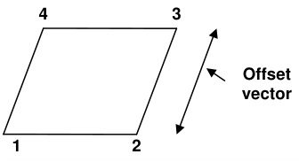

Le vecteur de décalage vous est demandé comme suit

Saisissez le décalage :

X-offset > 0 Y-offset > 0 Z-offset > 6

Les points 3 et 4 sont générés respectivement à partir des points 2 et 1 en ajoutant les valeurs de décalage à leurs coordonnées.

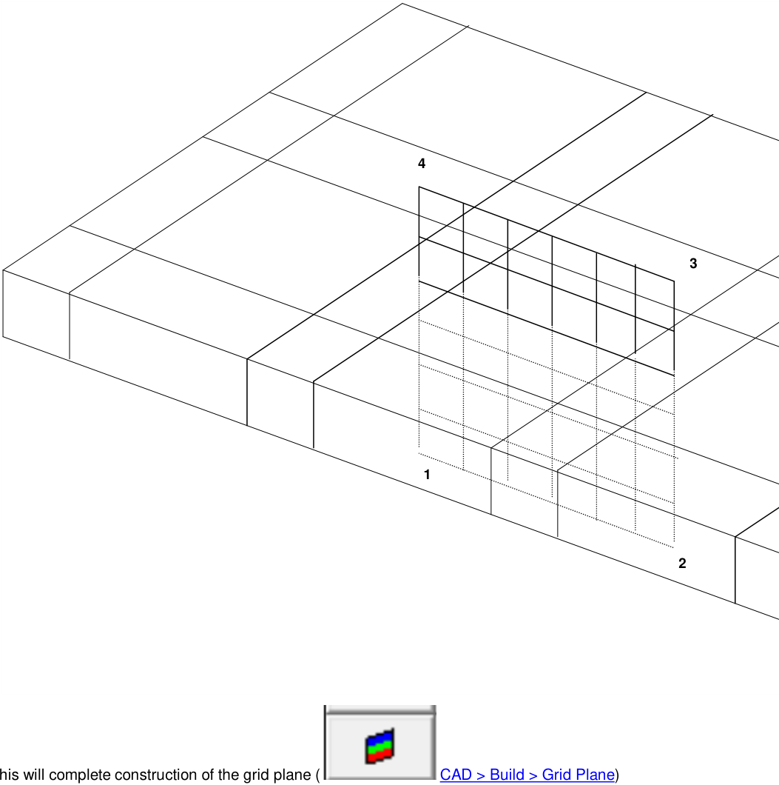

La construction du plan de grille est ainsi terminée (

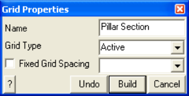

Saisissez un nom descriptif pour le plan de grille et laissez la case Fixed Grid Spacing décochée.

#### Définir les propriétés du grès encaissant

Nous devons maintenant définir les propriétés du matériau encaissant, avec la fonction des propriétés de matériau

#### CAD > Properties > Material Properties.

Cet élément ouvre un sous-menu consacré à la modification des propriétés de matériau. Notez que le matériau numéro 1 est par définition le matériau encaissant. Les autres numéros servent à définir des zones de matériaux alternatifs comme le charbon, la gouge de faille, le remblai, etc. Le numéro du matériau à modifier vous est d'abord demandé. Commençons par définir les propriétés du matériau encaissant

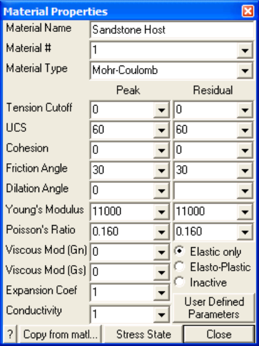

Saisissez :

Material Name: Sandstone Host Material # : 1 Young's (deformation) Modulus: 11000 MPa Poisson's Ratio: 0.16

Les modules visqueux peuvent être mis à zéro, car ils ne servent qu'à simuler le fluage en analyse non linéaire.

Nous voulons utiliser ici le critère de Mohr-Coulomb. Pour cela, définissez

Material Type: Mohr-Coulomb UCS: 60 MPa

Le paramètre de cohésion n'est pas utilisé ici et peut donc être mis à zéro.

Friction Angle: 30°

L'angle de dilatance n'est pas utilisé ici et peut donc être mis à zéro.

L'état de contrainte initial (avant exploitation) peut maintenant être défini

CAD > Properties > Material Properties > Stress State

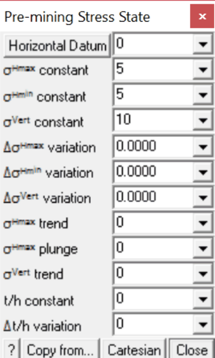

L'état de contrainte en champ lointain approprié pour ce modèle est

sHmax constant:  5 MPa sHmin constant:  5 MPa sVert constant: 10 MPa

Nous fixons à zéro la variation des contraintes avec la profondeur

DsHmax variation:  0 MPa/m DsHmin variation:  0 MPa/m DsVert variation:  0 MPa/m

Les orientations des contraintes (direction et plongement) doivent aussi être mises à zéro, ce qui définit sa et sb comme horizontales et sc comme verticale.

Le niveau de référence (Datum) peut aussi être mis à zéro, car il ne sert qu'à définir la variation avec la profondeur.

#### Définir les propriétés de la couche de charbon

Nous devons maintenant définir les propriétés de la couche de charbon, avec la fonction des propriétés de matériau

#### CAD > Properties > Material Properties

Cet élément ouvre un sous-menu consacré à la modification des propriétés de matériau. Rappelons que, lors de la construction du pilier de charbon, nous avons indiqué que le matériau numéro 2 serait utilisé pour ce bloc.

Réglons Material # sur 2.

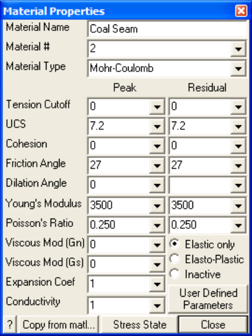

Saisissez :

Material Name: Coal Seam Young's  (deformation) Modulus: 3500 MPa Poisson's Ratio: 0.25

Les modules visqueux peuvent être mis à zéro, car ils ne servent qu'à simuler le fluage en analyse non linéaire.

Nous voulons utiliser ici le critère de Mohr-Coulomb. Pour cela, définissez

Material Type: Mohr-Coulomb UCS: 7.2 MPa

Le paramètre de cohésion n'est pas utilisé ici et peut donc être mis à zéro.

Friction Angle: 27°

L'angle de dilatance n'est pas utilisé ici et peut donc être mis à zéro.

L'état de contrainte initial (avant exploitation) peut maintenant être défini

#### CAD > Properties > Material Properties > Stress State

Nous voulons que la contrainte initiale dans le charbon soit la même que dans le grès encaissant ; utilisons donc Copy pour la copier depuis le matériau 1.

#### Définir les paramètres de contrôle

Nous devons maintenant définir les paramètres qui contrôlent la discrétisation et la résolution du modèle, avec la fonction des paramètres de contrôle

#### CAD > Properties > Control Parameters

Cet élément ouvre une boîte de dialogue regroupant les paramètres de contrôle

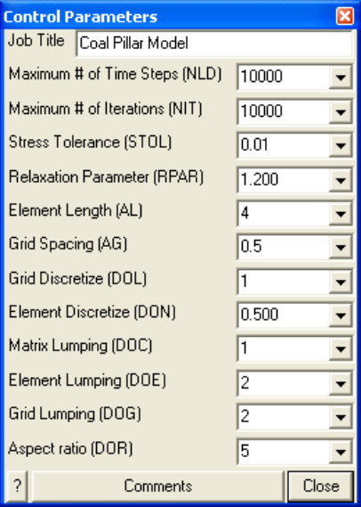

Saisissez :

Job Title: Coal Pillar Model

Tous les paramètres peuvent garder leurs valeurs par défaut, sauf la tolérance sur les contraintes, la longueur d'élément et l'espacement de grille.

Stress Tolerance: 0.01 MPa

doit valoir environ 0,1 % de l'état de contrainte en champ lointain. Cela garantit que, pendant la résolution, les contraintes de surface sont calculées avec une précision numérique de 0,01 MPa.

Element Length: 4

doit être égal à deux fois l'épaisseur de la couche de charbon. Ce paramètre fixe la taille minimale des éléments de frontière utilisés aux endroits où se trouvent des couches ou des piliers étroits. Il garantit la formulation d'un problème bien conditionné et facile à résoudre.

Grid Spacing: 0.5

doit valoir environ un quart de l'épaisseur de la couche. Ce paramètre fixe la taille minimale des éléments de frontière et l'espacement minimal sur le plan de grille aux endroits où celui-ci passe près du modèle ou le recoupe. Des résultats précis peuvent être obtenus jusqu'à une distance égale à la moitié de cet espacement des surfaces du modèle. Ce paramètre garantit aussi qu'un nombre suffisant de points de contrainte est calculé dans le pilier pour obtenir des contours réguliers.

Vous pouvez choisir un espacement de grille plus grand. Le problème sera alors plus petit et les temps de calcul plus courts. Toutefois, avec des éléments de frontière plus grands, les résultats seront moins précis, surtout près des surfaces du modèle ; de plus, avec un espacement de grille plus large, il n'est pas possible d'obtenir des contours réguliers.

Les valeurs suggérées pour les paramètres de discrétisation et de regroupement sont les suivantes :

_DON_ =0.5, _DOL_ = _DOC_ =1, _DOE_ = _DOG_ =2 pour une erreur de 10 à 20 % _DON_ =0.5, _DOL_ = _DOC_ =2, _DOE_ = _DOG_ =4 pour une erreur de 5 à 10 % _DON_ =1.0, _DOL_ =DOC=4, _DOE_ = _DOG_ =8 pour une erreur &lt; 5 %

Les réglages pour résultats approximatifs sont recommandés pour tous les problèmes, sauf ceux nécessitant une précision accrue. Avec ce réglage, on peut s'attendre à des erreurs numériques de 10 à 20 % sur les contraintes prédites. Les réglages pour résultats détaillés donnent une erreur numérique de 5 à 10 %, et les réglages de haute précision une erreur inférieure à 5 %. Vous pouvez choisir des réglages plus précis, mais le problème sera plus grand et les temps de calcul plus longs.

#### Lancer une analyse Map3D

La construction du modèle est terminée et nous pouvons lancer une analyse. Avec Map3D Fault-Slip, vous obtiendrez une solution élastique de ce problème. Avec Map3D NonLinear, une analyse non linéaire complète sera effectuée.

L'analyse se lance depuis le menu principal.

Vous pouvez exécuter l'analyse complète en sélectionnant

#### BEM Analysis

Ici, nous procéderons par étapes. Sélectionnez d'abord

#### Discretization

Si vous avez modifié le modèle depuis le dernier enregistrement, vous serez invité à enregistrer ces modifications.

Une fois les analyses d'intersection et de discrétisation terminées, sélectionnez

#### Analysis > Graphics

En mode graphique, sélectionnez l'option de vue discrétisée

#### View > Render > Discretize

Vous verrez ainsi comment les surfaces des blocs ont été discrétisées en éléments de frontière. Les contours de blocs doivent être activés pour voir chaque élément

#### View > Render > Block Outlines

Pour voir comment la grille a été discrétisée (si la barre d'outils des contours n'est pas visible, activez-la avec Tools > CAD Toolbar), sélectionnez

#### Plot > Grid Selection > Grid #1

dans la barre d'outils des contours

L'analyse de discrétisation peut être répétée autant de fois que nécessaire avec différentes valeurs d'espacement de grille et de paramètres de discrétisation et de regroupement, jusqu'à obtenir la densité souhaitée d'éléments de frontière et de points de grille.

Une fois satisfait, passez à l'analyse BEM (assemblage et résolution de la matrice) en sélectionnant

#### Analysis

dans le menu principal, puis

#### BEM Analysis

Une fois l'analyse terminée, sélectionnez

#### Analysis > Graphics

En mode graphique, vous pouvez tracer les contours de n'importe quel paramètre. Par exemple, pour afficher les contours de la contrainte principale majeure, sélectionnez

Plot > Stress > S1 Major Principal Stress

Un tracé de contours est alors généré sur le plan de grille.

L'interprétation des résultats n'est pas abordée ici.
