Cet exemple montre la construction d'un modèle pour une exploitation tabulaire en plusieurs étapes.

Les lignes de construction servent à définir l'emplacement détaillé des éléments souterrains tels que les excavations, les contacts, les structures, etc. Un modèle Map3D est normalement construit sur ces données de lignes de construction.

Les plans de mine ont été numérisés au préalable avec Map3D

#### CAD > Digitizer Setup

ou avec un autre logiciel de CAO. Ces plans peuvent être enregistrés dans l'un des formats suivants :

Le format de fichier de points est un fichier de données ASCII universel d'extension « .PNT ». Ce format est utile pour échanger des données brutes de lignes de construction avec d'autres logiciels de CAO.

Le format AutoCAD-DXF est un format d'échange de dessins courant, d'extension « .DXF ». Ce format est utile pour échanger des données de lignes de construction avec d'autres logiciels de CAO.

Nous voulons partir de zéro ; nous sélectionnons donc

#### File > New Model

Avant de commencer, notez que vous pouvez survoler n'importe quel bouton pour afficher une info-bulle indiquant sa fonction. Vous pouvez aussi cliquer avec le bouton droit sur n'importe quel élément pour obtenir une aide détaillée sur cette fonction.

#### Importer des plans de mine numérisés

Nous devons d'abord ouvrir un fichier contenant les plans de mine numérisés, avec

#### File > Open Construction Lines

Ici, les lignes de construction ont été enregistrées au format PNT. Le fichier « TAB.pnt » est fourni avec l'installation de Map3D et devrait être disponible pour l'importation.

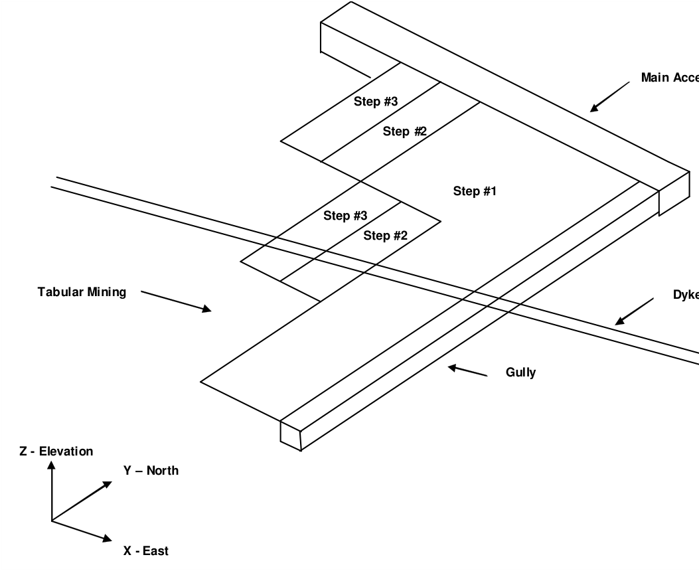

#### Repositionner la vue

Pendant la construction des blocs, ou à tout autre moment, vous pouvez repositionner la géométrie (translation, rotation ou zoom) pour faciliter la visualisation. Plusieurs moyens permettent de le faire (voir Rotation du modèle et Translation du modèle). Le plus simple pour faire pivoter est de maintenir le bouton gauche de la souris enfoncé tout en faisant glisser le curseur sur l'écran. La translation s'obtient en maintenant le bouton droit enfoncé. Pour zoomer en avant ou en arrière, maintenez les deux boutons enfoncés.

Positionnez la vue de façon à bien voir les lignes de construction.

#### Construire l'étape d'exploitation n° 1

Construisons maintenant l'étape d'exploitation tabulaire n° 1, à l'aide d'éléments à discontinuité de déplacement définis par le périmètre de la zone exploitée.

Pour construire le premier bloc, utilisez CAD > Build > DDLoop. Cette fonction peut être sélectionnée dans la barre d'outils CAD comme suit (si la barre d'outils CAD n'est pas visible, activez-la avec Tools > CAD Toolbar) :

Sélectionnez CAD > Build dans la barre d'outils CAD

Le sous-menu des fonctions de construction s'affiche

Sélectionnez ensuite

#### CAD > Build > DDLoop

Comme nous voulons nous accrocher aux lignes de construction, nous devons définir le mode d'accrochage, avec CAD > Snap > Nearest Edge. Cette fonction peut être sélectionnée dans la barre d'outils Build Entity

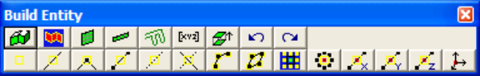

Pour activer l'accrochage à l'arête la plus proche, sélectionnez

#### CAD > Snap > Nearest Edge

(uniquement si le bouton d'accrochage à l'arête la plus proche n'est pas déjà en surbrillance).

Dans ce mode, une zone de sélection s'affiche à l'intersection du réticule. Les coordonnées de la position actuelle du curseur sont indiquées dans la barre d'état. Si la zone de sélection se trouve sur le sommet d'une ligne de construction, ce sommet est sélectionné ; sinon, c'est le point le plus proche de l'arête de la ligne de construction située sous la zone de sélection qui est sélectionné. Dans les deux cas, les 3 coordonnées (x, y et z) sont définies de manière unique.

La routine de construction DDLoop vous invite, dans la barre d'état, à saisir le premier sommet du bloc

Input: Select Point 1

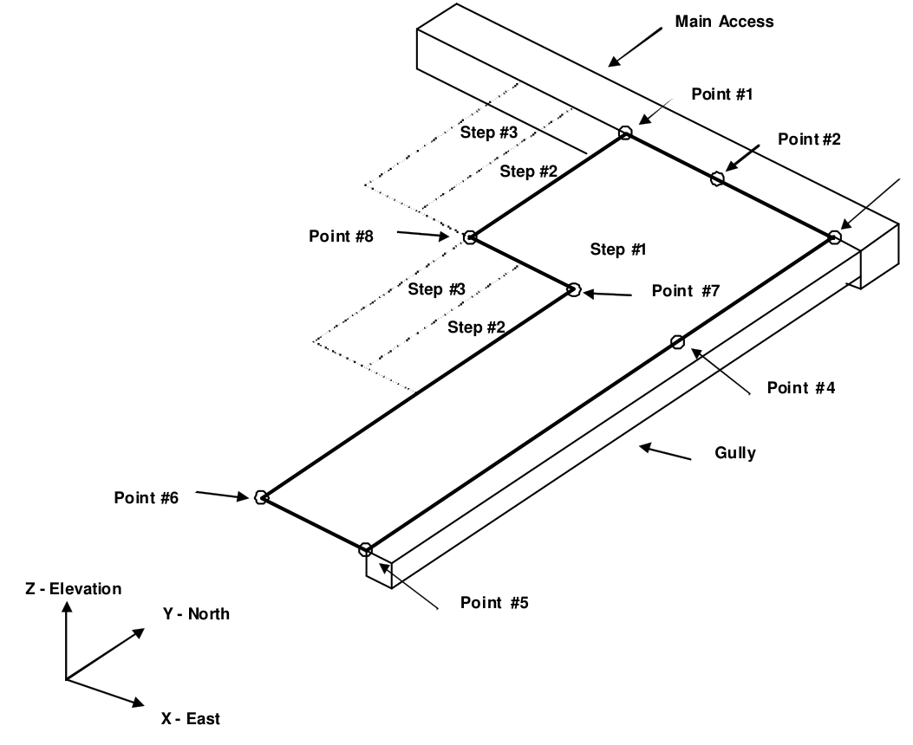

Sélectionnez les points 1 à 8 comme indiqué.

Notez que nous pourrions utiliser ici le mode d'accrochage aux sommets

#### CAD > Snap > Nearest Corner

pour tous les points sauf les points 2 et 4.

Si vous sélectionnez un mauvais emplacement, annulez simplement cette sélection

#### CAD > Build > Undo Point

puis réessayez.

Les points 2 et 4 sont facultatifs et n'ont été sélectionnés que pour obtenir un modèle plus net.

Une fois le point n° 8 sélectionné, le plan est complet. Pour terminer le DDLoop, sélectionnez à nouveau le point n° 1 ou cliquez sur le bouton.

Les propriétés du bloc vous sont automatiquement demandées (CAD > Build > DDLoop)

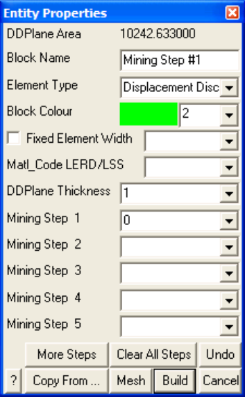

Saisissez :

Block Name: Mining Step #1 Element Type: Displacement Discontinuity Block Colour: 2 DDPlane Thickness: 1

DDPlane Thickness doit être égal à l'ouverture exploitée.

Cette exploitation tabulaire doit être excavée à l'étape d'exploitation 1, ce qui s'indique par

Mining Step 1: 0

Nous avons terminé et pouvons construire ce bloc en appuyant sur le bouton.

#### Construire l'étape d'exploitation n° 2

Construisons maintenant l'étape d'exploitation tabulaire n° 2, elle aussi à l'aide d'éléments à discontinuité de déplacement définis par le périmètre de la zone exploitée. Pour commencer, sélectionnez

CAD > Build > DDLoop

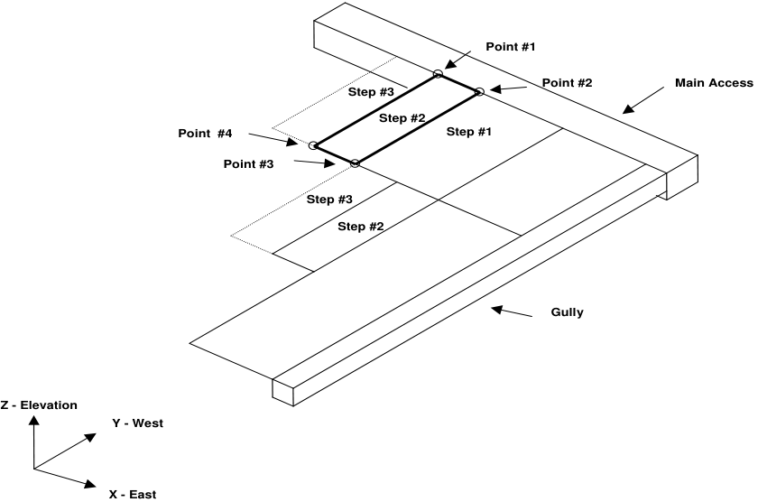

Sélectionnez les 4 points comme indiqué.

Une fois le point 4 sélectionné, le plan est complet. Pour terminer le DDLoop, sélectionnez à nouveau le point n° 1 ou cliquez sur le bouton.

Les propriétés du bloc vous sont automatiquement demandées (

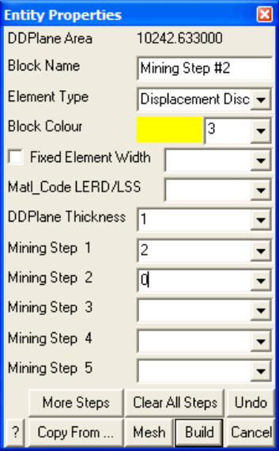

Saisissez :

Block Name: Mining Step #2 Element Type: Displacement Discontinuity Block Colour: 3 DDPlane Thickness: 1

DDPlane Thickness doit être égal à l'ouverture exploitée.

Cette exploitation tabulaire doit recevoir les propriétés du minerai (matériau n° 2) à l'étape d'exploitation 1, puis être excavée à l'étape 2. Cela s'indique par

Mining Step 1: 2 Mining Step 2: 0

Nous avons terminé et pouvons construire ce bloc en appuyant sur le bouton.

Construisez maintenant l'autre partie de l'étape 2 selon la même procédure.

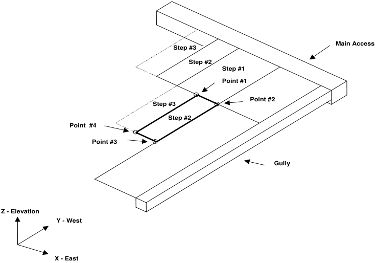

#### Construire l'étape d'exploitation n° 3

Cette exploitation se construit comme celle de l'étape 2, sauf qu'elle doit recevoir les propriétés du minerai (matériau n° 2) aux étapes d'exploitation 1 et 2, puis être excavée à l'étape 3.

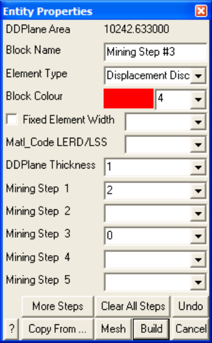

#### Obtenir des résultats

Bien que la géométrie d'exploitation soit définie, nous devons encore indiquer où nous voulons obtenir des prédictions de contraintes. Par défaut, elles sont calculées sur tous les plans DD non exploités. Pour obtenir aussi des contraintes hors de la couche, ou en avant de la zone exploitée, il faut placer des plans DD ou des plans de grille à ces endroits. Les plans de grille constituent une solution bien plus économique (en temps d'analyse).

Ici, nous choisissons de n'obtenir des résultats que sur les plans DD. Nous allons forcer la discrétisation de ces plans à une taille d'élément appropriée avec le paramètre Fixed Element Width. Pour cela, utilisez CAD > Edit > Properties > Entity Properties. Cette fonction peut être sélectionnée dans la barre d'outils CAD comme suit (si la barre d'outils CAD n'est pas visible, activez-la avec Tools > CAD Toolbar) :

Sélectionnez CAD > Edit dans la barre d'outils CAD

Le sous-menu des fonctions de modification s'affiche

Sélectionnez ensuite

CAD > Edit > Entity Properties

La barre d'outils de modification des entités s'ouvre

Au lancement de cette routine, vous êtes d'abord invité à constituer une liste des entités à modifier. Maintenez la touche Maj enfoncée et sélectionnez tous les plans DD représentant les étapes d'exploitation.

Une fois toute l'exploitation sélectionnée, sélectionnez à nouveau

#### CAD > Edit > Entity Properties

ou double-cliquez sur une entité pour ouvrir la boîte de dialogue Entity Properties.

Si un champ de la boîte de dialogue affiche « Variable », c'est que certains des blocs sélectionnés ont des valeurs différentes pour ce champ. Pour conserver ces valeurs (différentes pour chaque bloc), laissez le champ sur « Variable ». Pour appliquer une même valeur à tous les blocs sélectionnés, saisissez-la.

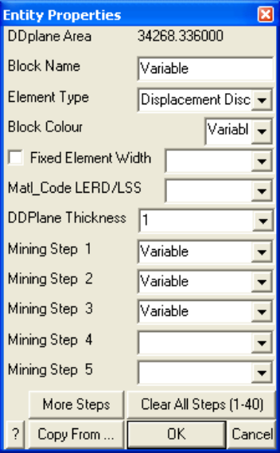

Ici, le seul champ à modifier est

Fixed Element Width:  20

Réglez cette valeur à 20, puis sélectionnez OK.

Map3D subdivisera ainsi la zone exploitée en éléments uniformes de 20 mètres de large lors de la discrétisation. Ce paramètre peut être réduit ultérieurement si une discrétisation plus fine est souhaitée.

#### Enregistrer la géométrie

Dans cet exemple, nous supposons que la géométrie définie jusqu'ici est satisfaisante. La géométrie finale et la séquence d'exploitation étant terminées, il convient d'enregistrer le modèle. Pour cela, sélectionnez

#### File > Save Model As

Enregistrons-le sous le nom « TAB.INP »

#### Construire le dyke

Pour compliquer un peu l'exemple, construisons maintenant le dyke, avec CAD > Build > FFLoop. Cette fonction peut être sélectionnée dans la barre d'outils CAD comme suit (si la barre d'outils CAD n'est pas visible, activez-la avec Tools > CAD Toolbar) :

Sélectionnez CAD > Build dans la barre d'outils CAD

Le sous-menu des fonctions de construction s'affiche

Sélectionnez ensuite

#### CAD > Build > FFLoop

Comme nous voulons nous accrocher aux sommets des lignes de construction, nous devons définir le mode d'accrochage, avec CAD > Snap > Nearest Corner. Cette fonction peut être sélectionnée dans la barre d'outils Build Entity

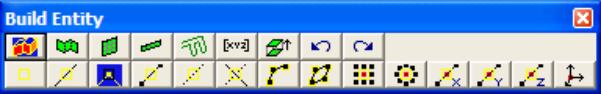

Pour activer l'accrochage au sommet le plus proche, sélectionnez

#### CAD > Snap > Nearest Corner

(uniquement si le bouton Nearest Corner Snap n'est pas déjà en surbrillance).

Nous pourrions en fait utiliser ici le mode d'accrochage aux arêtes

#### CAD > Snap > Nearest Edge

puisque les sommets des lignes de construction seraient de toute façon sélectionnés (tant que le sommet se trouve dans la zone de sélection). L'accrochage aux sommets permet toutefois d'être moins précis lors de la sélection, puisque seuls les sommets sont retenus.

Sélectionnez les quatre points comme indiqué sur la figure.

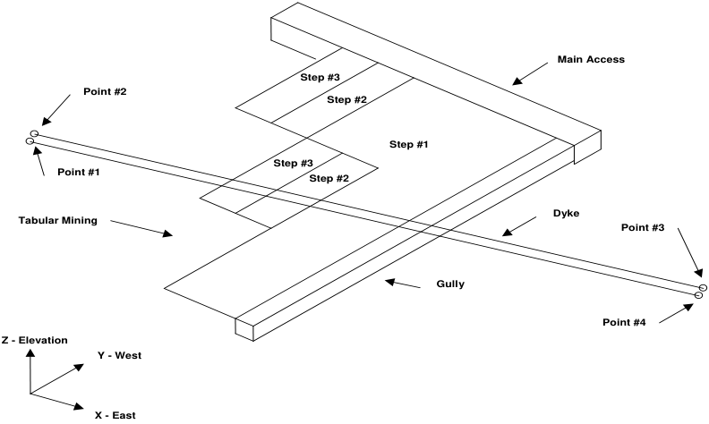

Si vous sélectionnez un mauvais emplacement, annulez simplement cette sélection avec le bouton d'annulation

#### CAD > Build > Undo Point, puis réessayez.

Enfin, sélectionnez à nouveau le premier point (le point n° 1).

Une fois le premier point resélectionné, la base du bloc est entièrement formée. Le message suivant s'affiche

#### Loop complete: Start next loop.

Pour terminer le bloc, nous générons les 4 points restants à partir des 4 premiers sommets en leur ajoutant un décalage. Pour cela, sélectionnez la fonction de décalage dans la barre d'outils Build Entity

#### CAD > Build > Extrude/Offset Remaining

Le vecteur de décalage vous est demandé comme suit

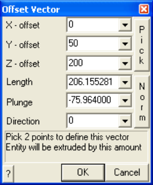

Saisissez le décalage :

X-offset > 0 Y-offset > 50 Z-offset > 200

Les points 5, 6, 7 et 8 sont générés respectivement à partir des points 1, 2, 3 et 4 en ajoutant les valeurs de décalage à leurs coordonnées.

Une fois le bloc construit, ses propriétés vous sont automatiquement demandées (CAD > Build > FFLoop)

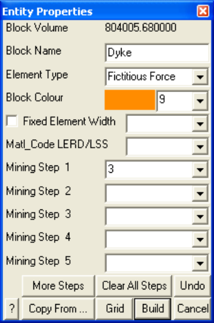

Saisissez :

Block Name: Dyke Element Type: Fictitious Force Block Colour: 9

Décochez Fixed Element Width pour désactiver cette fonction

Ce dyke doit recevoir le matériau n° 3 à l'étape d'exploitation 1, ce qui s'indique par

Mining Step 1: 3

Nous avons terminé et pouvons construire ce bloc en appuyant sur le

bouton.

Nous devons aussi prolonger le dyke sous l'exploitation. Pour cela, copions ce bloc sous l'exploitation. Sélectionnez

CAD > Edit dans la barre d'outils CAD

La barre d'outils de modification s'ouvre

Pour copier des entités, sélectionnez

CAD > Edit > Copy Entities

La barre d'outils de copie des entités s'ouvre

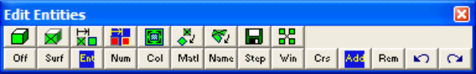

Au lancement de cette routine, vous êtes d'abord invité à constituer une liste des entités à modifier. Cliquez sur le dyke. La boîte de dialogue du vecteur de décalage de copie s'ouvre

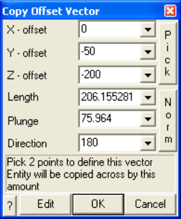

Choisissons cet emplacement graphiquement avec la fonction Pick.

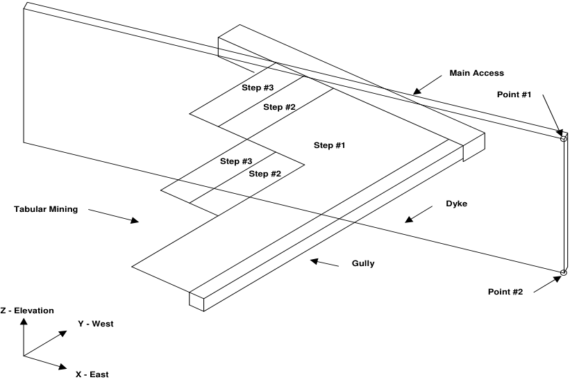

Le vecteur de décalage est alors défini

X - offset: 0

Y - offset: -50

Z - offset: -200

Sélectionnez OK. Le dyke est copié sous l'exploitation.

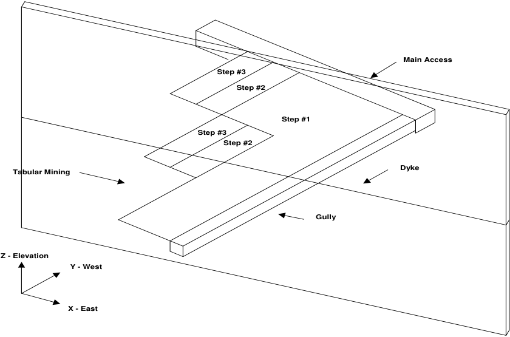

La construction du modèle est terminée.

#### Définir les propriétés du massif rocheux encaissant

Nous devons maintenant définir les propriétés du matériau encaissant, avec la fonction des propriétés de matériau

#### CAD > Properties > Material Properties

Cet élément ouvre un sous-menu consacré à la modification des propriétés de matériau. Notez que le matériau numéro 1 est par définition le matériau encaissant. Les autres numéros servent à définir des zones de matériaux alternatifs comme le minerai, la gouge de faille, le remblai, etc. Le numéro du matériau à modifier vous est d'abord demandé. Commençons par définir les propriétés du matériau encaissant

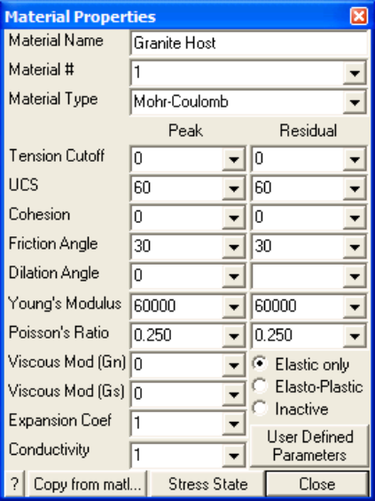

Saisissez :

Material Name: Granite Host Material #: 1 Young's (deformation) Modulus: 60000 MPa Poisson's Ratio: 0.25

Les modules visqueux peuvent être mis à zéro, car ils ne servent qu'à simuler le fluage en analyse non linéaire.

Nous voulons utiliser ici le critère de Mohr-Coulomb. Pour cela, définissez

Material Type: Mohr-Coulomb UCS: 60 MPa

Le paramètre de cohésion n'est pas utilisé ici et peut donc être mis à zéro.

Friction angle: 30°

L'angle de dilatance n'est pas utilisé ici et peut donc être mis à zéro.

Sélectionnez Stress State pour ouvrir la boîte de dialogue de l'état de contrainte

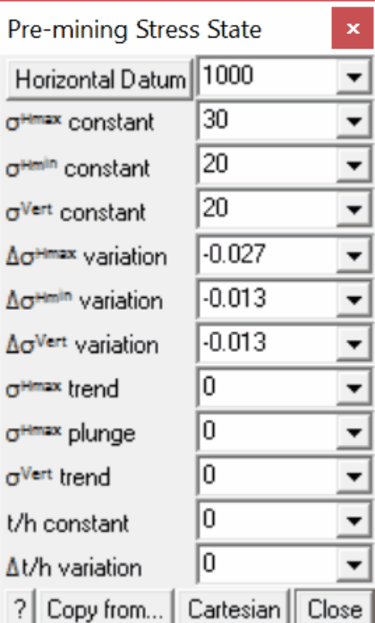

L'état de contrainte en champ lointain approprié pour ce modèle est

sa constant:  30 MPa sb constant:  20 MPa sc constant:  20 MPa

Nous fixons la variation des contraintes avec la profondeur à

Dsa variation:  -0.027 MPa/m Dsb variation:  -0.013 MPa/m Dsc variation:  -0.013 MPa/m

Les orientations des contraintes (direction et plongement) doivent aussi être mises à zéro, ce qui définit sa et sb comme horizontales et sc comme verticale.

Le niveau de référence (Datum) peut être fixé à 1000 mètres pour définir la variation avec la profondeur par

s + Ds ( _z_ - _Datum_ )

Ainsi défini, la contrainte sa vaut 30 MPa à la profondeur z de 1000 m et augmente de 0,027 MPa par mètre de profondeur.

#### Définir les propriétés du minerai

Nous devons maintenant définir les propriétés du minerai, avec la fonction des propriétés de matériau

#### CAD > Properties > Material Properties

Cet élément ouvre un sous-menu consacré à la modification des propriétés de matériau. Notez que le matériau numéro 1 est par définition le matériau encaissant. Les autres numéros servent à définir des zones de matériaux alternatifs comme le minerai, la gouge de faille, le remblai, etc. Le numéro du matériau à modifier vous est d'abord demandé.

Réglons Material # sur 2.

Tous les paramètres peuvent être définis à votre convenance. Soyez particulièrement attentif ici, car ce matériau est inséré dans des plans DD. Ces structures peuvent avoir un comportement non linéaire et se plastifier en compression et en cisaillement (voir la section sur Mohr-Coulomb dans les plans DD).

Sélectionnez Stress State pour ouvrir la boîte de dialogue de l'état de contrainte

Nous voulons que la contrainte initiale dans le minerai soit la même que dans l'encaissant ; utilisons donc Copy pour la copier depuis le matériau 1.

#### Définir les propriétés du dyke

Nous devons maintenant définir les propriétés du dyke, avec la fonction des propriétés de matériau

#### CAD > Properties > Material Properties

Cet élément ouvre un sous-menu consacré à la modification des propriétés de matériau. Notez que le matériau numéro 1 est par définition le matériau encaissant. Les autres numéros servent à définir des zones de matériaux alternatifs comme le minerai, la gouge de faille, le remblai, etc. Le numéro du matériau à modifier vous est d'abord demandé.

Réglons Material # sur 3.

Tous les paramètres peuvent être définis à votre convenance. Avec Map3D Non-Linear, soyez particulièrement attentif, car cette structure peut avoir un comportement non linéaire et se plastifier en compression et en cisaillement (voir la section sur Mohr-Coulomb dans les blocs FF 3D).

Veillez à sélectionner Stress State pour ouvrir la boîte de dialogue de l'état de contrainte et à définir pour le dyke le même état de contrainte que pour l'encaissant (Copy depuis le matériau 1).

#### Définir les paramètres de contrôle

Nous devons maintenant définir les paramètres qui contrôlent la discrétisation et la résolution du modèle, avec la fonction des paramètres de contrôle

#### CAD > Properties > Control Parameters

Cet élément ouvre une boîte de dialogue regroupant les paramètres de contrôle

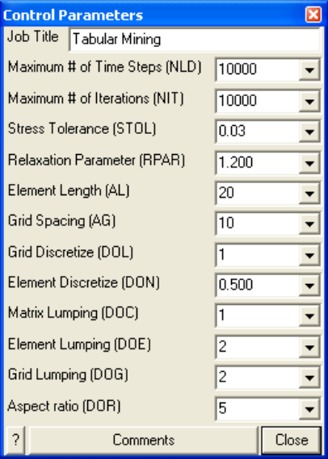

Saisissez :

Job Title: Tabular Mining

Tous les paramètres peuvent garder leurs valeurs par défaut, sauf la tolérance sur les contraintes, la longueur d'élément et l'espacement de grille.

Stress Tolerance: 0.03 MPa

doit valoir environ 0,1 % de l'état de contrainte en champ lointain. Cela garantit que, pendant la résolution, les contraintes de surface sont calculées avec une précision numérique de 0,03 MPa.

Element Length: 20

doit être égal à deux fois l'épaisseur du dyke (le dyke a 10 mètres d'épaisseur), car c'est la structure la plus étroite de ce modèle. Ce paramètre fixe la taille minimale des éléments de frontière utilisés aux endroits où se trouvent des couches ou des piliers étroits. Il garantit la formulation d'un problème bien conditionné et facile à résoudre.

L'espacement de grille (Grid Spacing) n'est pas utilisé, puisque nous n'avons défini aucune grille de points de champ.

Les valeurs suggérées pour les paramètres de discrétisation et de regroupement sont les suivantes :

_DON_ =0.5, _DOL_ = _DOC_ =1, _DOE_ = _DOG_ =2 pour une erreur de 10 à 20 % _DON_ =0.5, _DOL_ = _DOC_ =2, _DOE_ = _DOG_ =4 pour une erreur de 5 à 10 % _DON_ =1.0, _DOL_ =DOC=4, _DOE_ = _DOG_ =8 pour une erreur &lt; 5 %

Les réglages pour résultats approximatifs sont recommandés pour tous les problèmes, sauf ceux nécessitant une précision accrue. Avec ce réglage, on peut s'attendre à des erreurs numériques de 10 à 20 % sur les contraintes prédites. Les réglages pour résultats détaillés donnent une erreur numérique de 5 à 10 %, et les réglages de haute précision une erreur inférieure à 5 %. Vous pouvez choisir des réglages plus précis, mais le problème sera plus grand et les temps de calcul plus longs.

#### Lancer une analyse Map3D

La construction du modèle est terminée et nous pouvons lancer une analyse. Avec Map3D Fault-Slip, vous obtiendrez une solution élastique de ce problème. Avec Map3D NonLinear, une analyse non linéaire complète sera effectuée.

L'analyse se lance depuis le menu principal.

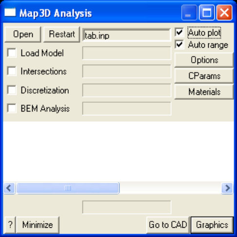

Vous pouvez exécuter l'analyse complète en sélectionnant

#### BEM Analysis

Ici, nous procéderons par étapes. Sélectionnez d'abord

#### Discretization

Si vous avez modifié le modèle depuis le dernier enregistrement, vous serez invité à enregistrer ces modifications.

Une fois les analyses d'intersection et de discrétisation terminées, sélectionnez

#### Analysis > Graphics

En mode graphique, sélectionnez l'option de vue discrétisée

#### View > Render > Discretize

Vous verrez ainsi comment les surfaces des blocs ont été discrétisées en éléments de frontière. Les contours de blocs doivent être activés pour voir chaque élément

#### View > Render > Block Outlines

Pour voir comment la grille a été discrétisée, sélectionnez

#### Plot > Grid Selection > Grid #1

Si tout est satisfaisant, passez à l'analyse BEM (assemblage et résolution de la matrice) en sélectionnant

#### Analysis

dans le menu principal, puis

#### BEM Analysis

Une fois l'analyse terminée, sélectionnez

#### Analysis > Graphics

En mode graphique, vous pouvez tracer les contours de n'importe quel paramètre. Par exemple, pour afficher le déplacement normal (convergence) sur l'exploitation tabulaire, sélectionnez

#### Plot > Surface Components > Dn Normal Displacement (Closure)

Un tracé de contours est alors généré sur les plans DD.

#### Construire l'accès principal

Il sera construit en dessinant un plan avec DDLoop, puis en l'extrudant en bloc 3D.

Pour cela, revenons à l'étape CAO de l'analyse Map3D en sélectionnant

#### Analysis > Go to CAD

dans la boîte de dialogue d'analyse. Sélectionnez ensuite

#### Analysis > Graphics

Pour commencer, sélectionnez la fonction de menu de construction DDLoop

#### CAD > Build > DD Loop

Réglez le mode d'accrochage sur l'arête la plus proche (ou le sommet le plus proche)

#### CAD > Snap > Nearest Edge

(uniquement si le bouton d'accrochage aux arêtes n'est pas déjà en surbrillance).

La routine de construction DDLoop vous invite, dans la barre d'état, à saisir le premier sommet du bloc

Input: Select Point 1

Sélectionnez les deux premiers points comme indiqué sur la figure.

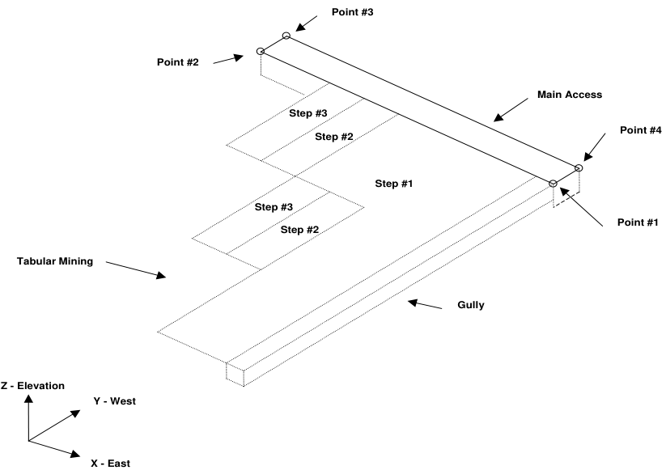

Les points 3 et 4 seront générés par décalage à partir de la ligne définie par les points 1 et 2. Pour cela, sélectionnez

#### CAD > Build > Offset Remaining

dans la barre d'outils de construction.

Le vecteur de décalage vous est demandé.

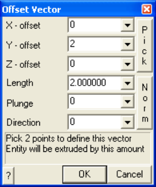

Saisissez le décalage

X - offset: 0

Y - offset: 2

#### Z - offset: 0

Les points 3 et 4 sont générés et la construction du DDLoop est terminée.

Les propriétés du bloc vous sont automatiquement demandées

Saisissez :

#### Block Name: Main Access

#### Element Type: Fictitious Force

Le vecteur de décalage servant à extruder le bloc vous est alors demandé.

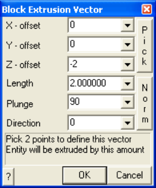

Saisissez le décalage :

X - offset: 0 Y - offset: 0 Z - offset: -2

Block Colour: 1 Fixed Element Width:   (laissez cette case décochée)

Cet accès doit être excavé à l'étape d'exploitation 1, ce qui s'indique par

Mining Step 1: 0

Nous avons terminé et pouvons construire ce bloc.

#### Construire le gully

Construisez maintenant le gully selon la même procédure que ci-dessus.

Sélectionnez les deux premiers points comme indiqué sur la figure.

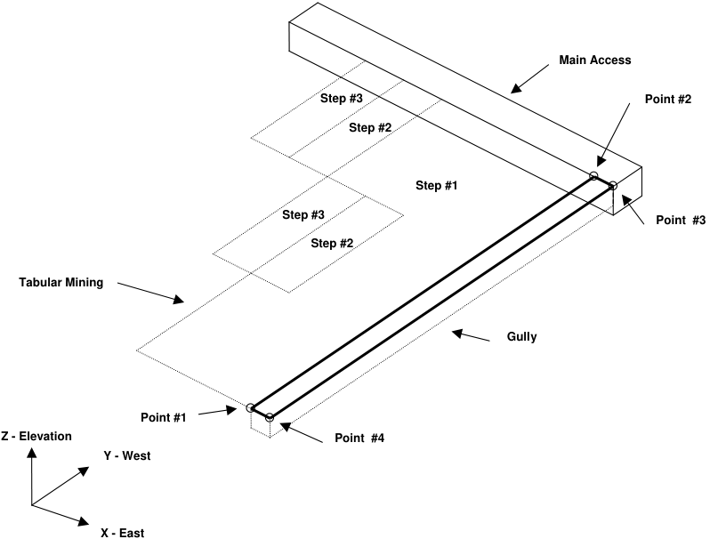

Les points 3 et 4 seront générés par décalage à partir de la ligne définie par les points 1 et 2. Pour cela, sélectionnez

CAD > Build > Offset Remaining

dans la barre d'outils de construction.

Le vecteur de décalage vous est demandé.

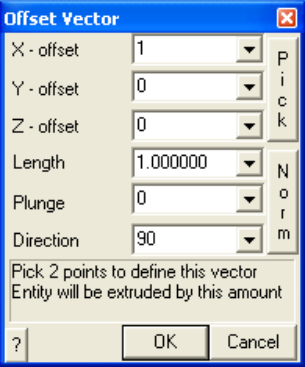

Saisissez le décalage :

- X - offset: 1

- Y - offset: 0

- Z - offset: 0

Les points 3 et 4 sont générés et la construction du DDLoop est terminée.

Les propriétés du bloc vous sont automatiquement demandées

#### Saisissez :

#### Block Name: Gully

#### Element Type: Fictitious Force

Le vecteur de décalage servant à extruder le bloc vous est alors demandé.

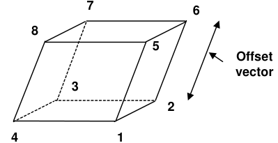

Saisissez le décalage :

X - offset: 0 Y - offset: 0 Z - offset: -1

Block Colour: 1

Fixed Element Width:   (laissez cette case décochée)

Cet accès doit être excavé à l'étape d'exploitation 1, ce qui s'indique par

Mining Step 1: 0

Nous avons terminé et pouvons construire ce bloc.

#### Discussion

Avant de poursuivre l'analyse, nous devons modifier le paramètre de contrôle Element Length ( _AL_ ) pour tenir compte correctement de ces nouveaux éléments du modèle

#### CAD > Properties > Control Parameters

AL doit être égal à deux fois l'épaisseur du gully (le gully a 1 mètre d'épaisseur), car c'est la structure la plus étroite de ce modèle.

Si nous discrétisons maintenant le modèle

#### Analysis > Discretization

un examen attentif montre qu'un grand nombre d'éléments de frontière sont utilisés pour discrétiser les zones adjacentes au gully et à l'accès principal. Ces structures seront manifestement coûteuses en temps d'analyse. Si elles ne contribuent pas de façon importante, on peut réaliser une économie considérable en les retirant de l'analyse, en les rendant inactives.

Pour cela, sélectionnez

#### Analysis > Go to CAD

dans la boîte de dialogue d'analyse. Sélectionnez ensuite

Analysis > Graphics

Sélectionnez maintenant

dans la barre d'outils CAD

La barre d'outils de modification s'ouvre

Pour modifier des entités, sélectionnez

CAD > Edit > Entity Properties

La barre d'outils de modification des entités s'ouvre

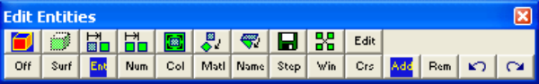

Au lancement de cette routine, vous êtes d'abord invité à constituer une liste des entités à modifier. Maintenez la touche Maj enfoncée et sélectionnez le gully et l'accès principal. Ne sélectionnez ni l'exploitation tabulaire ni le dyke.

Une fois ces structures sélectionnées, sélectionnez à nouveau

CAD > Edit > Entity Properties

ou double-cliquez sur le gully ou l'accès principal pour ouvrir la boîte de dialogue Entity Properties.

Si un champ de la boîte de dialogue affiche « Variable », c'est que certains des blocs sélectionnés ont des valeurs différentes pour ce champ. Pour conserver ces valeurs (différentes pour chaque bloc), laissez le champ sur « Variable ». Pour appliquer une même valeur à tous les blocs sélectionnés, saisissez-la.

Ici, le seul champ à modifier est Element Type. Réglez-le sur Inactive Fictitious Force

Element Type: Inactive Fictitious Force

puis sélectionnez OK.

Vous pouvez maintenant relancer l'analyse BEM en sélectionnant

BEM Analysis

