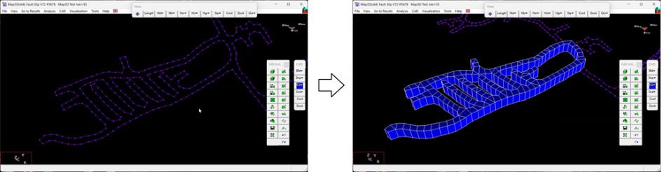

Cet exemple montre comment utiliser la fonction DDLoop de Map3D pour construire un réseau de galeries complexe. L'agencement comporte des formes de piliers intérieurs compliquées.

Les lignes de construction utilisées dans cette vidéo sont fournies avec la version de démonstration de Map3D et/ou peuvent être téléchargées depuis z305_floor_plan-a.dxf

**Démonstration vidéo de la construction de modèles DDLoop avec boucles intérieures**
