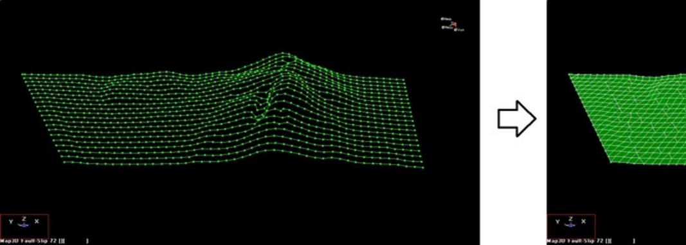

Cet exemple montre comment construire des modèles DDLoop dans Map3D avec l'option « Snap > Window ».

L'agencement comporte plusieurs lignes de construction subparallèles.

Les lignes de construction utilisées dans cette vidéo sont fournies avec la version de démonstration de Map3D et/ou peuvent être téléchargées depuis lines3a.dxf

**Démonstration vidéo de la construction de modèles DDLoop avec l'option Window (lines3a.dxf)**
