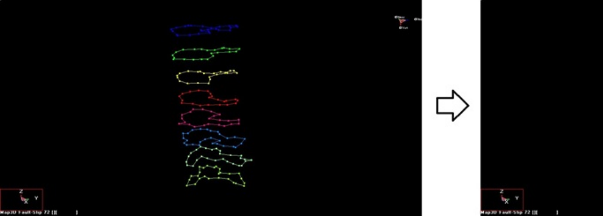

Cet exemple montre comment utiliser la fonction FFLoop de Map3D avec la nouvelle option « Snap > Window ».

L'agencement comporte plusieurs boucles de lignes de construction.

Cette vidéo montre la construction FFLoop à partir d'un ensemble de boucles de lignes de construction. Les lignes de construction utilisées dans cette vidéo sont fournies avec la version de démonstration de Map3D et/ou peuvent être téléchargées depuis 7a.pnt

**Démonstration vidéo de la construction de modèles FFLoop avec la nouvelle option « Win > Snap »**
