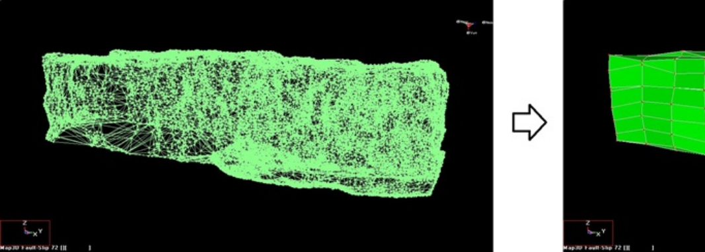

Cet exemple montre comment utiliser la simplification de modèles par découpage dans Map3D. L'agencement comporte une forme d'excavation excessivement complexe.

Cette vidéo montre la simplification d'une géométrie complexe par « Slicing » (découpage), « Smoothing » (lissage), puis construction « FFLoop ».

Les lignes de construction utilisées dans cette vidéo sont fournies avec la version de démonstration de Map3D et/ou peuvent être téléchargées depuis Skivpall.dxf

**Démonstration vidéo de la simplification de modèles par découpage (Skivpall.dxf)**
