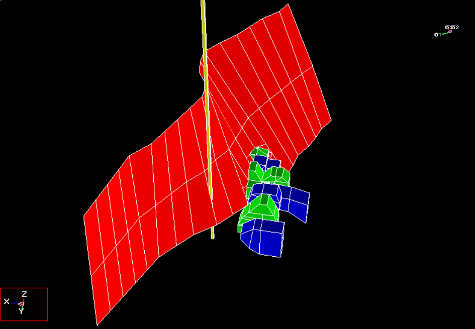

Dans cet exemple, plusieurs méthodes de modélisation de la rupture par glissement de faille sont examinées afin d'évaluer le comportement pseudo-statique du glissement. Les résultats de la modélisation numérique servent à comparer ces approches pour tenter de démontrer que ces résultats sont valides et fiables.

Exemple de glissement de faille

