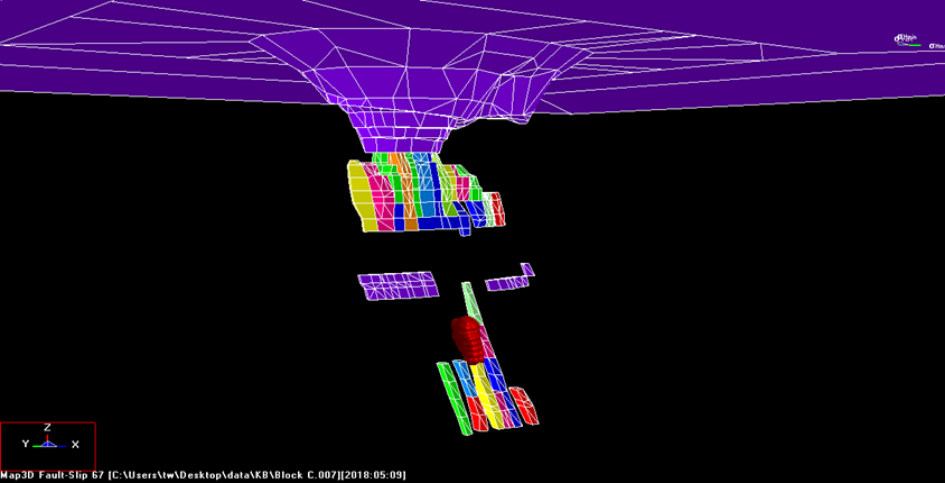

Dans cet exemple, un hors-profil survenu à un stade antérieur de l'exploitation sert à caler un modèle afin de prédire le comportement attendu lors de l'exploitation d'un niveau ultérieur plus profond.

#### Exemple KB

