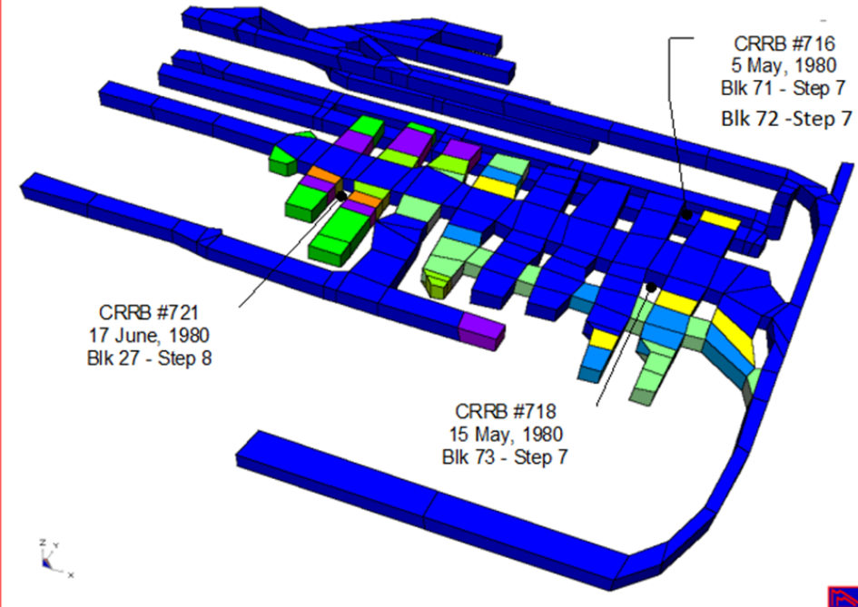

Dans cet exemple, plusieurs ruptures de piliers se sont produites pendant la phase de traçage des sous-niveaux (silling out) sur 3 niveaux différents. Elles servent à caler un modèle afin de prédire le comportement attendu lors de l'exploitation ultérieure d'un pilier de couronne.

#### Exemple CR

