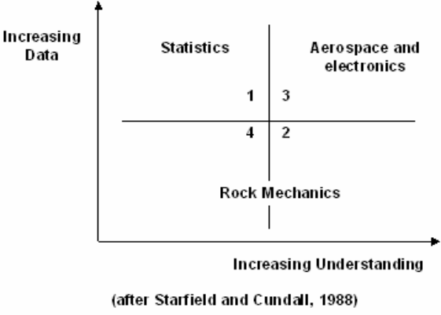
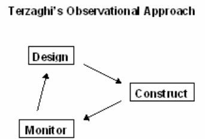
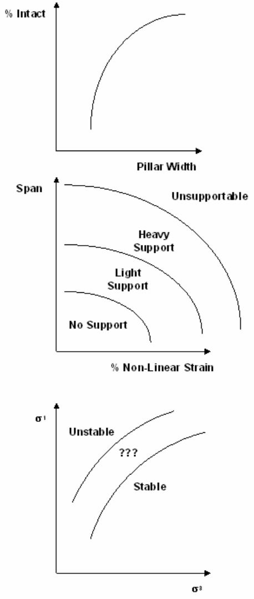
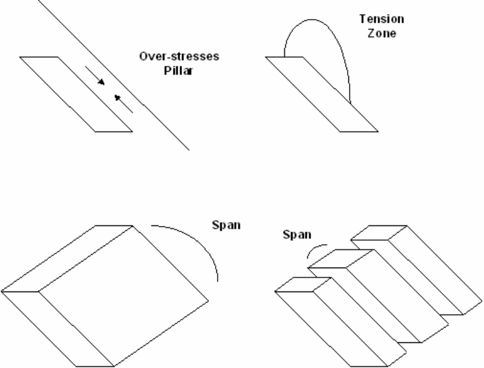
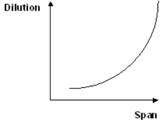
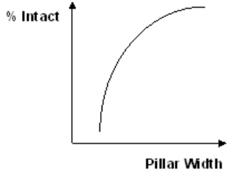
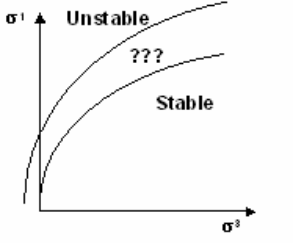
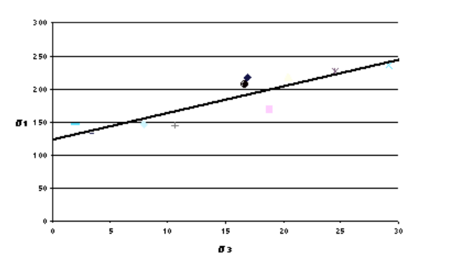

The simple goal of numerical modelling is to predict (with accuracy and reliability) how the rock mass will respond to mining. We specify the loading conditions, specify the geometry (this can include dykes, faults, bedding etc.), require equilibrium and continuity, assume that elasticity and/or non-linearity applies, then solve these equations for the stresses, strains, displacement etc. throughout the rock mass.

By examining the results from the stress analysis we can identify locations that are for example overstressed or yielding. We can determine what locations need support and what type of support is appropriate, etc.

Knowing what problems to expect, and the time and location of these problems is the ultimate goal. This allows you to compare alternative mine layouts and sequences, and to develop strategies to deal with problems when they occur. It avoids unexpected production interruptions. It allows you to lay down hard design numbers for support requirements, specific pillar widths, acceptable stope heights, etc. In short it provides a tool that helps you to design your mine. While numerical modelling is reasonably straightforward, interpreting the results is much more of a challenge. Numerical modelling for rock mass

predictions is not an exact science. There will always be rock mass features that are not anticipated or understood.

The following quotation from Starfield and Cundall (1988) suggests several reasons why this is so.

_Rock mechanics models fall into the class of "data-limited problems": one seldom knows enough about the features and behaviour of the rock mass to model it unambiguously. It follows that one cannot use models in rock mechanics in a conventional way (for example in electrical or aerospace engineering), and that there is a need to adopt a distinctive and appropriate methodology for rock mechanics modelling._

Problems are often ill posed, leading to difficulties in interpreting the results and the nagging question of whether or not the correct problem has been modelled. The design of the model should be driven by the questions that the model is supposed to answer rather than the details of the system that is being modelled. This helps to simplify and control the model.

A model is a simplification of reality rather than an imitation of reality. It is an intellectual tool that has to be designed or chosen for a specific task. The fundamental problem is the question of resolution. One is nervous of over-simplifying the problem.

It is futile ever to expect to have sufficient data to model rock masses in the conventional (for example in electrical or aerospace engineering) way. As one includes more and more detail one loses intellectual control of the model and so it becomes less instead of more effective.

#### What is the conventional approach for applying numerical modelling to mine design?

In most other engineering disciplines (electrical or aerospace engineering), numerical modelling is normally based on predicting response based on laboratory measured properties of materials. This generally works well if the materials, geometry and loading conditions are well known.

By contrast, the conventional method for applying numerical modelling to mine design is based on "Terzaghi's Observational Approach to Design".

Initially (i.e. pre-mining) you can conduct parametric studies. You can compare alternate designs and identify important factors affecting stability. You may find that certain orientations are more favourable than others, or perhaps that certain sequences are better choices than others. You can make some broad estimate of the cost-benefit of increased production versus increased maintenance and support requirements.

Knowing what type of problems to expect and locations that are particularly susceptible is certainly useful information as this allows you to develop strategies to deal with problems if and when they occur. But if you want to use modelling to lay down hard design numbers for support requirements, specific pillar widths, acceptable stope heights, and actual costs, you need to have confidence in the accuracy of your predictions.

For example, there would be no point in specifying that a pillar be made 1.2m wide based on a model prediction if you had no idea how reliable this prediction was. You would never allow personnel to walk under a brow based on modelling results that indicated the brow was safe unless you also were confident that the predictions were reliable.

It is fundamentally necessary to have knowledge of the reliability of a prediction to access risk and base cost benefit decisions on.

It is worth spending a moment to reflect on this statement. I can think of no examples where predictions of unknown reliability are of any value. You may admit that the reliability of your prediction is low and that your predictions could be ±100% error, alternatively you may have evidence to demonstrate that the reliability of your prediction is very high and that your prediction has less than ±10% error. Anyone in a decision making position needs to know this so they can weigh this into there cost benefit considerations.

Consider these two questions:

If you had demonstrable proof that model predictions were 99% reliable (±1% error) why wouldn't you use them?

If you had demonstrable proof that model predictions were 1% reliable (±99% error) why would you use them?

The crux of the matter here is really reliability! We must know how reliable our predictions are or we have nothing (Wiles 2006 and Wiles 2007).

Then how does one obtain reliable designs? The solution to this problem is the same tried and proven approach to design that all engineers use. The procedure used to establish the reliability is called "Terzaghi's Observational Approach to Design" (Terzaghi and Peck, 1967):

- Decide on some sort of initial mine layout - parametric studies.

- Begin mining.

- Monitor the rock mass response – normally visual.

- Redesign based on the observed behaviour - model calibration.

This process constitutes model calibration. Whether we use modelling or not, this is basically the approach we all use to design our mines.

_Design on the basis of the most unfavourable assumptions is inevitably uneconomical, but no other procedure provides the designer in advance of construction with the assurance that the soilsupported structure will not develop unanticipated defects. However, if the project permits modifications of the design during construction, important savings can be made by designing on the_

_basis of the most probable rather than the most unfavourable possibilities. The gaps in the available information are filled by designing during construction, and the design is modified in accordance with the findings. This basis of design may be called the observational procedure._

_In order to use the observational procedure in earthwork engineering, two requirements must be satisfied. First of all, the presence and general characteristics of the weak zones must be disclosed by the results of the subsoil exploration in advance of construction. Secondly, special provisions must_

_be made to secure quantitative information concerning the undesirable characteristics of these zones during construction before it is too late to modify the design in accordance with the findings. These requirements could not be satisfied until the mechanics of interaction between soil and water were clearly understood and adequate means for observation were developed. Depending on the nature of the project, the data required for practising the observational procedure are obtained by measuring pore pressures and piezometric levels; loads and stresses; horizontal, vertical and angular displacements; and quantity of seepage._

Although this text is dated, the ideas are sound. Applying these ideas to determining rock mass response predictions using numerical modelling leads to the following recommendations:

1) Be sure before you start that you are quite clear about why you are building a model and what questions you are trying to answer. Hypothesize possible modelling results and decisions that will be taken as a result. If you cannot make these decisions before you model, you likely will not be able to make them after you model. Some examples of how this might be approached are as follows:

   - Pillar width will be selected based on maximum of 50% yielding across the cross-section of the pillar.

   - Backfilling must be completed before 10% dilution is predicted.

   - Ground reconditioning will be required when non-linear deformations exceed 1% strain.

   - Long term ground instability will occur when elastic over-stressing exceeds 1.6 times the strength.

- 2) Use the model at the earliest possible stage in a project to generate both data and understanding. Models can often be used to help you understand what is going on.

3) Look for the controlling mechanics of the problem. Try to identify important mechanisms, modes of deformation and likely modes of failure. Use the model to conduct "numerical experiments" to clarify

conflicting ideas about what is going on in the field. Some examples of controlling mechanics are as follows:

- Compressive yielding of the hangingwall pillar formed between stopes and hangingwall fault is the cause of the dilution.

- Lack of confinement of the hangingwall is the cause of the dilution.

- Excessive span is the cause of the dilution.

4) Use the simplest possible model that will allow the important mechanisms to occur (2D, 3D, elastic, plastic, faults, water, heat, dynamics etc.). Implement this model and verify that it either ties in with your expectations, or if not, identify the weakness (in the model, or in your expectations) and adjust.

- Although two-dimensional analysis may be applicable early in the mining at very low extraction ratios, and late in the mining at very high extraction ratios, three-dimensional analysis is usually necessary.

- Slip on a weak fault may dominate the stress redistribution, thus requiring the use of fault slip simulations.

- Pillar yielding may be responsible for significant stress redistribution, thus requiring the use of non-linear analysis.

5) Once you have learned all you can from simple models, you may want to run more complex and detailed models to refine accuracy and explore those neglected aspects of the geology and rock mass response in the simple models.

6) Develop simple trends from the results to be used for design purposes. Assess sensitivity of these trends to various parameters assumed in the model. Statistics may be useful here in defining the reliability of the predictions. Some useful trends, which could be presented, are:

- Dilution volume versus span.

- % of pillar intact versus pillar width.

· Ground stability versus predicted stress state.

7) Monitor the rock mass response as the excavation progresses. Verify that the observed response agrees sufficiently well with the predicted results. Re-model is necessary as new information and understanding of the mechanics progress. How well does this approach work?

The value of this approach is that as mining progresses, you learn how reliable (or unreliable) your model is. Note that traditionally observations of the rock mass response are made visually and often supplemented with sparsely located instruments. By making observations of rock mass response, over time you literally get to see when the model works and when it does not. You learn what features need to be included in the model (e.g. fault planes, lithology, loading conditions etc.). You not only learn how to use the model to predict rock mass response, but also gain confidence in the predictions and recognise situations where the model predictions are suspect.

In short you learn how reliable (or unreliable) your predictions are.

Once you have established the reliability, you are in a position to fine tune your design. A well calibrated model allows you a glimpse into the future: to predict how the rock mass will respond.

When properly applied, this procedure is extremely valuable. You can trim pillars and modify the design with confidence, leaving ore only where you need to. You avoid unexpected interruptions in production. You can mine with confidence.

To reinforce this concept let's consider a real example. Consider multiple violent pillar failures that occurred over several years of mining. For each failure, a numerical model was run to determine the stress state at the time and location of the failure. If we plot all of these stress predictions on a set of s1 versus s3 axes we obtain the following:

This figure illustrates that there is a strong correlation between the stress state at the time of each failure and a linear strength criterion. The coefficient of correlation of this data is 0.90. Let's state this in a different way. If you calculate the difference between the stress state for each pillar and the best fit line, then take the mean of these errors, you find that the mean error in prediction of s1 is approximately 17 MPa. This gives a coefficient of variation of only ±9%.

It is evident that for this particular example that this approach can work very well: the stress state predicted from numerical modelling is a very reliable predictor for the time and location of pillar failures. Certainly, you would not expect pillars with stress states well below the best-fit line (more than 17 MPa) to fail. Also you would expect pillars well above (more than 17 MPa) the best-fit line to have failed at some previous mining step.

It is worth asking if this really is an application of Terzaghi's Observational Approach to design? Yes is fact it is. The mine operators tried many different modifications to the layout over the years of this study. The changes they tried were guided by the type of response they observed underground. Initially they found that although they could not avoid pillar failures, they could exert considerable control over when in the mining sequence this happened. In the end they found that by applying ground conditioning they could trigger the pillar failures at times that suited them best.

Implementation of Modelling Into the Mine Design Process

#### What are the shortcomings of this approach?

There are a few significant shortcomings to this approach. First of all, it takes many passes through the mine/monitor/redesign loop to learn how reliable the model predictions are. This takes time, manpower and continued dedication (a lot of trips underground). Monitoring the rock mass response is no trivial task. It may take several years before you establish the reliability with any confidence. Only you can decide if the effort can be justified, i.e. it is worth following through on this.

There are other less obvious limitations. There may be geologic features that cannot be adequately characterized for modelling. For example, often the details of the location, shape, extent and condition of various faults are not well enough known to be included in a numerical model with any accuracy. Exclusion of such features can invalidate the model results. Through proper application of Terzaghi's Observational Approach to Design you can establish that there is no reliability in the model predictions, and be left with an unpredictable situation (at least unpredictable as far as your existing model is concerned). "Geology in: geology out"

Finally, if local conditions such as pre-mining stresses, lithology or jointing vary rapidly from place to place it may be impractical to monitor with sufficient resolution to identify the effects of such changing features. There are modelling examples where these changing conditions have been taken into account. The resulting stress analyzes produced predictions with remarkable agreement to the observed deformations. In these cases at lease, this demonstrates that the variability in results is due to changing local conditions, not due to model error.

This type of variation is normally not taken into account and shows up as large scatter in your predictions thus reducing you reliability.

While Terzaghi's Observational Approach is sound, it may only serve to demonstrate the lack of reliability you really have.

Clearly we would like to find a way around these problems:

- We would like to shorten the calibration loop.

- We would also like to be able to characterise geologic features well enough for incorporation into numerical modelling.

- Finally we would like to reduce scatter and develop a model with high reliability.

How are we going to improve on these shortcomings? One promising avenue of research is integration of numerical modelling with seismic monitoring Map3Di.
