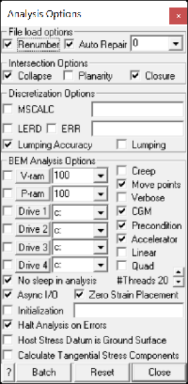

Sets up options that control various program operations.

#### File Load Options:

Analysis > Options > Renumber Renumber surfaces so the volume is positive (during file load). Analysis > Options > Auto Repair Attempts to repair you model by filling gaps, deleting duplicates etc.(during file load).

#### Intersection Options:

Analysis > Options > Collapse Merge adjacent surfaces (during intersection analysis).

Analysis > Options > Planarity Subdivide non-planar quadrilaterals into triangles (during intersection analysis).

Analysis > Options > Closure Conducts closure and overlap checking, and resolves Boolean intersections (during intersection analysis).

#### Discretization Options:

Analysis > Options > MSCALC Calculate results at user defined points (during Map3D BEM analysis).

Analysis > Options > LERD Calculate energy release rate and loading system stiffness (during Map3D BEM analysis).

Analysis > Options > ERR Calculate energy release rate and loading system stiffness (during Map3D BEM analysis).

Analysis > Options > Lumping Accuracy

Analysis > Options > Lumping Pre-calculate coefficient matrix size (during discretization analysis).

#### Map3D BEM Analysis Options:

Analysis > Options > V-ram Store part of the coefficient matrix in virtual RAM (during Map3D BEM analysis).

Analysis > Options > P-ram Store part of the coefficient matrix in physical RAM (during Map3D BEM analysis). Analysis > Options > Drive 1 Specify primary scratch drives for coefficient matrix (during Map3D BEM analysis).

Analysis > Options > Drive 2 Specify secondary scratch drive for coefficient matrix (during Map3D BEM analysis).

Analysis > Options > Drive 3 Specify third scratch drive for coefficient matrix (during Map3D BEM analysis).

Analysis > Options > Drive 4 Specify fourth scratch drive for coefficient matrix (during Map3D BEM analysis).

Analysis > Options > Creep Conduct elasto-visco-plastic creep analysis.

Analysis > Options > Move Points Move field points that are very close to boundary surfaces (during Map3D BEM analysis).

Analysis > Options > Verbose Write all solution vectors and field point results to the log file (during Map3D BEM analysis).

Analysis > Options > CGM Use the conjugate gradient solver (during Map3D BEM analysis).

Analysis > Options > Precondition Precondition the matrix (during Map3D BEM analysis). Analysis > Options > Accelerate Use the matrix accelerator (during Map3D BEM analysis). Analysis > Options > Linear Use higher order boundary elements (during Map3D BEM analysis).

Analysis > Options > Quad Use higher order boundary elements (during Map3D BEM analysis).

Analysis > Options > Threads = 8  indicates the number of threads currently active.

Analysis > Options > Nosleep in analysis Use Windows asynchronous I/O routines (during Map3D BEM analysis).

Analysis > Options > Async I/O Use Windows asynchronous I/O routines (during Map3D BEM analysis).

Analysis > Options > Zero Strain Placement When a new material is assigned to a block CAD > Edit > Entity Properties, these materials are initialized to the specified stress state CAD > Properties > Material Properties.

Analysis > Options > Initialization Initialize the model so that the analysis continues from where a previous analysis completed.

Analysis > Options > Halt on Errors Initialize the model so that the analysis continues from where a previous analysis completed.

Analysis > Options > Host Stress Datum is Ground Surface Treat the datum as ground surface such that any surfaces above the datum are assigned a zero stress state.

Analysis > Options > Calculate Tangential Stress Components In elastic analyses, tangential stresses are not calculated unless requested. This is because they are not required for the solution process and do require additional analysis time. These values are calculated by default during plastic analysis.

#### Miscellaneous Options:

Analysis > Options > Batch Set up analysis batch queue.

Analysis > Options > Reset
