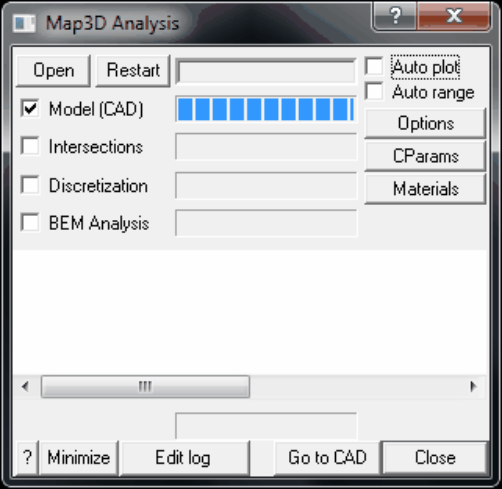

Opens the Map3D Analysis dialogue box that controls all stress analysis functions.

Analysis > Open Loads a model from a file.

Analysis > Restart Restarts an analysis that was aborted or interrupted by a power failure or operating system crash.

Analysis > Model (CAD) Loads a model from a file.

Analysis > Intersections Conducts contact and intersection analysis.

Analysis > Discretization Block and grid discretization.

Analysis > BEM Analysis Map3D BEM analysis.

Analysis > Auto Plot Automatically plot selected surface components as the Map3D BEM analysis proceeds.

Analysis > Auto Range Automatically modify the contour range as the Map3D BEM analysis proceeds.

Analysis > Options Sets up options that control various program operations.

Analysis > Cparams Modifies analysis control parameters during analysis.

Analysis > Materials Modifies material properties during analysis.

Analysis > Minimize Minimizes the graphics display during analysis.

Analysis > Edit log Edits the log file. The log file is a recording of all messages written to the message window.

Analysis > Go to CAD Go to the model building and editing stage.

Analysis > Close Close the dialogue box.

Analysis > Spawn Results Starts another instance of Map3D and loads the results for the first mining step. This is useful for viewing results of currently completed steps while subsequent steps are being analyzed.

Analysis > Suspend Suspends/Pauses the currently running analysis.

Analysis > Resume Resumes the currently suspended analysis.
