## 5.5.1.1 Block

Builds a fully three-dimensional FF (Fictitious Force) type block. These are used for 3D excavations, alternate material zones (ore zones or dykes) and backfilled zones. The block surfaces will be further subdivided into boundary elements at a later stage in the program. In Map3D Non-Linear these zones can yield and behave non-linearly.

Multiple blocks can be combined to create complex 3D shapes. The FFLoop routine ( CAD > Build > FF Loop) can be used to extrude a series of 3D FF blocks from a floor plane or section, and can be used to interpolate between multiple floor planes or sections.

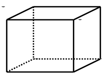

When the routine is initiated the user is prompted to select the first 4 corners that define one side (e.g. the bottom) of a 6-sided block. Once these are entered, the user is prompted for 4 additional corners (corners 5, 6, 7 and 8) that define the opposite side of the block (e.g. the top).

Corners can be ordered in the either the clockwise or counter clockwise sense provided the top and bottom are entered in the same order with the top side corners 5, 6, 7 and 8 laying directly above the bottom side corners 1, 2, 3 and 4.

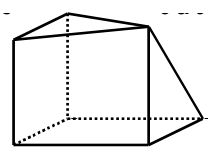

Any of the corners can be repeated to define 3 sided shapes and wedges.

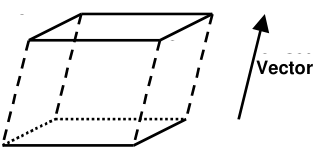

Once the base is defined (corners 1, 2, 3 and 4), the remaining corners (5, 6, 7 and 8) can be generated by offsetting or extruding

#### CAD > Build > Offset Remaining

The coordinates of the corners can be typed in from the keyboard

#### CAD > Build > Enter Point

selected by freehand drawing, picked from other entities (other blocks or construction lines) or digitized

#### CAD > Digitizer Setup > Activate

A large variety of drawing tools are available to assist in visually selecting points from the model

#### CAD > Snap

Corners can be unselected using

#### CAD > Build > Undo Point

Corners can be reselected using

#### CAD > Build > Redo Point

The block is considered to be complete when either the 8th corner is entered or the user selects

Upon completion of block construction the user is prompted to enter the block properties. This allows you to specify the various parameters including the block colour and mining sequence.

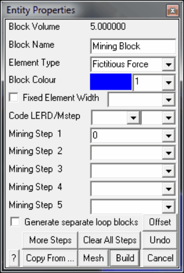

Block Volume - displays the volume of the block.

Block Name - specifies a descriptive name for the block.

Element Type - specifies the type of boundary element that will be used for the block.

- Fictitious Force - FF elements should be used for three-dimensional features such as excavations, alternate material zones, back-filled stopes etc.

- Displacement Discontinuity - DD elements should be used for tabular mining excavations, fractures and fault planes.

- Inactive elements can be used to display features that are to be included for visualization purposes only and not to be used for the actual stress analysis.

Block Colour - specifies the colour number that will be used to display the block.

Specifies the colour number that will be assigned to each button. A total of 10 colours are available for display. These are numbered respectively

1 through 10, 11 through 20, 21 through 30, etc.,

such that the same colour is displayed for numbers

1, 11, 21..., 2, 22, 32..., 3, 23, 33..., etc.

Fixed Element Width - specifies the user defined element width.

This parameter can be used to force uniform discretization on selected entities. Extreme caution should be used in specifying this value since a small value can easily lead to enormous problem size.

In general this option should not be used (unchecked) and discretization should be left to the _AL_ and _AG_ parameters. These latter parameters will concentrate elements only where analysis results are requested thus optimizing the use of elements and minimizing problem size. For further discussion refer to

#### CAD > Properties Control Parameters

This parameter can also be used to avoid making surfaces with sides larger than this during the intersection analysis. Any surfaces whose side length exceeds this dimension will not be collapsed

#### Analysis > Options > Collapse

During the discretization process, any surface whose side length exceeds this dimension will be subdivided to prevent surfaces having sides larger than this.

For an example of the use of this parameter refer to Tabular Mining Example

Matl_Code LERD/MStep - specifies the material code that will be substituted into the block for the LERD/LSS calculation.

The first box is for the material code.

The second box is to specify the mining step number when the calculation is to be done. If this box is left blank then the LERD calculation will be done for all steps.

#### Analysis > Options > LERD/LSS.

- Mining Step n - specifies the material code that will be used for this block in mining step n. In the above example, the block is non-existent at step 1, has material #2 (Ore) inserted in it at step 2, it is excavated at step 3 (material code 0 means to excavate), and finally at step 4 material #5 (backfill) is inserted. When you use a positive material number, the material is placed into the block at the specified initial stress state, and is then allowed to deform according to the elastic/plastic properties you have set for that material number. When you use a negative material number, the material is placed into the block at the specified initial stress state, but the stress state is held at these vales regardless of the deformations, thereby providing a stress boundary condition.

More Steps - allows specification of additional mining steps.

Clear All Steps - clears all mining steps (1-100).

Undo - unselects the last point entered and returns to the block construction routine

#### CAD > Build > Undo Point

Copy From… - allows you to select another block to copy the entity properties from.

Mesh - builds the block with surfaces subdivided into smaller parts at the specified block grid spacing.

Build - completes block construction and enters the block into the model database.

Once you have completed this operation you have one last chance to undo this and remove this block from the model database by selecting

#### CAD > Build > Undo Build

Cancel aborts block construction.

Note that it is possible to create zero volume blocks for example by specifying a zero length offset vector. This allows users to construct individual FF surfaces if desired. While this is permissible it is not recommended as this can lead to unclosed volumes.

FF blocks can be collapsed into DD planes at any time simply by changing the element type

#### CAD > Edit > Entity Properties

In this case the base of the block (the side defined by corners 1, 2, 3 and 4) will become the DD plane and the remainder of the block sides will be discarded.

Notes:

Different colour numbers should be used to represent logical groupings of blocks (e.g. for different levels, sections or logical mining units such as development, stoping etc.). These colours are user definable

#### Tools > Custom Colours

Any blocks with the same colour number will be automatically combined into single complex shapes by Map3D.

Since it is easy to toggle on and off the display of specific block colour numbers

#### View > Hide Block Colours

This provides an efficient method to work with complex model data.

For discussion on model building aspects refer to:

#### Model Building and Editing

For tutorials on model building refer to:

#### Model Building Tutorials

Pressing the space-bar automatically activates the last build function that was used.

## 5.5.1.2 FF Loop

Builds fully three-dimensional FF (Fictitious Force) type blocks. These are used for 3D excavations, alternate material zones (ore zones or dykes) and backfilled zones. The block surfaces will be further subdivided into boundary elements at a later stage in the program. In Map3D Non-Linear these zones can yield and behave non-linearly.

A few examples demonstrating this routine can be found under Model Building Tutorials. Refer specifically to

- Video demo of FFLoop model building with multiple loops

- Video demo of FFLoop model simplification using slicing

- FFLoop Drift Example

- FFLoop Stope Example

- Bulk Mining Example

#### FFLoops

When the routine is initiated the user is prompted to select the corners that define the perimeter of a series of floor plans or sections. The direction you traverse each loop is not relevant. As many loops as desired can be defined simultaneously. The number of points does not have to be the same on each

loop. The starting and end points on each loop (e.g. points 1 and 11 on the first loop, and points 12 and 22 on the second) must be at the same location to define a series of closed loops.

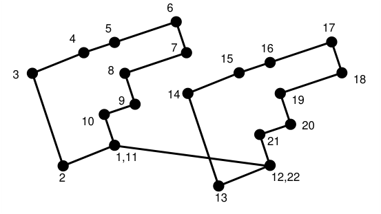

#### Snap > Trace

Individual points can be selected one at a time, or all points along a construction line segment can be selected using the CAD > Snap > Trace CLoop snap function.

#### Snap > Win

Individual points can be selected one at a time, or all points along multiple construction lines can be selected using the CAD > Snap > Window snap function.

#### Close

The FFLoop routine is considered to be complete when one of the following two conditions is met:

- the user selects the final loop point (i.e. point #22) a third time

- CAD > Build > FFLoop

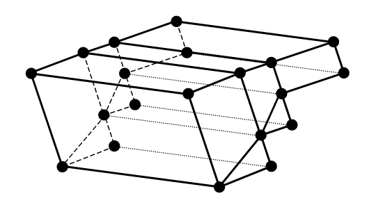

The loops will then be subdivided into a series of 3 or 4 sided FF elements. These surfaces will be further subdivided into boundary elements at a later stage in the program. The routine that does this subdivision searches for corners that are near one another, so the user should take care to define the loop such that the connections are straightforward. In the above example it is recommended that points 4 and 5 be selected or generated.

#### Guide Lines

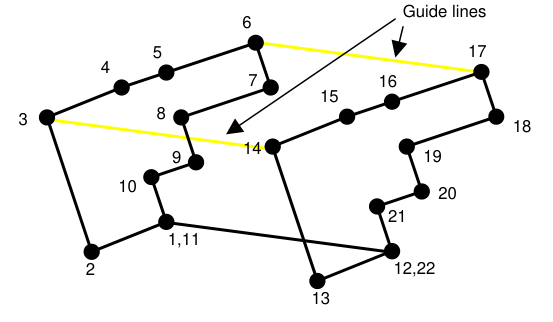

For more complex shapes, guide lines (shown in yellow) can be defined, that force the sides to be subdivided along these lines. These are simply defined as construction lines. For an example refer to [https://www.map3d.com/ffloop.htm](https://www.map3d.com/ffloop.htm). Guide lines must not intersect or cross one another.

#### Extrusion using Offset

Once the first closed loop has been entered, the remaining points can be generated by offsetting the remaining points using CAD > Build > Offset Remaining

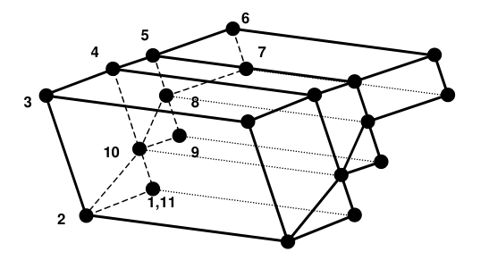

#### Miscellaneous

The coordinates of the corners can be typed in from the keyboard

#### CAD > Build > Enter Point

selected by freehand drawing, picked from other entities (other blocks or construction lines) or digitized

#### CAD > Digitizer Setup > Activate

A large variety of drawing tools are available to assist in visually selecting points from the model

#### CAD > Snap

Corners can be unselected using

#### CAD > Build > Undo Point

Corners can be reselected using

#### CAD > Build > Redo Point

Upon completion of block construction the user is prompted to enter the block properties. This allows you to specify the various parameters including the block colour and mining sequence.

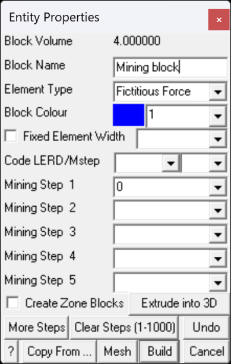

Block Volume - displays the volume of the block.

Block Name - specifies a descriptive name for the block.

Element Type - specifies the type of boundary element that will be used for the block.

- Fictitious Force - FF elements should be used for three-dimensional features such as excavations, alternate material zones, back-filled stopes etc.

- Displacement Discontinuity - DD elements should be used for tabular mining excavations, fractures and fault planes.

- Inactive elements can be used to display features that are to be included for visualization purposes only and not to be used for the actual stress analysis.

Block Colour - specifies the colour number that will be used to display the block.

Specifies the colour number that will be assigned to each button. A total of 10 colours are available for display. These are numbered respectively

1 through 10, 11 through 20, 21 through 30, etc.,

such that the same colour is displayed for numbers

1, 11, 21..., 2, 22, 32..., 3, 23, 33..., etc.

Fixed Element Width - specifies the user defined element width.

This parameter can be used to force uniform discretization on selected entities. Extreme caution should be used in specifying this value since a small value can easily lead to enormous problem size.

In general this option should not be used (unchecked) and discretization should be left to the _AL_ and _AG_ parameters. These latter parameters will concentrate elements only where analysis results are requested thus optimizing the use of elements and minimizing problem size. For further discussion refer to

#### CAD > Properties Control Parameters

This parameter can also be used to avoid making surfaces with sides larger than this during the intersection analysis. Any surfaces whose side length exceeds this dimension will not be collapsed

#### Analysis > Options > Collapse

During the discretization process, any surface whose side length exceeds this dimension will be subdivided to prevent surfaces having sides larger than this.

For an example of the use of this parameter refer to Tabular Mining Example

Matl_Code LERD/MStep - specifies the material code that will be substituted into the block for the LERD/LSS calculation.

The first box is for the material code.

The second box is to specify the mining step number when the calculation is to be done. If this box is left blank then the LERD calculation will be done for all steps.

#### Analysis > Options > LERD/LSS.

- Mining Step n - specifies the material code that will be used for this block in mining step n. In the above example, the block is non-existent at step 1, has material #2 (Ore) inserted in it at step 2, it is excavated at step 3 (material code 0 means to excavate), and finally at step 4 material #5 (backfill) is inserted. When you use a positive material number, the material is placed into the block at the specified initial stress state, and is then allowed to deform according to the elastic/plastic properties you have set for that material number. When you use a negative material number, the material is placed into the block at the specified initial stress state, but the stress state is held at these vales regardless of the deformations, thereby providing a stress boundary condition.

Create Zone Blocks - if you are building multi-loop blocks, you can specify whether or not interfaces will be created between each block so that each block can be treated as a separate mining unit. Each of these sub-sections will be assigned a different colour number to facilitate easy hiding/unhiding when viewing using Hide Block Colours. If you do not specify this option then a single large block will be created.

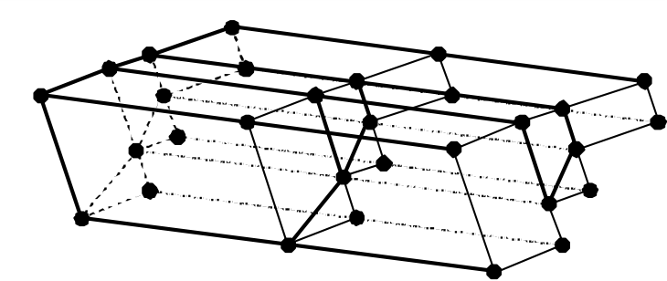

Extrude into 3D - allows you to offset a planar loop to extrude the block into a 3D shape. This operation can also be done using Extrude/Offset Remaining.

More Steps - allows specification of additional mining steps.

Clear All Steps - clears all mining steps (1-1000).

Undo - unselects the last point entered and returns to the block construction routine

#### CAD > Build > Undo Point

Copy From… - allows you to select another block to copy the entity properties from.

Mesh - builds the block with surfaces subdivided into smaller parts at the specified block grid spacing.

Build - completes block construction and enters the block into the model database.

Once you have completed this operation you have one last chance to undo this and remove this block from the model database by selecting

#### CAD > Build > Undo Build

Cancel aborts block construction.

Note that it is possible to create zero volume blocks for example by specifying a zero length offset vector. This allows users to construct individual FF surfaces if desired. While this is permissible it is not recommended as this can lead to unclosed volumes.

FF blocks can be collapsed into DD planes at any time simply by changing the element type

#### CAD > Edit > Entity Properties

In this case the base of the block (the side defined by corners 1, 2, 3 and 4) will become the DD plane and the remainder of the block sides will be discarded.

Notes:

Different colour numbers should be used to represent logical groupings of blocks (e.g. for different levels, sections or logical mining units such as development, stoping etc.). These colours are user definable

#### Tools > Custom Colours

Any blocks with the same colour number will be automatically combined into single complex shapes by Map3D.

Since it is easy to toggle on and off the display of specific block colour numbers

#### View > Hide Block Colours

This provides an efficient method to work with complex model data.

For discussion on model building aspects refer to:

#### Model Building and Editing

For tutorials on model building refer to:

#### Model Building Tutorials

Pressing the space-bar automatically activates the last build function that was used.

## 5.5.1.3 DD Loop

Builds DD (Displacement Discontinuity) type block. These are used for tabular mining, thin seams or fault planes. In all versions of Map3D these zones can yield and behave non-linearly. Multiple DD's can be combined to create complex offset and rolling shapes.

A few examples demonstrating this routine can be found under Model Building Tutorials. Refer specifically to

- Video demo of DDLoop model building with sub-parallel lines

- Video demo of DDLoop model building with interior loops

- DDLoop Pillar Example

- Tabular Mining Example

#### DDLoop

When the routine is initiated the user is prompted to select a series of loops that define the perimeter of the desired zones. The direction you traverse each loop is not relevant. The starting and end point of each loop (e.g. points 1 and 11, or 12 and 22) must be at the same location to define closed loops.

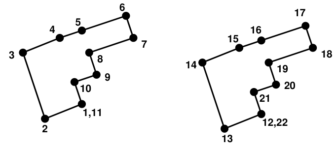

#### Snap > Trace

Individual points can be selected one at a time, or all points along a construction line segment can be selected using the CAD > Snap > Trace CLoop snap function.

#### Snap > Win

Individual points can be selected one at a time, or all points along multiple construction lines can be selected using the CAD > Snap > Window snap function.

#### Close

The DDLoop routine is considered to be complete when one of the following two conditions is met:

- the user selects the final loop point (i.e. point #12,22) a third time

- CAD > Build > DDLoop

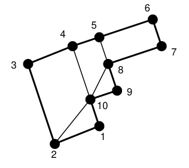

The loops will then be subdivided into a series of 3 or 4 sided DD elements. These surfaces will be further subdivided into boundary elements at a later stage in the program. The routine that does this subdivision searches for corners that are near one another, so the user should take care to define the loop such that the connections are straightforward. In the above example it is recommended that points 4 and 5 be selected or generated.

The Mesh build function (see below) can be used to build the block with surfaces subdivided into smaller parts at the specified block grid spacing. This routine generates interior points as required to maintain well shaped elements.

#### Guide Lines

Multiple interior zones can be traced simultaneously by defining guide lines (shown in yellow).

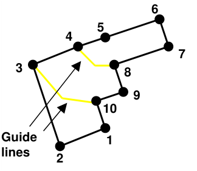

These are simply defined as construction lines. For an example refer to [https://www.map3d.com/t.htm](https://www.map3d.com/t.htm). Guide lines must traverse the perimeter loop from edge to edge. Multiple guide lines can be defined that intersect one another thus defining multiple zones.

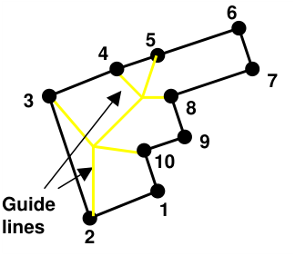

#### Interior Zones

Multiple interior zones (e.g. pillars) can be defined by tracing around their periphery as shown below. The direction you traverse the interior zone is not relevant. As many interior zones as desired can be defined in this way.

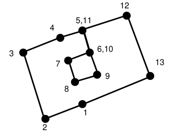

Alternatively these interior zones may be conveniently constructed by tracing around the outer perimeter ( CAD > Snap > Trace CLoop) and using guide lines to define the desired interior shapes.

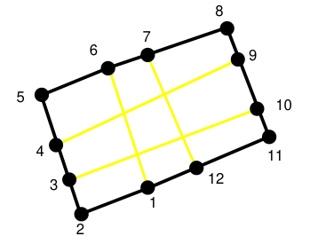

Create Zone Blocks - if you are building multi-loop DD planes, you can specify whether or not interfaces will be created between each sub-section so that each sub-section can be treated as a separate group of DDPlanes. Each of these sub-sections will be assigned a different colour number to facilitate easy hiding/unhiding when viewing using Hide Block Colours. If you do not specify this option then a single large group of DDPlanes will be created.

#### Extrusion using Offset

Once at least two points have been entered, the remaining points can be generated by offsetting the remaining points using CAD > Build > Offset Remaining

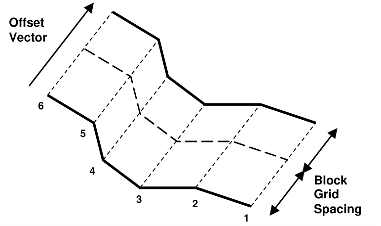

Note also that DD elements can be extruded into FF zones simply by changing the element type from DD to FF.

#### Miscellaneous

The coordinates of the corners can be typed in from the keyboard

#### CAD > Build > Enter Point

selected by freehand drawing, picked from other entities (other blocks or construction lines) or digitized

#### CAD > Digitizer Setup > Activate

A large variety of drawing tools are available to assist in visually selecting points from the model

#### CAD > Snap

Corners can be unselected using

#### CAD > Build > Undo Point

Corners can be reselected using

#### CAD > Build > Redo Point

Upon completion of block construction the user is prompted to enter the block properties. This allows you to specify the various parameters including the block colour and mining sequence.

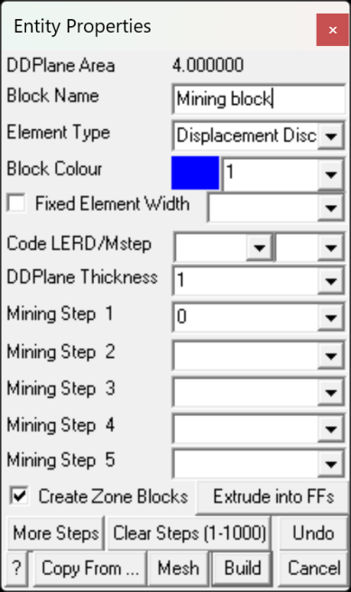

DDPlane Area - displays the combined area of all of the DDPlanes included in the DDLoop.

Block Name - specifies a descriptive name for the block.

Element Type - specifies the type of boundary element that will be used for the block.

- Displacement Discontinuity - DD type elements should be used for tabular mining excavations, fractures and fault planes.

- Fictitious Force - FF type elements should be used. For three-dimensional features such as excavations, alternate material zones, back-filled stopes etc.

- Inactive elements can be used to display features that are to be included for visualization purposes only and not to be used for the actual stress analysis.

Block Colour - specifies the colour number that will be used to display the block.

Specifies the colour number that will be assigned to each button. A total of 10 colours are available for display. These are numbered respectively

1 through 10, 11 through 20, 21 through 30, etc.,

such that the same colour is displayed for numbers

1, 11, 21..., 2, 22, 32..., 3, 23, 33..., etc.

Fixed Element Width - specifies the user defined element width.

This parameter can be used to force uniform discretization on selected entities. Extreme caution should be used in specifying this value since a small value can easily lead to enormous problem size.

In general this option should not be used (unchecked) and discretization should be left to the _AL_ and _AG_ parameters. These latter parameters will concentrate elements only where analysis results are requested thus optimizing the use of elements and minimizing problem size. For further discussion refer to

#### CAD > Properties Control Parameters

This parameter can also be used to avoid making surfaces with sides larger than this during the intersection analysis. Any surfaces whose side length exceeds this dimension will not be collapsed

#### Analysis > Options > Collapse

During the discretization process, any surface whose side length exceeds this dimension will be subdivided to prevent surfaces having sides larger than this.

For an example of the use of this parameter refer to Tabular Mining Example

Matl_Code LERD/MStep - specifies the material code that will be substituted into the block for the LERD/LSS calculation.

The first box is for the material code.

The second box is to specify the mining step number when the calculation is to be done. If this box is left blank then the LERD calculation will be done for all steps.

#### Analysis > Options > LERD/LSS.

#### Analysis > Options > LERD/LSS

DDPlane Thickness - specifies the thickness of the material inserted into the DD element (i.e. fault gouge, seam width, mining width or pillar height).

Normal displacement (closure) of the feature when in-filled will be limited to this thickness. Also, the normal displacement (closure) and shear displacement (ride) are divided by the thickness to determine the strain occurring in the in-filling material

Fault-Gouge in DD planes

Backfill-Hyperbolic in DD planes Equilibrated-Gouge in DD planes

Mohr-Coulomb in DD planes

This parameter should be specified in the same units used to specify the coordinate positions (e.g. metres or feet).

- Mining Step n - specifies the material code that will be used for this block in mining step n. In the above example, the block is non-existent at step 1, has material #2 (Ore) inserted in it at step 2, it is excavated at step 3 (material code 0 means to excavate), and finally at step 4 material #5 (backfill) is inserted. When you use a positive material number, the material is placed into the block at the specified initial stress state, and is then allowed to deform according to the elastic/plastic properties you have set for that material number. When you use a negative material number, the material is placed into the block at the specified initial stress state, but the stress state is held at these vales regardless of the deformations, thereby providing a stress boundary condition.

Extrude into FFs - allows you to extrude a DD plane into an FF block. You will be prompted for the extrusion vector

More Steps - allows specification of additional mining steps.

Clear All Steps - clears all mining steps (1-1000).

Undo - unselects the last point entered and returns to the block construction routine

#### CAD > Build > Undo Point

Copy From… - allows you to select another block to copy the entity properties from.

Mesh - builds the block with surfaces subdivided into smaller parts at the specified block grid spacing. This routine generates interior points as required to maintain good shaped elements.

Build - completes block construction and enters the block into the model database.

Once you have completed this operation you have one last chance to undo this and remove this block from the model database by selecting

#### CAD > Build > Undo Build

Cancel aborts block construction.

Note that it is possible to create zero volume blocks for example by specifying a zero length offset vector. This allows users to construct individual FF surfaces if desired. While this is permissible it is not recommended as this can lead to unclosed volumes.

DD blocks can be extruded into 3D FF blocks at any time simply by changing the element type

#### CAD > Edit > Entity Properties

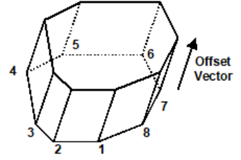

In this case corners 1 through 8 define the base of the block. The top and sides are automatically generated during the extrusion process.

Note that it is possible to create zero volume blocks for example by specifying a zero length offset vector. This allows users to construct individual FF surfaces if desired. While this is permissible it is not recommended as this can lead to unclosed volumes.

Notes:

Different colour numbers should be used to represent logical groupings of blocks (e.g. for different levels, sections or logical mining units such as development, stoping etc.). These colours are user definable

#### Tools > Custom Colours

Any blocks with the same colour number will be automatically combined into single complex shapes by Map3D.

Since it is easy to toggle on and off the display of specific block colour numbers

#### View > Hide Block Colours

This provides an efficient method to work with complex model data.

For discussion on model building aspects refer to:

#### Model Building and Editing

For tutorials on model building refer to:

#### Model Building Tutorials

Pressing the space-bar automatically activates the lat build function that was used.

## 5.5.1.4 Tunnel

Builds a Tunnel (FF - Fictitious Force type block). This is used to construct a 3D tunnel by extruding a cross-section along the tunnel path. The tunnel surfaces will be further subdivided into boundary elements at a later stage in the program.

#### Tunnel

Tunnel building proceeds in three stages:

- 1) Select the tunnel profile;

- 2) Select the tunnel reference point;

- 3) Select the tunnel path/layout.

**Stage 1 - Tunnel Profile**

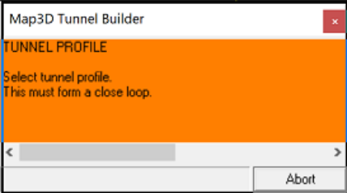

When the routine is initiated the user is prompted to select a tunnel profile:

- this must form a closed loop

- this can be constructed at any desired orientation (x-y, y-z, x-z or any user defined orientation) `o` note that if the profile is constructed in the x-y plane, the y-direction will be used as upwards `o` otherwise if the profile is constructed in the y-z or x-z plane, the z-direction will be used as upwards

- when selecting this, keep in mind that this tunnel profile will be extruded away from your point of view (as shown by the red arrows below)

- this can be selected as a series of points in a manner similar to how you select construction lines CAD > Build > Construction Lines

- alternatively, a shape that has been predefined with construction lines can be selected using for example CAD > Snap > Trace CLoop

- all snap and build functions can be used during profile section including CAD > Build > Offset Remaining

Here a tunnel profile is shown in green. The red arrows show the direction in which the tunnel will be extruded during stage 3 - tunnel path/layout.

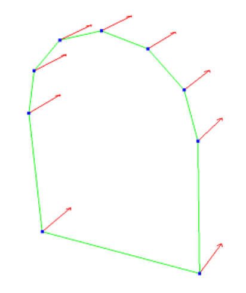

Map3D will detect a completed tunnel profile when the loop is closed. You will then be directed to stage 2 - tunnel reference point.

**Stage 2 - Tunnel Reference Point**

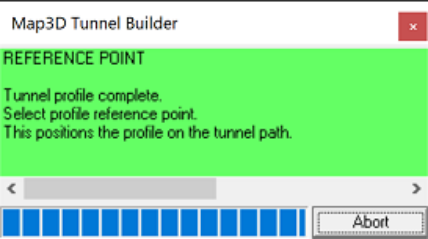

The tunnel reference point represents the location on the tunnel profile that will be used to locate the profile on the tunnel path/layout.

Below, the lower right hand corner has been selected as the reference point.

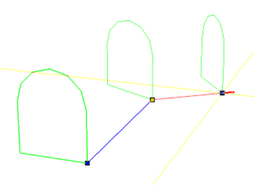

Upon selecting the reference point, you will be directed to stage 3 - tunnel path/layout.

Note that if the wrong reference point is selected, simply undo the selection using either CAD > Build > Undo Build or pressing the escape key.

**Stage 3 - Tunnel Path/Layout**

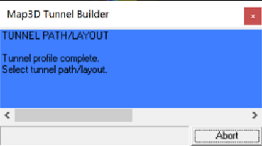

The tunnel path/layout can now be selected:

- the profile selected above will be extruded along the path/layout

- the path/layout can be selected in a manner similar to how you select construction lines CAD > Build > Construction Lines

- alternatively, the path/layout can be selected along a set of predefined construction lines

- closed tunnel loops are acceptable

- inclined tunnel paths are acceptable

- all snap and build functions can be used during profile section including CAD > Build > Offset Remaining

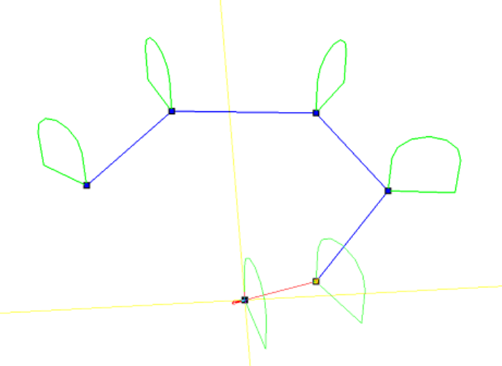

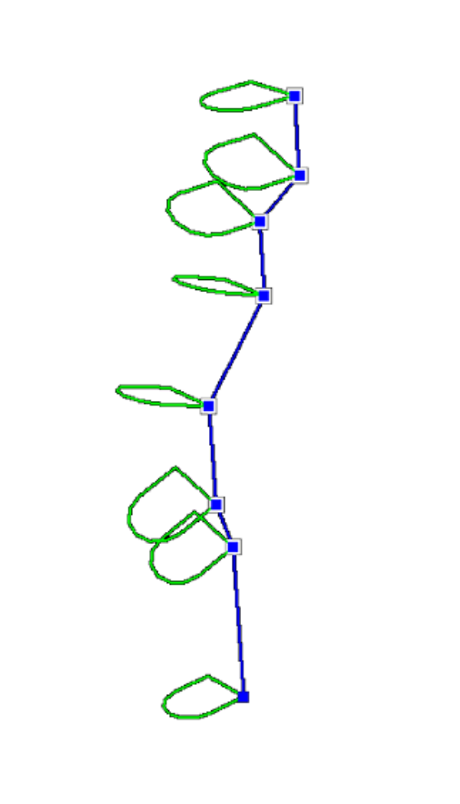

Above on the left, the first two points on the path have been chosen in the horizontal plane (inclined or declined less than 45°), hence the tunnel is extruded as a horizontal drive with the section oriented vertically as shown. On the right, the first two points on the path are chosen in the vertical plane (inclined or declined more than 45°), hence the tunnel is extruded as a vertical shaft with the section oriented near horizontally as shown.

The tunnel path/layout is considered to be complete when one of the following two conditions is met:

- the user selects the final point a second time

- CAD > Build > Tunnel

Upon completion, the tunnel will then be constructed as shown below.

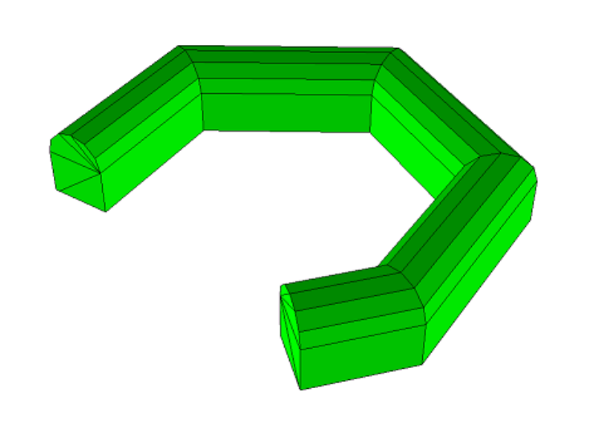

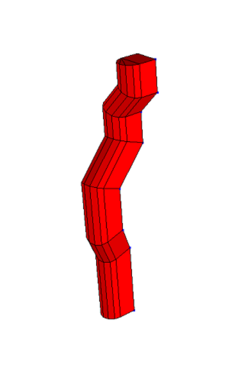

#### Miscellaneous

The coordinates of the corners can be typed in from the keyboard

#### CAD > Build > Enter Point

selected by freehand drawing, picked from other entities (other blocks or construction lines) or digitized

CAD > Digitizer Setup > Activate

A large variety of drawing tools are available to assist in visually selecting points from the model

CAD > Snap

Corners can be unselected using

#### CAD > Build > Undo Point

Corners can be reselected using

CAD > Build > Redo Point

Upon completion of block construction the user is prompted to enter the block properties. This allows you to specify the various parameters including the block colour and mining sequence.

Block Volume - displays the volume of the block.

Block Name - specifies a descriptive name for the block.

Element Type - specifies the type of boundary element that will be used for the block.

- Fictitious Force - FF elements should be used for three-dimensional features such as excavations, alternate material zones, back-filled stopes etc.

- Inactive elements can be used to display features that are to be included for visualization purposes only and not to be used for the actual stress analysis.

Block Colour - specifies the colour number that will be used to display the block.

Specifies the colour number that will be assigned to each button. A total of 10 colours are available for display. These are numbered respectively

1 through 10, 11 through 20, 21 through 30, etc.,

such that the same colour is displayed for numbers

1, 11, 21..., 2, 22, 32..., 3, 23, 33..., etc.

Fixed Element Width - specifies the user defined element width.

This parameter can be used to force uniform discretization on selected entities. Extreme caution should be used in specifying this value since a small value can easily lead to enormous problem size.

In general this option should not be used (unchecked) and discretization should be left to the _AL_ and _AG_ parameters. These latter parameters will concentrate elements only where analysis results are requested thus optimizing the use of elements and minimizing problem size. For further discussion refer to

#### CAD > Properties Control Parameters

This parameter can also be used to avoid making surfaces with sides larger than this during the intersection analysis. Any surfaces whose side length exceeds this dimension will not be collapsed

#### Analysis > Options > Collapse

During the discretization process, any surface whose side length exceeds this dimension will be subdivided to prevent surfaces having sides larger than this.

For an example of the use of this parameter refer to Tabular Mining Example

Matl_Code LERD/MStep - specifies the material code that will be substituted into the block for the LERD/LSS calculation.

The first box is for the material code.

The second box is to specify the mining step number when the calculation is to be done. If this box is left blank then the LERD calculation will be done for all steps.

#### Analysis > Options > LERD/LSS.

- Mining Step n - specifies the material code that will be used for this block in mining step n. In the above example, the block is non-existent at step 1, has material #2 (Ore) inserted in it at step 2, it is excavated at step 3 (material code 0 means to excavate), and finally at step 4 material #5 (backfill) is inserted. When you use a positive material number, the material is placed into the block at the specified initial stress state, and is then allowed to deform according to the elastic/plastic properties you have set for that material number. When you use a negative material number, the material is placed into the block at the specified initial stress state, but the stress state is held at these vales regardless of the deformations, thereby providing a stress boundary condition.

Generate Separate Loop Blocks - You can specify whether or not interfaces will be created between each block so that each block can be treated as a separate mining unit (as shown below). If you do not specify this option then a single large block will be created.

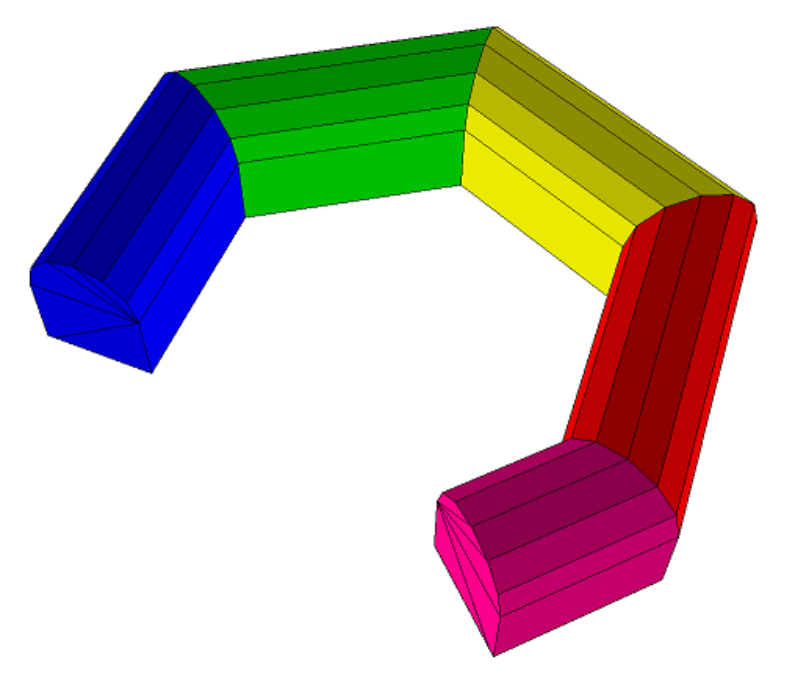

More Steps - allows specification of additional mining steps.

Clear All Steps - clears all mining steps (1-100).

Undo - unselects the last point entered and returns to the tunnel construction routine

#### CAD > Build > Undo Point

Copy From… - allows you to select another block to copy the entity properties from.

Mesh - builds the block with surfaces subdivided into smaller parts at the specified block grid spacing.

Build - completes block construction and enters the block into the model database.

Once you have completed this operation you have one last chance to undo this and remove this block from the model database by selecting

#### CAD > Build > Undo Build

Cancel aborts block construction.

Notes:

Different colour numbers should be used to represent logical groupings of blocks (e.g. for different levels, sections or logical mining units such as development, stoping etc.). These colours are user definable

#### Tools > Custom Colours

Any blocks with the same colour number will be automatically combined into single complex shapes by Map3D.

Since it is easy to toggle on and off the display of specific block colour numbers

#### View > Hide Block Colours

This provides an efficient method to work with complex model data.

For discussion on model building aspects refer to:

#### Model Building and Editing

For tutorials on model building refer to:

Model Building Tutorials

Pressing the space-bar automatically activates the last build function that was used.

## 5.5.1.5 Grid Plane

Builds a grid plane. Analysis results (stresses, strains and displacements) are calculated on these grid planes. Each grid plane will be further subdivided at a later stage in the program.

This function uses the same construction functionality as CAD > Build > DDLoop

CAD > Build > Grid Line.

Note that line grids can be created using

When the routine is initiated the user is prompted to select a closed loop of corners that define the perimeter of the grid plane. The grid plane is considered to be complete when either the final corner is selected the same as the first corner, or the user selects the build GPlane toolbar button

CAD > Build > Grid Plane

**Snap > Trace**

Individual points can be selected one at a time, or all points along a construction line segment can be selected using the CAD > Snap > Trace CLoop snap function.

#### Snap > Win

Individual points can be selected one at a time, or all points along multiple construction lines can be

selected using the CAD > Snap > Window snap function.

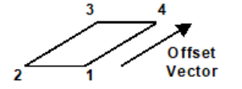

Once at least two points have been entered, the remaining points can be generated by offsetting

#### CAD > Build > Offset Remaining

The coordinates of the corners can be typed in from the keyboard

#### CAD > Build > Enter Point

selected by freehand drawing, picked from other entities (other blocks or construction lines) or digitized

#### CAD > Digitizer Setup > Activate

A large variety of drawing tools are available to assist in visually selecting points from the model

#### CAD > Snap

Corners can be unselected using

#### CAD > Build > Undo Point

Corners can be reselected using

#### CAD > Build > Redo Point

Upon completion of grid plane construction the user is prompted to enter the properties. This allows you to specify a name for the grid plane.

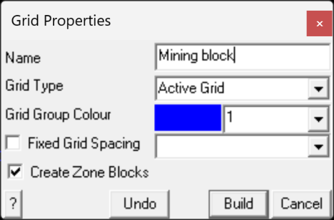

Name - specifies a descriptive name for the grid.

Grid Type - specifies whether you want the grid to be active (used in the stress analysis) or inactive (not used in the stress analysis).

Fixed Grid Spacing - specifies the user grid spacing.

This parameter can be used to force uniform discretization on selected grids. Extreme caution should be used in specifying this value since a small value can easily lead to enormous problem size.

In general this option should not be used (unchecked) and discretization should be left to the _AG_ parameter. This latter parameter will concentrate elements only where analysis results are requested thus optimizing the use of elements and minimizing problem size.

#### CAD > Properties Control Parameters

Create Zone Blocks - if you are building multi-loop grid planes, you can specify whether or not interfaces will be created between each sub-section so that each sub-section can be treated as a separate group of GPlanes. Each of these sub-sections will be assigned a different colour number to facilitate easy hiding/unhiding when viewing using Hide Grid Colours. If you do not specify this option then a single large group of GPlanes will be created.

Undo - unselects the last point entered and returns to the grid construction routine

#### CAD > Build > Undo Point

Build - completes grid construction and enters the block into the model database.

Once you have completed this operation you have one last chance to undo this and remove this grid from the model database by selecting

#### CAD > Build > Undo Build

Cancel - aborts grid construction.

For examples on the use of field point grid planes refer to:

#### Model Building Tutorials

Pressing the space-bar automatically activates the last build function that was used.

## 5.5.1.6 Grid Line

Builds a grid line. Analysis results (stresses, strains and displacements) are calculated on these grid lines. Each grid line will be further subdivided at a later stage in the program.

#### CAD > Build > Construction Lines

This function uses the same construction functionality as

#### CAD > Build > Grid Plane.

Note that grid planes can be created using

**2**

**1**

When the routine is initiated the user is prompted to select multiple corners that define points along the grid line.

The grid line is considered to be complete when either the final corner is selected twice or the user selects

CAD > Build > Grid Line

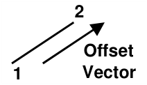

After the first point has been entered, the remaining point can be generated by offsetting

#### CAD > Build > Offset Remaining

The coordinates of the corners can be typed in from the keyboard

#### CAD > Build > Enter Point

selected by freehand drawing, picked from other entities (other blocks or construction lines) or digitized

#### CAD > Digitizer Setup > Activate

A large variety of drawing tools are available to assist in visually selecting points from the model

#### CAD > Snap

Corners can be unselected using

#### CAD > Build > Undo Point

Corners can be reselected using

#### CAD > Build > Redo Point

Upon completion of grid plane construction the user is prompted to enter the properties. This allows you to specify a name for the grid line.

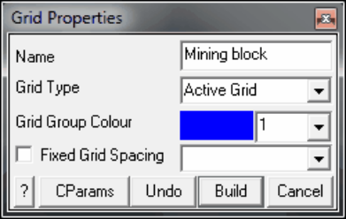

Name - specifies a descriptive name for the grid.

Grid Type - specifies whether you want the grid to be active (used in the stress analysis) or inactive (not used in the stress analysis).

Fixed Grid Spacing - specifies the user grid spacing.

This parameter can be used to force uniform discretization on selected grids. Extreme caution should be used in specifying this value since a small value can easily lead to enormous problem size.

In general this option should not be used (unchecked) and discretization should be left to the _AG_ parameter. This latter parameter will concentrate elements only where analysis results are requested thus optimizing the use of elements and minimizing problem size.

#### CAD > Properties Control Parameters

Undo - unselects the last point entered and returns to the grid construction routine

#### CAD > Build > Undo Point

Build - completes grid construction and enters the block into the model database.

Once you have completed this operation you have one last chance to undo this and remove this grid from the model database by selecting

#### CAD > Build > Undo Build

Cancel - aborts grid construction.

For examples on the use of field point grid planes refer to:

#### Model Building Tutorials

Pressing the space-bar automatically activates the last build function that was used.

## 5.5.1.7 Construction Lines

Builds construction lines. These are meant to represent the mining outlines and are used as aids for building your model. Construction lines are generally digitized from drawings or imported from other CAD packages.

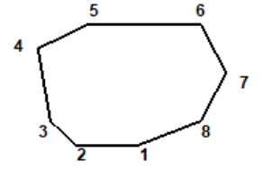

When the routine is initiated the user is prompted to select a series of corners that define the perimeter of the desired zone. The construction line is considered to be complete when either the 1st corner is repeated or the user selects

CAD > Build > Construction Lines

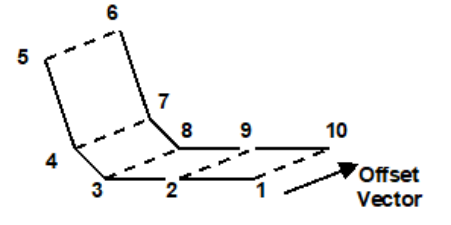

Once at least two points have been entered, the remaining points can be generated by offsetting

#### CAD > Build > Offset Remaining

The coordinates of the corners can be typed in from the keyboard

#### CAD > Build > Enter Point

selected by freehand drawing, picked from other entities (other blocks or construction lines) or digitized

#### CAD > Digitizer Setup > Activate

A large variety of drawing tools are available to assist in visually selecting points from the model

#### CAD > Snap

Corners can be unselected using

#### CAD > Build > Undo Point

Corners can be reselected using

#### CAD > Build > Redo Point

Upon completion of block construction the user is prompted to enter the properties. This allows you to specify the colour of the construction line.

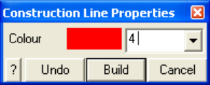

Colour - specifies the colour number that will be used to display the construction line. A total of 10 colours are available for display. These are numbered respectively

1 through 10, 11 through 20, 21 through 30, etc.,

such that the same colour is displayed for numbers

1, 11, 21..., 2, 22, 32..., 3, 23, 33..., etc.

Undo - unselects the last point entered and returns to the construction line grid building routine.

#### CAD > Build > Undo Point

Build - completes grid construction and enters the block into the model database.

Once you have completed this operation you have one last chance to undo this and remove this grid from the model database by selecting

#### CAD > Build > Undo Build

Cancel - aborts line construction.

Notes

Different colour numbers should be used to represent logical groupings of construction lines (e.g. for different levels, sections or logical mining units such as development, stoping etc.). These colours are user definable

#### Tools > Custom Colours

Since it is easy to toggle on and off the display of specific construction line colour numbers

#### View > Hide Block Colours

This provides an efficient method to work with complex construction line data.

For examples on the use of construction lines in model building refer to:

#### Model Building Tutorials

Pressing the space-bar automatically activates the last build function that was used.

## 5.5.1.8 Enter Point

The coordinates of the corners can be typed in from the keyboard during construction of the following entities:

#### CAD > Build > Block

CAD > Build > FF Loop

CAD > Build > DD Loop

CAD > Build > Tunnel

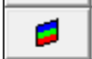

CAD > Build > Grid Plane

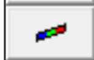

#### CAD > Build > Grid Line

#### CAD > Build > Construction Lines

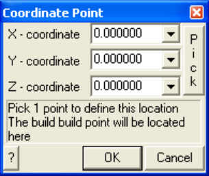

X, Y and Z – coordinate specify the coordinates of the point.

Pick - activates the cursor cross-hairs allowing interactive selection of the point from the model.

To assist in visually selecting points from the model, all snap functions are available.

#### CAD > Snap

Once selected, the coordinates of the point are displayed in the dialogue box.

## 5.5.1.9 Extrude/Offset Remaining

Extrudes a partially constructed entity to assist in generating the remaining points during construction of the following entities:

#### CAD > Build > Block

CAD > Build > FF Loop

CAD > Build > DD Loop

CAD > Build > Tunnel

CAD > Build > Grid Plane

CAD > Build > Grid Line

#### CAD > Build > Construction Lines

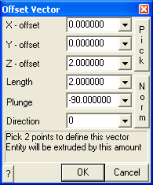

X, Y and Z – offset specify the components of the offset vector. All selected entities will be moved by this amount.

Pick - activates the cursor cross-hairs allowing interactive selection of the offset vector from the model. This requires that you select two points to define this vector.

Length, Plunge and Direction - specify the components of the offset vector. All selected entities will be moved by this amount.

Norm - activates the cursor allowing interactive selection of a surface to make the offset vector normal to. This requires that you select two points to define this vector. Once selected, the components of the offset vector are displayed in the dialogue box.

To assist in visually selecting points from the model, all snap functions are available.

#### CAD > Snap

Once selected, the components of the offset vector are displayed in the dialogue box.

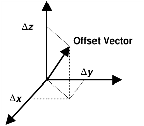

For example if you have constructed the base of a 3D block (points 1, 2, 3 and 4) and you wish to generate the remaining points (5, 6, 7 and 8) at one metre elevation above the base, you would simply enter the offset vector as (0,0,1).

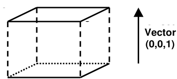

Note that it is possible to create zero volume blocks for example by specifying a zero length offset vector. This allows users to construct individual FF surfaces if desired. While this is permissible it is not recommended as this can lead to unclosed volumes.

## 5.5.1.10 Undo Point

During block construction, points are selected in sequence. This allows points to be unselected during construction of the following entities:

CAD > Build > Block

CAD > Build > FF Loop

CAD > Build > DD Loop

CAD > Build > Tunnel

CAD > Build > Grid Plane

CAD > Build > Grid Line

#### CAD > Build > Construction Lines

Any unselected points can be reselected using

#### CAD > Build > Redo Point

Once you have completed block construction, you can undo this and remove this block from the model database by selecting (10 levels of undo/redo are supported)

#### CAD > Build > Undo Build

You can then redo the block construction. This allows you to repeat any trial meshing operation.

CAD > Build > Undo Redo

## 5.5.1.11 Redo Point

During block construction, points are selected in sequence. This allows any points that have been unselected to be reselected during construction of the following entities:

#### CAD > Build > Block

#### CAD > Build > FF Loop

#### CAD > Build > DD Loop

CAD > Build > Tunnel

CAD > Build > Grid Plane

CAD > Build > Grid Line

CAD > Build > Construction Lines

Points can be unselected using

#### CAD > Build > Undo Point

Once you have completed block construction, you can undo this and remove this block from the model database by selecting (10 levels of undo/redo are supported)

#### CAD > Build > Undo Build

You can then redo the block construction. This allows you to repeat any trial meshing operation.

CAD > Build > Undo Redo

## 5.5.1.12 Undo Build

During block construction, points are selected in sequence. This allows points to be unselected during construction of the following entities:

CAD > Build > Block

CAD > Build > FF Loop

#### CAD > Build > DD Loop

CAD > Build > Tunnel

CAD > Build > Grid Plane

CAD > Build > Grid Line

#### CAD > Build > Construction Lines

Any unselected points can be reselected using

#### CAD > Build > Redo Point

Once you have completed block construction, you can undo this and remove this block from the model database by selecting (10 levels of undo/redo are supported)

#### CAD > Build > Undo Build

You can then redo the block construction. This allows you to repeat any trial meshing operation.

#### CAD > Build > Undo Redo

## 5.5.1.13 Redo Build

During block construction, points are selected in sequence. This allows any points that have been unselected to be reselected during construction of the following entities:

#### CAD > Build > Block

CAD > Build > FF Loop

CAD > Build > DD Loop

CAD > Build > Tunnel

CAD > Build > Grid Plane

CAD > Build > Grid Line

#### CAD > Build > Construction Lines

Points can be unselected using

CAD > Build > Undo Point

Once you have completed block construction, you can undo this and remove this block from the model database by selecting (10 levels of undo/redo are supported)

#### CAD > Build > Undo Build

You can then redo the block construction. This allows you to repeat any trial meshing operation.

CAD > Build > Undo Redo
