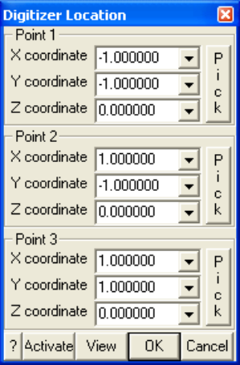

Setup the digitizer.

The digitizing plane is uniquely scaled, located and oriented by specifying 3 points on the drawing to be digitized.

The procedure for doing this is to:

1. select 3 points on the drawing,

2. enter the coordinates of each point,

3. then pick the points with the digitizer puck.

4. Pick activates the digitizer puck to allow selection of each point.

CAD > Digitizer > Activate toggles activation of the digitizer for selecting points from a drawing. This button can be placed on the CAD toolbar using Tools > CAD Toolbar > Configure.

View - repositions the view so you can see the digitizer plane superimposed with the model.

Digitizer support is available for any digitizer that can be setup to control cursor movements in absolute mode (i.e. providing a one to one correspondence of digitizer movement with cursor position). Most new digitizers ship with their own software drivers that provide this support. An alternative is to use the following software that supports most digitizers:

Virtual Tablet Interface Digitizer Technology Company 16541 Redmond Way, Suite 195C Redmond, Washington USA 98052 Tel: 206 868 3246 Fax: 206 885 7704
