## 5.5.4.1 Entity Properties

Edit block type, colour, mining sequence etc.

This routine can be initiated either by picking the button or simple right-clicking on any entity. When you initiate this routine you will first be prompted to build a list of entities that you wish to edit

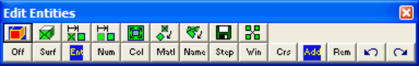

- If Tools > Shift-key Selection is checked, you must hold down the Shift-key to make multiple selections.

- By default, selected entities are added to the list, however if the Ctrl-key is held down, selected entities will be removed from the list.

- While holding down the Shift-key or Ctrl-key, you can drag open a crossing window.

- Use of this toolbar is detailed in Build A List of Entities for Editing

- Pressing the space-bar automatically activates the last edit function that was used.

- Holding the Alt-key when you right-click automatically repeats the last edit function that was used.

Once you have selected the desired entities, you can either pick any of the edit buttons:

CAD > Edit > Entity Properties Edit block type, colour, mining sequence, CAD > Edit > Erase Entities Erase selected entities, CAD > Edit > Move Entities Move selected entities, CAD > Edit > Copy Entities Copy selected entities, CAD > Edit > Scale Entities Scale selected entities, CAD > Edit > Rotate Azimuth Rotate the azimuth of selected entities, CAD > Edit > Rotate Dip Rotate the dip of selected entities,

CAD > Edit > Dump to File Dump selected entities to a file,

CAD > Edit > Group Group selected entities into a single block,

- double click on any vertex to execute the highlighted function,

- right click for a list of options.

If any of the fields in the dialogue box read "Variable" it is because some of the blocks you have selected have different properties for that field. If you wish to leave these properties as they are (i.e. different for each block), leave the field as "Variable". If you wish to change the value of that field for all selected blocks, enter the desired value.

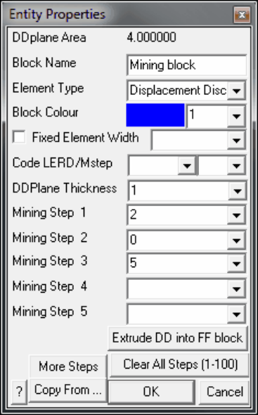

Block Volume - If you have selected all FF blocks, the total combined volume of the blocks will be displayed. If you have selected all FF blocks, the total combined volume of the blocks will be displayed.

DDPlane Area - If you have selected all DD blocks, displays the combined area of all of the DDPlanes included in the DDLoop.

Block Name - specifies a descriptive name for the block.

Element Type - specifies the type of boundary element that will be used for the block.

- Displacement Discontinuity - DD type elements should be used for tabular mining excavations, fractures and fault planes.

- Fictitious Force - FF type elements should be used for three-dimensional features such as excavations, alternate material zones, back-filled stopes etc.

- Inactive elements can be used to display features that are to be included for visualization purposes only and not to be used for the actual stress analysis.

- Note that DD type elements can be changed into GPlanes.

Block Colour - specifies the colour number that will be used to display the block.

- Specifies the colour number that will be assigned to each button. A total of 10 colours are available for display. These are numbered respectively

- 1 through 10,

11 through 20,

21 through 30, etc.,

- such that the same colour is displayed for numbers 1, 11, 21...,

- 2, 22, 32...,

- 3, 23, 33..., etc.

Fixed Element Width - specifies the user defined element width.

- This parameter can be used to force uniform discretization on selected entities. Extreme caution should be used in specifying this value since a small value can easily lead to enormous problem size.

- In general this option should not be used (unchecked) and discretization should be left to the _AL_ and _AG_ parameters. These latter parameters will concentrate elements only where analysis results are requested thus optimizing the use of elements and minimizing problem size. For further discussion refer to

CAD > Properties Control Parameters

- This parameter can also be used to avoid making surfaces with sides larger than this during the intersection analysis. Any surfaces whose side length exceeds this dimension will not be collapsed

#### Analysis > Options > Collapse

- During the discretization process, any surface whose side length exceeds this dimension will be subdivided to prevent surfaces having sides larger than this.

- For an example of the use of this parameter refer to Tabular Mining Example

Matl_Code LERD/MStep - specifies the material code that will be substituted into the block for the LERD/LSS calculation.

The first box is for the material code.

The second box is to specify the mining step number when the calculation is to be done. If this box is left blank then the LERD calculation will be done for all steps.

#### Analysis > Options > LERD/LSS.

DDPlane Thickness - specifies the thickness of the material inserted into the DD element (i.e. fault gouge, seam width, mining width or pillar height).

- Normal displacement (closure) of the feature when in-filled will be limited to this thickness. Also, the normal displacement (closure) and shear displacement (ride) are divided by the thickness to determine the strain occurring in the in-filling material

Mohr-Coulomb in DD planes

Fault-Gouge in DD planes Backfill-Hyperbolic in DD planes

- This parameter should be specified in the same units used to specify the coordinate positions (e.g. metres or feet).

Mining Step n - specifies the material code that will be used for this block in mining step n.

- In the above example, the block is non-existent at step 1, has material #2 (Ore) inserted in it at step 2, it is excavated at step 3 (material code 0 means to excavate), and finally at step 4 material #5 (backfill) is inserted.

- When you use a positive material number, the material is placed into the block at the specified initial stress state, and is then allowed to deform according to the elastic/plastic properties you have set for that material number.

- When you use a negative material number, the material is placed into the block at the specified initial stress state, but the stress state is held at these vales regardless of the deformations, thereby providing a stress boundary condition.

Extrude DD into FF blocks - allows you to extrude a DD plane into an FF block. You will be prompted for the extrusion vector

More Steps - allows specification of additional mining steps.

Clear All Steps - clears all mining steps (1-100).

Copy From… - allows you to select another block to copy the entity properties from.

OK - completes editing of blocks and modifies any properties that have been changed.

Cancel - aborts block editing.

Once you have completed any edit operation you have one chance to undo the modifications by selecting

#### Undo

You can also restore the same selection set and modify the same set of entities again be selecting

#### Redo

DD blocks can be extruded into 3D FF blocks simply by changing the element type from Displacement Discontinuity to Fictitious Force.

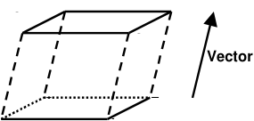

In this case corners 1 through 4 define the base of the block. The top and sides are automatically generated during the extrusion process. FF blocks can be collapsed into DD planes by changing the element type from Fictitious Force to Displacement Discontinuity. In this case the base of the block (the side defined by corners 1, 2, 3 and 4) will become the DD plane and the remainder of the block sides will be discarded.

Note that it is possible to create zero volume blocks for example by specifying a zero length offset vector. This allows users to construct individual FF surfaces if desired. While this is permissible it is not recommended as this can lead to unclosed volumes.

Notes

Different colour numbers should be used to represent logical groupings of blocks (e.g. for different levels, sections or logical mining units such as development, stoping etc.). These colours are user definable

#### Tools > Custom Colours

Any blocks with the same colour number will be automatically combined into single complex shapes by Map3D.

Since it is easy to toggle on and off the display of specific block colour numbers

#### View > Hide Block Colours

This provides an efficient method to work with complex model data.

You can adjust the double click time using

#### Tools > Double Click Time

For discussion on model building aspects refer to:

#### Model Building and Editing

For tutorials on model building refer to:

Model Building Tutorials

## 5.5.4.2 Erase Entities

Erase selected entities.

This routine can be initiated either by picking the button or simple right-clicking on any entity. When you initiate this routine you will first be prompted to build a list of entities that you wish to edit

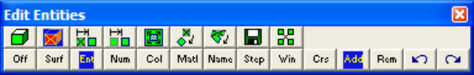

- If Tools > Shift-key Selection is checked, you must hold down the Shift-key to make multiple selections.

- By default, selected entities are added to the list, however if the Ctrl-key is held down, selected entities will be removed from the list.

- While holding down the Shift-key or Ctrl-key, you can drag open a crossing window.

- Use of this toolbar is detailed in Build A List of Entities for Editing

- Pressing the space-bar automatically activates the last edit function that was used.

- Holding the Alt-key when you right-click automatically repeats the last edit function that was used.

Once you have selected the desired entities, you can either pick any of the edit buttons:

CAD > Edit > Entity Properties Edit block type, colour, mining sequence, CAD > Edit > Erase Entities Erase selected entities, CAD > Edit > Move Entities Move selected entities, CAD > Edit > Copy Entities Copy selected entities,

CAD > Edit > Scale Entities Scale selected entities,

CAD > Edit > Rotate Azimuth Rotate the azimuth of selected entities, CAD > Edit > Rotate Dip Rotate the dip of selected entities, CAD > Edit > Dump to File Dump selected entities to a file,

CAD > Edit > Group Group selected entities into a single block,

- double click on any vertex to execute the highlighted function,

- right click for a list of options.

Once you have completed any edit operation you have one chance to undo the modifications by selecting

#### Undo

You can also restore the same selection set and modify the same set of entities again be selecting

#### Redo

You can adjust the double click time using

Tools > Double Click Time

## 5.5.4.3 Move Entities

Move selected entities.

This routine can be initiated either by picking the button or simple right-clicking on any entity. When you initiate this routine you will first be prompted to build a list of entities that you wish to edit

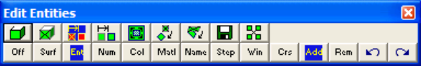

- If Tools > Shift-key Selection is checked, you must hold down the Shift-key to make multiple selections.

- By default, selected entities are added to the list, however if the Ctrl-key is held down, selected entities will be removed from the list.

- While holding down the Shift-key or Ctrl-key, you can drag open a crossing window.

- Use of this toolbar is detailed in Build A List of Entities for Editing

- Pressing the space-bar automatically activates the last edit function that was used.

- Holding the Alt-key when you right-click automatically repeats the last edit function that was used.

Once you have selected the desired entities, you can either pick any of the edit buttons:

CAD > Edit > Entity Properties Edit block type, colour, mining sequence, CAD > Edit > Erase Entities Erase selected entities, CAD > Edit > Move Entities Move selected entities, CAD > Edit > Copy Entities Copy selected entities,

CAD > Edit > Scale Entities Scale selected entities, CAD > Edit > Rotate Azimuth Rotate the azimuth of selected entities, CAD > Edit > Rotate Dip Rotate the dip of selected entities, CAD > Edit > Dump to File Dump selected entities to a file, CAD > Edit > Group Group selected entities into a single block,

- double click on any vertex to execute the highlighted function,

- right click for a list of options.

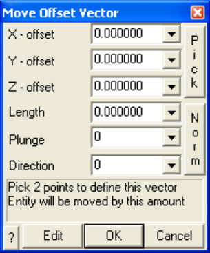

X, Y and Z – offset specify the components of the offset vector. All selected entities will be moved by this amount.

Pick - activates the cursor cross-hairs allowing interactive selection of the offset vector from the model. This requires that you select two points to define this vector.

Length, Plunge and Direction - specify the components of the offset vector. All selected entities will be moved by this amount.

Norm - activates the cursor allowing interactive selection of a surface to make the offset vector normal to.

To assist in visually selecting points from the model, all snap functions are available.

#### CAD > Snap

Once selected, the components of the offset vector are displayed in the dialogue box.

Edit - completes editing and invoked editing of the entity properties for the selected blocks.

OK - completes editing of the offset vector and moves the selected blocks.

Cancel - aborts moving of entities.

Once you have completed any edit operation you have one chance to undo the modifications by selecting

#### Undo

You can also restore the same selection set and modify the same set of entities again be selecting

#### Redo

You can adjust the double click time using

Tools > Double Click Time

## 5.5.4.4 Copy Entities

Copy selected entities.

This routine can be initiated either by picking the button or simple right-clicking on any entity. When you initiate this routine you will first be prompted to build a list of entities that you wish to edit

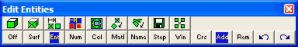

- If Tools > Shift-key Selection is checked, you must hold down the Shift-key to make multiple selections.

- By default, selected entities are added to the list, however if the Ctrl-key is held down, selected entities will be removed from the list.

- While holding down the Shift-key or Ctrl-key, you can drag open a crossing window.

- Use of this toolbar is detailed in Build A List of Entities for Editing

- Pressing the space-bar automatically activates the last edit function that was used.

- Holding the Alt-key when you right-click automatically repeats the last edit function that was used.

Once you have selected the desired entities, you can either pick any of the edit buttons:

CAD > Edit > Entity Properties Edit block type, colour, mining sequence, CAD > Edit > Erase Entities Erase selected entities, CAD > Edit > Move Entities Move selected entities, CAD > Edit > Copy Entities Copy selected entities, CAD > Edit > Scale Entities Scale selected entities, CAD > Edit > Rotate Azimuth Rotate the azimuth of selected entities, CAD > Edit > Rotate Dip Rotate the dip of selected entities, CAD > Edit > Dump to File Dump selected entities to a file, CAD > Edit > Group Group selected entities into a single block,

- double click on any vertex to execute the highlighted function,

- right click for a list of options.

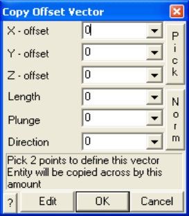

X, Y and Z – offset specify the components of the offset vector. All selected entities will be copied to the location specified by this offset.

Pick - activates the cursor cross-hairs allowing interactive selection of the offset vector from the model. This requires that you select two points to define this vector.

Length, Plunge and Direction - specify the components of the offset vector. All selected entities will be copied to the location specified by this offset.

Norm - activates the cursor allowing interactive selection of a surface to make the offset vector normal to.

To assist in visually selecting points from the model, all snap functions are available.

#### CAD > Snap

Once selected, the components of the offset vector are displayed in the dialogue box.

Edit - completes editing and invoked editing of the entity properties for the selected blocks.

OK - completes editing of the offset vector and moves the selected blocks.

Cancel - aborts moving of entities.

Once you have completed any edit operation you have one chance to undo the modifications by selecting

#### Undo

You can also restore the same selection set and modify the same set of entities again be selecting

#### Redo

You can adjust the double click time using

Tools > Double Click Time

## 5.5.4.5 Scale Entities

Scale the selected entities.

This routine can be initiated either by picking the button or simple right-clicking on any entity. When you initiate this routine you will first be prompted to build a list of entities that you wish to edit

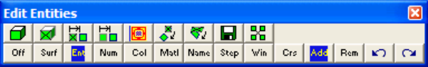

- If Tools > Shift-key Selection is checked, you must hold down the Shift-key to make multiple selections.

- By default, selected entities are added to the list, however if the Ctrl-key is held down, selected entities will be removed from the list.

- While holding down the Shift-key or Ctrl-key, you can drag open a crossing window.

- Use of this toolbar is detailed in Build A List of Entities for Editing

- Pressing the space-bar automatically activates the last edit function that was used.

- Holding the Alt-key when you right-click automatically repeats the last edit function that was used.

Once you have selected the desired entities, you can either pick any of the edit buttons:

CAD > Edit > Entity Properties Edit block type, colour, mining sequence, CAD > Edit > Erase Entities Erase selected entities, CAD > Edit > Move Entities Move selected entities, CAD > Edit > Copy Entities Copy selected entities, CAD > Edit > Scale Entities Scale selected entities,

CAD > Edit > Rotate Azimuth Rotate the azimuth of selected entities, CAD > Edit > Rotate Dip Rotate the dip of selected entities, CAD > Edit > Dump to File Dump selected entities to a file, CAD > Edit > Group Group selected entities into a single block,

- double click on any vertex to execute the highlighted function,

- right click for a list of options.

X, Y and Z – coordinates specify the coordinates of the centre for scaling. During scaling, this point will stay stationary. All other points will be moved to achieve the desired scaling.

Pick - activates the cursor cross-hairs allowing interactive selection of the centre or rotation from the model.

To assist in visually selecting points from the model, all snap functions are available.

CAD > Snap

Once selected, the components of the centre for scaling are displayed in the dialogue box.

Centroid - calculates the centre of all selected entities.

OK - completes editing of the coordinates and prompts you for the scale factors.

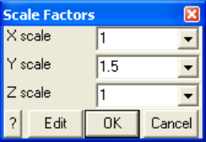

X, Y and Z - scale specifies the amount by which the entities are to be scaled. Below, the block is scaled 1.5 times in the y direction.

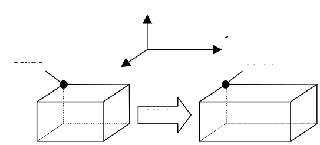

Edit - completes editing and invoked editing of the entity properties for the selected blocks.

OK - completes editing of the scale factors and scales the selected entities.

Cancel - aborts the scaling of entities.

Once you have completed any edit operation you have one chance to undo the modifications by selecting

#### Undo

You can also restore the same selection set and modify the same set of entities again be selecting

Redo

You can adjust the double click time using

Tools > Double Click Time

## 5.5.4.6 Rotate Azimuth

Rotate the azimuth of selected entities.

This routine can be initiated either by picking the button or simple right-clicking on any entity. When you initiate this routine you will first be prompted to build a list of entities that you wish to edit

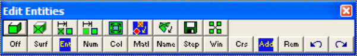

- If Tools > Shift-key Selection is checked, you must hold down the Shift-key to make multiple selections.

- By default, selected entities are added to the list, however if the Ctrl-key is held down, selected entities will be removed from the list.

- While holding down the Shift-key or Ctrl-key, you can drag open a crossing window.

- Use of this toolbar is detailed in Build A List of Entities for Editing

- Pressing the space-bar automatically activates the last edit function that was used.

- Holding the Alt-key when you right-click automatically repeats the last edit function that was used.

Once you have selected the desired entities, you can either pick any of the edit buttons:

CAD > Edit > Entity Properties Edit block type, colour, mining sequence, CAD > Edit > Erase Entities Erase selected entities, CAD > Edit > Move Entities Move selected entities, CAD > Edit > Copy Entities Copy selected entities, CAD > Edit > Scale Entities Scale selected entities, CAD > Edit > Rotate Azimuth Rotate the azimuth of selected entities, CAD > Edit > Rotate Dip Rotate the dip of selected entities, CAD > Edit > Dump to File Dump selected entities to a file, CAD > Edit > Group Group selected entities into a single block,

- double click on any vertex to execute the highlighted function,

- right click for a list of options.

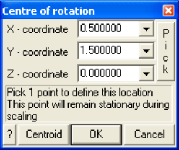

X, Y and Z – coordinates specify the coordinates of the centre of rotation.

Pick - activates the cursor cross-hairs allowing interactive selection of the centre or rotation from the model.

To assist in visually selecting points from the model, all snap functions are available.

#### CAD > Snap

Once selected, the components of the centre for scaling are displayed in the dialogue box.

Centroid - calculates the centre of all selected entities.

OK - completes editing of the coordinates and prompts you for the scale factors.

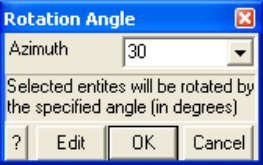

- Azimuth - specifies the angle (in degrees) through which you want the selected entities to be rotated. · The rotation takes place in the X-Y plane, thus all vertical lines remain vertical.

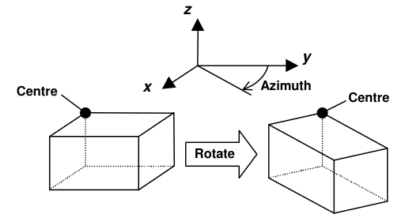

Edit - completes editing and invoked editing of the entity properties for the selected blocks.

OK - completes editing of the azimuth and rotates the selected entities.

Cancel - aborts the rotating of entities.

Once you have completed any edit operation you have one chance to undo the modifications by selecting

Undo

You can also restore the same selection set and modify the same set of entities again be selecting

Redo

You can adjust the double click time using

Tools > Double Click Time

## 5.5.4.7 Rotate Dip

Rotate the dip of selected entities.

This routine can be initiated either by picking the button or simple right-clicking on any entity. When you initiate this routine you will first be prompted to build a list of entities that you wish to edit

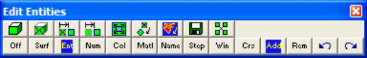

- If Tools > Shift-key Selection is checked, you must hold down the Shift-key to make multiple selections.

- By default, selected entities are added to the list, however if the Ctrl-key is held down, selected entities will be removed from the list.

- While holding down the Shift-key or Ctrl-key, you can drag open a crossing window.

- Use of this toolbar is detailed in Build A List of Entities for Editing

- Pressing the space-bar automatically activates the last edit function that was used.

- Holding the Alt-key when you right-click automatically repeats the last edit function that was used.

Once you have selected the desired entities, you can either pick any of the edit buttons:

CAD > Edit > Entity Properties Edit block type, colour, mining sequence, CAD > Edit > Erase Entities Erase selected entities, CAD > Edit > Move Entities Move selected entities, CAD > Edit > Copy Entities Copy selected entities, CAD > Edit > Scale Entities Scale selected entities, CAD > Edit > Rotate Azimuth Rotate the azimuth of selected entities, CAD > Edit > Rotate Dip Rotate the dip of selected entities,

CAD > Edit > Slice Entities Slice selected entities,

CAD > Edit > Dump to File Dump selected entities to a file, CAD > Edit > Group Group selected entities into a single block,

- double click on any vertex to execute the highlighted function,

- right click for a list of options.

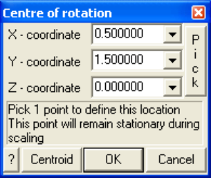

X, Y and Z – coordinates specify the coordinates of the centre of rotation.

Pick - activates the cursor cross-hairs allowing interactive selection of the centre or rotation from the model.

To assist in visually selecting points from the model, all snap functions are available.

#### CAD > Snap

Once selected, the components of the centre for scaling are displayed in the dialogue box.

Centroid - calculates the centre of all selected entities.

OK - completes editing of the coordinates and prompts you for the scale factors.

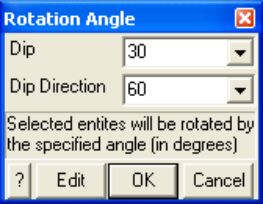

Dip - specifies the angle (in degrees) through which you want the selected entities to be rotated.

Dip Direction - specifies the azimuth (in degrees) at which the dip is to take place. The dip direction is 90° from the strike of the dip plane.

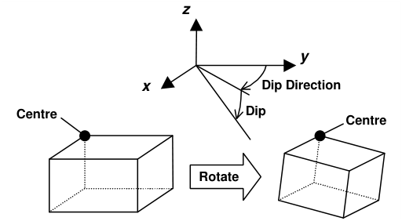

Edit - completes editing and invoked editing of the entity properties for the selected blocks.

OK - completes editing of the dip and dip direction and rotates the selected entities.

Cancel - aborts the rotating of entities.

Once you have completed any edit operation you have one chance to undo the modifications by selecting

#### Undo

You can also restore the same selection set and modify the same set of entities again be selecting

#### Redo

You can adjust the double click time using

#### Tools > Double Click Time

## 5.5.4.8 Slice Entities

Slice entities.

All entities can be sliced including FF blocks, DD planes, Grid planes, Grid lines and Construction lines.

Video Demo of Model_Simplification_Using_Slicing

This routine can be initiated either by picking the button or simple right-clicking on any entity. When you initiate this routine you will first be prompted to build a list of entities that you wish to edit

- If Tools > Shift-key Selection is checked, you must hold down the Shift-key to make multiple selections.

- By default, selected entities are added to the list, however if the Ctrl-key is held down, selected entities will be removed from the list.

- While holding down the Shift-key or Ctrl-key, you can drag open a crossing window.

- Use of this toolbar is detailed in Build A List of Entities for Editing

- Pressing the space-bar automatically activates the last edit function that was used.

- Holding the Alt-key when you right-click automatically repeats the last edit function that was used.

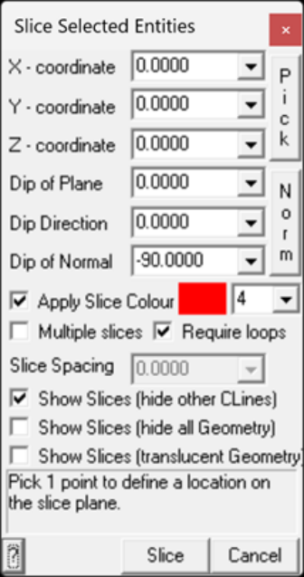

X, Y and Z – coordinate specify a point on the slicing/cutting plane.

Pick - activates the cursor cross-hairs allowing interactive selection of the point.

Dip of Plane, Dip Direction and Normal - specify the orientation of the slicing/cutting plane.

Norm - activates the cursor allowing interactive selection of a surface to make the slice plane parallel to. The dip and dip direction of the plane will be set normal to the selected surface.

Apply Slice Colour - when checked this specifies the colour number to be assigned to the CLines that are created during slicing, otherwise the colour of the object being sliced will be used.

Multiple Slices - specifies that multiple slices should be created at the specified slice spacing.

Require Loops - slices can either be single lines or optionally formed into closed loops.

Slice Spacing - specifies the optional multi-slice spacing.

Show Slices (hide other CLines) - will automatically hide all pre-existing CLines and display the newly created Cline slices.

Slice Spacing (hide all Geometry) - will automatically hide all pre-existing Geometry and display the newly created Cline slices.

Slice Spacing (translucent Geometry) - will automatically set all pre-existing Geometry to translucent, and display the newly created Cline slices.

- There are multiple "View > Hide" options available to control the display of the various entities including:

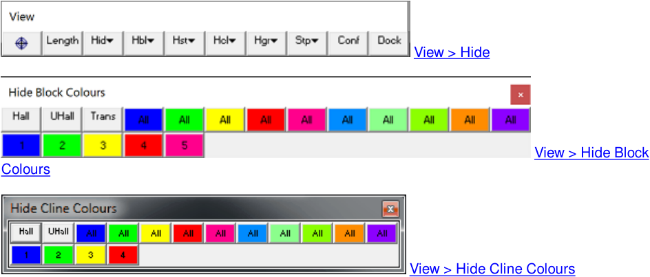

To assist in visually selecting points from the model, all snap functions are available.

#### CAD > Snap

Once selected, the components of the offset vector are displayed in the dialogue box.

Slice - executes the slicing/cutting operation for the selected blocks.

Cancel - aborts slicing of entities.

Once you have completed any edit operation you have one chance to undo the modifications by selecting

Undo

You can also restore the same selection set and modify the same set of entities again be selecting

Redo

You can adjust the double click time using

Tools > Double Click Time

## 5.5.4.9 Dump to File

Dumps selected entities to a file.

This routine can be initiated either by picking the button or simple right-clicking on any entity. When you initiate this routine you will first be prompted to build a list of entities that you wish to dump

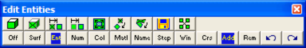

- If Tools > Shift-key Selection is checked, you must hold down the Shift-key to make multiple selections.

- By default, selected entities are added to the list, however if the Ctrl-key is held down, selected entities will be removed from the list.

- While holding down the Shift-key or Ctrl-key, you can drag open a crossing window.

- Use of this toolbar is detailed in Build A List of Entities for Editing

- Pressing the space-bar automatically activates the last edit function that was used.

- Holding the Alt-key when you right-click automatically repeats the last edit function that was used.

Once you have selected the desired entities, you can either pick any of the edit buttons:

CAD > Edit > Entity Properties Edit block type, colour, mining sequence, CAD > Edit > Erase Entities Erase selected entities, CAD > Edit > Move Entities Move selected entities, CAD > Edit > Copy Entities Copy selected entities, CAD > Edit > Scale Entities Scale selected entities, CAD > Edit > Rotate Azimuth Rotate the azimuth of selected entities, CAD > Edit > Rotate Dip Rotate the dip of selected entities, CAD > Edit > Dump to File Dump selected entities to a file,

CAD > Edit > Group Group selected entities into a single block,

- double click on any vertex to execute the highlighted function,

- right click for a list of options.

You can adjust the double click time using

Tools > Double Click Time

## 5.5.4.10 Group Entities

Group the selected entities into a single block. This is an advanced option that should only be used by experienced users.

At times you may need to erase or build individual surfaces, then group them together to form a single block. This function groups entities together to form seamless closed block from individual surfaces. Note that when using this operation the user must ensure that the grouped surfaces form a seamless, closed surface envelope with no internal surfaces. The presence of internal surfaces may cause errors.

The group function was implemented to allow advanced users to erase a few surface elements and rebuild them. It is also useful for joining surfaces together that are brought in from CAD packages. Note that the user is required to ensure that there are no internal surfaces and the surfaces you group together do form a seamless, closed surface envelope.

This routine can be initiated either by picking the button or simple right-clicking on any entity. When you initiate this routine you will first be prompted to build a list of entities that you wish to group

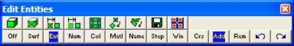

- If Tools > Shift-key Selection is checked, you must hold down the Shift-key to make multiple selections.

- By default, selected entities are added to the list, however if the Ctrl-key is held down, selected entities will be removed from the list.

- While holding down the Shift-key or Ctrl-key, you can drag open a crossing window.

- Use of this toolbar is detailed in Build A List of Entities for Editing

- Pressing the space-bar automatically activates the last edit function that was used.

- Holding the Alt-key when you right-click automatically repeats the last edit function that was used.

Once you have selected the desired entities, you can either pick any of the edit buttons:

CAD > Edit > Entity Properties Edit block type, colour, mining sequence, CAD > Edit > Erase Entities Erase selected entities, CAD > Edit > Move Entities Move selected entities, CAD > Edit > Copy Entities Copy selected entities, CAD > Edit > Scale Entities Scale selected entities, CAD > Edit > Rotate Azimuth Rotate the azimuth of selected entities, CAD > Edit > Rotate Dip Rotate the dip of selected entities,

CAD > Edit > Dump to File Dump selected entities to a file,

CAD > Edit > Group Group selected entities into a single block,

- double click on any vertex to execute the highlighted function,

- right click for a list of options.

If any of the fields in the dialogue box read "Variable" it is because some of the surfaces you have selected have different properties for that field. In order to group the selected entities into a single block, all surfaces must have the same settings for all fields. Use CAD > Edit > Entity Properties to do this.

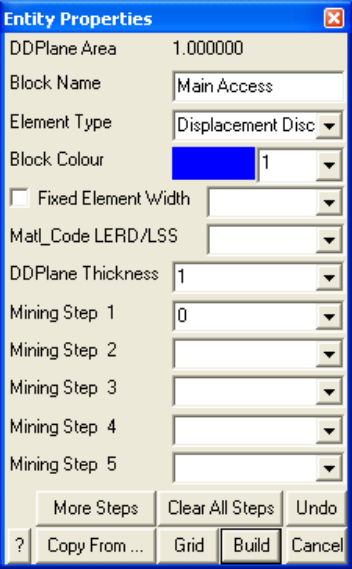

Once you have completed any edit operation you have one chance to undo the modifications by selecting

#### Undo

You can also restore the same selection set and modify the same set of entities again be selecting

#### Redo

You can adjust the double click time using

#### Tools > Double Click Time

## 5.5.4.11 Stretch Verticies

Adds an offset to selected vertices.

This routine can be initiated either by picking the button or simple right-clicking on any vertex. When you initiate this routine you will first be prompted to build a list of vertices that you wish to stretch

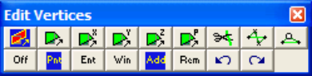

- If Tools > Shift-key Selection is checked, you must hold down the Shift-key to make multiple selections.

- By default, selected entities are added to the list, however if the Ctrl-key is held down, selected entities will be removed from the list.

- While holding down the Shift-key or Ctrl-key, you can drag open a crossing window.

- Use of this toolbar is detailed in Build A List of Vertices for Editing

- Pressing the space-bar automatically activates the last edit function that was used.

- Holding the Alt-key when you right-click automatically repeats the last edit function that was used.

Once you have selected the desired entities, you can either pick any of the edit buttons:

CAD > Edit > Stretch Vertices CAD > Edit > Move Vertices to Point CAD > Edit > Move Vertices to X CAD > Edit > Move Vertices to Y CAD > Edit > Move Vertices to Z CAD > Edit > Move Vertices to Plane CAD > Edit > Subdivide Construction Lines CAD > Edit > Smooth Construction Lines CAD > Edit > Remove Construction Vertex

- double click on any vertex to execute the highlighted function,

- right click for a list of options.

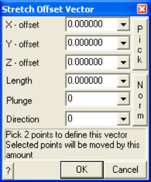

X, Y and Z – offset specify the components of the stretch vector.

- All selected vertices will be moved to the location specified by this offset.

- This requires that you select two points to define this vector.

- Once selected, the components of the offset vector are displayed in the dialogue box.

Pick activates the cursor cross-hairs allowing interactive selection of the offset vector from the model. This requires that you select two points to define this vector.

Length, Plunge and Direction - specify the components of the offset vector. All selected vertices will be moved by this amount.

Norm - activates the cursor allowing interactive selection of a surface to make the offset vector normal to.

To assist in visually selecting points from the model, all snap functions are available.

#### CAD > Snap

Once selected, the components of the offset vector are displayed in the dialogue box.

OK - completes editing of the offset vector and stretches the selected vertices.

Cancel - aborts stretching of vertices.

Once you have completed any edit operation you have one chance to undo the modifications by selecting

#### Undo

You can also restore the same selection set and modify the same set of entities again be selecting

#### Redo

You can adjust the double click time using

#### Tools > Double Click Time

## 5.5.4.12 Move Verticies to point

Moves selected vertices to a point.

This routine can be initiated either by picking the button or simple right-clicking on any vertex. When you initiate this routine you will first be prompted to build a list of vertices that you wish to move.

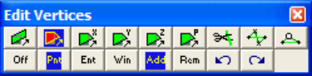

- If Tools > Shift-key Selection is checked, you must hold down the Shift-key to make multiple selections.

- By default, selected entities are added to the list, however if the Ctrl-key is held down, selected entities will be removed from the list.

- While holding down the Shift-key or Ctrl-key, you can drag open a crossing window.

- Use of this toolbar is detailed in Build A List of Vertices for Editing

- Pressing the space-bar automatically activates the last edit function that was used.

- Holding the Alt-key when you right-click automatically repeats the last edit function that was used.

Once you have selected the desired entities, you can either pick any of the edit buttons:

CAD > Edit > Stretch Vertices CAD > Edit > Move Vertices to Point CAD > Edit > Move Vertices to X CAD > Edit > Move Vertices to Y CAD > Edit > Move Vertices to Z CAD > Edit > Move Vertices to Plane CAD > Edit > Subdivide Construction Lines CAD > Edit > Smooth Construction Lines CAD > Edit > Remove Construction Vertex

- double click on any vertex to execute the highlighted function,

- right click for a list of options.

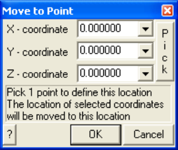

X, Y and Z – coordinate specify the coordinates of the point. All selected vertices will be moved to this point.

Pick - activates the cursor cross-hairs allowing interactive selection of the point from the model.

To assist in visually selecting points from the model, all snap functions are available.

#### CAD > Snap

Once selected, the components of the offset vector are displayed in the dialogue box.

OK - completes editing of the offset vector and stretches the selected vertices.

Cancel - aborts stretching of vertices.

Once you have completed any edit operation you have one chance to undo the modifications by selecting

#### Undo

You can also restore the same selection set and modify the same set of entities again be selecting

Redo

You can adjust the double click time using

#### Tools > Double Click Time

## 5.5.4.13 Move Verticies to X

Moves the X-coordinate of selected vertices.

This routine can be initiated either by picking the button or simple right-clicking on any vertex. When you initiate this routine you will first be prompted to build a list of vertices that you wish to move.

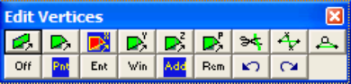

- If Tools > Shift-key Selection is checked, you must hold down the Shift-key to make multiple selections.

- By default, selected entities are added to the list, however if the Ctrl-key is held down, selected entities will be removed from the list.

- While holding down the Shift-key or Ctrl-key, you can drag open a crossing window.

- Use of this toolbar is detailed in Build A List of Vertices for Editing

- Pressing the space-bar automatically activates the last edit function that was used.

- Holding the Alt-key when you right-click automatically repeats the last edit function that was used.

Once you have selected the desired entities, you can either pick any of the edit buttons:

CAD > Edit > Stretch Vertices CAD > Edit > Move Vertices to Point CAD > Edit > Move Vertices to X CAD > Edit > Move Vertices to Y CAD > Edit > Move Vertices to Z

CAD > Edit > Move Vertices to Plane

CAD > Edit > Subdivide Construction Lines CAD > Edit > Smooth Construction Lines

CAD > Edit > Remove Construction Vertex

- double click on any vertex to execute the highlighted function,

- right click for a list of options.

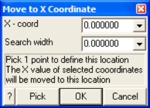

X – coordinate specify the X-coordinate of the point. The X-coordinate of all selected vertices (i.e. vertices in the list) will be moved to this value.

Search width all coordinates with the search width distance of the specified x-coordinate value will be moved even if they are not in the list.

Pick activates the cursor cross-hairs allowing interactive selection of the point from the model. To assist in visually selecting points from the model, all snap functions are available

To assist in visually selecting points from the model, all snap functions are available.

#### CAD > Snap

Once selected, the components of the offset vector are displayed in the dialogue box.

OK - completes editing of the offset vector and stretches the selected vertices.

Cancel - aborts stretching of vertices.

Once you have completed any edit operation you have one chance to undo the modifications by selecting

#### Undo

You can also restore the same selection set and modify the same set of entities again be selecting

#### Redo

You can adjust the double click time using

#### Tools > Double Click Time

## 5.5.4.14 Move Verticies to Y

Moves the Y-coordinate of selected vertices.

This routine can be initiated either by picking the button or simple right-clicking on any vertex. When you initiate this routine you will first be prompted to build a list of vertices that you wish to move.

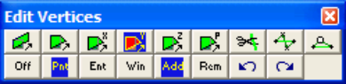

- If Tools > Shift-key Selection is checked, you must hold down the Shift-key to make multiple selections.

- By default, selected entities are added to the list, however if the Ctrl-key is held down, selected entities will be removed from the list.

- While holding down the Shift-key or Ctrl-key, you can drag open a crossing window.

- Use of this toolbar is detailed in Build A List of Vertices for Editing

- Pressing the space-bar automatically activates the last edit function that was used.

- Holding the Alt-key when you right-click automatically repeats the last edit function that was used.

Once you have selected the desired entities, you can either pick any of the edit buttons:

CAD > Edit > Stretch Vertices CAD > Edit > Move Vertices to Point CAD > Edit > Move Vertices to X CAD > Edit > Move Vertices to Y CAD > Edit > Move Vertices to Z CAD > Edit > Move Vertices to Plane CAD > Edit > Subdivide Construction Lines CAD > Edit > Smooth Construction Lines CAD > Edit > Remove Construction Vertex

- double click on any vertex to execute the highlighted function,

- right click for a list of options.

Y – coordinate specify the Y-coordinate of the point. The Y-coordinate of all selected vertices (i.e. vertices in the list) will be moved to this value.

Search width all coordinates with the search width distance of the specified y-coordinate value will be moved even if they are not in the list.

Pick activates the cursor cross-hairs allowing interactive selection of the point from the model. To assist in visually selecting points from the model, all snap functions are available

To assist in visually selecting points from the model, all snap functions are available.

#### CAD > Snap

Once selected, the components of the offset vector are displayed in the dialogue box.

OK - completes editing of the offset vector and stretches the selected vertices.

Cancel - aborts stretching of vertices.

Once you have completed any edit operation you have one chance to undo the modifications by selecting

#### Undo

You can also restore the same selection set and modify the same set of entities again be selecting

Redo

You can adjust the double click time using

Tools > Double Click Time

## 5.5.4.15 Move Verticies to Z

Moves the Z-coordinate of selected vertices.

This routine can be initiated either by picking the button or simple right-clicking on any vertex. When you initiate this routine you will first be prompted to build a list of vertices that you wish to move.

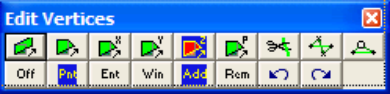

- If Tools > Shift-key Selection is checked, you must hold down the Shift-key to make multiple selections.

- By default, selected entities are added to the list, however if the Ctrl-key is held down, selected entities will be removed from the list.

- While holding down the Shift-key or Ctrl-key, you can drag open a crossing window.

- Use of this toolbar is detailed in Build A List of Vertices for Editing

- Pressing the space-bar automatically activates the last edit function that was used.

- Holding the Alt-key when you right-click automatically repeats the last edit function that was used.

Once you have selected the desired entities, you can either pick any of the edit buttons:

CAD > Edit > Stretch Vertices CAD > Edit > Move Vertices to Point CAD > Edit > Move Vertices to X CAD > Edit > Move Vertices to Y

CAD > Edit > Move Vertices to Z

CAD > Edit > Move Vertices to Plane

CAD > Edit > Subdivide Construction Lines

CAD > Edit > Smooth Construction Lines

CAD > Edit > Remove Construction Vertex

- double click on any vertex to execute the highlighted function,

- right click for a list of options.

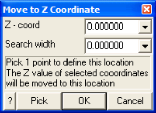

Z – coordinate specify the Z-coordinate of the point. The Z-coordinate of all selected vertices (i.e. vertices in the list) will be moved to this value.

Search width all coordinates with the search width distance of the specified z-coordinate value will be moved even if they are not in the list.

Pick activates the cursor cross-hairs allowing interactive selection of the point from the model. To assist in visually selecting points from the model, all snap functions are available

To assist in visually selecting points from the model, all snap functions are available.

#### CAD > Snap

Once selected, the components of the offset vector are displayed in the dialogue box.

OK - completes editing of the offset vector and stretches the selected vertices.

Cancel - aborts stretching of vertices.

Once you have completed any edit operation you have one chance to undo the modifications by selecting

#### Undo

You can also restore the same selection set and modify the same set of entities again be selecting

#### Redo

You can adjust the double click time using

#### Tools > Double Click Time

## 5.5.4.16 Move Verticies to Plane

Moves the selected vertices to a plane. Vertices are moved in the direction normal (or a user specified direction) to the plane.

This routine can be initiated either by picking the button or simple right-clicking on any vertex. When you initiate this routine you will first be prompted to build a list of vertices that you wish to move.

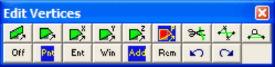

- If Tools > Shift-key Selection is checked, you must hold down the Shift-key to make multiple selections.

- By default, selected entities are added to the list, however if the Ctrl-key is held down, selected entities will be removed from the list.

- While holding down the Shift-key or Ctrl-key, you can drag open a crossing window.

- Use of this toolbar is detailed in Build A List of Vertices for Editing

- Pressing the space-bar automatically activates the last edit function that was used.

- Holding the Alt-key when you right-click automatically repeats the last edit function that was used.

Once you have selected the desired entities, you can either pick any of the edit buttons:

CAD > Edit > Stretch Vertices CAD > Edit > Move Vertices to Point CAD > Edit > Move Vertices to X CAD > Edit > Move Vertices to Y CAD > Edit > Move Vertices to Z CAD > Edit > Move Vertices to Plane CAD > Edit > Subdivide Construction Lines CAD > Edit > Smooth Construction Lines CAD > Edit > Remove Construction Vertex

- double click on any vertex to execute the highlighted function,

- right click for a list of options.

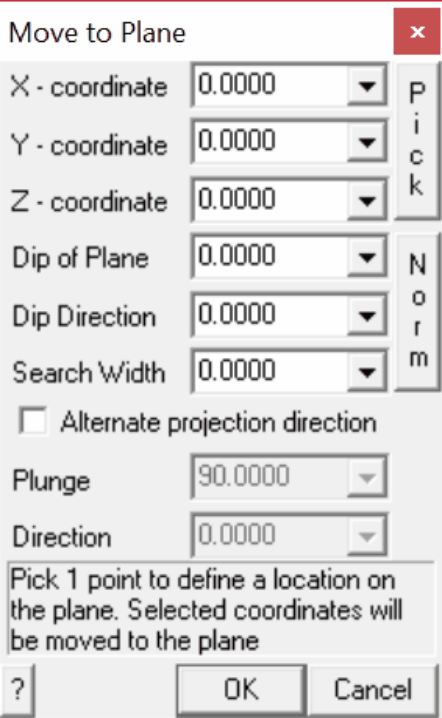

X Y Z – coordinate specify the coordinates of any point on the plane.

Pick activates the cursor cross-hairs allowing interactive selection of the x y z coordinates of the point on the plane from the model. To assist in visually selecting points from the model, all snap functions are available

Dip of Plane specify the dip of the plane (positive down in degrees).

Dip Direction specify the azimuth of the dip vector (degrees).

Norm - activates the cursor allowing interactive selection of a surface to make the plane parallel to. The dip and dip direction of the plane will be set normal to the selected surface.

Search width all coordinates with the search width distance of the specified plane will be moved even if they are not in the list.

Alternate projection direction - if not checked then all points will be projected on the selected plane in the direction normal to the plane. If checked, then the user can specify their own desired projection direction.

Plunge - user specified projection direction.

Direction - user specified projection direction.

To assist in visually selecting points from the model, all snap functions are available.

#### CAD > Snap

Once selected, the components of the offset vector are displayed in the dialogue box.

OK - completes editing of the offset vector and stretches the selected vertices.

Cancel - aborts stretching of vertices.

Once you have completed any edit operation you have one chance to undo the modifications by selecting

#### Undo

You can also restore the same selection set and modify the same set of entities again be selecting

Redo

You can adjust the double click time using

Tools > Double Click Time

## 5.5.4.17 Subdivide Edges

#### CAD > Edit > Remove

Inserts vertices on block edges or construction line edges (also see Construction Vertex).

This routine can be initiated either by picking the button or simple right-clicking on any edge. When you initiate this routine you will first be prompted to build a list of locations where you wish to insert vertices.

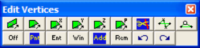

- If Tools > Shift-key Selection is checked, you must hold down the Shift-key to make multiple selections.

- By default, selected entities are added to the list, however if the Ctrl-key is held down, selected entities will be removed from the list.

- While holding down the Shift-key or Ctrl-key, you can drag open a crossing window.

- Use of this toolbar is detailed in Build A List of Vertices for Editing

- Pressing the space-bar automatically activates the last edit function that was used.

- Holding the Alt-key when you right-click automatically repeats the last edit function that was used.

Once you have selected the desired entities, you can either pick any of the edit buttons:

CAD > Edit > Stretch Vertices CAD > Edit > Move Vertices to Point CAD > Edit > Move Vertices to X CAD > Edit > Move Vertices to Y

#### CAD > Edit > Move Vertices to Z

CAD > Edit > Move Vertices to Plane

CAD > Edit > Subdivide Construction Lines

CAD > Edit > Smooth Construction Lines

CAD > Edit > Remove Construction Vertex

- double click on any vertex to execute the highlighted function,

- right click for a list of options.

Once you have completed any edit operation you have one chance to undo the modifications by selecting

#### Undo

You can also restore the same selection set and modify the same set of entities again be selecting

#### Redo

You can adjust the double click time using

#### Tools > Double Click Time

Notes:

- The location of all points along construction lines can be viewed by setting the View > Render > Cline dot radius parameter.

- Before using this trace smoothing function, construction lines should be cleaned up using the CAD > Pack and Renumber Clines function.

- You can adjust the double click time using Tools > Double Click Time.

## 5.5.4.18 Smooth Construction Lines

Smooths construction lines by eliminating corner points (also see Construction Vertex).

#### CAD > Edit > Remove

This routine can be initiated either by picking the button or simple right-clicking on any vertex. When you initiate this routine you will first be prompted to build a list of vertices that you wish to smooth.

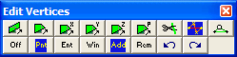

- If Tools > Shift-key Selection is checked, you must hold down the Shift-key to make multiple selections.

- By default, selected entities are added to the list, however if the Ctrl-key is held down, selected entities will be removed from the list.

- While holding down the Shift-key or Ctrl-key, you can drag open a crossing window.

- Use of this toolbar is detailed in Build A List of Vertices for Editing

- Pressing the space-bar automatically activates the last edit function that was used.

- Holding the Alt-key when you right-click automatically repeats the last edit function that was used.

Once you have selected the desired entities, you can either pick any of the edit buttons:

CAD > Edit > Stretch Vertices

CAD > Edit > Move Vertices to Point CAD > Edit > Move Vertices to X CAD > Edit > Move Vertices to Y CAD > Edit > Move Vertices to Z CAD > Edit > Move Vertices to Plane CAD > Edit > Subdivide Construction Lines CAD > Edit > Smooth Construction Lines CAD > Edit > Remove Construction Vertex

- double click on any vertex to execute the highlighted function,

- right click for a list of options.

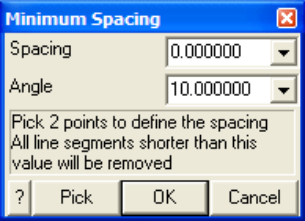

The Spacing value limits the minimum space between points. For example if the Spacing was specified as 2m and the trace length between points 4 and 5 in the following figure was 1.5m, point 4 would be removed and replaced by a straight line between points 3 and 5.

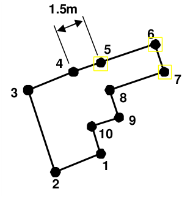

A zero value for this parameter indicates that it will not be used.

The Angle value limits the minimum angle between successive line segments. For example if the Angle was specified as 10° and the direction of line segment 3-4 was 7° different than the direction of line

segment 4-5 in the following figure, point 4 would be removed and replaced by a straight line between points 3 and 5.

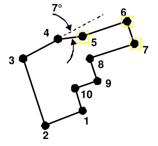

A zero value for this parameter indicates that it will not be used.

OK - completes editing of the offset vector and stretches the selected vertices.

Cancel - aborts stretching of vertices.

Once you have completed any edit operation you have one chance to undo the modifications by selecting

#### Undo

You can also restore the same selection set and modify the same set of entities again be selecting

#### Redo

You can adjust the double click time using

#### Tools > Double Click Time

Notes:

- The location of all points along construction lines can be viewed by setting the View > Render > Cline dot radius parameter.

- Before using this trace smoothing function, construction lines should be cleaned up using the CAD > Pack and Renumber Clines function.

- You can adjust the double click time using Tools > Double Click Time.

## 5.5.4.19 Remove Construction Line Vertex

Smooths construction lines by eliminating individual corner points (also see Construction Lines).

#### CAD > Edit > Smooth

This routine can be initiated either by picking the button or simple right-clicking on any vertex. When you initiate this routine you will first be prompted to build a list of vertices that you wish to remove.

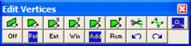

- If Tools > Shift-key Selection is checked, you must hold down the Shift-key to make multiple selections.

- By default, selected entities are added to the list, however if the Ctrl-key is held down, selected entities will be removed from the list.

- While holding down the Shift-key or Ctrl-key, you can drag open a crossing window.

- Use of this toolbar is detailed in Build A List of Vertices for Editing

- Pressing the space-bar automatically activates the last edit function that was used.

- Holding the Alt-key when you right-click automatically repeats the last edit function that was used.

Once you have selected the desired entities, you can either pick any of the edit buttons:

CAD > Edit > Stretch Vertices CAD > Edit > Move Vertices to Point CAD > Edit > Move Vertices to X CAD > Edit > Move Vertices to Y CAD > Edit > Move Vertices to Z CAD > Edit > Move Vertices to Plane CAD > Edit > Subdivide Construction Lines CAD > Edit > Smooth Construction Lines CAD > Edit > Remove Construction Vertex

- double click on any vertex to execute the highlighted function,

- right click for a list of options.

Once you have completed any edit operation you have one chance to undo the modifications by selecting

#### Undo

You can also restore the same selection set and modify the same set of entities again be selecting

#### Redo

You can adjust the double click time using

#### Tools > Double Click Time

Notes:

- The location of all points along construction lines can be viewed by setting the View > Render > Cline dot radius parameter.

- Before using this trace smoothing function, construction lines should be cleaned up using the CAD > Pack and Renumber Clines function.

- You can adjust the double click time using Tools > Double Click Time.
