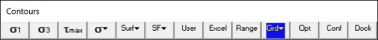
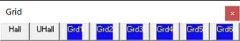
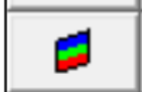
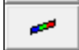

Selects a field point grid for viewing.

This routine can be initiated by picking the button on the Contour toolbar

This toolbar can be changed to a vertical orientation by dragging is against either the right or left hand edge of the main window.

It can be changed back to a horizontal orientation by dragging is against either the top or bottom edge of the main window.

Analysis results (stresses, strains and displacements) can be contoured on element surfaces and on field point grids.

With OpenGL enabled (Tools > OpenGL), all grids can be displayed simultaneously. Without OpenGL enabled, only two grids can be displayed simultaneously.

Hide All - Hides all grids.

Unhide All - Unhide all grids.

The user can construct multiple field point grid planes using

CAD > Build > Grid Plane

CAD > Build > Grid Line

Individual grid selection buttons can be placed on the view toolbar if desired using

Tools > View Toolbar Configure
