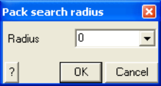

Packs and renumbers all model entities.

Coordinate points that are very close to one another are merged together. Corners of blocks that share the same location will use the same coordinate point number and hence will move together in any coordinate editing operation (Cad > Edit). This feature is useful for eliminating small gaps and overlaps between adjacent surfaces and blocks.

When you initiate this function you will be prompted to specify a pack search radius

Radius this value is used to merge points that are close to one another. A zero value for this parameter indicates that it will not be used, and instead Map3D will merge points if they are within a search radius of 1000th of the edge length from the line. Extreme caution should be used when specifying a non-zero value for this parameter since large values can cause more problems then it will fix by merging too many points together.

Any unused coordinate numbers are removed from the list of coordinates.

Blocks can be unpacked using the CAD > Unpack Blocks function.
