## 5.5.2.1 None

Disable snapping. No pick-box is displayed at the intersection of the cursor cross-hairs.

Points will be selected at the location indicated by the cross-hairs. This mode is useful for freehand sketching or digitizing. When digitizing, all three coordinate values are scaled off of the drawing. However when freehand sketching, only two of the coordinates can be located and the third must be supplied from the snap base

CAD > Snap > Cursor/Grid Base

This is the recommended setting while digitizing.

## 5.5.2.2 Nearest Edge

Snap to the nearest edge.

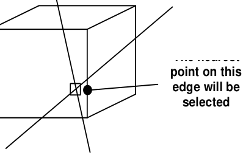

If the pick-box is located over the corner of an entity, that corner will be selected.

Otherwise the nearest point on the nearest edge will be selected.

The pick-box must be located over an entity or construction line.

## 5.5.2.3 Nearest Corner

Snap to the nearest corner.

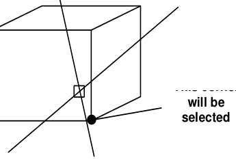

The corner nearest the pick-box will be selected.

The pick-box must be located over an entity or construction line.

## 5.5.2.4 Nearest Surface

Snap onto the surface.

If the pick-box is located over the corner of an entity, that corner will be selected.

If the pick-box is located over an edge, the nearest point on that edge will be selected.

Otherwise the nearest point on the surface will be selected.

The pick-box must be located over an entity or construction line.

## 5.5.2.5 Midpoint of Line

Snap to the midpoint of the selected edge.

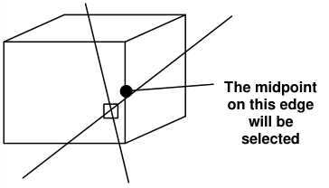

If the pick-box is located over the corner of an entity, that corner will be selected.

Otherwise the midpoint on the nearest edge will be selected.

The pick-box must be located over an entity or construction line.

## 5.5.2.6 Tangent Snap

Force cursor tangent to the selected edge.

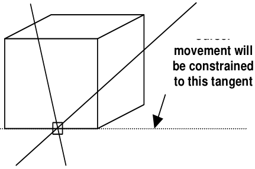

The edge nearest the pickbox will be selected. The pick-box must be located over an entity or construction line.

Once selected, all cursor movement will be constrained to the tangent defined by the selected edge. Points can now be selected anywhere along this tangent.

Once a point is selected, tangent snap is automatically cancelled. Tangent snap can be cancelled at any time by pressing the escape key (Esc) or right click the mouse.

To select points at even spacing along the tangent line, tangent snap can be used in conjunction with any of:

CAD > Snap > Grid Snap Snap to a rectangular grid.

CAD > Snap > X-Gird Snap Snap to the selected edge at an even X grid spacing.

CAD > Snap > Y-Grid Snap Snap to the selected edge at an even Y grid spacing.

CAD > Snap > Z-Grid Snap Snap to the selected edge at an even Z grid spacing.

## 5.5.2.7 Intersection Snap

Snap to the intersection of the selected edge and a tangent.

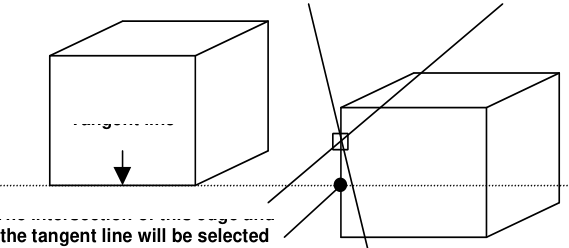

Since this function operates in full 3D, the tangent may pass above or below the selected edge and not actually intersect. In this case the closest point to the tangent line on the selected edge will be picked.

This convention must be emphasized. The intersection point will not be selected on the tangent line: it will be selected on the intersection line.

Using this feature is a two step process. When you click on the Intersect Snap button you will be prompted as follows:

1. First select a tangent line.

2. Then select the edge you want to intersect the tangent with. The point will be selected on this line.

The edge nearest the pickbox will be selected.

The pick-box must be located over an entity or construction line.

This function can be used to locate points at the intersection of the tangent and the projection of the selected edge.

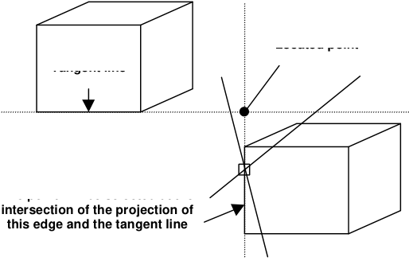

Once a point is selected, intersection snap is automatically cancelled. Intersection snap can be cancelled at any time by pressing the escape key (Esc) or right click the mouse.

For an example on the use of intersection snap in model building refer to

Tabular Mining

## 5.5.2.8 Trace Cline Snap

Snap to selected corners along a construction line segment. This snap mode can be used as a quick method for building DDLoops ( CAD > Build > DDLoop), FFLoops ( CAD > Build >

FFLoop),Tunnels ( CAD > Build > Tunnel and CAD > Build > GPlanes).

To use this snap mode you simply pick the start and end points along the desired construction line segment and all point between these will be automatically selected. For example if you select points 4 and 9, points 5, 6, 7 and 8 will automatically be selected. Note that if you select the same point twice, the entire loop will be selected.

**6**

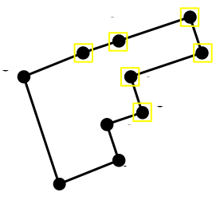

Notes:

The location of all points along construction lines can be viewed by setting the View > Render > Cline dot radius parameter.

Before using this trace snap mode, construction lines should be cleaned up using the CAD > Pack and Renumber Clines function.

The CAD > Edit > Smooth Construction Lines function can also be used to aid in cleaning up construction lines.

## 5.5.2.9 Trace Cloop Snap

Snap to all corners along a construction line segment. This snap mode can be used as a quick method for building DDLoops ( CAD > Build > DDLoop), FFLoops ( CAD > Build > FFLoop), Tunnels ( CAD > Build > Tunnel and CAD > Build > GPlanes).

To use this snap mode you simply pick a single points on the desired construction line segment and all points on this line will be automatically selected. For example if you select point 4, points 5, 6, 7, 8, 1, 2 and 3 will automatically be selected.

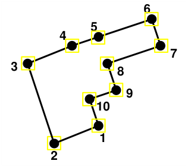

Notes:

The location of all points along construction lines can be viewed by setting the View > Render > Cline dot radius parameter.

Before using this trace snap mode, construction lines should be cleaned up using the CAD > Pack and Renumber Clines function.

The CAD > Edit > Smooth Construction Lines function can also be used to aid in cleaning up construction lines.

## 5.5.2.10 Points Window

Select corners using a window.

This snap mode can be used as a quick method for building DDLoops ( CAD > Build > DDLoop), FFLoops ( CAD > Build > FFLoop), Tunnels ( CAD > Build > Tunnel), CLines ( CAD >

Build > CLines) and GLines ( CAD > Build > GLines).

Although this snap mode is most often used to select multiple points along CLines, corners are permitted to be located on all element types including: FF elements, DD elements, GPlanes, GLines and CLines.

- Video Demo of FFLoop Model Building

- Video Demo of DDLoop model buiding

- Video Demo of Model_Simplification_Using_Slicing

In the figure above, if you pick one or more points prior to selecting a window, the windowed points will be added to those existing points, starting with the nearest previously selected point. For example if you were to pick point 3 prior to selecting a window, then use a window including points 4, 5, and 6 would add those points in that order.

Alternatively if you were to pick point 3 prior to selecting a window, then use a window including points 1, 2, and 10 would add those points in the order 2, 1 then 10.

In the figure above, if you do not pick one or more points prior to selecting a window, the windowed points will selected starting at locations as far as possible apart.

For example if you were select a window over all of the points, since points 2 and 6 are furthest apart, then points would be selected as 2, 3, 4, 5, 6, 7, 8, 9, 10, 1, 2.

As this example forms a closed loop, the points are selected as such.

CAD > Build > DDLoop).

This forms a loop suitable for DDLoop construction (

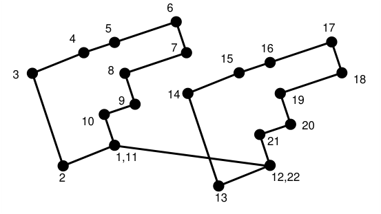

In the figure above, if you pick point 1 prior to selecting a window, then use a window including all points, then all of the points will be selected as shown: 1, 2, 3, 4, 5, 6, 7, 8, 9, 10, 11, 1, 12, 13, 14, 15, 16, 17, 18, 19, 20, 21, 22, 12.

This forms two loops suitable for FFLoop construction ( CAD > Build > FFLoop). Alternatively if you were to pick point 3 prior to selecting a window, then use a window including points 1, 2, and 10 would add those points in the order 2, 1 then 10.

Notes:

The location of all points along construction lines can be viewed by setting the View > Render > Cline dot radius parameter.

Before using this trace snap mode, construction lines should be cleaned up using the CAD > Pack and Renumber Clines function.

The CAD > Edit > Smooth Construction Lines function can also be used to aid in cleaning up construction lines.

## 5.5.2.11 Rectangular Grid Snap

Snap to a rectangular grid. No pick-box is displayed at the intersection of the cursor cross-hairs.

All cursor movement will be constrained to the grid points.

The grid can be oriented in either the X-Y, Y-Z or X-Z planes at any desired spacing and location. To set up these parameters use

CAD > Snap > Cursor/Grid Setup setup the cursor/grid spacing and orientation.

For an example on the use of grid snap mode in model building refer to

Freehand Sketching - Room and Pillar.

## 5.5.2.12 Circular Grid Snap

Snap to a cylindrical grid. No pick-box is displayed at the intersection of the cursor cross-hairs.

All cursor movement will be constrained to the grid points.

The grid can be oriented in either the X-Y, Y-Z or X-Z planes at any desired spacing and location. To set up these parameters use

CAD > Snap > Cursor/Grid Setup setup the cursor/grid spacing and orientation.

## 5.5.2.13 X-Grid Snap

Snap to an x-grid spacing.

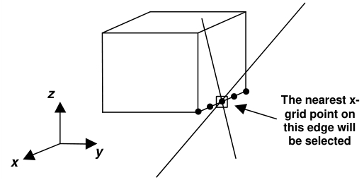

If the pick-box is located over the corner of an entity, that corner will be selected.

Otherwise the nearest point at the x-grid spacing on the nearest edge will be selected.

The pick-box must be located over an entity or construction line.

Since the x coordinate values are constrained to the prescribed X-grid spacing, the y and z coordinate values are calculated from the equation of the selected line.

The grid spacing and location are defined either by picking the X-Grid Snap button a second time or use

CAD > Snap > Cursor/Grid Setup setup the cursor/grid spacing and orientation.

X-grid snap can be used in conjunction with any of:

CAD > Snap > None Disable snapping.

CAD > Snap > Edge Snap to the nearest edge.

CAD > Snap > Tangent Snap Force cursor tangent to the selected edge.

## 5.5.2.14 Y-Grid Snap

Snap to a y-grid spacing.

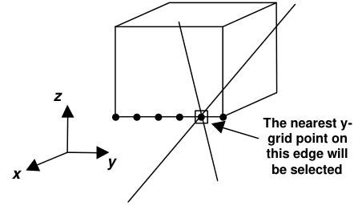

If the pick-box is located over the corner of an entity, that corner will be selected.

Otherwise the nearest point at the y-grid spacing on the nearest edge will be selected.

The pick-box must be located over an entity or construction line.

Since the y coordinate values are constrained to the prescribed y-grid spacing, the x and z coordinate values are calculated from the equation of the selected line.

The grid spacing and location are defined either by picking the Y-Grid Snap button a second time or use

CAD > Snap > Cursor/Grid Setup setup the cursor/grid spacing and orientation.

Y-grid snap can be used in conjunction with any of:

CAD > Snap > None Disable snapping.

CAD > Snap > Edge Snap to the nearest edge.

CAD > Snap > Tangent Snap Force cursor tangent to the selected edge.

## 5.5.2.15 Z-Grid Snap

Snap to a z-grid spacing.

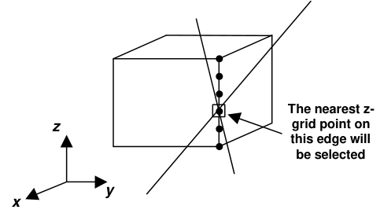

If the pick-box is located over the corner of an entity, that corner will be selected.

Otherwise the nearest point at the y-grid spacing on the nearest edge will be selected.

The pick-box must be located over an entity or construction line.

Since the z coordinate values are constrained to the prescribed Z-grid spacing, the x and y coordinate values are calculated from the equation of the selected line.

The grid spacing and location are defined either by picking the Z-Grid Snap button a second time or use

CAD > Snap > Cursor/Grid Setup setup the cursor/grid spacing and orientation.

Z-grid snap can be used in conjunction with any of:

CAD > Snap > None Disable snapping.

CAD > Snap > Edge Snap to the nearest edge.

CAD > Snap > Tangent Snap Force cursor tangent to the selected edge.

## 5.5.2.16 Cursor/Grid Setup

Setup the cursor/grid location, spacing and orientation.

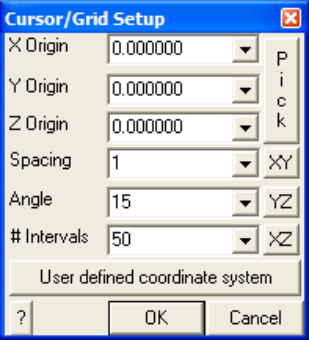

X, Y and Z Origin - specifies the coordinates of the centre of the grid.

Pick - activates the cursor cross-hairs allowing interactive selection of the cursor/grid base from the

model.

Spacing - specifies the distance between grid points.

Angle - specifies the angle (in degrees) between the radii of the cylindrical grid.

#### Intervals - specifies the number of grid points that will be displayed.

CAD > Snap > XY Cursor - constrains the cursor cross-hairs and snap grid to the X-Y plane.

CAD > Snap > YZ Cursor - constrains the cursor cross-hairs and snap grid to the Y-Z plane.

CAD > Snap > XZ Cursor - constrains the cursor cross-hairs and snap grid to the X-Z plane.

CAD > Snap > User defined Cursor - constrains the cursor cross-hairs and snap grid to the user defined plane.

The user defined coordinate system is only active with rectangular and circular grid snapping ( CAD > Snap > Grid Snap and CAD > Snap > Cylinder Snap).

The user defined plane is specified by its dip (j), dip direction (J) and rake (a) such that:

- Pnt on X - The local x-axis ( _x'_ ) is defined along the strike of the plane. A point on this axis can be selected using this function.

- Pnt on Y - The local y-axis ( _y'_ ) is defined as down dip. A point on this axis can be selected using using this function.

- The local z-axis is perpendicular to the plane.

- Norm - activates the cursor allowing interactive selection of a surface to make the local UCS plane parallel to. The dip and dip direction of the plane will be set normal to the selected surface.

- Rake - allows for rotation of X' around the local z-axis.

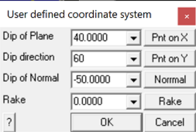

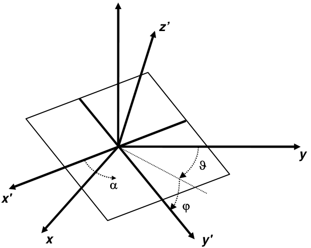

For an example on the use of grid snap mode in model building refer to Freehand Sketching - Room and Pillar.
