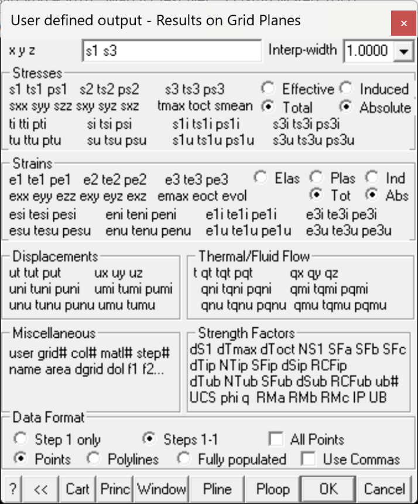
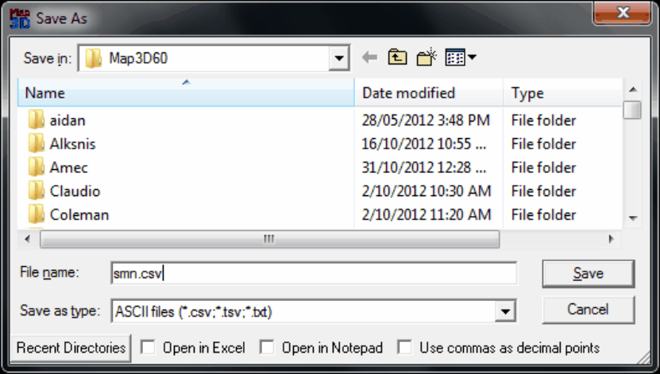
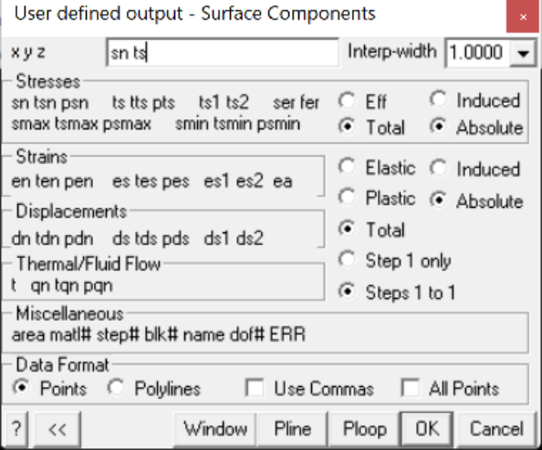
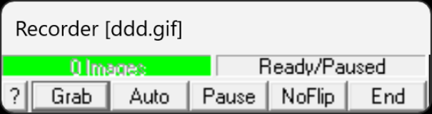

## 5.1.23.1 Copy Screen to Clipboard

Dumps a bitmap of the screen to the windows clipboard. This image can be pasted into other applications.

Since normally the screen background is black and element outlines are white, the user may want to select

File > Output > Copy Screen (B&W flipped)

to exchange these two colours.

## 5.1.23.2 Copy Screen (B&W flipped)

Dumps a bitmap of the screen to a PNG (Portable Network Graphics - *.PNG) , GIF (Compuserve Graphics Interchange Format)  or BMP (Windows device independent bitmap *.BMP) file with the screen background and element outline colours exchanged. This file can be loaded into other software for report presentation and printing.

For more details refer to

File > Output > PNG, GIF or BMP image

## 5.1.23.3 PNG, GIF, JPEG, BMP or TIFF Screen Image

Dumps a bitmap of the screen to a PNG (Portable Network Graphics - *.PNG), GIF (CompuServe Graphics Interchange Format), BMP (Windows device independent bitmap *.BMP) or TIFF (tagged image file format) file. This file can be loaded into other software for report presentation and printing.

Since normally the screen background is black and element outlines are white, the user may want to select

File > Output > PNG, GIF, JPEG, BMP or TIFF (B&W flipped)

to exchange these two colours.

These files can be displayed using File > Image Viewer

BMP format is a well supported (most web browsers, word processors and paint programs) graphic file format. The main advantage of BMP format is support for all colours displayed. Unfortunately since there is no compression, these files can be very large (1MB or more each).

PNG format is a well supported (most web browsers, word processors and paint programs) graphic file format. The main advantages of PNG format are excellent lossless compression (normally 1% of the size of a BMP file) and support for all colours displayed. Refer to File > Output > Image Recorder for animation details.

GIF format is the more widely supported graphic file format. The main advantages of GIF format are excellent lossless compression (normally 1% of the size of a BMP file) and animation capability. Unfortunately GIF only provides support for 256 display colours. Depending on what is displayed, Map3D can use up to 512 colours and hence GIF may not reproduce screen images in all colours

GIF format has been implemented using the specification Version 89a ©1987,1988,1989,1990 Copyright CompuServe Incorporated, Columbus, Ohio.

This software uses the FreeImage open source image library. See [http://freeimage.sourceforge.net](http://freeimage.sourceforge.net) for details. FreeImage is used under the (GNU GPL or FIPL), version (license version).

## 5.1.23.4 PNG, GIF, JPEG, BMP or TIFF (B&W flipped)

Dumps a bitmap of the screen to a PNG (Portable Network Graphics - *.PNG) , GIF (Compuserve Graphics Interchange Format)  or BMP (Windows device independent bitmap *.BMP) file with the screen background and element outline colours exchanged. This file can be loaded into other software for report presentation and printing.

For more details refer to

File > Output > PNG, JPEG, GIF, BMP or TIFF image

## 5.1.23.5 DXF Screen Image

Dumps a screen image to a file (*.DXF) in AutoCAD drawing exchange format. This is a vector format that can be imported into many software packages for further rendering.

## 5.1.23.6 PNT Screen Image

Dumps a screen image to a file (*.PNT) in a universal ASCII data file with the extension ".PNT". The PNT format is useful for exchanging raw model data with other CAD software. This is a vector format that can be imported into many software packages for further rendering.

## 5.1.23.7 OBJ Screen Image

Dumps a screen image to a file (*.OBJ) in Wavefront format. This is useful for exchanging model data with other CAD and virtual reality modelling software. This is a vector format that can be imported into many software packages for further rendering.

## 5.1.23.8 WRL Screen Image

Dumps a screen image to a file (*.WRL) in VRML format. VRML is useful for exchanging model data with other CAD and virtual reality modelling software. This is a vector format that can be imported into many software packages for further rendering.

## 5.1.23.9 3D-PDF Screen Image

Dumps a screen image to a file in PDF (3D) format. 3D PDF can be viewed in full 3D with Adobe Reader.

## 5.1.23.10 Selected Grid Components

Dumps selected grid components to a text file (*.txt) in a user controlled format.

By default all points on all grids are dumped. If you want to dump only a selected set of points use the window function defined below.

Upon selecting the desired data then OK, you will be prompted for a file name to save the data. You can select CSV (comma separated/delimited data), TSV (tab separated/delimited data) or TXT (space sepat\rated/delimited data). You can also specify to automatically open the file in Excel or Notepad. Note that you should not use CSV files with commas as decimal points.

#### Stresses:

s1 ts1 ps1 major principal stress s1 its trend and plunge.

s2 ts2 ps2 intermediate principal stress s2 its trend and plunge.

s3 ts3 ps3 minor principal stress s3 its trend and plunge. sxx syy szz sxy syz sxz Cartesian stress components. tmax maximum shear stress tmax = ½ ( s1 - s3 ) toct octahedral shear stress toct = ¹/3 [( s1 - s2 )² + ( s2 - s3 )² +( s3 - s1 )²]½ smean mean stress smean = ¹/3 ( s1 + s2 + s3 )

ti tti pti maximum shear stress in the grid plane, its trend and plunge. si tsi psi normal stress in the grid plane, its trend and plunge. s1i ts1i ps1i maximum stress tangential to the grid plane, its trend and plunge. s3i ts3i ps3i minimum stress tangential to the grid plane, its trend and plunge. tu ttu ptu maximum shear stress in the ubiquitous-plane, its trend and plunge. su tsu psu stress normal to the ubiquitous plane, its trend and plunge. s1u ts1u ps1u maximum stress tangential to the ubiquitous plane, its trend and plunge. s3u ts3u ps3u minimum stress tangential to the ubiquitous plane, its trend and plunge. The orientation of the ubiquitous-plane is specified in

Plot > Strength Factors > Ubiquitous Parameters

Effective/Total effective stress or total stress components. These options are only used in Map3D Thermal-Fluid Flow, as this code allows for calculation of steady state pore pressure distributions. Induced/Absolute Induced stress is the stress without the pre-mining stress contribution. This represents the stress change since the pre-mining condition. Absolute stress is the stress including the pre-mining stress contribution.

#### Strains:

e1 te1 pe1 major principal strain e1 its trend and plunge. e2 te2 pe2 intermediate principal strain e2 its trend and plunge.

e3 te3 pe3 minor principal strain e3 its trend and plunge. exx eyy ezz exy eyz exz Cartesian strain components. emax maximum shear strain emax = ½ ( e1 - e3 ) eoct octahedral shear strain eoct = ¹/3 [( e1 - e2 )² + ( e2 - e3 )² +( e3 - e1 )²]½ evol volumetric strain evol = ( e1 + e2 + e3 ) esi tesi pesi maximum shear strain in the grid plane, its trend and plunge. eni teni peni normal strain in the grid plane, its trend and plunge. e1i te1i pe1i maximum strain tangential to the grid plane, its trend and plunge. e3i te3i pe3i minimum strain tangential to the grid plane, its trend and plunge. esu tesu pesu maximum shear strain in the ubiquitous-plane, its trend and plunge. enu tenu penu strain normal to the ubiquitous plane, its trend and plunge. e1u te1u pe1u maximum strain tangential to the ubiquitous plane, its trend and plunge. e3u te3u pe3u minimum strain tangential to the ubiquitous plane, its trend and plunge. Elastic/Plastic/Total elastic, plastic or total strain components. These options are only used in Map3D Non-Linear, as this code allows for calculation of non-linear strains. Induced/Absolute Induced strain is the strain without the pre-mining contribution. This represents the strain change since the pre-mining condition. Absolute strain is the strain including the pre-mining strain contribution.

#### Displacements:

ut tut put total displacement, its trend and plunge. ux uy uz Cartesian displacement components. uni tuni puni displacement normal to the grid plane, its trend and plunge. umi tumi pumi maximum displacement tangential to the grid plane, its trend and plunge. unu tunu punu displacement normal to the ubiquitous plane, its trend and plunge. umu tumu pumu maximum displacement tangential to the ubiquitous plane, its trend and plunge.

#### Flow:

t temperature/head.

qt tqt pqt total flow, its trend and plunge. qx qy qz Cartesian flow components. qni tqni pqni displacement normal to the grid plane, its trend and plunge. qmi tqmi pqmi maximum displacement tangential to the grid plane, its trend and plunge. qnu tqnu pqnu displacement normal to the ubiquitous plane, its trend and plunge. qmu tqmu pqmu maximum displacement tangential to the ubiquitous plane, its trend and plunge.

#### Strength:

- ds1 excess major principal stress Ds1 = s1 - ( _UCS_ + _q_ s3 )

- dtmax excess maximum shear stress Dtmax = ½(s1 - s3) - [ _UCS_ + ½(s1+s3) ( _q_ -1) ]/( _q_ +1) = [s1 - ( _UCS_ + _q_ s3) ]/( _q_ +1)

- dtoct excess octahedral shear stress Dtoct = toct - [ _UCS_ + ( _q_ –1) smean ] Ö(2) /( _q_ +2)

- NS1 probability using the Normal distribution N(Ds1 /std)

- SFA Strength/Stress can be determined as ( _UCS_ + _q_ s3 )/ s1

- SFB Strength/Stress can be determined as ( _UCS_ + _q_ s3 - s3 )/(s1 - s3)

- SFC Strength/Stress can be determined as [ _UCS_ + ½(s1+s3) ( _q_ -1) ]/[ ½(s1 - s3)( _q_ +1) ]

- dTip excess in-plane shear stress Dtip = tip - [ Cohesion + sip tan(j) ]

- NTip probability using the Normal distribution N(Dtip /std)

- SFip Strength/Stress can be determined as [ Cohesion + sip tan(j) ] / tip

- dSip excess in-plane wall stress Dsip = [ 3 s1i - s3i ] - UCS

- RCFip Rock Condition Factor for the in-plane wall stress RCFip = [ 3 s1i - s3i ]/UCS

- dTub excess ubiquitous-plane shear stress Dtub

- NTub probability using the Normal distribution N(Dtub /std)

- SFub Strength/Stress can be determined as [ Cohesion + sub tan(j) ] / tub

- dSub excess ub-plane wall stress Dsub = [ 3 s1ub - s3ub ] - UCS

- RCFub Rock Condition Factor for the ub-plane wall stress RCFip = [ 3 s1ub - s3ub ]/UCS

- UB# Plots the UB set number (1, 2 or 3) that has the largest value of Dtub

- _UCS phi q_ Mohr-Coulomb strength parameters defined using Plot > Strength Factors > Rockmass Strength Parameters note that these parameters are only defined if you have specified the Mohr-Coulomb or Druker-Prager strength criterion

- _sc_ Hoek-Brown strength parameter defined using Plot > Strength Factors > Rockmass Strength Parameters note that this parameter is only defined if you have specified the Hoek-Brown strength criterion

#### Miscellaneous:

user User defined value.

grid# the number of the grid where the point is located. matl# the number of the material within which the point is located. The host material is material number 1. In problems where multiple materials are used, results may be calculated in an alternate material zone.

step# the mining step number. name the name of the grid. area the area of the grid patch adjacent to the point picked. dgrid distance to the nearest surface from each grid point. dol distance to the nearest grid _Dgrid_ divided by the grid spacing _Lgrid_ . f1 f2... user defined material parameters. These can be defined using Plot > Properties > Material Properties > User defined Parameters.

#### Data Format:

Points data will be written out as a series of points with one point per line:

- x1 y1 z1 values1 x2 y2 z2 values2 x3 y3 z3 values3 x4 y4 z4 values4

where xi yi zi represent the coordinates of each point,

valuesi represents the values of the list of user selected components at each point. The user defined values will be listed as a comment line (i.e. a line beginning with an asterisk "*") at the beginning of the file.

Polylines data will be written out as a series of polylines in PNT file format

- x1 y1 z1 3 values1 x2 y2 z2 2 values2 x3 y3 z3 2 values3 x4 y4 z4 2 values4

where xi yi zi represent the coordinates of each point,

- 3 indicates that this point is the beginning of a new line,

- 2 indicates that this point is a continuation of the same line,

valuesi represents the values of the list of user selected components at each corner of the polyline. The user defined values will be listed as a comment line (i.e. a line beginning with an asterisk "*") at the beginning of the file.

Fully Populated data will be written out such that all data will be on a regular sized grid.

Use Commas data will be written out with commas in place of decimal points.

#### Other:

&lt;&lt;    to shrink the dialogue box to small size

>>    to expand the dialogue box to large size Cartesian   configures for output of cartesian stress components. Principal   configures for output of principal stress components. Window   activates a graphical pick window.

- You will be prompted to select the two corners of the window by picking each with a single mouse click.

- Only grid points enclosed within the window will be included in the dump.

- If you do not use this function all points on all grids are dumped.

- To view the location of the actual contour points enable display of trajectories (Plot > Options > Trajectories). The contour points are located where the trajectories are drawn.

Polyline   activates a graphical pick polygon. You will be prompted to select a series of corners to define a polygon by picking each with a single mouse click:

- You must hold the Shift-key down while selecting these points.

- If you define a closed polygonal shape - those contour points enclosed in the polygon will be included.

- If you define an open polygonal shape - a series of points along the length of the polyline will be included.

- To view the location of the actual contour points enable display of trajectories (Plot > Options > Trajectories). The contour points are located where the trajectories are drawn.

- Simple rectangular widow shapes can be defined by holding the Shift-key and dragging open a window (same as with the Window button).

## 5.1.23.11 Selected Surface Components

Dumps selected surface components to a text file (*.txt) in a user controlled format.

By default all points on all surfaces are dumped. If you want to dump only a selected set of points use the window function defined below.

Upon selecting the desired data then OK, you will be prompted for a file name to save the data. You can select CSV (comma separated/delimited data), TSV (tab separated/delimited data) or TXT (space sepat\rated/delimited data).

You can also specify to automatically open the file in Excel or Notepad. Note that you should not use CSV files with commas as decimal points.

#### Stresses:

sn tsn psn stress normal to the surface, its trend and plunge.

ts tts pts maximum shear stress in the plane of the surface, its trend and plunge. ts1 ts2   shear stress components in the plane of the surface. ts1 is parallel to the first side (i.e. the side defined by x1 y1 z1 – x2 y2 z2). ts2 is perpendicular to ts1 in the direction of the second side (i.e. the side defined by x2 y2 z2 – x3 y3 z3).

ser surface stress error. Iterative solvers function by determining the error in the current solution of each simultaneous equation, then reducing these errors by a process of successive approximations. This parameter indicates the error for each of the equations.

fer failure criterion error. This parameter is only used for non-linear creep analyzes (including fault slip and 3D material non-linearity). This parameter should always be near zero unless some viscosity has been specified and the problem goes non-linear. In this latter case, viscous creep can allow stress states above the failure criterion, thus indicating a lack of static equilibrium. This parameter indicates the viscous stress for each of the equations.

smax tsmax psmax maximum tangential stress, its trend and plunge. smin tsmin psmin minimum tangential stress, its trend and plunge. Effective/Total – effective stress or total stress components. These options are only used in Map3D Thermal-Fluid Flow, as this code allows for calculation of steady state pore pressure distributions.

#### Strains:

en ten pen strain in the direction normal to the surface, its trend and plunge. This parameter is only used for DD planes and is calculated as the normal displacement (closure) divided by the thickness. es tes pes maximum shear strain in the plane of the surface, its trend and plunge. This parameter is only used for DD planes and is calculated as the  shear displacement (ride) divided by the thickness. es1 es2   shear strain components in the plane of the surface. es1 is parallel to the first side (i.e. the side defined by x1 y1 z1 – x2 y2 z2). es2 is perpendicular to es1 in the direction of the second side (i.e. the side defined by x2 y2 z2 – x3 y3 z3).

#### Displacements:

dn tdn pdn normal displacement (closure) in the direction normal to the surface, its trend and plunge. This parameter is only used for DD planes. Note that the elastic, plastic or total value can be specified.

ds tds pds maximum shear displacement (ride) in the plane of the surface, its trend and plunge. This parameter is only used for DD planes. Note that the elastic, plastic or total value can be specified.

ds1 ds2   shear displacement (ride) components in the plane of the surface. ds1 is parallel to the first side (i.e. the side defined by x1 y1 z1 – x2 y2 z2). ds2 is perpendicular to ds1 in the direction of the second side (i.e. the side defined by x2 y2 z2 – x3 y3 z3). Elastic/Plastic/Total elastic, plastic or total strain/displacement components. These options are only used for DD planes.

#### Miscellaneous:

area   the area of the surface. matl# the number of the material assigned to the surface. step# the mining step number. blk#   the block number. name   the name of the block surface. dof#   the degree of freedom number.

#### Data Format

Points data will be written out as a series of points with one point per line.

x1 y1 z1 values1 x2 y2 z2 values2 x3 y3 z3 values3 x4 y4 z4 values4

where xi yi zi represent the coordinates of each point,

valuesi represents the values of the list of user selected components at each point. The user defined values will be listed as a comment line (i.e. a line beginning with an asterisk "*") at the beginning of the file.

Polylines data will be written out as a series of polylines in PNT file format x1 y1 z1 3 values1 x2 y2 z2 2 values2 x3 y3 z3 2 values3 x4 y4 z4 2 values4

where xi yi zi represent the coordinates of each point,

3 indicates that this point is the beginning of a new line,

2 indicates that this point is a continuation of the same line,

valuesi represents the values of the list of user selected components at each corner of the polyline. The user defined values will be listed as a comment line (i.e. a line beginning with an asterisk "*") at the beginning of the file.

If linear BEM analysis (Analysis > Options > Linear) was not selected, valuesi are only available at the element centres and hence will only be supplied for the first point. If linear BEM analysis was selected, values are available at each corner and hence will only be supplied for all points.

#### Other

&lt;&lt;    to shrink the dialogue box to small size >>    to expand the dialogue box to large size Window   activates a graphical pick window.

- You will be prompted to select the two corners of the window by picking each with a single mouse click.

- Only grid points enclosed within the window will be included in the dump.

- If you do not use this function all points on all grids are dumped.

- To view the location of the actual contour points enable display of trajectories (Plot > Options > Trajectories). The contour points are located where the trajectories are drawn.

Polyline   activates a graphical pick polygon. You will be prompted to select a series of corners to define a polygon by picking each with a single mouse click:

- You must hold the Shift-key down while selecting these points.

- If you define a closed polygonal shape - those contour points enclosed in the polygon will be included.

- If you define an open polygonal shape - a series of points along the length of the polyline will be included.

- To view the location of the actual contour points enable display of trajectories (Plot > Options > Trajectories). The contour points are located where the trajectories are drawn.

- Simple rectangular widow shapes can be defined by holding the Shift-key and dragging open a window (same as with the Window button).

Use Commas data will be written out with commas in place of decimal points.

## 5.1.23.12 Animated TIFF/GIF Recorder

Records multiple sequential images to individual PNG, GIF, BMP or TIFF files.

Many presentation programs allow you to construct simple animations by displaying a sequence of images. The Map3D image recorder allows you to record multiple screen dumps to a individual PNG, GIF, BMP or TIFF files.

The animated TIFF/GIF Recorder saves multiple images to the same TIFF or GIF file. These images can be played back with an image viewer that can display animated TIFFs or GIFs (such as Map3D Image Viewer, most internet browsers, Windows Photo Viewer etc.).

The Image Recorder creates multiple images to separate files. Once you select File > Output > Image Recorder, you will be prompted to specify a file name to save the animation. Image file names will be generated by appending the image count onto the file name you specify (e.g. name0001.png, name0002.png, name0003.png ...).

The recorder dialogue box provides information on the current animation and allows you to control recording and specify animation options.

The current number of images in the animation is displayed along with the status of the recorder. Various status states include:

Ready/Paused – animation file is open and ready to record. Press Grab or Auto to add an image.

Capturing Image – image is being added to the animation.

Ready/Auto Capture - displayed images will be automatically added to the animation as you update the screen.

Recorder Off – animation file is closed and not ready to record.

Grab – adds the current displayed image to the animation.

Auto – automatically adds displayed images to the animation as you update the screen. This includes all rotation, translation and plotting operations you perform.

Pause – disables automatic mode.

Flipped/NoFlip – toggles background and foreground (normally black and white) will be reversed.

End – stops the recorder and closes the animation file.

#### Notes:

Additional images can be appended to an existing sequence of images be checking File > Output > Image Recorder > Append Images when selecting the file name for the animation sequence.

Rotation and translation operations can be repeated automatically by typing n# before selecting the operation. For example to produce an animated display of a stress plot, specify the following

Plot > Options > Persist

Plot > Stress > Sigma:1

View > Rotation Increment > 10

Select the Auto button

Type in 35#

Select rotate right (either from the rotation toolbar or the PageDown key).

A series of files numbered name001 to name036 will be created. These can be imported into presentation software for animation and display.

Stress contours that change as mining progresses can be displayed by grabbing a series of plots as the mining step is advanced.
