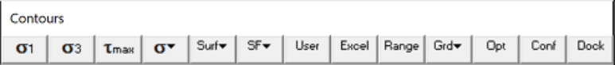
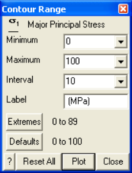

Specifies the contour range (minimum, maximum, interval ...) of the currently plotted contour. This routine can be initiated either by picking the button or simple right clicking on any contour.

**abe u te a**

Above, the contour range is shown in the horizontal orientation. Ths can be changed to the vertical orientation by checking Plot Options > Vertical Legend.

Minimum - specifies the lower value of the contour range.

Maximum - specifies the upper value of the contour range.

Interval - specifies the contour interval. The interval can be set larger than 1/10th of the maximum minus the minimum, but not smaller.

Label - specifies the contour label.

Extremes – Indicates the lower and upper extremes detected for this parameter. Selecting this button set the contour range to these values.

Defaults - Indicates the default lower and upper contour range for this parameter. Selecting this button set the contour range to these values.

Reset All - Sets the ranges of all plot parameters to the default values.

Plot – regenerates the contour plot.

The minimum contour range does not necessarily have to be set less than the maximum. For example when contouring strength factors it may be desirable to set the minimum to 2 and the maximum to 1 so that strength factors near one are contoured in the colour red.
