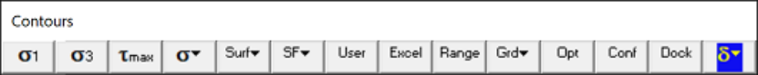
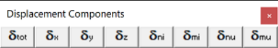
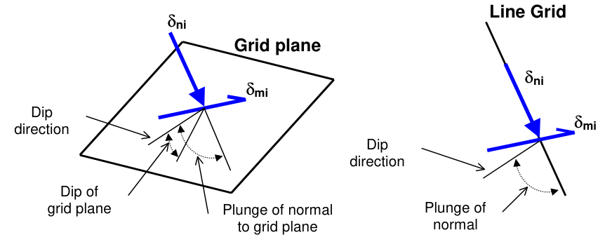
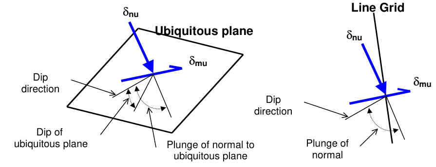

## 5.3.3.1 Total displacement

Contours the displacements.

These components can be accessed via the Displacement Components toolbar as follows:

This toolbar can be changed to a vertical orientation by dragging is against either the right or left hand edge of the main window.

It can be changed back to a horizontal orientation by dragging is against either the top or bottom edge of the main window.

Selecting the button on the Contours toolbar activates the Displacement Components toolbar. You can add this button to the Contours toolbar using the configuration button.

This toolbar is meant to provide quick access to displacement components.

Plot > Displacement > dtotal = ( dx² + dy² + dz² )½ Total Displacement   contours the total displacement Plot > Displacement > dx X-Displacement   contours the x-displacement component Plot > Displacement > dy Y-Displacement   contours the y-displacement component Plot > Displacement > dz Z-Displacement   contours the z-displacement component

To calculate the in-plane displacements, the displacement state at each point on the grid plane is reoriented to determine the maximum displacement parallel to the grid plane and the displacement normal to the plane. Note that dni is oriented normal to the grid plane and parallel to the direction of a line grid.

Plot > Displacement > dni In-plane normal   contours the displacement component normal to the grid plane.

Plot > Displacement > dmi In-plane maximum   contours the maximum displacement tangential to the grid plane.

To calculate the ubiquitous-plane #1 displacements, the displacement state at each point on the grid plane is reoriented to determine the maximum displacement parallel to the ubiquitous plane #1 and the displacement normal to the plane. Note that dmi is not oriented normal to the grid plane.

Plot > Displacement > dnu Ubiquitous-plane normal   contours the displacement component normal to the ubiquitous plane.

Plot > Displacement > dmu Ubiquitous-plane maximum   contours the maximum displacement tangential to the ubiquitous plane.

- dip direction is measured positive clockwise from the y-axis.

- dip of the plane is measured positive down from the horizontal (i.e. the dip direction).

- plunge of the normal is measured positive down (i.e. negative up) from the horizontal.

Notes:

The displacement toolbar can only be activated after the model building - CAD Stage

Map3D Analysis Stages.

The orientation of the ubiquitous shear plane is set using

Plot > Strength Factors > Ubiquitous Parameters

The contour range is set using

#### Plot > Range

This component can be added to the contour toolbar if desired

Tools > Configure Contouring Toolbar > Displacement

The user may find it handy to add the

More Displacement Components

button to the contouring toolbar for quick access to all displacement components.
