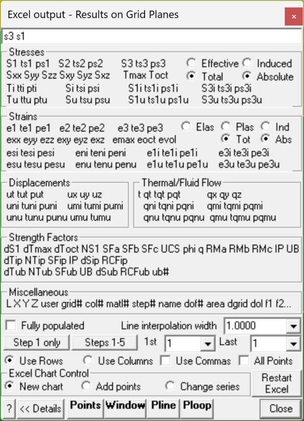

Plots specified grid components in Excel.

You must contour grid results in order to be able to select these for Excel plotting (e.g. Plot > Stress > s1 Major Principal Stress).

The first parameter will be used as the x plot axis (i..e abscissa). Additional parameters will define the y plot axes (i.e. series or ordinates). Multiple y plot axes parameters can be specified.

Two types of Excel plots can be created:

- selected contour points.

- a series of points along the length of a polyline.

If you plot "s3 s1", "si ti" or "su tu", then Map3D will provide the information about the best fit line (using linear regression) including:

- Intercept

- Slope

- friction angle

- standard deviation

- coefficient of variation

Fully populated   Specifies that all missing contour points will be generated via interpolation.

- This option applies only to plotting of selected contour points (Points, Window and closed Polyline).

- This option does not apply to plotting on an open polyline.

- Map3D calculates results on a sparsely populated grid in order to save on analysis time.

- To view the location of the actual contour points enable display of trajectories (Plot > Options > Trajectories).

- With this option unchecked, only the actual contour points will be included in the plot.

- With this option checked, all missing contour points will be included in the plot.

Line interpolation width   Specifies the desired spacing at which contour points will be generated via interpolation.

- This option applies only to plotting on an open polyline.

- This option does not apply to plotting of selected contour points.

- If the Line interpolation width is set to zero, only the ends of the open polyline will be plotted.

- Otherwise points will be generated along the polyline via interpolation at the specified Line interpolation width.

Step # only   Specifies that the results for step # only will be dumped (# is the currently displayed loaded mining step).

Steps 1-5   Specifies that the results for all steps will be dumped.

   - Note that this can take a considerable amount of time for large data sets so you must be patient and wait for Map3D  to cycle through all of the steps.

- 1st/Last   Specifies that the results for all steps including and between 1st and Last will be dumped.

   - Note that this can take a considerable amount of time for large data sets so you must be patient and wait for Map3D  to cycle through all of the steps.

Use Commas   Specifies that the results dumped to Excel will have commas in place of decimal points for the number format.

Use Rows   When dumping multiple mining steps (refer to Steps 1-5 above), results will appear in accumulating rows.

Use Columns   When dumping multiple mining steps (refer to Steps 1-5 above), results will appear in accumulating columns.

- Note that you may want to specify All Points to ensure that no points are missing between corresponding rows.

All Points   Specifies that the all points are dumped to Excel - including points inside excavations.

Restart Excel   If Map3D looses communication with Excel, you must Restart Excel to re-establish communications.

Points   activates graphical picking of individual points.

- The nearest point to the pick point will be plotted.

- To view the location of the actual contour points enable display of trajectories (Plot > Options > Trajectories). The contour points are located where the trajectories are drawn.

Window   activates a rectangular pick window.

- You will be prompted to select the two corners of the window by picking each with a single mouse click.

- Only grid points enclosed within the window will be included in the plot.

- To view the location of the actual contour points enable display of trajectories (Plot > Options > Trajectories). The contour points are located where the trajectories are drawn.

Pline (open)   activates a graphical pick polygon.

- You can select two points to define a single line segment.

- If you hold down the Shift-key multiple line segments can be selected.

- You can specify the desired spacing at which contour points will be generated via interpolation with using the Line interpolation width parameter.

- The user may find it useful to superimpose a regular grid on top of the contours (Plot > Options > Grid Lines) to assist in selecting the polyline location.

- If the Line interpolation width is set to zero, only the ends of the open polyline will be plotted.

- If you define an open polyline shape - a series of points along the length of the polyline will be plotted.

- If you define a closed polygonal shape - those contour points enclosed in the polygon will be plotted.

Pline (closed)   activates a graphical pick polygon.

- You must hold down the Shift-key so that multiple line segments can be selected.

- A closed polygonal shape is defined by closing the polyline by selecting the starting point.

- If you define a closed polygonal shape - those contour points enclosed in the polygon will be plotted.

- If you define an open polyline shape - a series of points along the length of the polyline will be plotted.

- To view the location of the actual contour points enable display of trajectories (Plot > Options > Trajectories). The contour points are located where the trajectories are drawn.

Ploop (closed)   this is the same as Pline (closed) except the polyline will automatically be closed to form a closed loop.

- You must hold down the Shift-key so that multiple line segments can be selected.

#### Excel Chart Control:

New chart - creates a new Excel chart.

Extend existing chart - adds data to the existing Excel chart. All plot parameters must be the same as those used previously.

Change series - changes or adds new series to an existing Excel chart. Only the first plot parameter must be the same. Additional plot parameters can be specified as desired.

#### Stresses:

s1 ts1 ps1 major principal stress s1 its trend and plunge.

s2 ts2 ps2 intermediate principal stress s2 its trend and plunge. s3 ts3 ps3 minor principal stress s3 its trend and plunge. sxx syy szz sxy syz sxz Cartesian stress components. tmax maximum shear stress tmax = ½ ( s1 - s3 ) toct octahedral shear stress toct = ¹/3 [( s1 - s2 )² + ( s2 - s3 )² +( s3 - s1 )²]½ smean mean stress smean = ¹/3 ( s1 + s2 + s3 ) ti tti pti maximum shear stress in the grid plane, its trend and plunge. si tsi psi normal stress in the grid plane, its trend and plunge. s1i ts1i ps1i maximum stress tangential to the grid plane, its trend and plunge. s3i ts3i ps3i minimum stress tangential to the grid plane, its trend and plunge. tu ttu ptu maximum shear stress in the ubiquitous-plane, its trend and plunge. su tsu psu stress normal to the ubiquitous plane, its trend and plunge. s1u ts1u ps1u maximum stress tangential to the ubiquitous plane, its trend and plunge. s3u ts3u ps3u minimum stress tangential to the ubiquitous plane, its trend and plunge. The orientation of the ubiquitous-plane is specified in

Plot > Strength Factors > Ubiquitous Parameters

Effective/Total effective stress or total stress components. These options are only used in Map3D Thermal-Fluid Flow, as this code allows for calculation of steady state pore pressure distributions. Induced/Absolute induced stress or absolute stress components (i.e. the stress without the premining stress contribution).

#### Strains:

e1 te1 pe1 major principal strain e1 its trend and plunge. e2 te2 pe2 intermediate principal strain e2 its trend and plunge. e3 te3 pe3 minor principal strain e3 its trend and plunge. exx eyy ezz exy eyz exz Cartesian strain components. emax maximum shear strain emax = ½ ( e1 - e3 ) eoct octahedral shear strain eoct = ¹/3 [( e1 - e2 )² + ( e2 - e3 )² +( e3 - e1 )²]½ evol volumetric strain evol = ( e1 + e2 + e3 ) esi tesi pesi maximum shear strain in the grid plane, its trend and plunge. eni teni peni normal strain in the grid plane, its trend and plunge. e1i te1i pe1i maximum strain tangential to the grid plane, its trend and plunge. e3i te3i pe3i minimum strain tangential to the grid plane, its trend and plunge. esu tesu pesu maximum shear strain in the ubiquitous-plane, its trend and plunge. enu tenu penu strain normal to the ubiquitous plane, its trend and plunge. e1u te1u pe1u maximum strain tangential to the ubiquitous plane, its trend and plunge. e3u te3u pe3u minimum strain tangential to the ubiquitous plane, its trend and plunge. Elastic/Plastic/Total elastic, plastic or total strain components. These options are only used in Map3D Non-Linear, as this code allows for calculation of non-linear strains. Induced/Absolute induced strain or absolute strain components (i.e. the stress without the premining stress contribution).

#### Displacements:

ut tut put total displacement, its trend and plunge. ux uy uz Cartesian displacement components. uni tuni puni displacement normal to the grid plane, its trend and plunge. umi tumi pumi maximum displacement tangential to the grid plane, its trend and plunge. unu tunu punu displacement normal to the ubiquitous plane, its trend and plunge. umu tumu pumu maximum displacement tangential to the ubiquitous plane, its trend and plunge.

#### Flow:

t temperature/head.

qt tqt pqt total flow, its trend and plunge. qx qy qz Cartesian flow components. qni tqni pqni displacement normal to the grid plane, its trend and plunge. qmi tqmi pqmi maximum displacement tangential to the grid plane, its trend and plunge. qnu tqnu pqnu displacement normal to the ubiquitous plane, its trend and plunge. qmu tqmu pqmu maximum displacement tangential to the ubiquitous plane, its trend and plunge.

#### Strength:

· ds1 excess major principal stress Ds1 = s1 - ( _UCS_ + _q_ s3 )

- dtmax excess maximum shear stress Dtmax = ½(s1 - s3) - [ _UCS_ + ½(s1+s3) ( _q_ -1) ]/( _q_ +1) = [s1 - ( _UCS_ + _q_ s3) ]/( _q_ +1)

- dtoct excess octahedral shear stress Dtoct = toct - [ _UCS_ + ( _q_ –1) smean ] Ö(2) /( _q_ +2)

- NS1 probability using the Normal distribution N(Ds1 /std)

- SF-A Strength/Stress can be determined as ( _UCS_ + _q_ s3 )/ s1

- SF-B Strength/Stress can be determined as ( _UCS_ + _q_ s3 - s3 )/(s1 - s3)

- SF-C Strength/Stress can be determined as [ _UCS_ + ½(s1+s3) ( _q_ -1) ]/[ ½(s1 - s3)( _q_ +1) ]

- dTip excess in-plane shear stress Dtip = tip - [ Cohesion + sip tan(j) ]

- NTip probability using the Normal distribution N(Dtip /std)

- SFip Strength/Stress can be determined as [ Cohesion + sip tan(j) ] / tip

- dSip excess in-plane wall stress Dsip = [ 3 s1i - s3i ] - UCS

- RCFip Rock Condition Factor for the in-plane wall stress RCFip = [ 3 s1i - s3i ]/UCS

- dTub excess ubiquitous-plane shear stress Dtub

- NTub probability using the Normal distribution N(Dtub /std)

- SFub Strength/Stress can be determined as [ Cohesion + sub tan(j) ] / tub

- dSub excess ub-plane wall stress Dsub = [ 3 s1ub - s3ub ] - UCS

- RCFub Rock Condition Factor for the ub-plane wall stress RCFip = [ 3 s1ub - s3ub ]/UCS

- UB# Plots the UB set number (1, 2 or 3) that has the largest value of Dtub

#### Miscellaneous:

L  Length along a line. Use the Polyline command to select the desired line.

X  coordinate value. Y  coordinate value. Z  coordinate value. user User defined value.

grid# the number of the grid where the point is located. col# the colour number assigned to the grid where the point is located.

matl# the number of the material within which the point is located. The host material is material number 1. In problems where multiple materials are used, results may be calculated in an alternate material zone.

step# the mining step number. name the name assigned to the grid where the point is located.

dof#   a unique number specifying the storage location of the point in the Map3D database. area the area of the segment associated with the selected point on the GPlane. dgrid distance to the nearest surface from each grid point. dol distance to the nearest grid _Dgrid_ divided by the grid spacing _Lgrid_ .

f1 f2... user defined material parameters. These can be defined using Plot > Properties > Material Properties > User defined Parameters.
