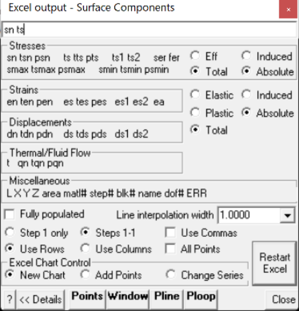

Plots specified surface components in Excel.

You must contour surface results in order to be able to select these for Excel plotting (e.g. Plot > Surface Components > Ts Shear Stress).

The first parameter will be used as the x plot axis (i..e abscissa). Additional parameters will define the y plot axes (i.e. series or ordinates). Multiple y plot axes parameters can be specified.

Two types of Excel plots can be created:

- selected contour points.

- a series of points along the length of a polyline.

Excel plotting through Map3D is facilitated by the add-in routine Map3D.xla

- This routine is automatically loaded when Map3D starts Excel.

- You must allow this macro to run in order for the Map3D plotting routines to work.

Fully populated   Specifies that all missing contour points will be generated via interpolation.

- This option applies only to plotting of selected contour points (Points, Window and closed Polyline).

- This option does not apply to plotting on an open polyline.

- Map3D calculates results on a sparsely populated grid in order to save on analysis time.

- To view the location of the actual contour points enable display of trajectories (Plot > Options > Trajectories).

- With this option unchecked, only the actual contour points will be included in the plot.

- With this option checked, all missing contour points will be included in the plot.

Line interpolation width   Specifies the desired spacing at which contour points will be generated via interpolation.

- This option applies only to plotting on an open polyline.

- This option does not apply to plotting of selected contour points.

- If the Line interpolation width is set to zero, only the ends of the open polyline will be plotted.

- Otherwise points will be generated along the polyline via interpolation at the specified Line interpolation width.

Step # only   Specifies that the results for step # only will be dumped (# is the currently displayed loaded mining step).

Steps 1-5   Specifies that the results for all steps will be dumped.

- Note that this can take a considerable amount of time for large datasets so you must be patient and wait for Map3D  to cycle through all of the steps.

Use Commas   Specifies that the results dumped to Excel will have commas in place of decimal points for the number format.

Restart Excel   If Map3D looses communication with Excel, you must Restart Excel to re-establish communications.

Points   activates graphical picking of individual points.

- The nearest point to the pick point will be plotted.

- To view the location of the actual contour points enable display of trajectories (Plot > Options > Trajectories). The contour points are located where the trajectories are drawn.

Window   activates a rectangular pick window.

- You will be prompted to select the two corners of the window by picking each with a single mouse click.

- Only grid points enclosed within the window will be included in the plot.

- To view the location of the actual contour points enable display of trajectories (Plot > Options > Trajectories). The contour points are located where the trajectories are drawn.

Polyline (closed)   activates a graphical pick polygon.

- You must hold down the Shift-key so that multiple line segments can be selected.

- A closed polygonal shape is defined by closing the polyline by selecting the starting point.

- If you define a closed polygonal shape - those contour points enclosed in the polygon will be plotted.

- If you define an open polyline shape - a series of points along the length of the polyline will be plotted.

- To view the location of the actual contour points enable display of trajectories (Plot > Options > Trajectories). The contour points are located where the trajectories are drawn.

Polyline (open)   activates a graphical pick polygon.

- You can select two points to define a single line segment.

- If you hold down the Shift-key multiple line segments can be selected.

- You can specify the desired spacing at which contour points will be generated via interpolation with using the Line interpolation width parameter.

- The user may find it useful to superimpose a regular grid on top of the contours (View > Render > Grid Lines) to assist in selecting the polyline location.

- If the Line interpolation width is set to zero, only the ends of the open polyline will be plotted.

- If you define an open polyline shape - a series of points along the length of the polyline will be plotted.

- If you define a closed polygonal shape - those contour points enclosed in the polygon will be plotted.

#### Excel Chart Control:

New chart - creates a new Excel chart.

Extend existing chart - adds data to the existing Excel chart. All plot parameters must be the same as those used previously.

Change series - changes or adds new series to an existing Excel chart. Only the first plot parameter must be the same. Additional plot parameters can be specified as desired.

#### Stresses:

sn tsn psn stress normal to the surface, its trend and plunge.

ts tts pts maximum shear stress in the plane of the surface, its trend and plunge. ts1 ts2   shear stress components in the plane of the surface. ts1 is parallel to the first side (i.e. the side defined by x1 y1 z1 – x2 y2 z2). ts2 is perpendicular to ts1 in the direction of the second side (i.e. the side defined by x2 y2 z2 – x3 y3 z3).

ser surface stress error. Iterative solvers function by determining the error in the current solution of each simultaneous equation, then reducing these errors by a process of successive approximations. This parameter indicates the error for each of the equations.

fer failure criterion error. This parameter is only used for non-linear creep analyzes (including fault slip and 3D material non-linearity). This parameter should always be near zero unless some viscosity has been specified and the problem goes non-linear. In this latter case, viscous creep can allow stress states above the failure criterion, thus indicating a lack of static equilibrium. This parameter indicates the viscous stress for each of the equations.

smax tsmax psmax maximum tangential stress, its trend and plunge. smin tsmin psmin minimum tangential stress, its trend and plunge. Effective/Total – effective stress or total stress components. These options are only used in Map3D Thermal-Fluid Flow, as this code allows for calculation of steady state pore pressure distributions. Induced/Absolute induced stress or absolute stress components (i.e. the stress without the premining stress contribution).

#### Strains:

en ten pen strain in the direction normal to the surface, its trend and plunge. This parameter is only used for DD planes and is calculated as the normal displacement (closure) divided by the thickness. es tes pes maximum shear strain in the plane of the surface, its trend and plunge. This parameter is only used for DD planes and is calculated as the  shear displacement (ride) divided by the thickness.

es1 es2   shear strain components in the plane of the surface. es1 is parallel to the first side (i.e. the side defined by x1 y1 z1 – x2 y2 z2). es2 is perpendicular to es1 in the direction of the second side (i.e. the side defined by x2 y2 z2 – x3 y3 z3).

Elastic/Plastic/Total elastic, plastic or total strain components. These options are used for DD planes in Map3D Fault-Slip, and also used in Map3D Non-Linear, as this code allows for calculation of non-linear strains.

Induced/Absolute induced strain or absolute strain components (i.e. the stress without the premining stress contribution).

#### Displacements:

dn tdn pdn normal displacement (closure) in the direction normal to the surface, its trend and plunge. This parameter is only used for DD planes. Note that the elastic, plastic or total value can be specified.

ds tds pds maximum shear displacement (ride) in the plane of the surface, its trend and plunge. This parameter is only used for DD planes. Note that the elastic, plastic or total value can be specified.

ds1 ds2   shear displacement (ride) components in the plane of the surface. ds1 is parallel to the first side (i.e. the side defined by x1 y1 z1 – x2 y2 z2). ds2 is perpendicular to ds1 in the direction of the second side (i.e. the side defined by x2 y2 z2 – x3 y3 z3).

#### Miscellaneous:

L  Length along a line. Use the Polyline command to select the desired line. X  coordinate value. Y  coordinate value. Z  coordinate value. area   the area of the surface. matl# the number of the material assigned to the surface. step# the mining step number. blk#   the block number. name the block name. dof#   the degree of freedom number. ERR   energy release rate plot.
