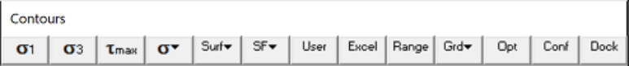
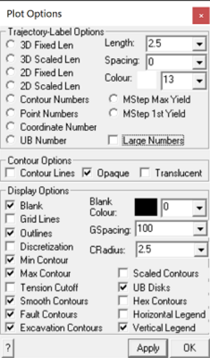

Sets up contour plot options.

This routine can be initiated either by picking the button or simple right clicking on any contour.

This toolbar can be changed to a vertical orientation by dragging is against either the right or left hand edge of the main window.

It can be changed back to a horizontal orientation by dragging is against either the top or bottom edge of the main window.

#### Trajectory-Label Options:

- 3D Fixed Length – display fixed length 3D orientation indicators.

The indicator is constructed as a 3D vector with an arrow head placed on the end that points away from you (i.e. into the display). This permits you to determine whether the vector is dipping away from you or towards you. Vectors that appear as dots point directly into or away from the display.

If you orient the view such that you are looking along the edge of a grid, you will see the vectors protruding in and out of the contour plane.

The length of the vectors is set with the TLength: parameter.

The density of the vectors is set with the TSpacing: parameter.

- 3D Scaled Length – display scaled length 3D orientation indicators.

The indicator is constructed as described above.

The length of the vectors are scaled to the stress magnitude such that if the magnitude equals the minimum of the contour range, the vector is drawn with zero length. If the magnitude equals the maximum of the contour range, the vector is drawn with the length specified by the TLength: parameter.

- 2D Fixed Length – display fixed length 2D orientation indicators.

The indicator is constructed as a 2D projection of the true 3D vector, in the plane of the grid.

The length of the vectors is set with the TLength: parameter.

The density of the vectors is set with the TSpacing: parameter.

- 2D Scaled Length – display scaled length 2D orientation indicators.

The indicator is constructed as described above.

The indicator is constructed as a 2D projection of the true 3D vector, in the plane of the grid.

The length of the vectors are scaled to the stress magnitude such that if the magnitude equals the minimum of the contour range, the vector is drawn with zero length. If the magnitude equals the maximum of the contour range, the vector is drawn with the length specified by the TLength: parameter.

- Contour Numbers – display contour numbers on the contours. The number corresponds to the magnitude of the contour at each point.

- Point Numbers – display point numbers on the contours. The number corresponds to the record number of each point.

- Coordinate Numbers – display coordinate numbers on the contours. The number corresponds to the x,y,z coordinates of each point.

- UB Number – display the number of the ubiquitous joint set (1, 2 or 3) with the maximum excess shear stress on the contours. Refer to Ubiquitous Parameters

- MStep Max Yield – display the step at which the maximum excess stress occurs. Refer to Accumulated Damage

- MStep 1st Yield – display the step at which the first yield occurs. Refer to Accumulated Damage

- Large Numbers – display numbers with large size or small size.

- Length – set the length that the orientation indicators will be drawn. If you set this parameter too small, the trajectory vectors will be too small to see. If you set this parameter too large, the trajectory vectors will overlap and create a confusing display.

- Spacing – set the spacing between adjacent orientation indicators or numbers. If set this parameter to zero, trajectories will be drawn at all grid points. For finely discretized grids, the trajectory vectors may be too concentrated and difficult to distinguish. Larger values for this parameter will result in fewer trajectory symbols being drawn.

- Colour – set the colour with which the trajectories are drawn.

#### Contour Options:

- Contour Lines – draws lines between the contour colours. These lines help highlight the boundary between different contour intervals and are particularly useful for black and white presentation.

- Opaque – draws the contours as opaque colours. If both this option and the translucent option are unchecked, only contour lines (i.e. no coloured contour) will be drawn.

- Translucent - draws the contours as translucent colours. If both this option and the opaque option are unchecked, only contour lines (i.e. no coloured contour) will be drawn.

#### Display Options:

- Blank – when checked, contours are blanked out where the grid plane passes through excavation blocks. This is useful to identify the extent of excavations when portions of the model have been hidden. It is also useful for generation of 2D sections since the location of the excavations are clearly visible.

Blank Colour: - sets colour used for Blanking.

Grid Lines – contours are drawn with lines at regular grid intervals. The desired interval is set using the Spacing: parameter.

Outlines – outlines are drawn around the grid edges. When using multiple grids you may not want to see these outlines.

Discretization – the grid discretization is superimposed on the contours.

Min Contour – when unchecked, contours below the minimum contour range are not drawn. This is useful for displaying contours where only the upper part of the contour range is important.

For example when displaying non-linear strain components or excess stresses, it is often useful to only have non-zero portions of the contours visible.

If the desired parameter has a negative value simply swap the maximum and minimum contour range or plot the absolute value of the parameter.

Max Contour – when unchecked, contours above the maximum contour range are not drawn.

- Tension Cutoff Symbol – when checked a special tension symbol will be plotted anywhere the stress state is below the specified tension cutoff. This option is only used for strength factor plots.

- Smooth Contours – if you have not checked the linear analysis option, results are only calculated at the centre of each boundary element and contour plots of surface values will appear very checkered. This option smoothes these contours to assist in interpretation.

If you have checked the linear analysis option results are calculated at element corners. Since no smoothing is required this option is ignored.

This option has no effect on grid plots.

Fault contours – Contours are drawn on fault surfaces. These are DD surfaces with fault-gouge material type.

Excavation contours – Contours are drawn on excavation surfaces. These are FF or DD surfaces with 0 material type.

Scalled Contours – display contours as a topographical surface.

The height normal to the plane is scaled to the stress magnitude such that if the magnitude equals the minimum of the contour range, the height is drawn with zero length. If the magnitude equals the maximum of the contour range, the vector is drawn with the length specified by the CRadius: parameter.

For line grids, the radius of the tube is scaled.

UB disks – toggles display of planar contour plot or disks representing the orientation of the UB plane. Refer to UB-Plane Parameters for more information.

Hex contours – in the Visco-Plastic version of Map3D this will enable display of values calculated at internal node points.

Horizontal Legend - orients the contour interval legend horizontally.

Vertical Banner - orients the contour interval legend vertically.

GSpacing: - sets the grid interval.

CRadius - sets the radius for contouring of line grids.

#### Miscellaneous:

Apply – regenerates the contour plot.
