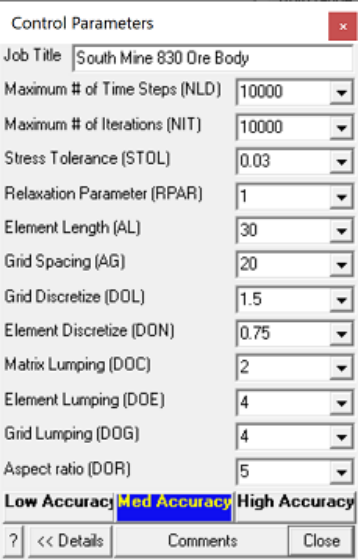
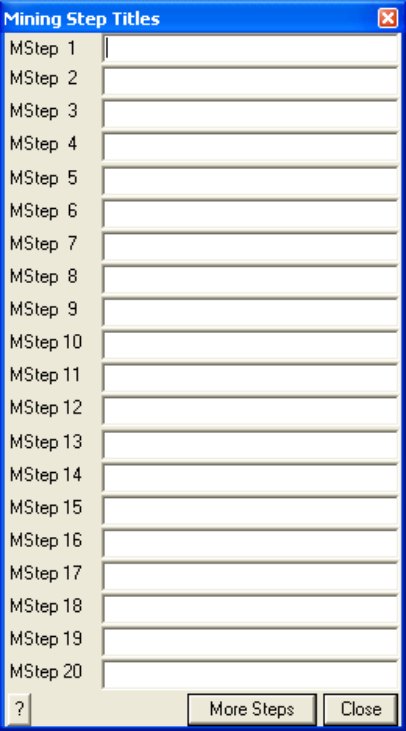

## 5.3.12.1 Control Parameters

Specification of analysis control parameters.

**Job Title** - specifies a descriptive project title.

**Maximum # of Time Steps (** **_NLD_ )** - specifies the maximum number of steps that will be used during analysis. This parameter is only relevant if you are conducting a non-linear creep analysis

#### Analysis > Options > Creep

where this limits the actual number of time steps.

If this parameter is exceeded, the program stops and the user is prompted for instructions on how to proceed. This parameter can be modified during solution.

Unless the user has some special reason for limiting the number of time steps this parameter should be set to an arbitrarily large number.

**Maximum # of Iterations (** **_NIT_ )** - specifies the maximum number of iterations that will used during matrix solution.

If this parameter is exceeded, the program stops and the user is prompted for instructions on how to proceed. This parameter can be modified during solution.

Unless the user has some special reason for limiting the number of time steps this parameter should be set to an arbitrarily large number.

**Stress Tolerance (** **_STOL_ )** - specifies the required accuracy of the matrix solution.

During matrix solution the accuracy is successively improved with each iteration. When the maximum stress error falls below this value the matrix can be considered to be solved.

The suggested value for the parameter is 0.1% of the far field stress state at the depth of interest. _STOL_ should be specified in the same units as the far field stress state (e.g. MPa or psi).

**Relaxation Parameter (** **_RPAR_ )** - specifies the maximum relaxation value that will be used during matrix solution.

During matrix solution the program continuously modifies the relaxation parameter in an attempt to obtain convergence with as few as possible iterations. This parameter limits the maximum value that will be used.

The value of 1.2 is recommended for well-conditioned problems. For poorly conditioned problems a value of 0.8 should be used.

**Element Length (** **_AL_ )** - specifies the minimum element length.

During the discretization process all model surfaces (surfaces of FF blocks and DD planes) are subdivided into boundary elements with side length

_Lelem = Delem/DON_

where _Delem_ is determined by Map3D as the smallest distance between adjacent model surfaces. Since at some locations the distance _Delem_ may be zero, the minimum element side length _AL_ must be specified.

_AL_ should be set equal to twice the smallest pillar or stope width. The same units used to specify the coordinates should be used (e.g. metres or feet).

Once discretization is complete, the distance _Delem_ can be plotted using

Plot > Miscellaneous > Delem distance to nearest element on surfaces.

Note that if desired, this behaviour can be overridden on an element by element basis by specifying the maximum width for each element

#### CAD > Edit > Entity Properties > Maximum Width

This allows users to force fine uniform discretization on surfaces in areas where there are no grid planes.

**Grid Spacing (** **_AG_ )** - specifies the minimum grid spacing.

During the discretization process all field point grids and model surfaces are subdivided into elements with side length

_Lgrid = Dgrid/DOL_

where _Dgrid_ is determined by Map3D as the smallest distance between model surfaces and grid planes. Since at some locations the distance _Dgrid_ may be zero, the minimum grid spacing _AG_ must be specified. This same process is used to discretize model surfaces (surfaces of FF blocks and DD planes) that are near field point grids.

_AG_ should be set equal to the smallest dimension of interest. For example if the user needs to see the stress distribution across a 2m wide pillar, a value for _AG_ of 0.5 would give sufficient number of field points for accurate contouring. The same units used to specify the coordinates should be used (e.g. metres or feet).

Once discretization is complete, the distance _Dgrid_ can be plotted on model surfaces using

Plot > Surface Components > Dgird distance to nearest grid

or on grids using

Plot > Miscellaneous > Delem distance to nearest element on grids.

Note that if desired, this behaviour can be overridden on a grid by grid basis by specifying the maximum spacing for each grid

#### CAD > Edit > Entity Properties > Maximum Width

This allows users to force fine uniform discretization on grids.

**Grid Discretize (** **_DOL_ ) -** specifies the desired distance to element length ratio used to determine the grid spacing from

_Lgrid = Dgrid/DOL_

where _Dgrid_ is determined by Map3D as the smallest distance between model surfaces and grid planes.

A value for _DOL_ of 1.0 is generally adequate and can be expected to provide solutions with 10-20% error. If higher accuracy is required a value for _DOL_ of 2.0 should give 5-10% error. Use a value of 4.0 for less than 5% error. Although higher values of _DOL_ results in generation of more boundary elements and hence longer run times, this is necessary to obtain increased accuracy.

Once discretization is complete, the ratio of _Dgrid/Lelem_ can be plotted on model surfaces using

Plot > Miscellaneous > Dgrid/Lelem _DOL_ ratio on surfaces

or the ratio of _Dgrid/Lgrid_ on grids using

Plot > Miscellaneous > Dgrid/Lgrid _DOL_ ratio on grids.

**Element Discretize (** **_DON_ ) -** specifies the desired distance to element length ratio used to determine the element side length

_Lelem = Delem/DON_

where _Delem_ represents the distance to the nearest model surface.

A value for _DON_ of 0.5 is generally adequate for all problems except those with very narrow excavations or pillars. In this latter case a value for _DON_ of 1.0 is recommended. Although higher values of _DON_ results in generation of more boundary elements and hence longer run times, this is necessary to obtain a well conditioned solvable problem for very narrow excavations or pillars.

Once discretization is complete, the ratio of _Delem/Lelem_ can be plotted using

Plot > Miscellaneous > Delem/Lelem _DON_ ratio on surfaces.

**Matrix Lumping (** **_DOC_ ) -** specifies the desired distance to element length ratio. During matrix assembly, all elements that fit within the dimension

#### _Delem/DOC_

will be lumped together. _Delem_ represents the distance to the nearest model surface.

Just as for _DOL_ , a value for _DOC_ of 1.0 is generally adequate and can be expected to provide solutions with 10-20% error. If higher accuracy is required a value for _DOC_ of 2.0 should give 5-10% error. Use a value of 4.0 for less than 5% error. Although higher values of _DOC_ result in larger coefficient matricies and hence longer run times, this is necessary to obtain increased accuracy.

Once discretization is complete, the distance _Delem_ can be plotted using

Plot > Miscellaneous > Delem distance to nearest element on surfaces.

**Element Lumping (** **_DOE_ ) -** specifies the desired distance to element length ratio. During grid assembly, all elements that fit within the dimension

#### _Dgrid/DOE_

will be lumped together. _Dgrid_ represents the distance to the nearest field point grid surface.

A value for _DOE_ of 2.0 is generally adequate and can be expected to provide solutions with 10-20% error. If higher accuracy is required a value for _DOE_ of 4.0 should give 5-10% error. Use a value of 8.0 for less than 5% error. Although higher values of _DOE_ result in longer run times, this is necessary to obtain increased accuracy.

Once discretization is complete, the distance _Dgrid_ can be plotted on grids using

Plot > Miscellaneous > Delem distance to nearest element on grids.

**Grid Lumping (** **_DOG_ ) -** specifies the desired distance to element length ratio. During grid assembly, all grid points that fit within the dimension

#### _Dgrid/DOG_

will be lumped together. _Dgrid_ represents the distance to the nearest field point grid surface.

A value for _DOG_ of 2.0 is generally adequate and can be expected to provide solutions with 10-20% error. If higher accuracy is required a value for _DOG_ of 4.0 should give 5-10% error. Use a value of 8.0 for less than 5% error. Although higher values of _DOG_ result in longer run times, this is necessary to obtain increased accuracy.

Once discretization is complete, the distance _Dgrid_ can be plotted on grids using

Plot > Miscellaneous > Delem distance to nearest element on grids.

**Aspect Ratio (** **_DOR_ ) -** specifies the desired element aspect ratio. A value for _DOR_ of 5.0 is recommended for all problems except where the user wants narrow elements subdivided into more uniform shapes.

Sets _DON_ =0.5, _DOL=DOC_ =1, _DOE=DOG_ =2 for 10-20% error. Sets _DON_ =0.5, _DOL=DOC_ =2, _DOE=DOG_ =4 for 5-10% error. Sets _DON_ =1, _DOL=DOC_ =4, _DOE=DOG_ =8 for &lt; 5% error.

**Comments -** allows you to specify comments to be saved with the run.

#### Summary:

- _STOL_ should be set equal to 0.1% of the far field stress state at the depth of interest. Use the same units as the far field stress state (e.g. MPa or psi).

- _AL_ should be set equal to twice the smallest pillar or stope width. Use the same units used to specify the coordinates (e.g. metres or feet).

- _AG_ should be set equal to the smallest dimension of interest. Use the same units used to specify the coordinates (e.g. metres or feet).

- Elements are discretized to a side length that is the smaller of _Delem/DON_ and _Dgrid/DOL_ , such that it cannot be less than _AL_ and cannot be larger than the maximum width.

- Grid are discretized to a spacing is determined from _Dgrid/DOL_ such that is cannot be less than _AG_ and cannot be larger than the maximum spacing.

- During matrix assembly, all elements that fit within the dimension _Delem/DOC_ will be lumped together.

- During grid assembly, all elements that fit within the dimension _Dgrid/DOE_ will be lumped together.

- During grid assembly, all grid points that fit within the dimension _Dgrid/DOG_ will be lumped together.

#### Notes:

For a more detailed discussion on discretization and lumping refer to

- Discretization and Lumping.

## 5.3.12.2 Mining Step Titles

Specification of a specifies a descriptive title for each mining step.

## 5.3.12.3 Material Properties

Specification of material properties.

Several different dialogue boxes will appear depending on the material type selected: Mohr-Coulomb, Hoek-Brown, Drucker-Prager, Backfill Hyperbolic and None.

Mohr-Coulomb in 3D FF blocks can be used as a flow rule for non-linear material behaviour in Map3D Non-Linear and Map3D Visco-Plastic. Can also be used as failure criterion in 3D FF blocks or in the host material in Map3D Fault-Slip.

Hoek-Brown in 3D FF blocks can be used as failure criterion in 3D FF blocks or in the host material in Map3D Fault-Slip.

Drucker-Prager in 3D FF blocks can be used as failure criterion in 3D FF blocks or in the host material in Map3D Fault-Slip.

Fault-Gouge in DD planes can be used as a flow rule in DD planes in Map3D Fault-Slip, Map3D NonLinear or Map3D Visco-Plastic.

Equilibrated-Gouge in DD planes can be used as a flow rule in DD planes in Map3D Fault-Slip, Map3D Non-Linear or Map3D Visco-Plastic.

Yielding-Pillar in DD planes can be used as a flow rule in DD planes in Map3D Fault-Slip, Map3D NonLinear or Map3D Visco-Plastic.

Hyperbolic-Backfill in DD planes can be used as a flow rule in DD planes in Map3D Fault-Slip, Map3D Non-Linear or Map3D Visco-Plastic.

Quadratic-Backfill in DD planes can be used as a flow rule in DD planes in Map3D Fault-Slip, Map3D Non-Linear or Map3D Visco-Plastic.

Softened Material in 3D FF blocks or DD planes can be used to soften an elastic material to simulate ground yielding and the resulting stress redistribution effects.

Stress State specify the pre-mining stress state.

In elastic analyses the failure criterion is used only for strength factor calculations and contour plotting and does not affect the analysis results.

In non-linear analyses (3D FF blocks in Map3D Non-Linear, 3D FF blocks in Map3D Visco-Plastic, and DD planes in Map3D Fault-Slip) the failure criterion is used as a flow rule to control yielding and nonlinear deformations.

## 5.3.12.4 Map3Di Setup

Sets up the Map3Di analysis.

Map3Di allows one to superimpose external field loading effects into the Map3D model. For details on this feature refer to Map3Di.

When you check a Map3Di loading file for use you will be prompted to search for a file name, location. If the search is successful, the file will be checked.

The Map3Di loading file is specified in polyline file format. Refer to Contour Plane Options for details on generating a Map3Di loading file.

Comment lines must start with an asterisk "*" in column 1.

2D planes are stored as a series of triangle or quadrilateral polylines as follows:

x1 y1 z1 3 values1 x2 y2 z2 2 values2 x3 y3 z3 2 values3 x4 y4 z4 2 values4 ...

3D blocks are stored as a series of tetrahedral or hexahedral polylines as follows:

x1 y1 z1 3 values1 x2 y2 z2 2 values2 x3 y3 z3 2 values3 x4 y4 z4 2 values4 x5 y5 z5 1 values5 x6 y6 z6 1 values6

x7 y7 z7 1 values7

x8 y8 z8 1 values8

where **xi yi zi** represent the coordinates of each point.

- 3 indicates that this point is the beginning of a new polyline.

- 2 indicates that this point forms part of the base of the block.

- 1 indicates that this point forms part of the top of the block. This item is only used for definition of 3D block shapes.

Additional polylines are specified by repeating the sequence (i.e. starting a new polyline with the number **3** ).

Any of the points can be repeated or skipped to specify triangular shaped sides or tetrahedrons.

- valuesi specifies the magnitude of the field loading at the centre, or at each corner. If only values1 is specified (i.e. values2 … are left blank) that value is applied uniformly across the entity.

- If valuesi are specified for all corners, the field loading is applied according to a higher order polynomial distribution.

For 2D surface triangles a linear distribution is used

_a_ + _b x_ + _c y_

For 2D quadrilaterals, the following distribution is used

_a_ + _b x_ + _c y_ + _d x y_

For 3D block shapes, as many terms as possible of the distribution are used

_a_ + _b x_ + _c y_ + _d z_ + _e x y_ + _f y z_ + _g z x_ + _h x y z_

The actual field loading effects can be specified in several ways.

#### 2D Planes

2D planes define a Displacement Discontinuity with specified normal displacement (closure) dn, and shear displacement (ride) ds, such that valuesi can be specified either as

dn ds or dn ds1 ds2

If only dn ds are specified, the shear displacement (ride) is applied parallel to the maximum in-plane shear stress for the 2D plane.

If all of dn ds1 ds2 are specified, the shear displacement (ride) component ds1 is applied parallel to the first side (i.e. the side defined by x1 y1 z1 – x2 y2 z2). ds2 is applied perpendicular to ds1 in the direction of the second side (i.e. the side defined by x2 y2 z2 - x3 y3 z3).

Shear displacement (ride) and normal displacement (closure) are specified in displacement units (i.e. the same units as the geometry is specified in (metres).

The shear displacement (ride) and normal displacement (closure) may be determined from in situ or laboratory measurements of shear, closure and/or crack opening, or from another numerical modelling program such as a reservoir or hydraulic fracture simulator. These can also be estimated from seismic monitoring data.

#### 3D Blocks

3D blocks define a zone with specified strain e, either as

e1 e2 e3 or exx eyy ezz exy eyz ezx

If only e1 e2 e3 are specified, these principal strains are applied parallel to the principal stresses. The strains are used to determine the initial stress s° using

s1° = [ ( _1-_ n) e1 + n ( e2 + e3 ) ] _E_ / [ ( _1+_ n) ( _1-2_ n) ] s2° = [ ( _1-_ n) e2 + n ( e3 + e1 ) ] _E_ / [ ( _1+_ n) ( _1-2_ n) ] s3° = [ ( _1-_ n) e3 + n ( e1 + e2 ) ] _E_ / [ ( _1+_ n) ( _1-2_ n) ]

If all of exx eyy ezz exy eyz ezx are specified, these strains are applied as Cartesian components. The strains are used to determine the initial stress s° using

sxx°  = [ ( _1-_ n) exx + n ( eyy + ezz ) ] _E_ / [ ( _1+_ n) ( _1-2_ n) ] syy° = [ ( _1-_ n) eyy + n ( ezz + exx ) ] _E_ / [ ( _1+_ n) ( _1-2_ n) ] szz°  = [ ( _1-_ n) ezz + n ( exx + eyy ) ] _E_ / [ ( _1+_ n) ( _1-2_ n) ] txy° = exy _E_ / ( _1+_ n) tyz° = eyz _E_ / ( _1+_ n) tzx° = ezx _E_ / ( _1+_ n)

Strains are specified in dimensionless strain units (i.e. 0.001 would specify 1000 micro strain).

_E_ and n represent respectively Young's (rock mass scale - deformation) modulus and Poisson's ratio. Map3D automatically determines which material the corner of the 3D block is located within and uses the corresponding material properties.

The strains may be determined from in situ or laboratory measurements of temperature or fluid pressure, or from another numerical modelling program such as a thermal analysis code. These can also be estimated from seismic monitoring data.

The strains that should be applied can be determined from the temperature through an expansion coefficient _A_ , where the temperature change or fluid pressure change (from the background value) induces the initial stresses

s1° **=** s2° **=** s3° = _A_ D _T_

For fluid flow problems the expansion coefficient _A_ , should be set to unity (positive one) for saturated media. For thermal problems the expansion coefficient should be specified as a negative quantity given by

_A_ = a _E /(1-2_ n _)_

where a represents the coefficient of thermal expansion (i.e. the linear expansivity).

#### Notes

This function must be set up before conducting the Map3D BEM analysis

Analysis > BEM Analysis.

CAD > Properties > Map3Di Setup > View enables viewing of the Map3Di data.

## 5.3.12.5 Model Information

Displays the current tally for the following model parameters:

- number of surfaces used to define the geometry,

- number of coordinates used to define the surfaces,

- number of mining steps.

The following parameters are only displayed after the discretization analysis (Analysis > Discretization) is complete:

- number of boundary elements,

- number of boundary nodes (only used for higher order elements (Analysis > Options > Linear),

- number of field points on user defined grids.
