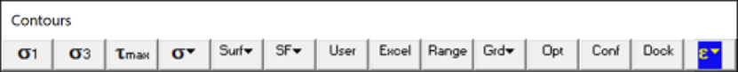
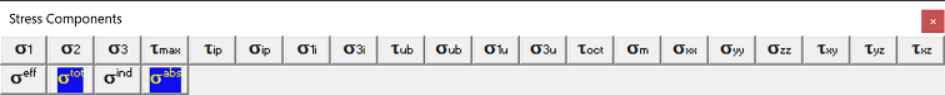
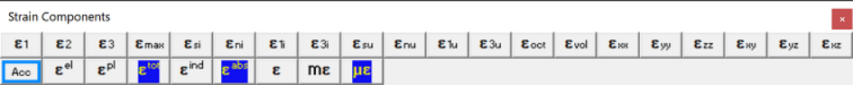
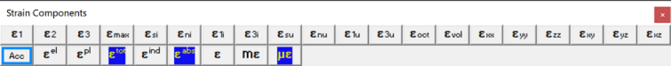
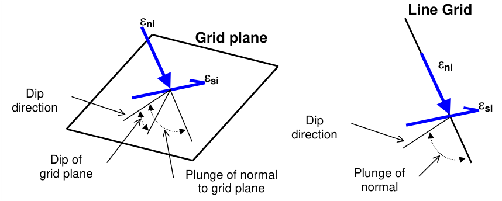
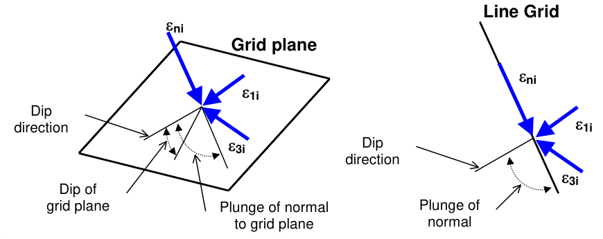
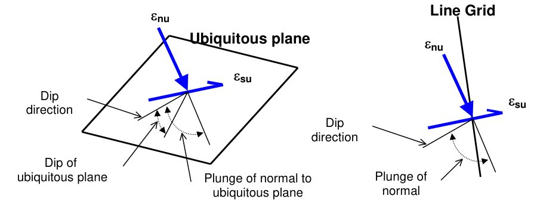
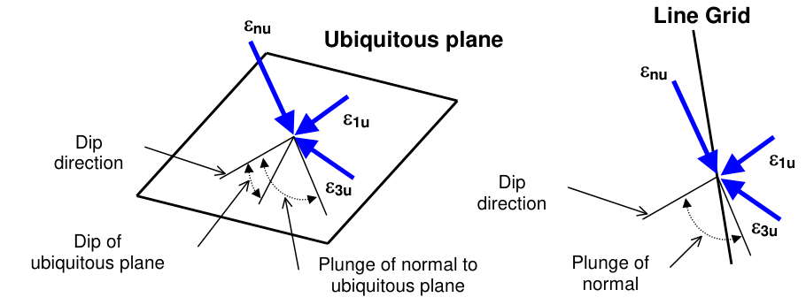

## 5.3.2.1 Major Principal Strain

Contours the major , intermediate and minor principal strains. These components can be accessed via the Strain Components toolbar as follows:

This toolbar can be changed to a vertical orientation by dragging is against either the right or left hand edge of the main window.

It can be changed back to a horizontal orientation by dragging is against either the top or bottom edge of the main window.

Selecting the button on the Contours toolbar activates the Stress Components toolbar.

This toolbar can be changed to a vertical orientation by dragging is against either the right or left hand edge of the main window.

It can be changed back to a horizontal orientation by dragging is against either the top or bottom edge of the main window.

Selecting the button on the Contours toolbar activates the Strain Components toolbar.

You can add this button to the Contours toolbar using the configuration

button.

In elastic analysis the major principal stress is normally used with the minor principal stress and the Mohr-Coulomb or Hoek-Brown strength criterion to estimate the amount of damage due to overstressing. By contrast, in non-linear analysis the stresses can never exceed the strength unless some creep is used. In this latter case, viscous creep can allow stress states above the failure criterion, thus indicating a lack of static equilibrium. Hence for non-linear analysis one normally directly considers the amount of non-linear strain or the strain rate predicted by the model

Mohr-Coulomb in 3D FF blocks

#### Accumulated Damage:

In the case of plastic analysis, the accumulated damage function can be activated, When Acc is not activated, the current value of plastic strain is used. When Acc is activated, damage is tracked from step 1 to the current step throughout the model loading history, hence the worst case (maximum) plastic strain is plotted.

Note that both the step at which first yield occurs MStep 1st Yield, and the step at which the maximum plastic strain occurs MStep Max Yield, are tracked and can be displayed as trajectory labels.

#### Strain Components:

Note that there are three components of strain that can be contoured:

Plot > Strain > Value > Elastic Plot > Strain > Value > Plastic

Plot > Strain > Value > Total

There are also two different ways of presenting the strain:

Plot > Strain > Value > Induced Strain

Plot > Strain > Value > Absolute Strain

The contour range is set using

#### Plot > Range

Any of these components can be added to the contouring toolbar if desired.

Tools > Configure Contouring Toolbar > Strain

The user may find it handy to add the

#### More Strain Components

button to the contouring toolbar for quick access to all strain components.

## 5.3.2.4 Maximum Shear Strain

Contours the maximum shear strain ½( e1 - e3 )

This component can be accessed via the Strain Components toolbar as follows:

This toolbar can be changed to a vertical orientation by dragging is against either the right or left hand edge of the main window.

It can be changed back to a horizontal orientation by dragging is against either the top or bottom edge of the main window.

Selecting the button on the Contours toolbar activates the Stress Components toolbar.

You can add this button to the Contours toolbar using the configuration button.

In elastic analysis the major principal stress is normally used with the minor principal stress and the Mohr-Coulomb or Hoek-Brown strength criterion to estimate the amount of damage due to overstressing. By contrast, in non-linear analysis the stresses can never exceed the strength unless some creep is used. In this latter case, viscous creep can allow stress states above the failure criterion, thus indicating a lack of static equilibrium. Hence for non-linear analysis one normally directly considers the amount of non-linear strain or the strain rate predicted by the model

Mohr-Coulomb in 3D FF blocks

Note that there are three components of strain that can be contoured:

Plot > Strain > Value > Elastic Plot > Strain > Value > Plastic Plot > Strain > Value > Total

There are also two different ways of presenting the strain:

Plot > Strain > Value > Induced Strain Plot > Strain > Value > Absolute Strain

The contour range is set using

#### Plot > Range

Any of these components can be added to the contouring toolbar if desired

Tools > Configure Contouring Toolbar > Strain

The user may find it handy to add the

#### More Strain Components

button to the contouring toolbar for quick access to all strain components.

## 5.3.2.5 In-Plane Shear Strain

Contours the maximum shear strain acting on the grid plane, and the strain component normal to the grid plane or parallel to a line grid.

These components can be accessed via the Strain Components toolbar as follows:

This toolbar can be changed to a vertical orientation by dragging is against either the right or left hand edge of the main window.

It can be changed back to a horizontal orientation by dragging is against either the top or bottom edge of the main window.

Selecting the button on the Contours toolbar activates the Stress Components toolbar.

You can add this button to the Contours toolbar using the configuration button.

#### Plot > Grid Selection

To calculate the in-plane strains, the strain state at each point on the grid plane is reoriented to determine the maximum shear strain parallel to the grid plane and the strain normal to the plane. Note that eip is oriented normal to the grid plane and parallel to the direction of a line grid.

- dip direction is measured positive clockwise from the y-axis.

- dip of the plane is measured positive down from the horizontal (i.e. the dip direction).

- plunge of the normal is measured positive down (i.e. negative up) from the horizontal.

In elastic analysis the maximum in-plane shear stress is normally used with the in-plane normal stress and the Mohr-Coulomb strength criterion

Mohr-Coulomb in 3D FF blocks

to estimate the amount of damage due to over-stressing. By contrast, in non-linear analysis the stresses can never exceed the strength unless some creep is used. In this latter case, viscous creep can allow stress states above the failure criterion, thus indicating a lack of static equilibrium. Hence for non-linear analysis one normally directly considers the amount of non-linear strain or the strain rate predicted by the model

Mohr-Coulomb in DD planes

to estimate the amount of slip due to over-stressing, on a fault, joint set or bedding plane oriented in the same way as the grid plane. Since these parameters are orientation dependant, this criterion is representative for anisotropic rock mass stability.

Note that there are three components of strain that can be contoured:

Plot > Strain > Value > Elastic

Plot > Strain > Value > Plastic Plot > Strain > Value > Total

There are also two different ways of presenting the strain:

Plot > Strain > Value > Induced Strain Plot > Strain > Value > Absolute Strain

The contour range is set using

#### Plot > Range

Any of these components can be added to the contouring toolbar if desired

Tools > Configure Contouring Toolbar > Strain

The user may find it handy to add the

#### More Strain Components

button to the contouring toolbar for quick access to all strain components.

Related topics:

Plot > Strain > e1i In-plane Maximum Plot > Strain > e3i In-plane Minimum Plot > Strain > esu Ubiquitous-plane Shear Plot > Strain > enu Ubiquitous-plane Normal

## 5.3.2.7 In-Plane Maximum Strain

Contours the maximum and minimum strains tangential to the currently selected grid plane or perpendicular to a line grid.

These components can be accessed via the Strain Components toolbar as follows:

This toolbar can be changed to a vertical orientation by dragging is against either the right or left hand edge of the main window.

It can be changed back to a horizontal orientation by dragging is against either the top or bottom edge of the main window.

Selecting the button on the Contours toolbar activates the Stress Components toolbar.

You can add this button to the Contours toolbar using the configuration button.

#### Plot > Grid Selection

To calculate the maximum and minimum in-plane strains, the strains tangential to the grid plane are determined, then resolved to give the maximum and minimum values. Note that eni is oriented normal to the grid plane and parallel to the direction of a line grid. Also note that eni, e1i and e3i are perpendicular to one another.

- dip direction is measured positive clockwise from the y-axis.

- dip of the plane is measured positive down from the horizontal (i.e. the dip direction).

- plunge of the normal is measured positive down (i.e. negative up) from the horizontal.

Note that there are three components of strain that can be contoured:

#### Plot > Strain > Value > Elastic

Plot > Strain > Value > Plastic Plot > Strain > Value > Total

There are also two different ways of presenting the strain:

Plot > Strain > Value > Induced Strain Plot > Strain > Value > Absolute Strain

The contour range is set using

Plot > Range

This component can be added to the contour toolbar if desired

Tools > Configure Contouring Toolbar > Strain

The user may find it handy to add the

More Strain Components

button to the contouring toolbar for quick access to all strain components.

Related topics:

Plot > Strain > esi In-plane Shear Plot > Strain > eni In-plane Normal Plot > Strain > e1u Ubiquitous-plane Maximum. Plot > Strain > e3u Ubiquitous-plane Minimum.

## 5.3.2.9 Ubiquitous-Plane Shear Strain

Contours the maximum shear strain acting on ubiquitous plane #1, and the strain component normal to this plane.

These components can be accessed via the Strain Components toolbar as follows:

This toolbar can be changed to a vertical orientation by dragging is against either the right or left hand edge of the main window.

It can be changed back to a horizontal orientation by dragging is against either the top or bottom edge of the main window.

Selecting the button on the Contours toolbar activates the Stress Components toolbar.

You can add this button to the Contours toolbar using the configuration button.

To calculate the ubiquitous strains, the strain state at each point on the grid plane is reoriented to determine the maximum shear strain parallel to the ubiquitous plane and the strain normal to the ubiquitous plane. Note that enu is oriented normal to the ubiquitous plane and is not parallel to the direction of a line grid.

- dip direction is measured positive clockwise from the y-axis.

- dip of the plane is measured positive down from the horizontal (i.e. the dip direction).

- plunge of the normal is measured positive down (i.e. negative up) from the horizontal.

The orientation of the ubiquitous shear plane is set using

#### Plot > Strength Factors > Ubiquitous Parameters

Note that there are three components of strain that can be contoured:

Plot > Strain > Value > Elastic

Plot > Strain > Value > Plastic Plot > Strain > Value > Total

There are also two different ways of presenting the strain:

Plot > Strain > Value > Induced Strain

Plot > Strain > Value > Absolute Strain

The contour range is set using

#### Plot > Range

This component can be added to the contour toolbar if desired

#### Tools > Configure Contouring Toolbar > Strain

The user may find it handy to add the

#### More Strain Components

button to the contouring toolbar for quick access to all strain components.

Related topics:

Plot > Strain > e1u Ubiquitous-plane Maximum. Plot > Strain > e3u Ubiquitous-plane Minimum. Plot > Strain > esi In-plane Shear Plot > Strain > eni In-plane Normal

## 5.3.2.11 Ubiquitous-Plane Maximum Strain

Contours the maximum and minimum strains tangential to the ubiquitous plane #1. These components can be accessed via the Strain Components toolbar as follows:

This toolbar can be changed to a vertical orientation by dragging is against either the right or left hand edge of the main window.

It can be changed back to a horizontal orientation by dragging is against either the top or bottom edge of the main window.

Selecting the button on the Contours toolbar activates the Stress Components toolbar.

You can add this button to the Contours toolbar using the configuration button.

To calculate the ubiquitous strains, the strain state at each point on the grid plane is reoriented to determine the maximum and minimum strain parallel to the ubiquitous plane. Note that enu is not oriented normal to the ubiquitous plane and is not parallel to the direction of a line grid.

- dip direction is measured positive clockwise from the y-axis.

- dip of the plane is measured positive down from the horizontal (i.e. the dip direction).

- plunge of the normal is measured positive down (i.e. negative up) from the horizontal.

The orientation of the ubiquitous shear plane is set using

#### Plot > Strength Factors > Ubiquitous Parameters

Note that there are three components of strain that can be contoured:

Plot > Strain > Value > Elastic

Plot > Strain > Value > Plastic

Plot > Strain > Value > Total

There are also two different ways of presenting the strain:

Plot > Strain > Value > Induced Strain

Plot > Strain > Value > Absolute Strain

The contour range is set using

#### Plot > Range

This component can be added to the contour toolbar if desired

#### Tools > Configure Contouring Toolbar > Strain

The user may find it handy to add the

#### More Strain Components

button to the contouring toolbar for quick access to all strain components.

Related topics:

Plot > Strain > esi Ubiquitous-plane Shear

Plot > Strain > eni Ubiquitous-plane Normal

Plot > Strain > e1u In-plane Maximum.

Plot > Strain > e3u In-plane Minimum.

## 5.3.2.13 Octahedral Shear Strain

Contours the octahedral shear strain

eoct = ¹/3 [ (e1 - e2)² + (e2 - e3)² +(e3 - e1)² ]½

and the volumetric strain

evvol = (e1 + e2 + e3)

These components can be accessed via the Strain Components toolbar as follows:

This toolbar can be changed to a vertical orientation by dragging is against either the right or left hand edge of the main window.

It can be changed back to a horizontal orientation by dragging is against either the top or bottom edge of the main window.

Selecting the button on the Contours toolbar activates the Stress Components toolbar.

You can add this button to the Contours toolbar using the configuration button.

In elastic analysis the major principal stress is normally used with the minor principal stress and the Mohr-Coulomb or Hoek-Brown strength criterion to estimate the amount of damage due to overstressing.

By contrast, in non-linear analysis the stresses can never exceed the strength unless some creep is used. In this latter case, viscous creep can allow stress states above the failure criterion, thus indicating a lack of static equilibrium. Hence for non-linear analysis one normally directly considers the amount of non-linear strain or the strain rate predicted by the model

Mohr-Coulomb in 3D FF blocks

Note that there are three components of strain that can be contoured:

Plot > Strain > Value > Elastic Plot > Strain > Value > Plastic Plot > Strain > Value > Total

There are also two different ways of presenting the strain:

Plot > Strain > Value > Induced Strain

Plot > Strain > Value > Absolute Strain

The contour range is set using

#### Plot > Range

This component can be added to the contour toolbar if desired

#### Tools > Configure Contouring Toolbar > Strain

The user may find it handy to add the

#### More Strain Components

button to the contouring toolbar for quick access to all strain components.

## 5.3.2.15 Exx Strain Component

Contours the Cartesian strrain components. These components can be accessed via the Strain Components toolbar as follows:

This toolbar can be changed to a vertical orientation by dragging is against either the right or left hand edge of the main window.

It can be changed back to a horizontal orientation by dragging is against either the top or bottom edge of the main window.

Selecting the button on the Contours toolbar activates the Stress Components toolbar.

You can add this button to the Contours toolbar using the configuration button.

Plot > Strain >  exx Cartesian Strain Component   normal strain in the direction of the x-axis Plot > Strain >  eyy Cartesian Strain Component   normal strain in the direction of the y-axis Plot > Strain >  ezz Cartesian Strain Component   normal strain in the direction of the z-axis Plot > Strain >  exy Cartesian Strain Component   normal strain in the direction of the x-y plane Plot > Strain >  eyz Cartesian Strain Component   normal strain in the direction of the y-z plane Plot > Strain >  exz Cartesian Strain Component   normal strain in the direction of the x-z plane

Note that there are three components of strain that can be contoured:

Plot > Strain > Value > Elastic Plot > Strain > Value > Plastic Plot > Strain > Value > Total

There are also two different ways of presenting the strain:

Plot > Strain > Value > Induced Strain Plot > Strain > Value > Absolute Strain

The contour range is set using

#### Plot > Range

This component can be added to the contour toolbar if desired

Tools > Configure Contouring Toolbar > Strain

The user may find it handy to add the

More Strain Components

button to the contouring toolbar for quick access to all strain components.

## 5.3.2.21 Value

5.3.2.21.1  Elastic strain

Selects the elastic, plastic or total strain component. These components can be accessed via the Strain Components toolbar as follows:

This toolbar can be changed to a vertical orientation by dragging is against either the right or left hand edge of the main window.

It can be changed back to a horizontal orientation by dragging is against either the top or bottom edge of the main window.

Selecting the button on the Contours toolbar activates the Stress Components toolbar.

You can add this button to the Contours toolbar using the configuration button.

For details, refer to

Mohr-Coulomb in 3D FF blocks.

### 5.3.2.21.4 Induced Strain

Plot the induced or absolute strain component.

This component can be accessed via the Strain Components toolbar as follows:

This toolbar can be changed to a vertical orientation by dragging is against either the right or left hand edge of the main window.

It can be changed back to a horizontal orientation by dragging is against either the top or bottom edge of the main window.

Selecting the button on the Contours toolbar activates the Stress Components toolbar.

You can add this button to the Contours toolbar using the configuration button.

Induced strain is the strain without the pre-mining strain contribution. This represents the strain change since the pre-mining condition.

Absolute strain is the strain including the pre-mining strain contribution.

Also see:

Plot > Stress > Value > Induced Strain Plot > Stress > Value > Absolute Strain

### 5.3.2.21.6 Strain

Plot strain:

- in unscaled units (strain/1),

- in milli-strain (strain/1000),

- in micro-strain (strain/1000000).

This component can be accessed via the Strain Components toolbar as follows:

This toolbar can be changed to a vertical orientation by dragging is against either the right or left hand edge of the main window.

It can be changed back to a horizontal orientation by dragging is against either the top or bottom edge of the main window.

Selecting the button on the Contours toolbar activates the Stress Components toolbar.

You can add this button to the Contours toolbar using the configuration button.

