## 5.3.6.1 Rock Mass Parameters

### 5.3.6.1.1 Rockmass Strength Parameters

Sets up the strength parameters for generating strength factor contour plots in terms of principal stress components.

These components can be accessed via the Strength Factor Components toolbar as follows:

This toolbar can be changed to a vertical orientation by dragging is against either the right or left hand edge of the main window.

It can be changed back to a horizontal orientation by dragging is against either the top or bottom edge of the main window.

Selecting the button on the Contours toolbar activates the Strength Factor Components toolbar.

In elastic analysis the major and minor principal stresses can be used with the Mohr-Coulomb, HoekBrown or Drucker-Prager strength criteria to estimate the amount of damage due to over-stressing. Since none of the parameters have any orientation sensitivity, this criterion is representative for homogeneous rock mass stability.

By contrast, in non-linear analysis the stresses can never exceed the strength unless some creep is used. In this latter case, viscous creep can allow stress states above the failure criterion, thus indicating a lack of static equilibrium. Hence for non-linear analysis one normally directly considers the amount of non-linear strain or the strain rate predicted by the model

Mohr-Coulomb in 3D FF blocks.

#### Mohr-Coulomb

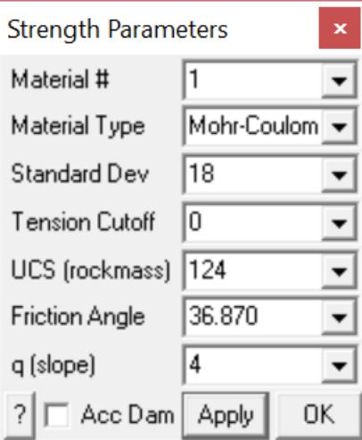

Material # specifies the material number. Material #1 represents the host material. Other material numbers are used to define alternate material zones such as ore, fault gouge, backfill etc.

Standard Deviation specifies the uncertainty you have in the failure criterion measured in the s1 direction.

Material Type specifies the material type: Mohr-Coulomb, Hoek-Brown, Drucker-Prager or None.

Tension Cutoff, UCS, Friction Angle the Mohr-Coulomb criterion defines strength in terms of principal stresses as follows:

#### Mohr-Coulomb

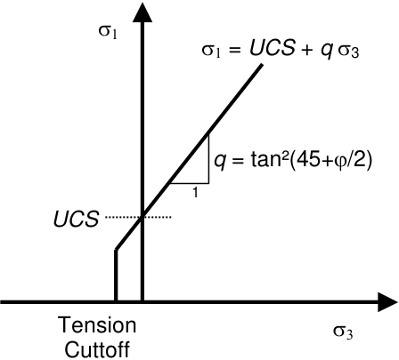

Tension cutoff and UCS are specified in units of stress (MPa or psi). Friction angle is specified in degrees.

Apply – regenerates the contour plot.

Acc Dam – plots accumulated damage. Refer to Accumulated Damage

#### Hoek-Brown

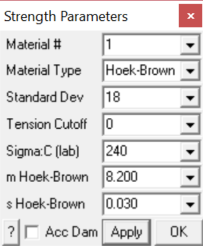

Material # specifies the material number. Material #1 represents the host material. Other material numbers are used to define alternate material zones such as ore, fault gouge, backfill etc.

Material Type specifies the material type: Mohr-Coulomb, Hoek-Brown, Drucker-Prager or None.

Standard Deviation specifies the uncertainty you have in the failure criterion measured in the s1 direction (specified in units of stress, MPa or psi).

Tension Cutoff, Sigma:C, m and s the Hoek-Brown criterion defines strength in terms of principal stresses as follows:

#### Hoek-Brown

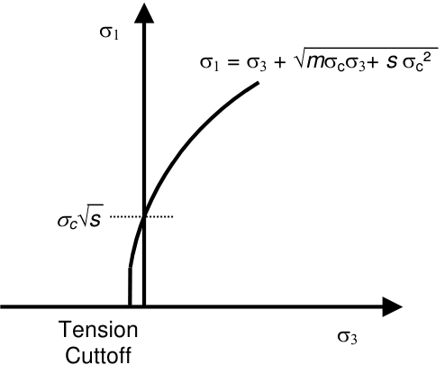

Tension cutoff and Sigma:C are specified in units of stress (MPa or psi).

Apply – regenerates the contour plot.

Acc Dam – plots accumulated damage. Refer to Accumulated Damage

#### Drucker-Prager

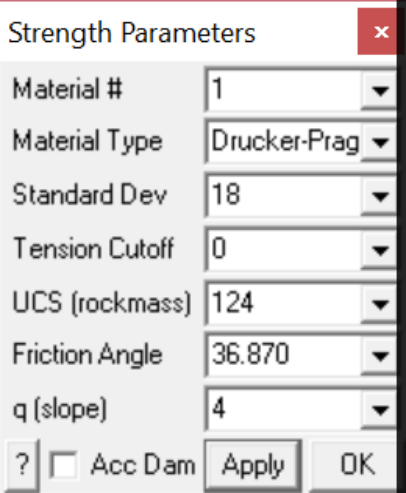

Material # specifies the material number. Material #1 represents the host material. Other material numbers are used to define alternate material zones such as ore, fault gouge, backfill etc. Material Type specifies the material type: Mohr-Coulomb, Hoek-Brown, Drucker-Prager or None.

Standard Deviation specifies the uncertainty you have in the failure criterion measured in the toct direction.

Tension Cutoff, UCS, Friction Angle the Drucker-Prager criterion defines strength in terms of principal stresses as follows:

#### Drucker-Prager

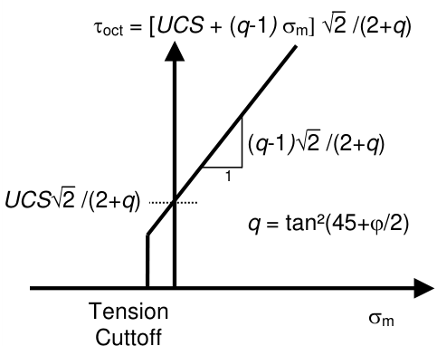

where

toct = ¹/3 [(s1 - s2)² + (s2 - s3)² +(s3 - s1)²]½

smean = ¹/3 (s1 + s2 + s3)

Tension cutoff and UCS are specified in units of stress (MPa or psi). Friction angle is specified in degrees.

Note that the strength parameters have been chosen so that the criterion simplifies to the MohrCoulomb criterion when s2 equals s3.

Apply – regenerates the contour plot.

Acc Dam – plots accumulated damage. Refer to Accumulated Damage

#### Related topics:

Plot > Strength Factor > Probability N-distribution

Plot > Strength Factor > SF-A - Strength/Stress Plot > Strength Factor > SF-B - Strength/Stress Plot > Strength Factors > SF-C - Strength/Stress Plot > Strength Factors > dS1 - Excess Stress Plot > Strength Factors > dTmax - Excess Stress

Plot > Strength Factors > dToct - Excess Stress

Plot > Strength Factors > In-plane Parameters

Plot > Strength Factors > Ubiquitous Parameters

### 5.3.6.1.2 Accumulated Damage

Plot Accumulated Damage.

This component can be accessed via the Strength Factor Components toolbar as follows:

This toolbar can be changed to a vertical orientation by dragging is against either the right or left hand edge of the main window.

It can be changed back to a horizontal orientation by dragging is against either the top or bottom edge of the main window.

Selecting the button on the Contours toolbar activates the Strength Factor Components toolbar.

When Acc is not activated, the Excess Stress, Probability of Failure, Strength Factor and RCF are plotted for the current stress values.

When Acc is activated, damage is tracked from step 1 to the current step throughout the model loading history, hence the worst case for Excess Stress, Probability of Failure, Strength Factor or RCF is plotted.

This allows elastic stress analysis results to be used in a manner similar to accumulated strain in a plasticity model.

Damage tracking is done separately for the 5 following cases:

1. Rock Mass failure (Excess S1 Stress, Probability, Strength Factor) 2. In-Plane Shear failure (Excess Shear Stress, Probability, Strength Factor) 3. Ub-Plane Shear failure (Excess Shear Stress, Probability, Strength Factor)

4. In-Plane Excess Wall Stress (Excess Stress, RCF)

5. Ub-Plane Excess Wall Stress (Excess Stress, RCF)

Note that both the step at which first yield occurs MStep 1st Yield, and the step at which the maximum excess stress occurs MStep Max Yield, are tracked and can be displayed as trajectory labels.

### 5.3.6.1.3 S1 Excess Stress

Contours the excess major principal stress and strength factor using method  "A". These components can be accessed via the Strength Factor Components toolbar as follows:

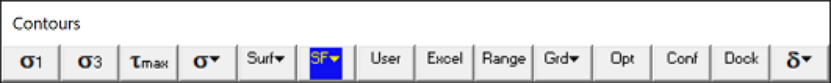

This toolbar can be changed to a vertical orientation by dragging is against either the right or left hand edge of the main window.

It can be changed back to a horizontal orientation by dragging is against either the top or bottom edge of the main window.

Selecting the

button on the Contours toolbar activates the Strength Factor Components toolbar.

In elastic analysis the major and minor principal stresses can be used with the Mohr-Coulomb or HoekBrown strength criteria

#### Plot > Strength Factors > Strength Parameters

to estimate the amount of damage due to over-stressing. Since none of the parameters have any orientation sensitivity, this criterion is representative for homogeneous rock mass stability.

By contrast, in non-linear analysis the stresses can never exceed the strength unless some creep is used. In this latter case, viscous creep can allow stress states above the failure criterion, thus indicating a lack of static equilibrium. Hence for non-linear analysis one normally directly considers the amount of non-linear strain or the strain rate predicted by the model

Mohr-Coulomb in 3D FF blocks.

Method "A" assumes that the stress path to failure takes place by increasing s1 without loss of confinement. This is representative of a pillar failure where s1 is considered to be the driving force.

#### Mohr-Coulomb

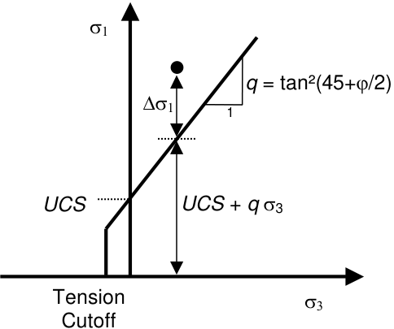

Plot > Strength Factors > SF-A   Strength/Stress can be determined as ( _UCS_ + _q_ s3 )/ s1 Plot > Strength Factors > SF/A   Stress/Strength can be determined as s1 / ( _UCS_ + _q_ s3 ) Plot > Strength Factors > Ds1   excess stress can be determined as Ds1 = s1 - ( _UCS_ + _q_ s3 )

Plot > Strength Factors > N(Ds1 /std)   Probability using the Normal distribution.

the same as in method "B".

#### Hoek-Brown

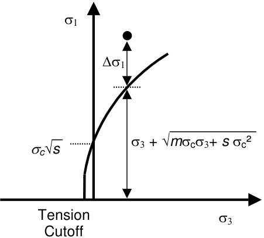

Plot > Strength Factors > SF-A   Strength/Stress can be determined as [ s3 + Ö( _m_ scs3 + _s_ sc²) ] / s1

Plot > Strength Factors > SF/A   Stress/Strength can be determined as s1 / [ s3 + Ö( _m_ scs3 + _s_ sc²) ]

Plot > Strength Factors > Ds1   excess stress can be determined as Ds1 = s1 - [ s3 + Ö( _m_ scs3 + _s_ sc²) ]

Plot > Strength Factors > N(Ds1 /std)   Probability using the Normal distribution.

the same as in method "B".

Drucker-Prager is only defined using method "C".

Strength parameters are setup using

Plot > Strength Factors > Strength Parameters

Related topics:

Plot > Strength Factor > SF-B - Strength/Stress Plot > Strength Factors > SF-C - Strength/Stress Plot > Strength Factors > dTmax - Excess Stress Plot > Strength Factors > dToct - Excess Stress Plot > Strength Factors > In-plane Parameters Plot > Strength Factors > Ubiquitous Parameters

### 5.3.6.1.4 Tmax Excess Stress

Contours the excess shear stress or strength factor using method "C". These components can be accessed via the Strength Factor Components toolbar as follows:

This toolbar can be changed to a vertical orientation by dragging is against either the right or left hand edge of the main window.

It can be changed back to a horizontal orientation by dragging is against either the top or bottom edge of the main window.

Selecting the button on the Contours toolbar activates the Strength Factor Components toolbar.

In elastic analysis the major and minor principal stresses can be used with the Mohr-Coulomb or HoekBrown strength criteria

Plot > Strength Factors > Strength Parameters

to estimate the amount of damage due to over-stressing. Since none of the parameters have any orientation sensitivity, this criterion is representative for homogeneous rock mass stability.

By contrast, in non-linear analysis the stresses can never exceed the strength unless some creep is used. In this latter case, viscous creep can allow stress states above the failure criterion, thus indicating a lack of static equilibrium. Hence for non-linear analysis one normally directly considers the amount of non-linear strain or the strain rate predicted by the model

Mohr-Coulomb in 3D FF blocks.

Method "C" assumes that the stress path to failure takes place by increasing s1 while loosing confinement. This is representative of an abutment failure where s1 - s3 is considered to be the driving force.

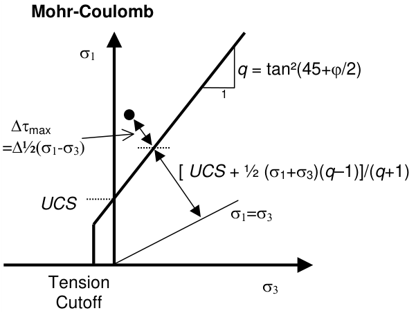

Plot > Strength Factors > SF-C   Strength/Stress can be determined as [ _UCS_ + ½(s1+s3) ( _q_ - 1) ]/[ ½(s1 - s3)( _q_ +1) ]

Plot > Strength Factors > SF/C   Stress/Strength can be determined as [ ½(s1 - s3)( _q_ +1) ]/ [ _UCS_ + ½(s1+s3) ( _q_ -1) ]

Plot > Strength Factors > Dtmax   excess stress can be determined as

Dtmax = ½(s1 - s3) - [ _UCS_ + ½(s1+s3) ( _q_ -1) ]/( _q_ +1)

= [s1 - ( _UCS_ + _q_ s3) ]/( _q_ +1)

#### Hoek-Brown

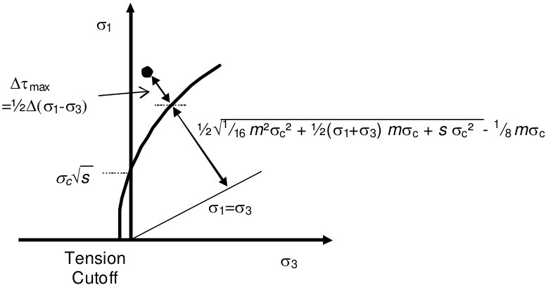

Plot > Strength Factors > SF-C   Strength/Stress can be determined as &#123; Ö[1 /16 _m_ ²sc² + ½(s1 + s3) _m_ sc + _s_ sc²] - ¼ _m_ sc&#125;/(s1 - s3)

Plot > Strength Factors > SF/C   Stress/Strength can be determined as (s1 - s3)/&#123; Ö[1 /16 _m_ ²sc² + ½(s1 + s3) _m_ sc + _s_ sc²] - ¼ _m_ sc &#125;

Plot > Strength Factors > Dtmax   excess stress can be determined as

Dtmax = ½(s1 - s3) - ½&#123; Ö[1 /16 _m_ ²sc² + ½(s1 + s3) _m_ sc + _s_ sc²] - ¼ _m_ sc &#125;

#### Drucker-Prager

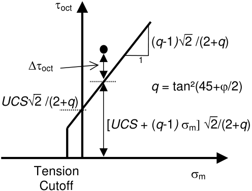

SF-C Strength/Stress   can be determined as [ _UCS_ + ( _q_ –1) smean ] Ö(2) /[ toct ( _q_ +2) ]

SF-C Stress/Strength   can be determined as toct /[ _UCS_ + ( _q_ –1) smean ] Ö(2) /( _q_ +2) Dtoct Excess   can be determined as toct - [ _UCS_ + ( _q_ –1) smean ] Ö(2) /( _q_ +2)

where

_q_ = tan²(45+j/2) toct = ¹/3 Ö[( s1 - s2 )² + ( s2 - s3 )² +( s3 - s1 )²] smean = ¹/3 ( s1 + s2 + s3 )

Note that the strength parameters have been chosen so that the criterion simplifies to the MohrCoulomb criterion when s2 equals s3.

Strength parameters are setup using

Plot > Strength Factors > Strength Parameters

Related topics:

Plot > Strength Factor > SF-A - Stress/Strength Plot > Strength Factors > SF-B - Stress/Strength Plot > Strength Factors > dS1 - Excess Stress Plot > Strength Factors > In-plane Parameters Plot > Strength Factors > Ubiquitous Parameters

5.3.6.1.6  NS1 Normal Probability

Contours the excess major principal stress and strength factor using method  "A". These components can be accessed via the Strength Factor Components toolbar as follows:

This toolbar can be changed to a vertical orientation by dragging is against either the right or left hand edge of the main window.

It can be changed back to a horizontal orientation by dragging is against either the top or bottom edge of the main window.

Selecting the button on the Contours toolbar activates the Strength Factor Components toolbar.

In elastic analysis the major and minor principal stresses can be used with the Mohr-Coulomb or HoekBrown strength criteria

Plot > Strength Factors > Strength Parameters

to estimate the amount of damage due to over-stressing. Since none of the parameters have any orientation sensitivity, this criterion is representative for homogeneous rock mass stability.

By contrast, in non-linear analysis the stresses can never exceed the strength unless some creep is used. In this latter case, viscous creep can allow stress states above the failure criterion, thus indicating a lack of static equilibrium. Hence for non-linear analysis one normally directly considers the amount of non-linear strain or the strain rate predicted by the model

Mohr-Coulomb in 3D FF blocks.

Method "A" assumes that the stress path to failure takes place by increasing s1 without loss of confinement. This is representative of a pillar failure where s1 is considered to be the driving force.

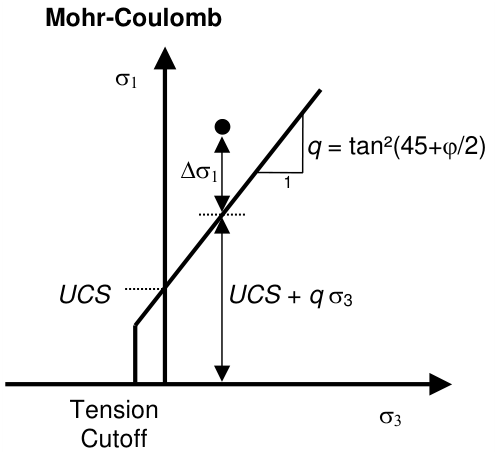

Plot > Strength Factors > SF-A   Strength/Stress can be determined as ( _UCS_ + _q_ s3 )/ s1 Plot > Strength Factors > SF/A   Stress/Strength can be determined as s1 / ( _UCS_ + _q_ s3 ) Plot > Strength Factors > Ds1   excess stress can be determined as Ds1 = s1 - ( _UCS_ + _q_ s3 )

Plot > Strength Factors > N(Ds1 /std)   Probability using the Normal distribution.

the same as in method "B".

#### Hoek-Brown

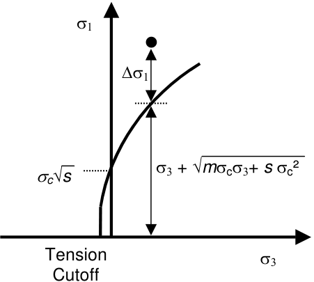

Plot > Strength Factors > SF-A   Strength/Stress can be determined as [ s3 + Ö( _m_ scs3 + _s_ sc²) ] / s1

Plot > Strength Factors > SF/A   Stress/Strength can be determined as s1 / [ s3 + Ö( _m_ scs3 + _s_ sc²) ]

Plot > Strength Factors > Ds1   excess stress can be determined as Ds1 = s1 - [ s3 + Ö( _m_ scs3 + _s_ sc²) ]

Plot > Strength Factors > N(Ds1 /std)   Probability using the Normal distribution.

the same as in method "B".

Drucker-Prager is only defined using method "C".

Strength parameters are setup using

Plot > Strength Factors > Strength Parameters

Related topics:

Plot > Strength Factor > SF-B - Strength/Stress Plot > Strength Factors > SF-C - Strength/Stress Plot > Strength Factors > dTmax - Excess Stress Plot > Strength Factors > dToct - Excess Stress Plot > Strength Factors > In-plane Parameters Plot > Strength Factors > Ubiquitous Parameters

### 5.3.6.1.8 SF-B Strength/Stress

Contours the excess major principal stress and strength factor using method  "B". These components can be accessed via the Strength Factor Components toolbar as follows:

This toolbar can be changed to a vertical orientation by dragging is against either the right or left hand edge of the main window.

It can be changed back to a horizontal orientation by dragging is against either the top or bottom edge of the main window.

Selecting the

button on the Contours toolbar activates the Strength Factor Components toolbar.

In elastic analysis the major and minor principal stresses can be used with the Mohr-Coulomb or HoekBrown strength criteria

#### Plot > Strength Factors > Strength Parameters

to estimate the amount of damage due to over-stressing. Since none of the parameters have any orientation sensitivity, this criterion is representative for homogeneous rock mass stability.

By contrast, in non-linear analysis the stresses can never exceed the strength unless some creep is used. In this latter case, viscous creep can allow stress states above the failure criterion, thus indicating a lack of static equilibrium. Hence for non-linear analysis one normally directly considers the amount of non-linear strain or the strain rate predicted by the model

Mohr-Coulomb in 3D FF blocks.

Method "B" assumes that the stress path to failure takes place by increasing s1 without loss of confinement. This is representative of a pillar failure where s1 - s3 is considered to be the driving force.

#### Mohr-Coulomb

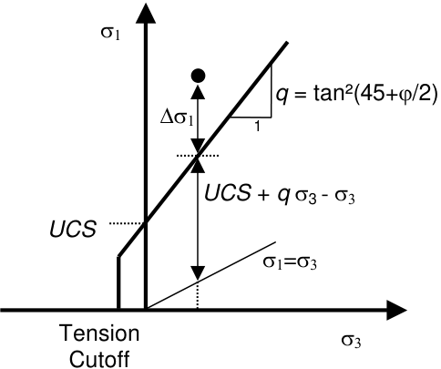

Plot > Strength Factors > SF-B   Strength/Stress can be determined as ( _UCS_ + _q_ s3 - s3 )/(s1 - s3)

Plot > Strength Factors > SF/B   Stress/Strength can be determined as (s1 - s3)/( _UCS_ + _q_ s3 - s3 )

Plot > Strength Factors > Ds1   excess stress can be determined as Ds1 = s1 - ( _UCS_ + _q_ s3 )

Plot > Strength Factors > N(Ds1 /std)   Probability using the Normal distribution.

the same as in method "A".

#### Hoek-Brown

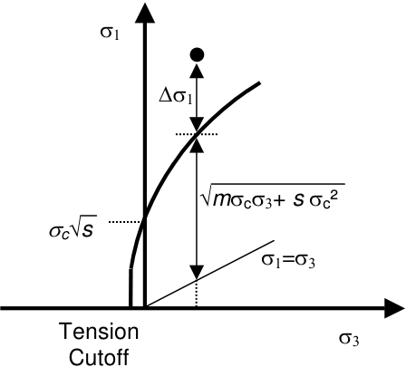

Plot > Strength Factors > SF-B   Strength/Stress can be determined as Ö( _m_ scs3 + _s_ sc²)/(s1 - s3) Plot > Strength Factors > SF/B   Stress/Strength can be determined as (s1 - s3)/Ö( _m_ scs3 + _s_ sc²) Plot > Strength Factors > Ds1   excess stress can be determined as Ds1 = s1 - [ s3 + Ö( _m_ scs3 + _s_ sc²) ]

Plot > Strength Factors > N(Ds1 /std)   Probability using the Normal distribution.

the same as in method "A".

Drucker-Prager is only defined using method "C".

Strength parameters are setup using

Plot > Strength Factors > Strength Parameters

Related topics:

Plot > Strength Factor > SF-A - Strength/Stress Plot > Strength Factors > SF-C - Strength/Stress Plot > Strength Factors > dTmax - Excess Stress Plot > Strength Factors > dToct - Excess Stress Plot > Strength Factors > In-plane Parameters Plot > Strength Factors > Ubiquitous Parameters

### 5.3.6.1.9 SF-C Strength/Stress

Contours the excess shear stress or strength factor using method "C". These components can be accessed via the Strength Factor Components toolbar as follows:

This toolbar can be changed to a vertical orientation by dragging is against either the right or left hand edge of the main window.

It can be changed back to a horizontal orientation by dragging is against either the top or bottom edge of the main window.

Selecting the button on the Contours toolbar activates the Strength Factor Components toolbar.

In elastic analysis the major and minor principal stresses can be used with the Mohr-Coulomb or HoekBrown strength criteria

#### Plot > Strength Factors > Strength Parameters

to estimate the amount of damage due to over-stressing. Since none of the parameters have any orientation sensitivity, this criterion is representative for homogeneous rock mass stability.

By contrast, in non-linear analysis the stresses can never exceed the strength unless some creep is used. In this latter case, viscous creep can allow stress states above the failure criterion, thus indicating a lack of static equilibrium. Hence for non-linear analysis one normally directly considers the amount of non-linear strain or the strain rate predicted by the model

Mohr-Coulomb in 3D FF blocks.

Method "C" assumes that the stress path to failure takes place by increasing s1 while loosing confinement. This is representative of an abutment failure where s1 - s3 is considered to be the driving force.

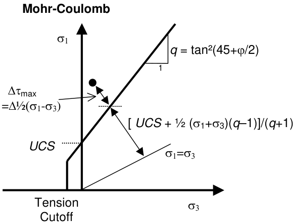

Plot > Strength Factors > SF-C   Strength/Stress can be determined as [ _UCS_ + ½(s1+s3) ( _q_ - 1) ]/[ ½(s1 - s3)( _q_ +1) ]

Plot > Strength Factors > SF/C   Stress/Strength can be determined as [ ½(s1 - s3)( _q_ +1) ]/ [ _UCS_ + ½(s1+s3) ( _q_ -1) ]

Plot > Strength Factors > Dtmax   excess stress can be determined as

Dtmax = ½(s1 - s3) - [ _UCS_ + ½(s1+s3) ( _q_ -1) ]/( _q_ +1)

= [s1 - ( _UCS_ + _q_ s3) ]/( _q_ +1)

#### Hoek-Brown

Plot > Strength Factors > SF-C   Strength/Stress can be determined as &#123; Ö[1 /16 _m_ ²sc² + ½(s1 + s3) _m_ sc + _s_ sc²] - ¼ _m_ sc&#125;/(s1 - s3)

Plot > Strength Factors > SF/C   Stress/Strength can be determined as (s1 - s3)/&#123; Ö[1 /16 _m_ ²sc² + ½(s1 + s3) _m_ sc + _s_ sc²] - ¼ _m_ sc &#125;

Plot > Strength Factors > Dtmax   excess stress can be determined as

Dtmax = ½(s1 - s3) - ½&#123; Ö[1 /16 _m_ ²sc² + ½(s1 + s3) _m_ sc + _s_ sc²] - ¼ _m_ sc &#125;

#### Drucker-Prager

SF-C Strength/Stress   can be determined as [ _UCS_ + ( _q_ –1) smean ] Ö(2) /[ toct ( _q_ +2) ]

SF-C Stress/Strength   can be determined as toct /[ _UCS_ + ( _q_ –1) smean ] Ö(2) /( _q_ +2) Dtoct Excess   can be determined as toct - [ _UCS_ + ( _q_ –1) smean ] Ö(2) /( _q_ +2)

where

_q_ = tan²(45+j/2) toct = ¹/3 Ö[( s1 - s2 )² + ( s2 - s3 )² +( s3 - s1 )²] smean = ¹/3 ( s1 + s2 + s3 )

Note that the strength parameters have been chosen so that the criterion simplifies to the MohrCoulomb criterion when s2 equals s3.

Strength parameters are setup using

Plot > Strength Factors > Strength Parameters

Related topics:

Plot > Strength Factor > SF-A - Stress/Strength Plot > Strength Factors > SF-B - Stress/Strength Plot > Strength Factors > dS1 - Excess Stress Plot > Strength Factors > In-plane Parameters Plot > Strength Factors > Ubiquitous Parameters

### 5.3.6.1.10 SF/A Stress/Strength

Contours the excess major principal stress and strength factor using method  "A". These components can be accessed via the Strength Factor Components toolbar as follows:

This toolbar can be changed to a vertical orientation by dragging is against either the right or left hand edge of the main window.

It can be changed back to a horizontal orientation by dragging is against either the top or bottom edge of the main window.

Selecting the button on the Contours toolbar activates the Strength Factor Components toolbar.

In elastic analysis the major and minor principal stresses can be used with the Mohr-Coulomb or HoekBrown strength criteria

Plot > Strength Factors > Strength Parameters

to estimate the amount of damage due to over-stressing. Since none of the parameters have any orientation sensitivity, this criterion is representative for homogeneous rock mass stability.

By contrast, in non-linear analysis the stresses can never exceed the strength unless some creep is used. In this latter case, viscous creep can allow stress states above the failure criterion, thus indicating a lack of static equilibrium. Hence for non-linear analysis one normally directly considers the amount of non-linear strain or the strain rate predicted by the model

Mohr-Coulomb in 3D FF blocks.

Method "A" assumes that the stress path to failure takes place by increasing s1 without loss of confinement. This is representative of a pillar failure where s1 is considered to be the driving force.

Plot > Strength Factors > SF-A   Strength/Stress can be determined as ( _UCS_ + _q_ s3 )/ s1 Plot > Strength Factors > SF/A   Stress/Strength can be determined as s1 / ( _UCS_ + _q_ s3 ) Plot > Strength Factors > Ds1   excess stress can be determined as Ds1 = s1 - ( _UCS_ + _q_ s3 )

Plot > Strength Factors > N(Ds1 /std)   Probability using the Normal distribution.

the same as in method "B".

#### Hoek-Brown

Plot > Strength Factors > SF-A   Strength/Stress can be determined as [ s3 + Ö( _m_ scs3 + _s_ sc²) ] / s1

Plot > Strength Factors > SF/A   Stress/Strength can be determined as s1 / [ s3 + Ö( _m_ scs3 + _s_ sc²) ]

Plot > Strength Factors > Ds1   excess stress can be determined as Ds1 = s1 - [ s3 + Ö( _m_ scs3 + _s_ sc²) ]

Plot > Strength Factors > N(Ds1 /std)   Probability using the Normal distribution.

the same as in method "B".

Drucker-Prager is only defined using method "C".

Strength parameters are setup using

Plot > Strength Factors > Strength Parameters

Related topics:

Plot > Strength Factor > SF-B - Strength/Stress Plot > Strength Factors > SF-C - Strength/Stress Plot > Strength Factors > dTmax - Excess Stress Plot > Strength Factors > dToct - Excess Stress Plot > Strength Factors > In-plane Parameters Plot > Strength Factors > Ubiquitous Parameters

### 5.3.6.1.11 SF/B Stress/Strength

Contours the excess major principal stress and strength factor using method  "B". These components can be accessed via the Strength Factor Components toolbar as follows:

This toolbar can be changed to a vertical orientation by dragging is against either the right or left hand edge of the main window.

It can be changed back to a horizontal orientation by dragging is against either the top or bottom edge of the main window.

Selecting the

button on the Contours toolbar activates the Strength Factor Components toolbar.

In elastic analysis the major and minor principal stresses can be used with the Mohr-Coulomb or HoekBrown strength criteria

#### Plot > Strength Factors > Strength Parameters

to estimate the amount of damage due to over-stressing. Since none of the parameters have any orientation sensitivity, this criterion is representative for homogeneous rock mass stability.

By contrast, in non-linear analysis the stresses can never exceed the strength unless some creep is used. In this latter case, viscous creep can allow stress states above the failure criterion, thus indicating a lack of static equilibrium. Hence for non-linear analysis one normally directly considers the amount of non-linear strain or the strain rate predicted by the model

Mohr-Coulomb in 3D FF blocks.

Method "B" assumes that the stress path to failure takes place by increasing s1 without loss of confinement. This is representative of a pillar failure where s1 - s3 is considered to be the driving force.

#### Mohr-Coulomb

Plot > Strength Factors > SF-B   Strength/Stress can be determined as ( _UCS_ + _q_ s3 - s3 )/(s1 - s3)

Plot > Strength Factors > SF/B   Stress/Strength can be determined as (s1 - s3)/( _UCS_ + _q_ s3 - s3 )

Plot > Strength Factors > Ds1   excess stress can be determined as Ds1 = s1 - ( _UCS_ + _q_ s3 )

Plot > Strength Factors > N(Ds1 /std)   Probability using the Normal distribution.

the same as in method "A".

#### Hoek-Brown

Plot > Strength Factors > SF-B   Strength/Stress can be determined as Ö( _m_ scs3 + _s_ sc²)/(s1 - s3) Plot > Strength Factors > SF/B   Stress/Strength can be determined as (s1 - s3)/Ö( _m_ scs3 + _s_ sc²) Plot > Strength Factors > Ds1   excess stress can be determined as Ds1 = s1 - [ s3 + Ö( _m_ scs3 + _s_ sc²) ]

Plot > Strength Factors > N(Ds1 /std)   Probability using the Normal distribution.

the same as in method "A".

Drucker-Prager is only defined using method "C".

Strength parameters are setup using

Plot > Strength Factors > Strength Parameters

Related topics:

Plot > Strength Factor > SF-A - Strength/Stress Plot > Strength Factors > SF-C - Strength/Stress Plot > Strength Factors > dTmax - Excess Stress Plot > Strength Factors > dToct - Excess Stress Plot > Strength Factors > In-plane Parameters Plot > Strength Factors > Ubiquitous Parameters

### 5.3.6.1.12 SF/C Stress/Strength

Contours the excess shear stress or strength factor using method "C". These components can be accessed via the Strength Factor Components toolbar as follows:

This toolbar can be changed to a vertical orientation by dragging is against either the right or left hand edge of the main window.

It can be changed back to a horizontal orientation by dragging is against either the top or bottom edge of the main window.

Selecting the button on the Contours toolbar activates the Strength Factor Components toolbar.

In elastic analysis the major and minor principal stresses can be used with the Mohr-Coulomb or HoekBrown strength criteria

#### Plot > Strength Factors > Strength Parameters

to estimate the amount of damage due to over-stressing. Since none of the parameters have any orientation sensitivity, this criterion is representative for homogeneous rock mass stability.

By contrast, in non-linear analysis the stresses can never exceed the strength unless some creep is used. In this latter case, viscous creep can allow stress states above the failure criterion, thus indicating a lack of static equilibrium. Hence for non-linear analysis one normally directly considers the amount of non-linear strain or the strain rate predicted by the model

Mohr-Coulomb in 3D FF blocks.

Method "C" assumes that the stress path to failure takes place by increasing s1 while loosing confinement. This is representative of an abutment failure where s1 - s3 is considered to be the driving force.

Plot > Strength Factors > SF-C   Strength/Stress can be determined as [ _UCS_ + ½(s1+s3) ( _q_ - 1) ]/[ ½(s1 - s3)( _q_ +1) ]

Plot > Strength Factors > SF/C   Stress/Strength can be determined as [ ½(s1 - s3)( _q_ +1) ]/ [ _UCS_ + ½(s1+s3) ( _q_ -1) ]

Plot > Strength Factors > Dtmax   excess stress can be determined as

Dtmax = ½(s1 - s3) - [ _UCS_ + ½(s1+s3) ( _q_ -1) ]/( _q_ +1)

= [s1 - ( _UCS_ + _q_ s3) ]/( _q_ +1)

#### Hoek-Brown

Plot > Strength Factors > SF-C   Strength/Stress can be determined as &#123; Ö[1 /16 _m_ ²sc² + ½(s1 + s3) _m_ sc + _s_ sc²] - ¼ _m_ sc&#125;/(s1 - s3)

Plot > Strength Factors > SF/C   Stress/Strength can be determined as (s1 - s3)/&#123; Ö[1 /16 _m_ ²sc² + ½(s1 + s3) _m_ sc + _s_ sc²] - ¼ _m_ sc &#125;

Plot > Strength Factors > Dtmax   excess stress can be determined as

Dtmax = ½(s1 - s3) - ½&#123; Ö[1 /16 _m_ ²sc² + ½(s1 + s3) _m_ sc + _s_ sc²] - ¼ _m_ sc &#125;

#### Drucker-Prager

SF-C Strength/Stress   can be determined as [ _UCS_ + ( _q_ –1) smean ] Ö(2) /[ toct ( _q_ +2) ]

SF-C Stress/Strength   can be determined as toct /[ _UCS_ + ( _q_ –1) smean ] Ö(2) /( _q_ +2) Dtoct Excess   can be determined as toct - [ _UCS_ + ( _q_ –1) smean ] Ö(2) /( _q_ +2)

where

_q_ = tan²(45+j/2) toct = ¹/3 Ö[( s1 - s2 )² + ( s2 - s3 )² +( s3 - s1 )²] smean = ¹/3 ( s1 + s2 + s3 )

Note that the strength parameters have been chosen so that the criterion simplifies to the MohrCoulomb criterion when s2 equals s3.

Strength parameters are setup using

Plot > Strength Factors > Strength Parameters

Related topics:

Plot > Strength Factor > SF-A - Stress/Strength Plot > Strength Factors > SF-B - Stress/Strength Plot > Strength Factors > dS1 - Excess Stress Plot > Strength Factors > In-plane Parameters Plot > Strength Factors > Ubiquitous Parameters

## 5.3.6.2 In-Plane Parameters

5.3.6.2.1  In-plane parameters

Sets up the strength parameters for generating strength factor contour plots in terms of in-plane stress components.

These components can be accessed via the Strength Factor Components toolbar as follows:

This toolbar can be changed to a vertical orientation by dragging is against either the right or left hand edge of the main window.

It can be changed back to a horizontal orientation by dragging is against either the top or bottom edge of the main window.

Selecting the button on the Contours toolbar activates the Strength Factor Components toolbar.

To calculate the in-plane shear and normal stresses, the stress state at each point on the grid plane is reoriented to determine the maximum shear stress parallel to the grid plane and the stress normal to the grid plane.

In elastic analysis the maximum in-plane shear and normal stresses can be used with the MohrCoulomb strength criterion to estimate the amount of slip due to over-stressing, on a fault, joint set or bedding plane oriented in the same way as the grid plane. Since these parameters are orientation dependant, this criterion is representative for anisotropic rock mass stability.

By contrast, in non-linear analysis the stresses can never exceed the strength unless some creep is used. In this latter case, viscous creep can allow stress states above the failure criterion, thus indicating a lack of static equilibrium. Hence for non-linear analysis one normally directly considers the amount of non-linear strain or the strain rate predicted by the model

Mohr-Coulomb in DD planes Fault-Gouge in DD planes Backfill-Hyperbolic in DD planes

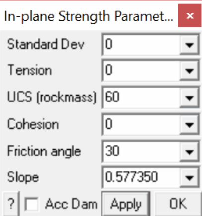

The Mohr-Coulomb criterion defines the shear strength in terms of shear stress and normal stress as follows:

#### Mohr-Coulomb

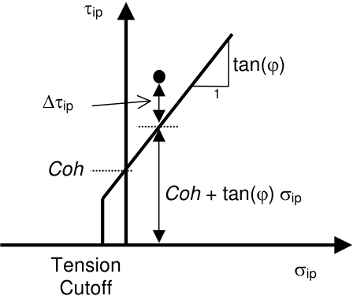

Tension cutoff, UCS and Cohesion are specified in units of stress (MPa or psi).

Friction angle is specified in degrees.

Standard Deviation specifies the uncertainty you have in the failure criterion measured in the tip direction (specified in units of stress, MPa or psi).

Acc Dam – plots accumulated damage. Refer to Accumulated Damage

Apply – regenerates the contour plot.

Related topics:

Plot > Strength Factor > Probability N-distribution Plot > Strength Factor > SF-ip - Stress/Strength Plot > Strength Factors > SF-ub - Stress/Strength Plot > Strength Factors > dTip - Excess Stress Plot > Strength Factors > dTub - Excess Stress Plot > Strength Factors > Rockmass Strength Parameters Plot > Strength Factors > Ubiquitous Parameters

### 5.3.6.2.2 Accumulated Damage

Plot Accumulated Damage.

This component can be accessed via the Strength Factor Components toolbar as follows:

This toolbar can be changed to a vertical orientation by dragging is against either the right or left hand edge of the main window.

It can be changed back to a horizontal orientation by dragging is against either the top or bottom edge of the main window.

Selecting the button on the Contours toolbar activates the Strength Factor Components toolbar.

When Acc is not activated, the Excess Stress, Probability of Failure, Strength Factor and RCF are plotted for the current stress values.

When Acc is activated, damage is tracked from step 1 to the current step throughout the model loading history, hence the worst case for Excess Stress, Probability of Failure, Strength Factor or RCF is plotted.

This allows elastic stress analysis results to be used in a manner similar to accumulated strain in a plasticity model.

Damage tracking is done separately for the 5 following cases:

1. Rock Mass failure (Excess S1 Stress, Probability, Strength Factor) 2. In-Plane Shear failure (Excess Shear Stress, Probability, Strength Factor) 3. Ub-Plane Shear failure (Excess Shear Stress, Probability, Strength Factor)

4. In-Plane Excess Wall Stress (Excess Stress, RCF)

5. Ub-Plane Excess Wall Stress (Excess Stress, RCF)

Note that both the step at which first yield occurs MStep 1st Yield, and the step at which the maximum excess stress occurs MStep Max Yield, are tracked and can be displayed as trajectory labels.

### 5.3.6.2.3 In-plane Excess Shear Stress

Contours the strength for in-plane shear.

These components can be accessed via the Strength Factor Components toolbar as follows:

This toolbar can be changed to a vertical orientation by dragging is against either the right or left hand edge of the main window.

It can be changed back to a horizontal orientation by dragging is against either the top or bottom edge of the main window.

Selecting the

button on the Contours toolbar activates the Strength Factor Components toolbar.

To calculate the in-plane shear and normal stresses, the stress state at each point on the grid plane is reoriented to determine the maximum shear stress parallel to the grid plane and the stress normal to the grid plane.

In elastic analysis the maximum in-plane shear and normal stresses can be used with the MohrCoulomb strength criterion

#### Plot > Strength Factors > In-plane Parameters

to estimate the amount of slip due to over-stressing, on a fault, joint set or bedding plane oriented in the same way as the grid plane. Since these parameters are orientation dependant, this criterion is representative for anisotropic rock mass stability.

By contrast, in non-linear analysis the stresses can never exceed the strength unless some creep is used. In this latter case, viscous creep can allow stress states above the failure criterion, thus indicating a lack of static equilibrium. Hence for non-linear analysis one normally directly considers the amount of non-linear strain or the strain rate predicted by the model

Mohr-Coulomb in DD planes

Fault-Gouge in DD planes

Backfill-Hyperbolic in DD planes

Here we assume that the stress path to failure takes place by increasing tip without loosing confinement.

#### Mohr-Coulomb

SF-ip Strength/Stress   can be determined as [ Cohesion + sip tan(j) ] / tip SF-ip Stress/Strength   can be determined as tip / [ Cohesion + sip tan(j) ] dTip Excess   can be determined as Dtip = tip - [ Cohesion + sip tan(j) ]

NTip Probability   can be determined as N(Dtip /std)

Strength parameters are set up using

Plot > Strength Factors > In-plane Parameters

Related topics:

Plot > Stress > Tip - In-plane Shear Plot > Stress > Sip - In-plane Normal Plot > Strength Factors > SF-ub Strength/Stress Plot > Strength Factors > dTub Excess

Plot > Strength Factors > NSub Probability

### 5.3.6.2.4 In-plane Excess Wall Stress

Contours the strength for in-plane wall stress. These components can be accessed via the Strength Factor Components toolbar as follows:

This toolbar can be changed to a vertical orientation by dragging is against either the right or left hand edge of the main window.

It can be changed back to a horizontal orientation by dragging is against either the top or bottom edge of the main window.

Selecting the

button on the Contours toolbar activates the Strength Factor Components toolbar.

To calculate the in-plane wall stress, the stress state at each point on the grid plane is reoriented to determine the maximum and minimum tangential stress parallel to the grid plane.

The maximum wall stress for a virtual circular excavation oriented perpendicular to the grid plane can then be determined as [ 3 s1i - s3i ].

Note that sip is oriented normal to the grid plane and parallel to the direction of a line grid. Also note that sip, s1i and s3i are perpendicular to one another.

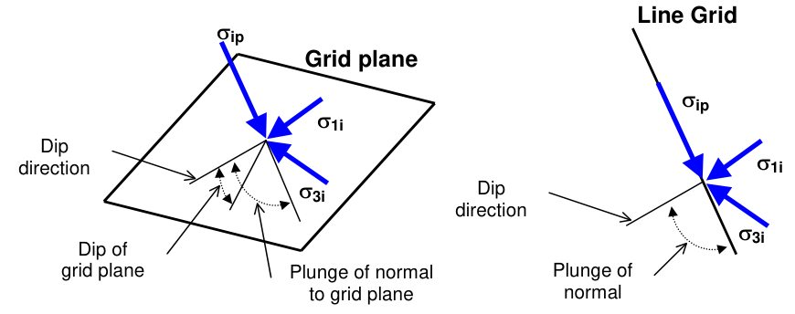

- dip direction is measured positive clockwise from the y-axis.

- dip of the plane is measured positive down from the horizontal (i.e. the dip direction).

- plunge of the normal is measured positive down (i.e. negative up) from the horizontal.

dSip Excess   can be determined as Dsip = [ 3 s1i - s3i ] - UCS

RCFip   can be determined as RCFip = [ 3 s1i - s3i ]/UCS

Strength parameters are set up using

Plot > Strength Factors > In-plane Parameters

Related topics:

Plot > Stress > Tip - In-plane Shear Plot > Stress > Sip - In-plane Normal Plot > Stress > S1i - In-plane Maximum Plot > Stress > S3i - In-plane Minimum Plot > Strength Factors > SF-ub Strength/Stress Plot > Strength Factors > dTub Excess Plot > Strength Factors > dSub Excess Plot > Strength Factors > NSub Probability

### 5.3.6.2.6 NTip Normal Probability

Contours the strength for in-plane shear. These components can be accessed via the Strength Factor Components toolbar as follows:

This toolbar can be changed to a vertical orientation by dragging is against either the right or left hand edge of the main window.

It can be changed back to a horizontal orientation by dragging is against either the top or bottom edge of the main window.

Selecting the button on the Contours toolbar activates the Strength Factor Components toolbar.

To calculate the in-plane shear and normal stresses, the stress state at each point on the grid plane is reoriented to determine the maximum shear stress parallel to the grid plane and the stress normal to the grid plane.

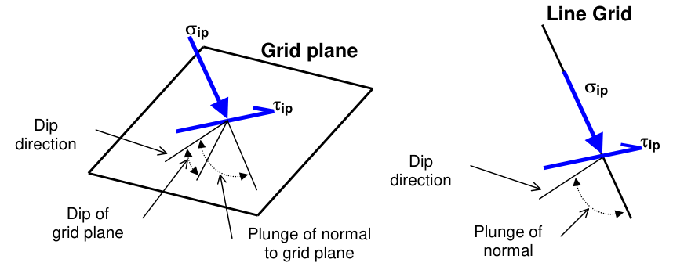

In elastic analysis the maximum in-plane shear and normal stresses can be used with the MohrCoulomb strength criterion

#### Plot > Strength Factors > In-plane Parameters

to estimate the amount of slip due to over-stressing, on a fault, joint set or bedding plane oriented in the same way as the grid plane. Since these parameters are orientation dependant, this criterion is representative for anisotropic rock mass stability.

By contrast, in non-linear analysis the stresses can never exceed the strength unless some creep is used. In this latter case, viscous creep can allow stress states above the failure criterion, thus indicating a lack of static equilibrium. Hence for non-linear analysis one normally directly considers the amount of non-linear strain or the strain rate predicted by the model

Mohr-Coulomb in DD planes

Fault-Gouge in DD planes

Backfill-Hyperbolic in DD planes

Here we assume that the stress path to failure takes place by increasing tip without loosing confinement.

#### Mohr-Coulomb

SF-ip Strength/Stress   can be determined as [ Cohesion + sip tan(j) ] / tip SF-ip Stress/Strength   can be determined as tip / [ Cohesion + sip tan(j) ] dTip Excess   can be determined as Dtip = tip - [ Cohesion + sip tan(j) ]

NTip Probability   can be determined as N(Dtip /std)

Strength parameters are set up using

Plot > Strength Factors > In-plane Parameters

Related topics:

Plot > Stress > Tip - In-plane Shear Plot > Stress > Sip - In-plane Normal Plot > Strength Factors > SF-ub Strength/Stress Plot > Strength Factors > dTub Excess

Plot > Strength Factors > NSub Probability

## 5.3.6.3 UB-Plane Parameters

5.3.6.3.1  Ubiquitous parameters

Sets up the strength parameters for generating strength factor contour plots in terms of ubiquitousplane stress components.

These components can be accessed via the Strength Factor Components toolbar as follows:

This toolbar can be changed to a vertical orientation by dragging is against either the right or left hand edge of the main window.

It can be changed back to a horizontal orientation by dragging is against either the top or bottom edge of the main window.

Selecting the

button on the Contours toolbar activates the Strength Factor Components toolbar.

To calculate the ubiquitous shear and normal stresses, the stress state at each point on the grid plane is reoriented to determine the maximum shear stress parallel to the ubiquitous shear plane and the stress normal to the ubiquitous shear plane.

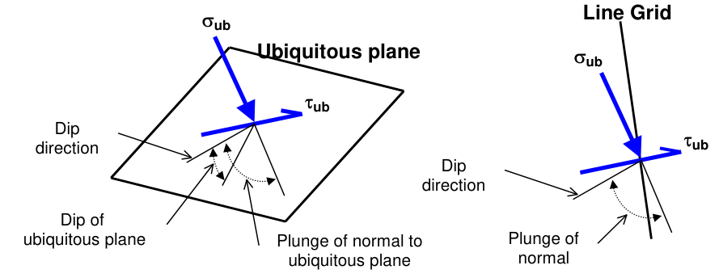

In elastic analysis the maximum ubiquitous-plane shear and normal stresses can be used with the Mohr-Coulomb strength criterion to estimate the amount of slip due to over-stressing, on a fault, joint set or bedding plane at the specified orientation. Since these parameters are orientation dependant, this criterion is representative for anisotropic rock mass stability.

By contrast, in non-linear analysis the stresses can never exceed the strength unless some creep is used. In this latter case, viscous creep can allow stress states above the failure criterion, thus indicating a lack of static equilibrium. Hence for non-linear analysis one normally directly considers the amount of non-linear strain or the strain rate predicted by the model

Mohr-Coulomb in DD planes

Fault-Gouge in DD planes

Backfill-Hyperbolic in DD planes

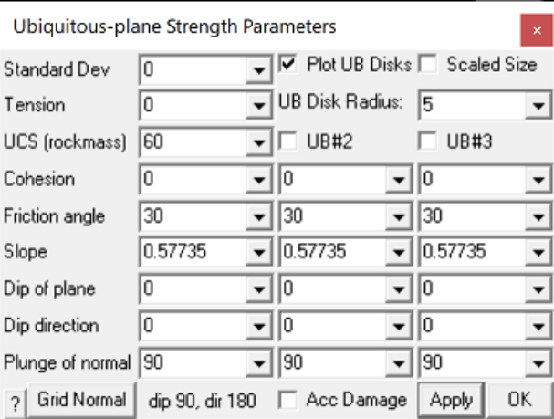

Cohesion and Friction Angle the Mohr-Coulomb criterion defines strength in terms of principal stresses as follows:

#### Mohr-Coulomb

Tension cutoff, UCS and Cohesion are specified in units of stress (MPa or psi). Friction angle is specified in degrees.

Standard Deviation specifies the uncertainty you have in the failure criterion measured in the tip direction (specified in units of stress, MPa or psi).

Dip of plane – specifies the dip of the ubiquitous plane (in degrees). The dip of the normal is automatically adjusted to reflect changes in this value.

Dip Direction – specifies the dip direction of the ubiquitous plane (in degrees).

Dip of Normal – specifies the dip of the normal to the ubiquitous plane (in degrees). The dip of plane is automatically adjusted to reflect changes in this value.

Grid Normal – sets the ubiquitous plane parallel to the currently selected grid plane. In this case all inplane results will be identical to the ubiquitous plane results.

Acc Dam – plots accumulated damage. Refer to Accumulated Damage

Plot UB DIsks – toggles display of planar contour plot or disks representing the orientation of the UB plane.

Scaled Size – scales the size of the UB disk to the magnitude.

UB DIsk Radius – specifies the radius of the UB disks.

Apply – regenerates the contour plot.

UB#2 & UB#3 – activates strength parameters for ubiquitous plane #2 and/or #3. When checked, the

minimum for all active ubiquitous planes is presented for all strength parameters ( Plot > Strength Factor > Probability N-distribution, Plot > Strength Factors > SF-ub - Stress/Strength and Plot > Strength Factors > dTub - Excess Stress). To determine which ubiquitous plane has the minimum strength you can plot Plot > Strength Factors > UB# with minimum strength) or left click on and strength parameter plot.

Related topics:

Plot > Strength Factor > Probability N-distribution Plot > Strength Factors > SF-ub - Stress/Strength Plot > Strength Factor > SF-ip - Stress/Strength Plot > Strength Factors > dTub - Excess Stress Plot > Strength Factors > dTip - Excess Stress Plot > Strength Factors > UB# with minimum strength Plot > Strength Factors > Rockmass Strength Parameters

Plot > Strength Factors > In-plane Parameters

### 5.3.6.3.2 Accumulated Damage

Plot Accumulated Damage. This component can be accessed via the Strength Factor Components toolbar as follows:

This toolbar can be changed to a vertical orientation by dragging is against either the right or left hand edge of the main window.

It can be changed back to a horizontal orientation by dragging is against either the top or bottom edge of the main window.

Selecting the button on the Contours toolbar activates the Strength Factor Components toolbar.

When Acc is not activated, the Excess Stress, Probability of Failure, Strength Factor and RCF are plotted for the current stress values.

When Acc is activated, damage is tracked from step 1 to the current step throughout the model loading history, hence the worst case for Excess Stress, Probability of Failure, Strength Factor or RCF is plotted.

This allows elastic stress analysis results to be used in a manner similar to accumulated strain in a plasticity model.

Damage tracking is done separately for the 5 following cases:

1. Rock Mass failure (Excess S1 Stress, Probability, Strength Factor) 2. In-Plane Shear failure (Excess Shear Stress, Probability, Strength Factor) 3. Ub-Plane Shear failure (Excess Shear Stress, Probability, Strength Factor)

4. In-Plane Excess Wall Stress (Excess Stress, RCF)

5. Ub-Plane Excess Wall Stress (Excess Stress, RCF)

Note that both the step at which first yield occurs MStep 1st Yield, and the step at which the maximum excess stress occurs MStep Max Yield, are tracked and can be displayed as trajectory labels.

- 5.3.6.3.3  Ubiquitous Excess Shear Stress

Contours the strength for ubiquitous-plane shear. These components can be accessed via the Strength Factor Components toolbar as follows:

This toolbar can be changed to a vertical orientation by dragging is against either the right or left hand edge of the main window.

It can be changed back to a horizontal orientation by dragging is against either the top or bottom edge of the main window.

Selecting the button on the Contours toolbar activates the Strength Factor Components toolbar.

To calculate the ubiquitous shear and normal stresses, the stress state at each point on the grid plane is reoriented to determine the maximum shear stress parallel to the ubiquitous shear plane and the stress normal to the ubiquitous shear plane.

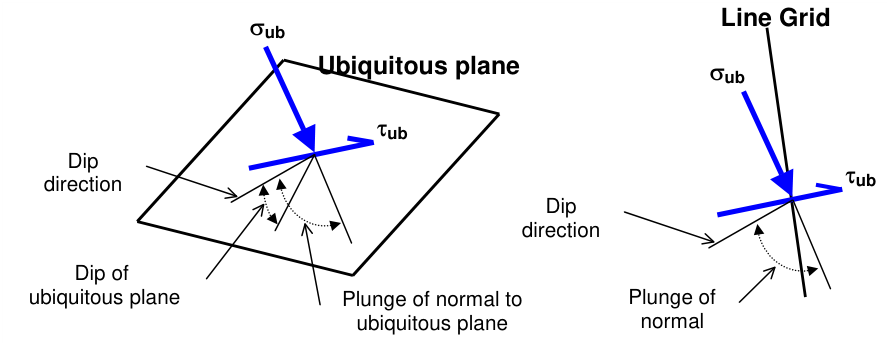

The orientation of the ubiquitous shear plane is set using

#### Plot > Strength Factors > Ubiquitous Parameters

In elastic analysis the maximum ubiquitous-plane shear and normal stress can be used with the MohrCoulomb strength criterion to estimate the amount of slip due to over-stressing, on a fault, joint set or bedding plane at the specified orientation. Since these parameters are orientation dependant, this criterion is representative for anisotropic rock mass stability.

By contrast, in non-linear analysis the stresses can never exceed the strength unless some creep is used. In this latter case, viscous creep can allow stress states above the failure criterion, thus indicating a lack of static equilibrium. Hence for non-linear analysis one normally directly considers the amount of non-linear strain or the strain rate predicted by the model

Mohr-Coulomb in DD planes

Fault-Gouge in DD planes

Backfill-Hyperbolic in DD planes

Here we assume that the stress path to failure takes place by increasing tub without loosing confinement.

#### Mohr-Coulomb

SF-ub Strength/Stress   can be determined as [ Cohesion + sub tan(j) ] / tub SF-ub Stress/Strength   can be determined as tub / [ Cohesion + sub tan(j) ] dTub Excess   can be determined as Dtub = tub - [ Cohesion + sub tan(j) ] NTub Probability   can be determined as N(Dtub /std)

Strength parameters are set up using

Plot > Strength Factors > Ubiquitous Parameters

Related topics:

Plot > Stress > Tub - Ubiquitous-plane Shear Plot > Stress > Sub - Ubiquitous-plane Normal Plot > Stress > S1u - Ubiquitous-plane Maximum Plot > Stress > S3u - Ubiquitous-plane Minimum Plot > Strength Factors > SF-ub Strength/Stress Plot > Strength Factors > dTip Excess Plot > Strength Factors > dSip Excess Plot > Strength Factors > NTip Probability

UB#2 & UB#3 – activates strength parameters for ubiquitous plane #2 and/or #3. When checked, the minimum for all active ubiquitous planes is presented for all strength parameters ( Plot > Strength Factor > Probability N-distribution, Plot > Strength Factors > SF-ub - Stress/Strength and

Plot > Strength Factors > dTub - Excess Stress). To determine which ubiquitous plane has the minimum strength you can plot Plot > Strength Factors > UB# with minimum strength) or left click on and strength parameter plot.

### 5.3.6.3.4 Ubiquitous Plane Excess Wall Stress

Contours the strength for ub-plane wall stress.

These components can be accessed via the Strength Factor Components toolbar as follows:

This toolbar can be changed to a vertical orientation by dragging is against either the right or left hand edge of the main window.

It can be changed back to a horizontal orientation by dragging is against either the top or bottom edge of the main window.

Selecting the button on the Contours toolbar activates the Strength Factor Components toolbar.

To calculate the ub-plane wall stress, the stress state at each point on the grid plane is reoriented to determine the maximum and minimum tangential stress parallel to the ub plane.

The maximum wall stress for a virtual circular excavation oriented perpendicular to the ub-plane can then be determined as [ 3 s1u - s3u ].

Note that sub is oriented normal to the ub-plane. Also note that sub, s1 and s3u are perpendicular to one another.

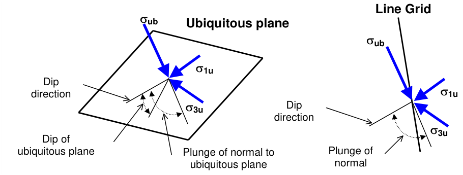

- dip direction is measured positive clockwise from the y-axis.

- dip of the plane is measured positive down from the horizontal (i.e. the dip direction).

- plunge of the normal is measured positive down (i.e. negative up) from the horizontal.

dSub Excess   can be determined as Dsub = [ 3 s1u - s3u ] - UCS

RCFub   can be determined as RCFub = [ 3 s1u - s3u ]/UCS

The orientation of the ubiquitous shear plane is set using

Plot > Strength Factors > Ubiquitous Parameters

Related topics:

Plot > Stress > Tub - Ubiquitous-plane Shear Plot > Stress > Sub - Ubiquitous-plane Normal Plot > Stress > S1u - Ubiquitous-plane Maximum Plot > Stress > S3u - Ubiquitous-plane Minimum Plot > Strength Factors > SF-ub Strength/Stress Plot > Strength Factors > dTip Excess Plot > Strength Factors > dSip Excess Plot > Strength Factors > NTip Probability

### 5.3.6.3.6 NTub Normal Probability

Contours the strength for ubiquitous-plane shear. These components can be accessed via the Strength Factor Components toolbar as follows:

This toolbar can be changed to a vertical orientation by dragging is against either the right or left hand edge of the main window.

It can be changed back to a horizontal orientation by dragging is against either the top or bottom edge of the main window.

Selecting the button on the Contours toolbar activates the Strength Factor Components toolbar.

To calculate the ubiquitous shear and normal stresses, the stress state at each point on the grid plane is reoriented to determine the maximum shear stress parallel to the ubiquitous shear plane and the stress normal to the ubiquitous shear plane.

The orientation of the ubiquitous shear plane is set using

#### Plot > Strength Factors > Ubiquitous Parameters

In elastic analysis the maximum ubiquitous-plane shear and normal stress can be used with the MohrCoulomb strength criterion to estimate the amount of slip due to over-stressing, on a fault, joint set or bedding plane at the specified orientation. Since these parameters are orientation dependant, this criterion is representative for anisotropic rock mass stability.

By contrast, in non-linear analysis the stresses can never exceed the strength unless some creep is used. In this latter case, viscous creep can allow stress states above the failure criterion, thus indicating a lack of static equilibrium. Hence for non-linear analysis one normally directly considers the amount of non-linear strain or the strain rate predicted by the model

Mohr-Coulomb in DD planes

Fault-Gouge in DD planes

Backfill-Hyperbolic in DD planes

Here we assume that the stress path to failure takes place by increasing tub without loosing confinement.

#### Mohr-Coulomb

SF-ub Strength/Stress   can be determined as [ Cohesion + sub tan(j) ] / tub SF-ub Stress/Strength   can be determined as tub / [ Cohesion + sub tan(j) ] dTub Excess   can be determined as Dtub = tub - [ Cohesion + sub tan(j) ] NTub Probability   can be determined as N(Dtub /std)

Strength parameters are set up using

Plot > Strength Factors > Ubiquitous Parameters

Related topics:

Plot > Stress > Tub - Ubiquitous-plane Shear Plot > Stress > Sub - Ubiquitous-plane Normal Plot > Stress > S1u - Ubiquitous-plane Maximum Plot > Stress > S3u - Ubiquitous-plane Minimum Plot > Strength Factors > SF-ub Strength/Stress Plot > Strength Factors > dTip Excess Plot > Strength Factors > dSip Excess Plot > Strength Factors > NTip Probability

UB#2 & UB#3 – activates strength parameters for ubiquitous plane #2 and/or #3. When checked, the minimum for all active ubiquitous planes is presented for all strength parameters ( Plot > Strength Factor > Probability N-distribution, Plot > Strength Factors > SF-ub - Stress/Strength and

Plot > Strength Factors > dTub - Excess Stress). To determine which ubiquitous plane has the minimum strength you can plot Plot > Strength Factors > UB# with minimum strength) or left click on and strength parameter plot.
