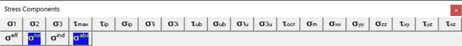
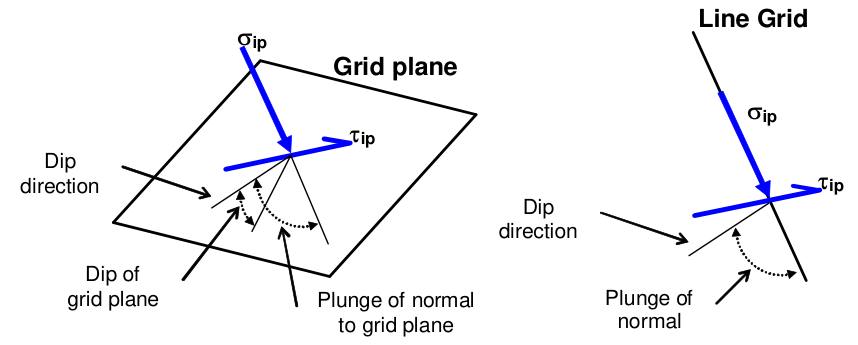
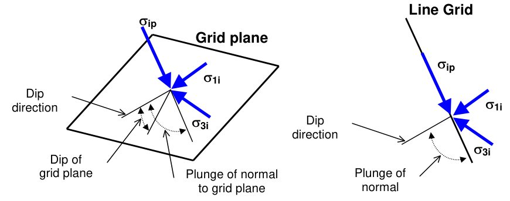
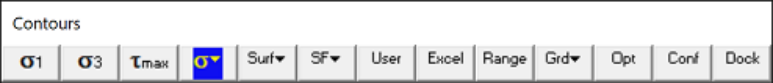
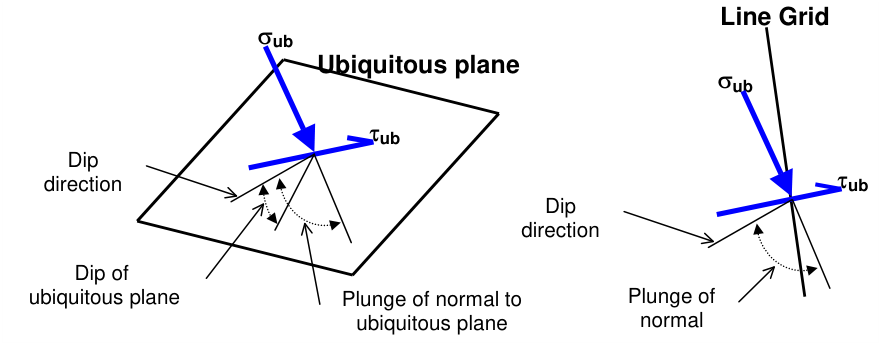
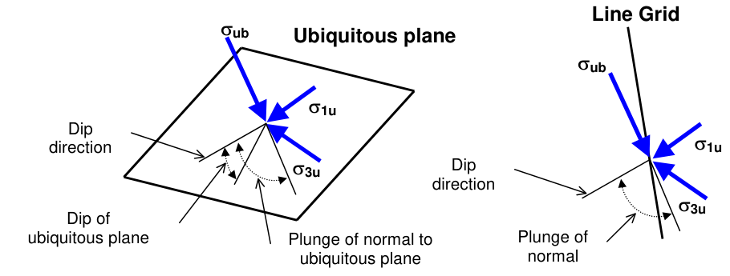

## 5.3.1.1 Major Principal Stress

This allows you to principal stress components s1 s2 s3. These components can be accessed via the Stress Components toolbar as follows:

This toolbar can be changed to a vertical orientation by dragging is against either the right or left hand edge of the main window.

It can be changed back to a horizontal orientation by dragging is against either the top or bottom edge of the main window.

Selecting the button on the Contours toolbar activates the Stress Components toolbar.

In elastic analysis, the major principal stress is normally used with the minor principal stress and the Mohr-Coulomb or Hoek-Brown strength criterion

#### Plot > Strength Factors > Strength Parameters

to estimate the amount of damage in the rockmass due to over-stressing. Since none of the parameters have any orientation sensitivity, this criterion is representative for homogeneous rock mass stability.

By contrast, in non-linear analysis the stresses can never exceed the strength unless some creep is used. In this latter case, viscous creep can allow stress states above the failure criterion, thus indicating a lack of static equilibrium. Hence for non-linear analysis one normally directly considers the amount of non-linear strain or the strain rate predicted by the model

Mohr-Coulomb in 3D FF blocks.

Over-stressing can be presented in several forms including:

Plot > Strength Factor > SF-A Strength/Stress Plot > Strength Factor > SF-B Strength/Stress Plot > Strength Factors > SF-C Strength/Stress Plot > Strength Factors > dS1 Excess Stress Plot > Strength Factors > dTmax Excess Stress

The contour range is set using

#### Plot > Range

Any of these components can be added to the contouring toolbar if desired

Tools > Configure Contouring Toolbar > Stress

The user may find it handy to add the

#### More Stress Components

button to the contouring toolbar for quick access to all stress components.

The intermediate principal stress is normally used in the calculation of the octahedral shear stress

Plot > Stress > Toct Octahedral shear Stress

or the mean stress

Plot > Stress > Smean Mean Stress.

## 5.3.1.4 Maximum Shear Stress

This allows you to principal stress components tmax=½(s1 - s3). This component can be accessed via the Stress Components toolbar as follows:

This toolbar can be changed to a vertical orientation by dragging is against either the right or left hand edge of the main window.

It can be changed back to a horizontal orientation by dragging is against either the top or bottom edge of the main window.

Selecting the button on the Contours toolbar activates the Stress Components toolbar.

In elastic analysis, the maximum shear stress is normally used with the minor principal stress and the Mohr-Coulomb or Hoek-Brown strength criterion

#### Plot > Strength Factors > Strength Parameters

to estimate the amount of damage due to over-stressing. Since none of the parameters have any orientation sensitivity, this criterion is representative for homogeneous rock mass stability.

By contrast, in non-linear analysis the stresses can never exceed the strength unless some creep is used. In this latter case, viscous creep can allow stress states above the failure criterion, thus indicating a lack of static equilibrium. Hence for non-linear analysis one normally directly considers the amount of non-linear strain or the strain rate predicted by the model

Mohr-Coulomb in 3D FF blocks.

Over-stressing can be presented in several forms including:

Plot > Strength Factor > SF-A Strength/Stress Plot > Strength Factor > SF-B Strength/Stress Plot > Strength Factors > SF-C Strength/Stress Plot > Strength Factors > dS1 Excess Stress Plot > Strength Factors > dTmax Excess Stress

The contour range is set using

Plot > Range

Any of these components can be added to the contouring toolbar if desired

Tools > Configure Contouring Toolbar > Stress

The user may find it handy to add the

#### More Stress Components

button to the contouring toolbar for quick access to all stress components.

## 5.3.1.5 In-Plane Shear Stress

This allows you to contour the maximum shear stress acting on the grid plane, and the stress

component normal to the grid plane or parallel to a line grid. These components can be accessed via the Stress Components toolbar as follows:

This toolbar can be changed to a vertical orientation by dragging is against either the right or left hand edge of the main window.

It can be changed back to a horizontal orientation by dragging is against either the top or bottom edge of the main window.

Selecting the button on the Contours toolbar activates the Stress Components toolbar.

To calculate the in-plane stresses, the stress state at each point on the grid plane is reoriented to determine the maximum shear stress parallel to the grid plane and the stress normal to the plane. Note that sip is oriented normal to the grid plane and parallel to the direction of a line grid.

- dip direction is measured positive clockwise from the y-axis.

- dip of the plane is measured positive down from the horizontal (i.e. the dip direction).

- plunge of the normal is measured positive down (i.e. negative up) from the horizontal.

In elastic analysis, the maximum in-plane shear stress is normally used with the in-plane normal stress and the Mohr-Coulomb strength criterion

Plot > Strength Factors > In-plane Parameters

to estimate the amount of slip due to over-stressing, on a fault, joint set or bedding plane oriented in the same way as the grid plane. Since these parameters are orientation dependant, this criterion is representative for anisotropic rock mass stability.

By contrast, in non-linear analysis the stresses can never exceed the strength unless some creep is used. In this latter case, viscous creep can allow stress states above the failure criterion, thus indicating a lack of static equilibrium. Hence for non-linear analysis one normally directly considers the amount of non-linear strain or the strain rate predicted by the model

Mohr-Coulomb in DD planes Fault-Gouge in DD planes Backfill-Hyperbolic in DD planes.

Over-stressing can be presented in several forms including:

Plot > Strength Factors > SF-ip Strength/Stress Plot > Strength Factors > dTip Excess Shear Stress

The contour range is set using

Plot > Range

Any of these components can be added to the contouring toolbar if desired

Tools > Configure Contouring Toolbar > Stress

The user may find it handy to add the

#### More Stress Components

button to the contouring toolbar for quick access to all stress components.

Related topics:

Plot > Stress > S1i In-plane Maximum Plot > Stress > S3i In-plane Minimum Plot > Stress > Tub Ubiquitous-plane Shear Plot > Stress > Sub Ubiquitous-plane Normal

## 5.3.1.7 In-Plane Maximum Stress

This allows you to contour the maximum and minimum stresses tangential to the currently selected grid plane or perpendicular to a line grid. These components can be accessed via the Stress Components toolbar as follows:

This toolbar can be changed to a vertical orientation by dragging is against either the right or left hand edge of the main window.

It can be changed back to a horizontal orientation by dragging is against either the top or bottom edge of the main window.

Selecting the button on the Contours toolbar activates the Stress Components toolbar.

To calculate the maximum and minimum in-plane stresses, the stresses tangential to the grid plane are determined, then resolved to give the maximum and minimum values. Note that sip is oriented normal to

the grid plane and parallel to the direction of a line grid. Also note that sip, s1i and s3i are perpendicular to one another.

- dip direction is measured positive clockwise from the y-axis.

- dip of the plane is measured positive down from the horizontal (i.e. the dip direction).

- plunge of the normal is measured positive down (i.e. negative up) from the horizontal.

The contour range is set using

#### Plot > Range

This component can be added to the contour toolbar if desired

#### Tools > Configure Contouring Toolbar > Stress

The user may find it handy to add the

#### More Stress Components

button to the contouring toolbar for quick access to all stress components.

Related topics:

Plot > Stress > Tip In-plane Shear Plot > Stress > Sip In-plane Normal Plot > Stress > S1u Ubiquitous-plane Maximum. Plot > Stress > S3u Ubiquitous-plane Minimum.

## 5.3.1.9 Ubiquitous-Plane Shear Stress

This allows you to contour the maximum shear stress acting on ubiquitous plane #1, and the stress component normal to this plane. These components can be accessed via the Stress Components toolbar as follows:

This toolbar can be changed to a vertical orientation by dragging is against either the right or left hand edge of the main window.

It can be changed back to a horizontal orientation by dragging is against either the top or bottom edge of the main window.

Selecting the button on the Contours toolbar activates the Stress Components toolbar.

To calculate the ubiquitous stresses, the stress state at each point on the grid plane is reoriented to determine the maximum shear stress parallel to the ubiquitous plane and the stress normal to the ubiquitous plane. Note that sub is oriented normal to the ubiquitous plane and is not parallel to the direction of a line grid.

- dip direction is measured positive clockwise from the y-axis.

- dip of the plane is measured positive down from the horizontal (i.e. the dip direction).

- plunge of the normal is measured positive down (i.e. negative up) from the horizontal.

The orientation of the ubiquitous shear plane is set using

#### Plot > Strength Factors > Ubiquitous Parameters

In elastic analysis the maximum ubiquitous-plane shear stress is normally used with the ubiquitousplane normal stress and the Mohr-Coulomb strength criterion

#### Plot > Strength Factors > Ubiquitous Parameters

to estimate the amount of slip due to over-stressing, on a fault, joint set or bedding plane at the specified orientation. Since these parameters are orientation dependant, this criterion is representative for anisotropic rock mass stability.

By contrast, in non-linear analysis the stresses can never exceed the strength unless some creep is used. In this latter case, viscous creep can allow stress states above the failure criterion, thus indicating

a lack of static equilibrium. Hence for non-linear analysis one normally directly considers the amount of non-linear strain or the strain rate predicted by the model

Mohr-Coulomb in DD planes Fault-Gouge in DD planes Backfill-Hyperbolic in DD planes.

Over-stressing can be presented in several forms including:

Plot > Strength Factors > SF-ub Strength/Stress. Plot > Strength Factors > dTub Excess Shear Stress.

The contour range is set using

#### Plot > Range

This component can be added to the contour toolbar if desired

Tools > Configure Contouring Toolbar > Stress

The user may find it handy to add the

#### More Stress Components

button to the contouring toolbar for quick access to all stress components.

Related topics:

Plot > Stress > S1u Ubiquitous-plane Maximum Plot > Stress > S3u Ubiquitous-plane Minimum Plot > Stress > Tip In-plane Shear Plot > Stress > Sip In-plane Normal

The orientation of the ubiquitous-plane is specified in

Plot > Strength Factors > Ubiquitous Parameters

## 5.3.1.11 Ubiquitous-Plane Maximum Stress

This allows you to contour the the maximum and minimum stresses tangential to the ubiquitous plane #1.

These components can be accessed via the Stress Components toolbar as follows:

This toolbar can be changed to a vertical orientation by dragging is against either the right or left hand edge of the main window.

It can be changed back to a horizontal orientation by dragging is against either the top or bottom edge of the main window.

Selecting the button on the Contours toolbar activates the Stress Components toolbar.

To calculate the maximum and minimum ubiquitous-plane stresses, the stresses tangential to the plane are determined, then resolved to give the maximum and minimum values. Note that sub is oriented normal to the ubiquitous plane and is not parallel to the direction of a line grid. Also note that sub, s1u and s3u are perpendicular to one another.

- dip direction is measured positive clockwise from the y-axis.

- dip of the plane is measured positive down from the horizontal (i.e. the dip direction).

- plunge of the normal is measured positive down (i.e. negative up) from the horizontal.

The orientation of the ubiquitous shear plane is set using

Plot > Strength Factors > Ubiquitous Parameters

The contour range is set using

#### Plot > Range

This component can be added to the contour toolbar if desired

#### Tools > Configure Contouring Toolbar > Stress

The user may find it handy to add the

#### More Stress Components

button to the contouring toolbar for quick access to all stress components.

Related topics:

Plot > Stress > Tub In-plane Shear Plot > Stress > Sub In-plane Normal Plot > Stress > S1i In-plane Maximum. Plot > Stress > S3i In-plane Minimum.

## 5.3.1.13 Octahedral Shear Stress

Contours the octahedral shear stress

toct = ¹/3 [ (s1 - s2)² + (s2 - s3)² +(s3 - s1)² ]½

and mean stress

smean = ¹/3 (s1 + s2 + s3)

These components can be accessed via the Stress Components toolbar as follows:

This toolbar can be changed to a vertical orientation by dragging is against either the right or left hand edge of the main window.

It can be changed back to a horizontal orientation by dragging is against either the top or bottom edge of the main window.

Selecting the button on the Contours toolbar activates the Stress Components toolbar.

In elastic analysis the octahedral shear stress is normally used with the mean stress and the DruckerPrager strength criterion

#### Plot > Strength Factors > Strength Parameters

to estimate the amount of damage due to over-stressing. Since none of the parameters have any orientation sensitivity, this criterion is representative for homogeneous rock mass stability.

By contrast, in non-linear analysis the stresses can never exceed the strength unless some creep is used. In this latter case, viscous creep can allow stress states above the failure criterion, thus indicating a lack of static equilibrium. Hence for non-linear analysis one normally directly considers the amount of non-linear strain or the strain rate predicted by the model

Mohr-Coulomb in 3D FF blocks.

Over-stressing can be presented in several forms including:

Plot > Strength Factors > SF-C Strength/Stress Plot > Strength Factors > dToct Excess Stress Plot > Strength Factors > dS1 Excess Stress Plot > Strength Factors > dTmax Excess Stress

The contour range is set using

#### Plot > Range

Any of these components can be added to the contouring toolbar if desired

#### Tools > Configure Contouring Toolbar > Stress

The user may find it handy to add the

#### More Stress Components

button to the contouring toolbar for quick access to all stress components.

## 5.3.1.15 Sxx Cartesian Stress

Contours the Cartesian stress components. These components can be accessed via the Stress Components toolbar as follows:

This toolbar can be changed to a vertical orientation by dragging is against either the right or left hand edge of the main window.

It can be changed back to a horizontal orientation by dragging is against either the top or bottom edge of the main window.

Selecting the button on the Contours toolbar activates the Stress Components toolbar.

Plot > Stress > sxx Cartesian Stress Component   normal stress in the direction of the x-axis. Plot > Stress > syy Cartesian Stress Component   normal stress in the direction of the y-axis. Plot > Stress > szz Cartesian Stress Component   normal stress in the direction of the z-axis. Plot > Stress > txy Cartesian Stress Component   shear stress in the x-y plane. Plot > Stress > tyz Cartesian Stress Component   shear stress in the y-z plane. Plot > Stress > tzx Cartesian Stress Component   shear stress in the x-z plane.

The contour range is set using

#### Plot > Range

Any of these components can be added to the contouring toolbar if desired

Tools > Configure Contouring Toolbar > Stress

The user may find it handy to add the

#### More Stress Components

button to the contouring toolbar for quick access to all stress components.

## 5.3.1.21 Value

### 5.3.1.21.1 Effective stress

Selects the effective or total stress component. These components can be accessed via the Stress Components toolbar as follows:

This toolbar can be changed to a vertical orientation by dragging is against either the right or left hand edge of the main window.

It can be changed back to a horizontal orientation by dragging is against either the top or bottom edge of the main window.

Selecting the button on the Contours toolbar activates the Stress Components toolbar.

Effective stress is the skeletal stress (i.e. without the pore pressure component). Total stress is the skeletal stress plus the pore pressure (or thermal component).

This option is only used with Map3D Thermal-Fluid Flow the Thermal stress/Fluid flow analysis version of Map3D.

Refer to Expansion Coefficient and Conductivity for details.

### 5.3.1.21.3 Induced Stress

Plot the induced or absolute stress component. These components can be accessed via the Stress Components toolbar as follows:

This toolbar can be changed to a vertical orientation by dragging is against either the right or left hand edge of the main window.

It can be changed back to a horizontal orientation by dragging is against either the top or bottom edge of the main window.

Selecting the button on the Contours toolbar activates the Stress Components toolbar.

Induced stress is the stress without the pre-mining stress contribution. This represents the stress change since the pre-mining condition.

Absolute stress is the stress including the pre-mining stress contribution.

Also see:

Plot > Strain > Value > Induced Strain

Plot > Strain > Value > Absolute Strain
