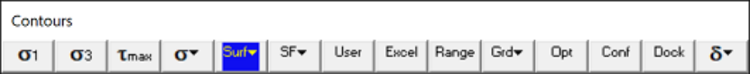
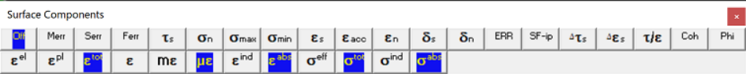
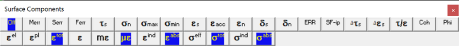
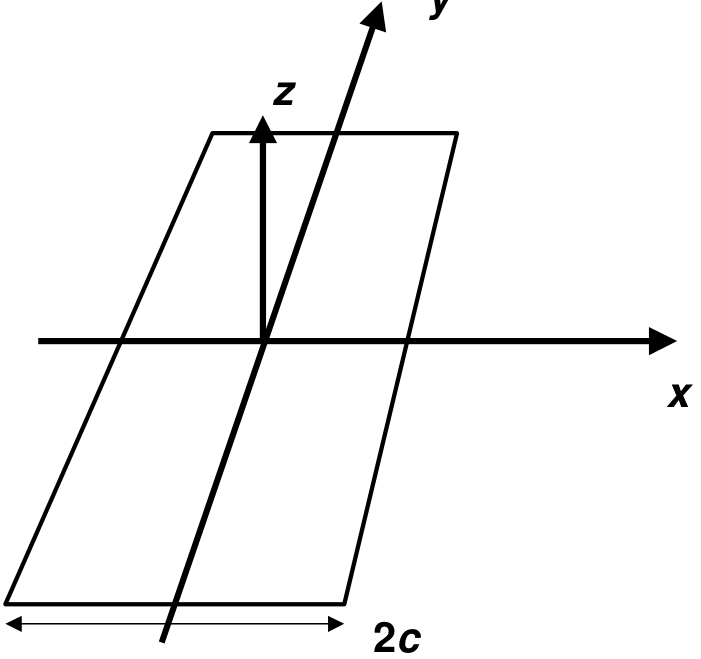
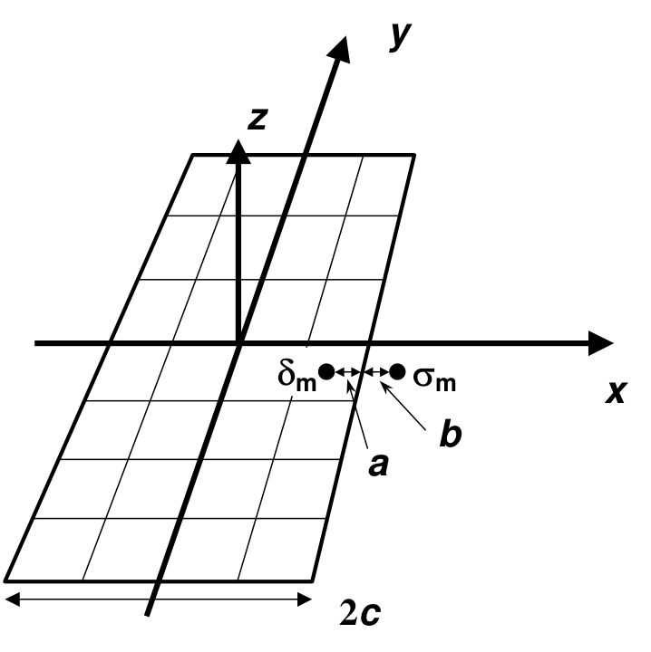
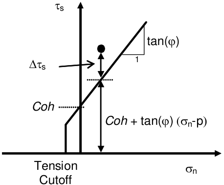
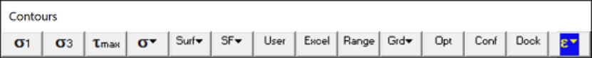
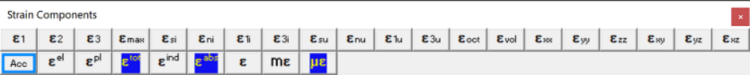
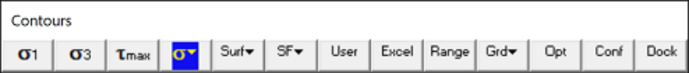
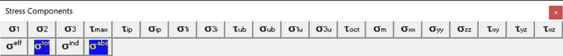

## 5.3.7.1 Surface Contours Off

Turns the contours off.

This component can be accessed via the Strength Factor Components toolbar as follows:

This toolbar can be changed to a vertical orientation by dragging is against either the right or left hand edge of the main window.

It can be changed back to a horizontal orientation by dragging is against either the top or bottom edge of the main window.

Selecting the button on the Contours toolbar activates the Surface Components toolbar.

## 5.3.7.2 Serr Stress error

Contours the surface stress error.

These components can be accessed via the Strength Factor Components toolbar as follows:

This toolbar can be changed to a vertical orientation by dragging is against either the right or left hand edge of the main window.

It can be changed back to a horizontal orientation by dragging is against either the top or bottom edge of the main window.

Selecting the button on the Contours toolbar activates the Surface Components toolbar.

During matrix solution Map3D is attempting to progressively solve the simultaneous equations saved in the coefficient matrix along with any other equations describing the alternate material zones, fault slip, creep etc. The iterative solver functions by determining the error in the current solution of each

simultaneous equation (the surface stress error), then reducing these errors by a process of successive approximations.

The Stress Error contours the current stress error on all surfaces.

The Maximum Stress Error contours the locations where the maximum stress errors occur.

A converged solution is assumed to have been obtained when the maximum surface stress error and the maximum failure criterion error are reduced below the user specified stress tolerance STOL

Analysis > CParams

#### Related Topics:

Plot > Surface Components > Ferr - Failure Error

Analysis Dialog

## 5.3.7.3 Ferr Failure error

Contours the surface failure criterion error.

This component can be accessed via the Strength Factor Components toolbar as follows:

This toolbar can be changed to a vertical orientation by dragging is against either the right or left hand edge of the main window.

It can be changed back to a horizontal orientation by dragging is against either the top or bottom edge of the main window.

Selecting the button on the Contours toolbar activates the Surface Components toolbar.

During matrix solution Map3D is attempting to progressively solve the simultaneous equations saved in the coefficient matrix along with any other equations describing the alternate material zones, fault slip, creep etc. The iterative solver functions by determining the error in the current solution of each simultaneous equation (the surface stress error), then reducing these errors by a process of successive approximations.

A converged solution is assumed to have been obtained when the maximum surface stress error and the maximum failure criterion error are reduced below the user specified stress tolerance STOL

Analysis > CParams

The failure criterion error is only used for non-linear creep analyzes (including fault slip and 3D material non-linearity). This parameter should always be near zero unless some viscosity has been specified and the problem goes non-linear. In this latter case, viscous creep can allow stress states above the failure criterion, thus indicating a lack of static equilibrium.

#### Related Topics:

Plot > Surface Components > Serr - Stress Error

Analysis > Options > Creep Analysis Dialog

## 5.3.7.4 Shear stress

Contours the maximum shear stress in the plane of the surface. This component can be accessed via the Strength Factor Components toolbar as follows:

This toolbar can be changed to a vertical orientation by dragging is against either the right or left hand edge of the main window.

It can be changed back to a horizontal orientation by dragging is against either the top or bottom edge of the main window.

Selecting the button on the Contours toolbar activates the Surface Components toolbar.

In elastic analysis the maximum in-plane shear stress is normally used with the in-plane normal stress and the Mohr-Coulomb strength criterion to estimate the amount of slip due to over-stressing, on a fault, joint set or bedding plane.

By contrast, in non-linear analysis the maximum in-plane shear stress can never exceed the strength unless some creep is used. In this latter case, viscous creep can allow stress states above the failure criterion, thus indicating a lack of static equilibrium. Hence for non-linear analysis one normally directly considers the amount of slip predicted by the model

Mohr-Coulomb in DD planes

Fault-Gouge in DD planes

Backfill-Hyperbolic in DD planes

The contour range is set using

Plot > Range

This component can be added to the contour toolbar if desired

Tools > Configure Contouring Toolbar

#### Related Topics:

Plot > Surface Components > Sn Normal Stress Plot > Surface Components > dTs - Excess Shear Stress Plot > Surface Components > dEs - Incremental Shear Strain Plot > Surface Components > Es - Shear Strain Plot > Surface Components > ds - Shear Displacement (Ride)

## 5.3.7.5 Normal stress

Contours the stress normal to the surface.

This component can be accessed via the Strength Factor Components toolbar as follows:

This toolbar can be changed to a vertical orientation by dragging is against either the right or left hand edge of the main window.

It can be changed back to a horizontal orientation by dragging is against either the top or bottom edge of the main window.

Selecting the button on the Contours toolbar activates the Surface Components toolbar.

In elastic analysis the maximum in-plane shear stress is normally used with the in-plane normal stress and the Mohr-Coulomb strength criterion to estimate the amount of slip due to over-stressing, on a fault, joint set or bedding plane.

By contrast, in non-linear analysis the maximum in-plane shear stress can never exceed the strength unless some creep is used. In this latter case, viscous creep can allow stress states above the failure criterion, thus indicating a lack of static equilibrium. Hence for non-linear analysis one normally directly considers the amount of slip predicted by the model

Mohr-Coulomb in DD planes

Fault-Gouge in DD planes

Backfill-Hyperbolic in DD planes

The contour range is set using

Plot > Range

This component can be added to the contour toolbar if desired

Tools > Configure Contouring Toolbar

#### Related Topics:

Plot > Surface Components > Ts Shear Stress

Plot > Surface Components > dTs - Excess Shear Stress

Plot > Surface Components > dEs - Incremental Shear Strain

Plot > Surface Components > Es - Shear Strain

Plot > Surface Components > ds - Shear Displacement (Ride)

## 5.3.7.6 Maximum Tangential Stress

Contours the stresses tangential to the surface. These components can be accessed via the Strength Factor Components toolbar as follows:

This toolbar can be changed to a vertical orientation by dragging is against either the right or left hand edge of the main window.

It can be changed back to a horizontal orientation by dragging is against either the top or bottom edge of the main window.

Selecting the button on the Contours toolbar activates the Surface Components toolbar.

In elastic analyses, tangential stresses are not calculated unless requested. This is because they are not required for the solution process and do require addition al analysis time. This calcuation is requested by checking Analysis > Options > Calculate Tangential Stress Components.

These values are calculated by default during plastic analysis.

In elastic analysis the maximum tangential stress is often referred to as the extreme fibre stress. This is useful to determine locations where the stresses exceed the unconfined compressive strength or tensile strenght of the rock mass.

The contour range is set using

#### Plot > Range

This component can be added to the contour toolbar if desired

Tools > Configure Contouring Toolbar

## 5.3.7.8 Shear strain

Contours the shear strain occurring in the in-filling material of DD elements. This component can be accessed via the Strength Factor Components toolbar as follows:

This toolbar can be changed to a vertical orientation by dragging is against either the right or left hand edge of the main window.

It can be changed back to a horizontal orientation by dragging is against either the top or bottom edge of the main window.

Selecting the button on the Contours toolbar activates the Surface Components toolbar.

The shear strain is determined by dividing the shear displacement (ride) by the DDplane thickness.

CAD > Edit > Entity Properties > DDplane Thickess

Note that there are three components of strain that can be contoured:

Plot > Surface Components > Value > Elastic Plot > Surface Components > Value > Plastic Plot > Surface Components > Value > Total

There are also two different ways of presenting the strain:

Plot > Strain > Value > Induced Strain Plot > Strain > Value > Absolute Strain

Note that is the current level of shear strain acting on the DD surfaces.

Since the displacement can change direction and even reverse during slip, the total accumulated shear strain can give different values.

The contour range is set using

Plot > Range

This component can be added to the contour toolbar if desired

Tools > Configure Contouring Toolbar

#### Related Topics:

Plot > Surface Components > dEs - Incremental Shear Strain

Plot > Surface Components > ds - Shear Displacement (Ride)

## 5.3.7.10 Normal strain

Contours the normal strain occurring in the in-filling material of DD elements. This component can be accessed via the Strength Factor Components toolbar as follows:

This toolbar can be changed to a vertical orientation by dragging is against either the right or left hand edge of the main window.

It can be changed back to a horizontal orientation by dragging is against either the top or bottom edge of the main window.

Selecting the button on the Contours toolbar activates the Surface Components toolbar.

The normal strain is determined by dividing the normal displacement (closure) by the DDplane thickness

#### CAD > Edit > Entity Properties > DDplane Thickess

Note that there are three components of strain that can be contoured:

Plot > Surface Components > Value > Elastic Plot > Surface Components > Value > Plastic Plot > Surface Components > Value > Total

The contour range is set using

#### Plot > Range

This component can be added to the contour toolbar if desired

Tools > Configure Contouring Toolbar

#### Related Topics:

Plot > Surface Components > dn - Normal Displacement (Closure)

## 5.3.7.11 Shear Displacement (Ride)

Contours the ride or shear displacement occurring on DD elements. This component can be accessed via the Strength Factor Components toolbar as follows:

This toolbar can be changed to a vertical orientation by dragging is against either the right or left hand edge of the main window.

It can be changed back to a horizontal orientation by dragging is against either the top or bottom edge of the main window.

Selecting the button on the Contours toolbar activates the Surface Components toolbar.

Note that there are three components of shear displacement that can be contoured:

Plot > Surface Components > Value > Elastic Plot > Surface Components > Value > Plastic Plot > Surface Components > Value > Total

There are also two different ways of presenting the displacement:

Plot > Strain > Value > Induced Strain Plot > Strain > Value > Absolute Strain

The contour range is set using

Plot > Range

This component can be added to the contour toolbar if desired

Tools > Configure Contouring Toolbar

#### Related Topics:

Plot > Surface Components > dEs - Incremental Shear Strain Plot > Surface Components > Es - Shear Strain

## 5.3.7.12 Normal Displacement (Closure)

Contours the closure or normal displacement occurring on DD elements. This component can be accessed via the Strength Factor Components toolbar as follows:

This toolbar can be changed to a vertical orientation by dragging is against either the right or left hand edge of the main window.

It can be changed back to a horizontal orientation by dragging is against either the top or bottom edge of the main window.

Selecting the button on the Contours toolbar activates the Surface Components toolbar.

Note that there are three components of closure that can be contoured:

Plot > Surface Components > Value > Elastic Plot > Surface Components > Value > Plastic Plot > Surface Components > Value > Total

The contour range is set using

Plot > Range

This component can be added to the contour toolbar if desired

Tools > Configure Contouring Toolbar

#### Related Topics:

Plot > Surface Components > ds - Shear Displacement (Ride)

## 5.3.7.13 ERR

Calculate energy release rate.

This component can be accessed via the Strength Factor Components toolbar as follows:

This toolbar can be changed to a vertical orientation by dragging is against either the right or left hand edge of the main window.

It can be changed back to a horizontal orientation by dragging is against either the top or bottom edge of the main window.

Selecting the button on the Contours toolbar activates the Surface Components toolbar.

This routine enables the user to calculate energy release rate ( _ERR_ ) ahead of an excavation face. An alternative method is available where _ERR_ can be calculated at any desired location Analysis > Options > LERD/LSS

#### Crack-tip Formulation

Consider a planar crack in an infinite homogeneous elastic medium. It is well known that near the crack tip, the aperture d exhibits a Ö _r_ response near the face

and the stress s exhibits a 1/Ö _r_ response

where _r_ represents the distance from the crack tip.

The total energy released can be determined for a small increment of face advance a by superimposing the normal displacement (closure) with the stress over the region a. This requires that we offset the coordinate system for d by the distance a giving

The total energy released can then be calculated from (the integral is taken from 0 to a)

- _W_ = ½ ò s d _dr_

[4] = ½ _p_ d _p_ s ò Ö(a- _r_ )/Ö _r dr_ = ¼ p a _p_ d _p_ s

The energy release rate can now be determined by differentiating by a to arrive at

This expression has only made the assumption that d exhibits a Ö _r_ response near the face and that s exhibits a 1/Ö _r_ response near the face. No assumptions regarding the geometry have been made. There is no requirement for _p_ d to be related to _p_ s in any way. Note that these assumptions are only true in an infinite homogeneous elastic medium. Near bi-material interfaces or other excavation surfaces these assumptions break down.

#### Analytical Solution for a Planar Crack

Consider a planar crack with width 2 _c_ and length eight times the width.

For such a shape, the aperture (normal displacement or closure) can be determined analytically as (at the mid-section)

#### d = 4(1-n²)/ _E p_ Ö( _c_ ²- _x_ ²) [6]

where _E_ and n represent respectively Young's (rock mass scale - deformation) modulus and Poisson's ratio, and _p_ represents the homogeneous pre-mining stress state. The stress ahead of the crack tip can also be determined analytically as

The work done in deforming the crack surfaces is equivalent to the total energy released and can be determined as follows (the integral is taken from - _c_ to + _c_ )

- _W_ = ½ ò _p_ d _dx_

[8] = 2p (1-n²) _p_ ²/ _E_ ò Ö( _c_ ²- _x_ ²) _dx_

- = p (1-n²) _p_ ² _c_ ²/ _E_

As the length of the crack increases, the energy release per unit length of crack extension can be determined by differentiation as

For extension of one end of the crack only, we obtain the energy release rate as half this value

_ERR_ = p (1-n²) _p_ ² _c_ / _E_ [10]

#### Comparison with Planar Crack Solution

If we now compare the planar crack geometry with the crack-tip formulation, it can be observed that for planar crack (comparing equations [1] and [2] with [6] and [7])

_p_ d = 4(1-n²)/ _E p_ Ö(2 _c_ ) [11] _p_ s = _p_ Ö(c/2) [12]

Observation of these equations reveals that these two parameters can be related in the case of a planar crack geometry by

_p_ d = 8(1-n²)/ _E p_ s [13]

Substituting these into equation [5] for _ERR_ provides

_ERR_ = p (1-n²) _p_ ² _c_ / _E_ [14]

the same result as determined for the planar crack (equation [10]).

Various substitutions for _p_ d and _p_ s can be made to determine

_ERR_ = 2p (1-n²) p _p_ s²/ _E_ [15] and _ERR_ = 1/32 p _p_ d² _E_ /(1-n²) [16]

This later equation is the same expression derived by Ryder and Jager (their equation [11], p. 236, Rock Mechanics for Tabular Hard Rock Mines, 2002). They state that this equation is used to calculate _ERR_ in MINSIM. Some form of a-edge correction (Ryder and Napier, Numerical Methods in Geomechanics, Nagoya, 1985) is also apparently implemented but the details on exactly how this done are unclear.

#### _ERR_ Calculation in Map3D

Both of _p_ d and _p_ s can be determined from numerical modelling.

For example, given the normal displacement (closure) dm determined at distance _a_ behind the advancing face, _p_ d can be determined using equation [1] as

Similarly, given the stress sm at distance _b_ ahead of the advancing face, _p_ s can be determined using equation [2] as

Note that there is no reason for _a_ to be equal to _b_ and hence there is no requirement for uniform boundary element sizes.

Once either or both of _p_ d and _p_ s are determined, _ERR_ is readily calculated from equation [5], [15] or [16].

Detailed studies of stress and displacement distributions near the crack tip reveal that for constant DD elements, both the aperture and stress are consistently over-estimated. Fortunately, the degree of overestimation is closely related to the element size and it can be found that if _a_ is multiplied by 3/2 and _b_ is multiplied by 2/3, much more accurate results can be obtained. With these substitutions, and using equation [17] and [18], _ERR_ can be determined from

- _ERR_ = 1/6 p dm sm Ö(2/3 _b)_ / Ö(3/2 _a)_

- = 1/6 p dm sm Ö( _b_ / _a)_ [19]

This equation is used to calculate _ERR_ in Map3D.

#### An Example

With _E_ of 60000 MPa, n of 0.25, _p_ of 100 MPa and _c_ of 100 m we calculate theoretical values for _p_ s of 707.11, _p_ d of 0.088388 and 49.1 MN/m for _ERR_

This can be modelled using Map3D using uniform elements of width _w_ , to provide the following results:

|_w_(m)|_b_=_a_(m)|sm (MPa)|dm (m)|_ERR _(MN/m)|error|
|---|---|---|---|---|---|
|50|25|197.567|0.5209|53.9|+9.8%|
|25|12.5|262.669|0.3754|51.6|+5.2%|
|12.5|6.25|358.943|0.2679|50.3|+2.5%|
|10|5|398.56|0.2402|50.1|+2.1%|
|6.25|3.125|498.323|0.1903|49.6|+1.0%|
|5|2.5|554.58|0.1705|49.5|+0.9%|
|3.125|1.5625|697.764|0.1349|49.3|+0.4%|

Note that the stress sm and normal displacement (closure) dm are determined at the element centres. Since uniform element widths were used, _a_ equals _b_ equals ½ _w_

## 5.3.7.14 SF-D Strength/Stress

Contours the strength/stress ratio on DD elements. This component can be accessed via the Strength Factor Components toolbar as follows:

This toolbar can be changed to a vertical orientation by dragging is against either the right or left hand edge of the main window.

It can be changed back to a horizontal orientation by dragging is against either the top or bottom edge of the main window.

Selecting the button on the Contours toolbar activates the Surface Components toolbar.

In elastic analysis the maximum in-plane shear stress is normally used with the in-plane normal stress and the Mohr-Coulomb strength criterion to estimate the amount of slip due to over-stressing, on a fault, joint set or bedding plane.

By contrast, in non-linear analysis the maximum in-plane shear stress can never exceed the strength unless some creep is used. In this latter case, viscous creep can allow stress states above the failure criterion, thus indicating a lack of static equilibrium. Hence for non-linear analysis one normally directly considers the amount of slip predicted by the model

Mohr-Coulomb in DD planes

Fault-Gouge in DD planes

Backfill-Hyperbolic in DD planes

#### Mohr-Coulomb

Strength/Stress   can be determined as  [ Cohesion + (sn-p) tan(j) ] / ts

dTs   Excess Shear Stress  can be determined as Dts = ts - [ Cohesion + (sn-p) tan(j) ]

If fluid pressure is specified as part of the Stress State, the effective normal stress (sn-p) is used (here p is the fluid pressure).

The contour range is set using

Plot > Range

This component can be added to the contour toolbar if desired

Tools > Configure Contouring Toolbar

#### Related Topics:

Plot > Surface Components > dTs - Excess Shear Stress

## 5.3.7.15 Excess Shear Stress

Contours the excess stress Dts on DD elements.

This component can be accessed via the Strength Factor Components toolbar as follows:

This toolbar can be changed to a vertical orientation by dragging is against either the right or left hand edge of the main window.

It can be changed back to a horizontal orientation by dragging is against either the top or bottom edge of the main window.

Selecting the button on the Contours toolbar activates the Surface Components toolbar.

This feature is used only in non-linear analyzes (3D FF blocks in Map3D Non-Linear and DD planes in Map3D Fault-Slip). For details refer to

CAD > Properties > Material Properties

At each creep step the stress state on all yielding elements (elements where the stress exceeds the strength) is calculated as the strength plus the creep resistance. This limits the size of plastic creep increment Deplastic on each yielding element

- ts = Strength + _C_ Deplastic /D _t_

- _C_ = _G_ D _t_

where the creep resistance is determined as the creep coefficient _C_ , times the plastic strain rate. Note that the user must select both the creep coefficient _C_ , and the time step size D _t_ , then specify the quotient of these as the viscous modulus _G_ . The contribution to the stress ts, made by the creep increment is the excess stress given by

Dts   = _C_ Deplastic /D _t_

The accumulated plastic strain eplastic, is determined as the sum of the plastic creep increments Deplastic, for all creep steps.

#### Related Topics:

Plot > Surface Components > dEs - Incremental Shear Strain Plot > Surface Components > Ts - Shear Stress Plot > Surface Components > Es - Shear Strain

Analysis > Options > Creep

## 5.3.7.16 Incremental Shear Strain

Contours the plastic creep increment Deplastic on DD elements.

This component can be accessed via the Strength Factor Components toolbar as follows:

This toolbar can be changed to a vertical orientation by dragging is against either the right or left hand edge of the main window.

It can be changed back to a horizontal orientation by dragging is against either the top or bottom edge of the main window.

Selecting the button on the Contours toolbar activates the Surface Components toolbar.

This feature is used only in non-linear analyzes (3D FF blocks in Map3D Non-Linear and DD planes in Map3D Fault-Slip). For details refer to

CAD > Properties > Material Properties

At each creep step the stress state on all yielding elements (elements where the stress exceeds the strength) is calculated as the strength plus the creep resistance. This limits the size of plastic creep increment \plastic on each yielding element

- ts = Strength + _C_ Deplastic /D _t_

- _C_ = _G_ D _t_

where the creep resistance is determined as the creep coefficient _C_ , times the plastic strain rate. Note that the user must select both the creep coefficient _C_ , and the time step size D _t_ , then specify the quotient of these as the viscous modulus _G_ . The contribution to the stress ts, made by the creep increment is the excess stress given by

Dts   = _C_ Deplastic /D _t_

The accumulated plastic strain eplastic, is determined as the sum of the plastic creep increments Deplastic, for all creep steps.

Note that since the user must select the time step size D _t_ , in order to define the viscous modulus _G_ , the shear strain rate is easily determined from the incremental shear strain Deplastic, simply by dividing by the time step size.

#### Related Topics:

Plot > Surface Components > dTs - Excess Shear Stress

Plot > Surface Components > Ts - Shear Stress

Plot > Surface Components > Es - Shear Strain

Analysis > Options > Creep

## 5.3.7.17 Stress/Strain rate

Contours the excess stress divided by the plastic creep increment Dts / Deplastic on DD elements. This component can be accessed via the Strength Factor Components toolbar as follows:

This toolbar can be changed to a vertical orientation by dragging is against either the right or left hand edge of the main window.

It can be changed back to a horizontal orientation by dragging is against either the top or bottom edge of the main window.

Selecting the button on the Contours toolbar activates the Surface Components toolbar.

This feature is used only in non-linear analyzes (3D FF blocks in Map3D Non-Linear and DD planes in Map3D Fault-Slip). For details refer to

#### CAD > Properties > Material Properties

At each creep step the stress state on all yielding elements (elements where the stress exceeds the strength) is calculated as the strength plus the creep resistance. This limits the size of plastic creep increment Deplastic on each yielding element

- ts = Strength + _C_ Deplastic /D _t_

- _C_ = _G_ D _t_

where the creep resistance is determined as the creep coefficient _C_ , times the plastic strain rate. Note that the user must select both the creep coefficient _C_ , and the time step size D _t_ , then specify the quotient of these as the viscous modulus _G_ . The contribution to the stress ts, made by the creep increment is the excess stress given by

Dts   = _C_ Deplastic /D _t_

The accumulated plastic strain eplastic, is determined as the sum of the plastic creep increments Deplastic, for all creep steps.

#### Related Topics:

Plot > Surface Components > dTs - Excess Shear Stress Plot > Surface Components > dEs - Incremental Shear Strain Plot > Surface Components > Ts - Shear Stress Plot > Surface Components > Es - Shear Strain

#### Analysis > Options > Creep

## 5.3.7.18 Cohesion

Contours the Cohesion and Friction angle of the gouge material. These components can be accessed via the Strength Factor Components toolbar as follows:

This toolbar can be changed to a vertical orientation by dragging is against either the right or left hand edge of the main window.

It can be changed back to a horizontal orientation by dragging is against either the top or bottom edge of the main window.

Selecting the button on the Contours toolbar activates the Surface Components toolbar.

This is of particular interest when you use the Equilibrated-Gouge material type since the cohesion and friction angle can vary from place to place..

## 5.3.7.20 Temperature/Head

Contours the temperature or head.

Map3D Thermal-Fluid Flow can be used to simultaneously solve steady state heat/fluid flow coupled to the stress analysis. The program is set up so that the user need only specify the temperature/head boundary conditions, then the coupled thermal/fluid flow stress problem is solved simultaneously. This feature is useful for the simulation of heating or cooling effects and drained or undrained response of soils.

For more details refer to

#### Expansion Coefficient and Conductivity

The contour range is set using

#### Plot > Range

This component can be added to the contour toolbar if desired

Tools > Configure Contouring Toolbar

## 5.3.7.21 Normal Flux

Contours the flow rate normal to the surface.

Map3D Thermal-Fluid Flow can be used to simultaneously solve steady state heat/fluid flow coupled to the stress analysis. The program is set up so that the user need only specify the temperature/head boundary conditions, then the coupled thermal/fluid flow stress problem is solved simultaneously. This feature is useful for the simulation of heating or cooling effects and drained or undrained response of soils.

For more details refer to

Expansion Coefficient and Conductivity

The contour range is set using

Plot > Range

This component can be added to the contour toolbar if desired

Tools > Configure Contouring Toolbar

## 5.3.7.22 Value

5.3.7.22.1  Elastic strain

Selects the elastic, plastic or total strain component. These components can be accessed via the Strain Components toolbar as follows:

This toolbar can be changed to a vertical orientation by dragging is against either the right or left hand edge of the main window.

It can be changed back to a horizontal orientation by dragging is against either the top or bottom edge of the main window.

Selecting the button on the Contours toolbar activates the Stress Components toolbar.

You can add this button to the Contours toolbar using the configuration button.

For details, refer to

Mohr-Coulomb in 3D FF blocks.

### 5.3.7.22.4 Absolute Strain

Plot the induced or absolute strain component.

This component can be accessed via the Strain Components toolbar as follows:

This toolbar can be changed to a vertical orientation by dragging is against either the right or left hand edge of the main window.

It can be changed back to a horizontal orientation by dragging is against either the top or bottom edge of the main window.

Selecting the button on the Contours toolbar activates the Stress Components toolbar.

You can add this button to the Contours toolbar using the configuration button.

Induced strain is the strain without the pre-mining strain contribution. This represents the strain change since the pre-mining condition.

Absolute strain is the strain including the pre-mining strain contribution.

Also see:

Plot > Stress > Value > Induced Strain Plot > Stress > Value > Absolute Strain

### 5.3.7.22.6 Induced Stress

Plot the induced or absolute stress component. These components can be accessed via the Stress Components toolbar as follows:

This toolbar can be changed to a vertical orientation by dragging is against either the right or left hand edge of the main window.

It can be changed back to a horizontal orientation by dragging is against either the top or bottom edge of the main window.

Selecting the button on the Contours toolbar activates the Stress Components toolbar.

Induced stress is the stress without the pre-mining stress contribution. This represents the stress change since the pre-mining condition.

Absolute stress is the stress including the pre-mining stress contribution.

Also see:

Plot > Strain > Value > Induced Strain

Plot > Strain > Value > Absolute Strain
