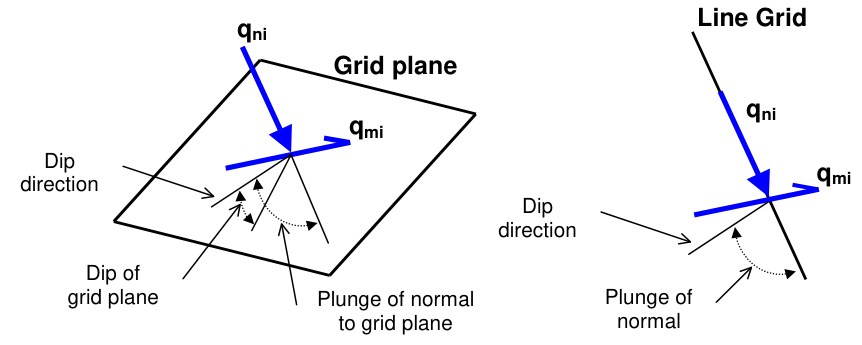
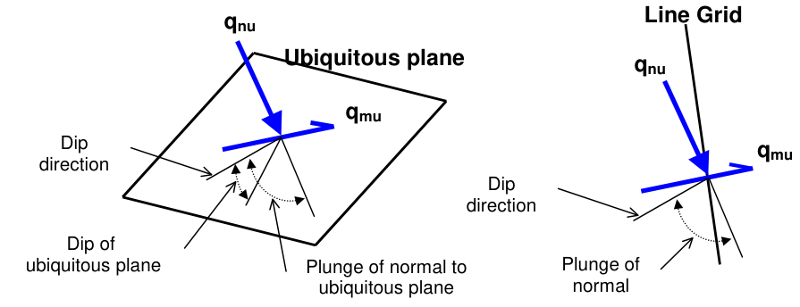

## 5.3.5.1 Plot > Thermal/Flux

Activate the Thermal/Flux toolbar – after Map3D Thermal-Fluid Flow BEM analysis.

Parameters for Thermal/Flux Analysis are described in Expansion Coefficient and Conductivity.

This toolbar is meant to provide quick access to thermal/flux components.

Plot > Flux > t/h   Temperature/Head

Plot > Flux > qtotal = ( qx² + qy² + qz² )½ Total Flux   contours the total displacement

Plot > Flux > qx X-Flux   contours the x-flux component

Plot > Flux > qy Y-Flux   contours the y-flux component

Plot > Flux > qz Z-Flux   contours the z-flux component

To calculate the in-plane flux, the flux state at each point on the grid plane is reoriented to determine the maximum flux parallel to the grid plane and the flux normal to the plane. Note that qni is oriented normal to the grid plane and parallel to the direction of a line grid.

Plot > Flux > qni In-plane normal   contours the flux component normal to the grid plane.

Plot > Flux > qmi In-plane maximum   contours the maximum flux tangential to the grid plane.

To calculate the ubiquitous-plane #1 flux, the flux state at each point on the grid plane is reoriented to determine the maximum flux parallel to the ubiquitous plane #1 and the flux normal to the plane. Note that dmi is not oriented normal to the grid plane.

Plot > Flux > qnu Ubiquitous-plane normal   contours the flux component normal to the ubiquitous plane.

Plot > Flux > qmu Ubiquitous-plane maximum   contours the maximum flux tangential to the ubiquitous plane.

- dip direction is measured positive clockwise from the y-axis.

- dip of the plane is measured positive down from the horizontal (i.e. the dip direction).

- plunge of the normal is measured positive down (i.e. negative up) from the horizontal.

#### Notes:

The flux toolbar can only be activated after the model building - CAD Stage

#### Map3D Analysis Stages.

The orientation of the ubiquitous shear plane is set using

Plot > Strength Factors > Ubiquitous Parameters

The contour range is set using

#### Plot > Range

This component can be added to the contour toolbar if desired

Tools > Configure Contouring Toolbar > Displacement

The user may find it handy to add the

#### More Flow Components

button to the contouring toolbar for quick access to all flow components.
