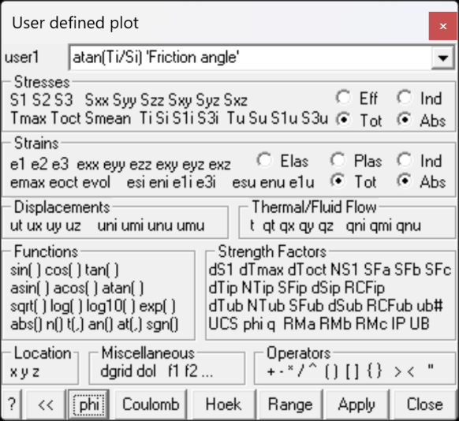

Contours a user defined stress component.

#### Stresses:

- S1 S2 S3 principal stress components s1 s2 s3

- Sxx Syy Szz Sxy Syz Sxz Cartesian stress components sxx syy szz txy tyz tzx

- Tmax maximum shear stress ½(s1 - s3)

- Toct octahedral shear stress toct = ¹/3 [(s1 - s2)² + (s2 - s3)² +(s3 - s1)²]½

- Smean mean stress smean = ¹/3 (s1 + s2 + s3)

- Ti Si maximum shear and normal stress in the grid plane tip sip

- S1i S3i maximum and minimum stress tangential to the grid plane s1i s3i

- Tu Su maximum shear and normal stress in the ubiquitous-plane tub sub. The orientation of the ubiquitous shear plane is set using

- S1u S3u maximum and minimum stress tangential to the ubiquitous plane s1u s3u \]

- Effective/Total effective stress or total stress components. These options are only used in Map3D Thermal-Fluid Flow, as this code allows for calculation of steady state pore pressure distributions.

- Induced/Absolute induced stress or absolute stress components (i.e. the stress without the premining stress contribution).

#### Strains:

- e1 e2 e3 major principal strain e1 e2 e3

- exx eyy ezz exy eyz exz Cartesian strain components exx eyy ezz exy eyz ezx

- emax maximum shear strain ½(e1 - e3)

- eoct octahedral shear strain eoct = ¹/3 [(e1 - e2)² + (e2 - e3)² +(e3 - e1)²]½

- evol volumetric strain evol = (e1 + e2 + e3)

- esi eni maximum shear and normal strain in the grid plane esi eni

- e1i e3i maximum and minimum strain tangential to the grid plane e1i e3i

- esu enu maximum shear and normal strain in the ubiquitous-plane esu enu

- e1u e3u maximum and minimum strain tangential to the ubiquitous plane e1u e3u

- Elastic/Plastic/Total elastic, plastic or total strain components. These options are only used in Map3D Non-Linear, as this code allows for calculation of non-linear strains.

- Induced/Absolute induced strain or absolute strain components (i.e. the stress without the premining stress contribution).

#### Displacements:

- ut total displacement, its trend and plunge dt

- · ux uy uz Cartesian displacement components dx dy dz

- uni displacement normal to the grid plane dni

- umi maximum displacement tangential to the grid plane dmi

- unu displacement normal to the ubiquitous plane dnu

- umu maximum displacement tangential to the ubiquitous plane dmu

#### Thermal/Fluid Flow:

- t temperature/head

- qt total flow, its trend and plunge.

- qx qy qz Cartesian flow components.

- qni displacement normal to the grid plane.

- qmi maximum displacement tangential to the grid plane.

- qnu displacement normal to the ubiquitous plane.

- qmu maximum displacement tangential to the ubiquitous plane.

#### Functions:

- sin() cos() tan()   sine, cosine and tangent trigonometric functions.

- asin() acos() atan()   Inverse trigonometric functions.

- sqrt()   square root function.

- log()   natural logarithmic function.

- log10()   base 10 logarithmic function.

- exp()   exponential function (antilogarithm).

- abs()   absolute value.

- n() an()   normal and inverse normal probability distribution. The argument used with the normal distribution is (Ds1/ _s_ ) which represents the excess major principal stress divided by the standard deviation (see ).

- t(,) at(,)   t and inverse t probability distribution. The argument used with the t distribution is (Ds1/ ( _sg),n_ -2) where Ds1 represents the excess major principal stress, _s_ represents the standard deviation, _n_ represents the number of data points, and _g_ represents the factor  [1 + 1/ _n_ + (s3 - sm) ²/s3²/( _n_ -1)]½ where sm represents the mean value of s3, and s3 represents the standard deviation of s3.

- sgn()   sign function return +1 for positive values, -1 for negative values and 0 for values with magnitude less than 10-12 .

#### Strength:

- ds1 excess major principal stress Ds1 = s1 - ( _UCS_ + _q_ s3 )

- dtmax excess maximum shear stress Dtmax = ½(s1 - s3) - [ _UCS_ + ½(s1+s3) ( _q_ -1) ]/( _q_ +1) = [s1 - ( _UCS_ + _q_ s3) ]/( _q_ +1)

- dtoct excess octahedral shear stress Dtoct = toct - [ _UCS_ + ( _q_ –1) smean ] Ö(2) /( _q_ +2)

- NS1 probability using the Normal distribution N(Ds1 /std)

- SFA Strength/Stress can be determined for Mohr-Coulomb as ( _UCS_ + _q_ s3 )/ s1

- or for Hoek-Brown as [ s3 + Ö( _m_ scs3 + _s_ sc²) ] / s1

- SFB Strength/Stress can be determined  for Mohr-Coulomb as ( _UCS_ + _q_ s3 - s3 )/(s1 - s3) or for Hoek-Brown as [ s3 + Ö( _m_ scs3 + _s_ sc²) ] / (s1 - s3)

- SFC Strength/Stress can be determined  for Mohr-Coulomb as [ _UCS_ + ½(s1+s3) ( _q_ -1) ]/[ ½(s1 - s3)( _q_ +1) ]

or for Hoek-Brown as &#123;Ö[1 /16 _m_ ²sc² + ½(s1 + s3) _m_ sc + _s_ sc²] - ¼ _m_ sc&#125;/(s1 - s3)

- dTip excess in-plane shear stress Dtip = tip - [ Cohesion + sip tan(j) ]

- NTip probability using the Normal distribution N(Dtip /std)

- SFip Strength/Stress can be determined as [ Cohesion + sip tan(j) ] / tip

- dSip excess in-plane wall stress Dsip = [ 3 s1i - s3i ] - UCS

- RCFip Rock Condition Factor for the in-plane wall stress RCFip = [ 3 s1i - s3i ]/UCS

- dTub excess ubiquitous-plane shear stress Dtub

- NTub probability using the Normal distribution N(Dtub /std)

- SFub Strength/Stress can be determined as [ Cohesion + sub tan(j) ] / tub

- dSub excess ub-plane wall stress Dsub = [ 3 s1ub - s3ub ] - UCS

- RCFub Rock Condition Factor for the ub-plane wall stress RCFip = [ 3 s1ub - s3ub ]/UCS

- UB# Plots the UB set number (1, 2 or 3) that has the largest value of Dtub

- _UCS phi q_ Mohr-Coulomb strength parameters defined using Plot > Strength Factors > Rockmass Strength Parameters note that these parameters are only defined if you have specified the Mohr-Coulomb or Druker-Prager strength criterion

- _RMa_ Rock mass strength defined for Mohr-Coulomb as ( _UCS_ + _q_ s3 )

or for Hoek-Brown as [ s3 + Ö( _m_ scs3 + _s_ sc²) ]

- _RMb_ Rock mass strength defined for Mohr-Coulomb as ( _UCS_ + _q_ s3 - s3 )

- or for Hoek-Brown as [ Ö( _m_ scs3 + _s_ sc²) ]

- _RMc_ Rock mass strength defined  for Mohr-Coulomb as  [ _UCS_ + ½(s1+s3) ( _q_ -1) ]/( _q_ +1) or for Hoek-Brown as &#123;Ö[1 /16 _m_ ²sc² + ½(s1 + s3) _m_ sc + _s_ sc²] - ¼ _m_ sc&#125;/2

- _IP_ In-Plane strength defined using Mohr-Coulomb as [ Cohesion + sip tan(j) ]

- _UB_ Ubiquitous strength defined using Mohr-Coulomb as [ Cohesion + sub tan(j) ]

- _sc_ Hoek-Brown strength parameter defined using Plot > Strength Factors > Rockmass Strength Parameters note that this parameter is only defined if you have specified the Hoek-Brown strength criterion

#### Location:

- x y z   coordinate of grid point.

#### Miscellaneous:

- Dgrid distance to the nearest surface from each grid point.

- Dol distance to the nearest grid _Dgrid_ divided by the grid spacing _Lgrid_ .

- f1 f2... user defined material parameters. These can be defined using Plot > Properties > Material Properties > User defined Parameters.

#### Operators:

- + - * / ^   addition, subtraction, multiplication, division and exponentiation operators. Note that exponentials are computed first, followed by multiplication and division and finally addition and subtraction.

- () [] &#123;&#125;   styles of brackets. Pairs of brackets must match.

- >   maximum value. For example if the plot equation is specified as s1 > 10, the larger of s1 or 10 will be plotted.

- &lt;   minimum value. For example if the plot equation is specified as s1 &lt; 10, the smaller of s1 or 10 will be plotted.

- " "   comment.

#### Other:

- phi:   atan(Ti/Si) plots the friction angle necessary to resist slip on a fault, joint set or bedding plane oriented in the same way as the grid plane.

- Mohr-Coulomb:   60 + S3*tan(45+30/2)^2   plots the strength for a Mohr-Coulomb criterion with a UCS of 60 and friction angle of 30°. The equation _UCS_ + S3* _q_ or alternatively _UCS_ +S3*tan(45+ _phi_ /2)^2 could also be used here if the strength parameters have been previously

- defined using Plot > Strength Factors > Rockmass Strength Parameters.

- Hoek:     S3 + sqrt( 0.1*60*S3 + 0.005*60^2 )   plots the strength for a Hoek-Brown criterion with a sc of 60 and m of 0.1 and s of 0.005.

- Range – sets the contour range.

- Plot – regenerates the contour plot.

The pull-down window allows you to store up to 20 different equations. These are stored between Map3D sessions in the map3d.ini file.
