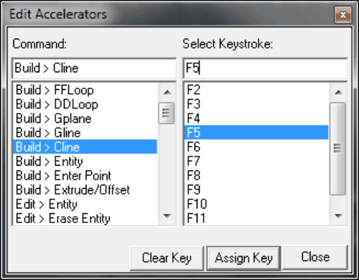

Allows you select use defined hotkeys.

For example to assign the F5 key to activate the Build > Cline function you would assign the function key as follows:

- Note that function key assignments are saved from session to session the Map3D.cfg file.
