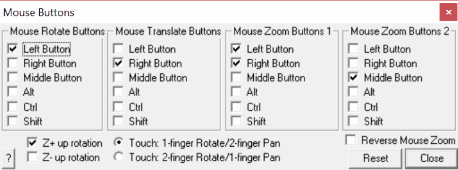

## 5.6.1.1 Mouse Buttons

Allows you to specify custom mouse rotation, translation and zoom functionality.

Note that a maximum of two buttons can be specified for each function. These buttons will be saved from session to session.

Z+ up rotation - specifies that the Z+ axis is constrained to point vertically such that when the Z+ axis points upwards, dragging the mouse to the left rotates the model to the left.

Z- up rotation - reverses the above assumption. In this case specifies that the Z+ axis is constrained to point vertically such that when the Z+ axis points upwards, dragging the mouse to the left rotates the model to the right.

Touch: 1-finger Rotate/2-finger Pan - touch screen controls set for 1-finger drag rotates the model and 2-finger drag pans the model.

Touch: 2-finger Rotate/1-finger Pan - touch screen controls set for 2-finger drag rotates the model and 1-finger drag pans the model.

Touch Zoom - two finger pinch zooms the model.

Reverse Mouse Wheel - reverses the action of the mouse wheel such that forward rotation zooms the model in instead of out.

## 5.6.1.2 Double Click Time

Specifies the amount time (in milliseconds) between double mouse clicks.

Double clicks are used to activate edit functions

CAD > Edit

## 5.6.1.3 Drag Wait Time

Specifies the amount time (in milliseconds) you must hold down a mouse button before the drag mouse pointer appears.

The drag mouse pointer is used to rotate and translate and zoom the model.
