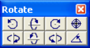
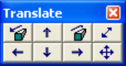
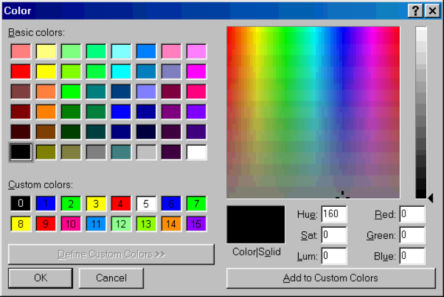

## 5.6.2.1 Rotation Toolbar

Activate the rotation toolbar.

The model can be rotated by using these buttons or by dragging the orientation icon around to the desired position.

Rotate Counter clockwise (Insert key)

Rotate Up (Home key or shift+up arrow)

Rotate Clockwise (Page Up key)

Rotate Left (Delete key or shift+left arrow)

Rotate Down (End key or shift+down arrow)

Rotate Right (Page Down key or shift+right arrow)

View > Centre of Rotation

View > Rotation Increment

Notes:

If the rotation toolbar is not visible it can be activated with

Tools > Rotation Toolbar

Before rotating the model you should set the desired centre of rotation

View > Centre of Rotation

## 5.6.2.2 Translation Toolbar

Activate the translation toolbar.

The model can be translated by using these buttons or by dragging the model to the desired position.

Zoom In (Enter or "+" key) Translate Up (up arrow) Zoom Out (Ctrl+Enter or "-" key) Translate Left (left arrow) Translate Down (down arrow) Translate Right (right arrow) View > Zoom Factor

View > Translation Increment

Notes:

If the translation toolbar is not visible it can be activated with

Tools > Translation Toolbar

Before zooming in

Zoom In

you should set the desired centre of rotation

View > Centre of Rotation

## 5.6.2.3 Contour Toolbar

Activate the contouring toolbar – after Map3D BEM analysis.

The default configuration for this toolbar is as follows:

This toolbar is meant to provide quick access to commonly used stress parameters.

Plot > Stress > S1 Major Principal Stress

Plot > Stress > S3 Minor Principal Stress

Plot > Stress > Tmax Maximum Shear Stress

Plot > Stress activates the stress toolbar. This toolbar contains all stress components.

Plot > Surface Components activates the surface toolbar. This toolbar contains all surface components.

Plot > Strength Factors activates the strength factor toolbar. This toolbar contains all strength parameter components.

Plot > Stress > User User defined stress plot.

Plot > Range specifies the contour range (minimum, maximum, interval ...) of the currently plotted contour.

Plot > Grid Selection Activate the grid selection toolbar.

Plot > Surface Components > Options specifies contour plot options (trajectories, contour lines ...).

Tools > Contouring Toolbar Configure add or remove buttons from the contouring toolbar.

Notes:

Buttons can be moved around on the toolbar simply by holding down the left mouse button and dragging the button to the desired location.

The contouring toolbar can only be activated after the model building - CAD Stage

Map3D Analysis Stages.

## 5.6.2.4 Configure Contour Toolbar

Adds or remove buttons from the contouring toolbar.

Simply check or uncheck the desired item to add or remove the desired item from the toolbar.

Notes:

The contouring toolbar can only be activated

#### Tools > Contouring toolbar

after the model building - CAD Stage

Map3D Analysis Stages.

Buttons can be moved around on the toolbar simply by holding down the left mouse button and dragging the button to the desired location.

The toolbar configuration is saved between analyzes in the map3d.ini file.

## 5.6.2.5 Solve Toolbar

Activate the solve toolbar – during Map3D BEM analysis.

The default configuration for this toolbar is as follows:

This toolbar is meant to provide quick access to parameters that are important during the solution stage of the Map3D BEM analysis

#### Analysis > BEM Analysis

Plot > Surface Components > Serr Stress Error Plot > Surface Components > Ferr Failure Error Plot > Surface Components > Shear Stress Plot > Surface Components > Normal Stress Plot > Surface Components > Shear Displacement (Ride)

Plot > Surface Components activates the surface toolbar containing all surface components. Plot > Range specifies the contour range (minimum, maximum, interval ...) of the currently plotted contour.

Plot > Surface Components > Options specifies contour plot options (trajectories, contour lines ...).

Tools > Solve Toolbar Configure add or remove buttons from the solve toolbar.

Notes:

During analysis, the solve toolbar is displayed when you suspend the analysis

#### Analysis > Suspend.

If this option is not checked the solve toolbar will not be activated when you suspend the Map3D BEM analysis.

Buttons can be moved around on the toolbar simply by holding down the left mouse button and dragging the button to the desired location.

The solve toolbar can only be activated after the model building - CAD Stage

#### Map3D Analysis Stages.

Related Topics:

Analysis > Auto Plot.

Analysis > Auto Range.

## 5.6.2.6 Configure Solve Toolbar

Adds or remove buttons from the solve toolbar.

Simply check or uncheck the desired item to add or remove the desired item from the toolbar.

Notes:

The solve toolbar can only be activated

#### Tools > Solve toolbar

after the model building - CAD Stage

#### Map3D Analysis Stages

During analysis, the solve toolbar is displayed when you suspend the analysis

#### Analysis > Suspend

Buttons can be moved around on the toolbar simply by holding down the left mouse button and dragging the button to the desired location.

The toolbar configuration is saved between analyzes in the map3d.ini file.

## 5.6.2.7 View Toolbar

Activates the view toolbar.

The default configuration for this toolbar is as follows

This toolbar provides quick access to various viewing functions.

View > Centre of Rotation   Sets the centre of rotation. This point remains stationary while you rotate and zoom the display.

View > Zoom   activates a graphical zoom window. You will be prompted to select the two corners of the window by picking each with a single mouse click.

View > Pan   activates a graphical pan. You will be prompted to select the two ends of the pan vector by picking each with a single mouse click.

View > Length   activates a graphical length measuring tool. You will prompted to select the two ends of the length vector by picking each with a single mouse click. These points must be selected on the model or on a contour. The length, dip and dip direction of the selected vector is reported. If you hold down the shift key while selecting points, you can define a line composed of multiple segments and obtain the total length. If you define a closed polygonal shape (by holding down the shift key while selecting points) on a contour plot, the average contour value within the polygon will be reported (see Plot > Polygon Box). Simple rectangular widow shapes can be defined by holding the shift key and dragging open a window.

View > Hide activates the hide toolbar.

View > Hide Block Colours activates the hide block colour toolbar.

View > Hide CLine Colours activates the hide construction line colour toolbar.

File > Mining Step activates the mining step selection toolbar.

Tools > View Toolbar Configure adds or removes buttons from the view toolbar.

Notes:

Buttons can be moved around on the toolbar simply by holding down the left mouse button and dragging the button to the desired location.

## 5.6.2.8 Configure View Toolbar

Adds or remove buttons from the view toolbar.

Simply check or uncheck the desired item to add or remove the desired item from the toolbar.

Notes:

Buttons can be moved around on the toolbar simply by holding down the left mouse button and dragging the button to the desired location.

The toolbar configuration is saved between analyzes in the map3d.ini file.

## 5.6.2.9 CAD Toolbar

Activate the CAD toolbar.

The default configuration for this toolbar is as follows:

This toolbar is meant to provide quick access to CAD functions that are used in the model building and editing stage of the Map3D BEM analysis

#### Analysis > Go to CAD

CAD > Build Activate the build toolbar for building new model entities.

CAD > Snap Activate the snap toolbar for setting the snap mode. CAD > Edit Activate the edit toolbar for modifying model entities. CAD > Grid Selection Activate the grid selection toolbar for displaying grids. Tools > CAD Toolbar > Configure Add or remove buttons.

Notes:

The CAD toolbar is only displayed during the model building and editing stage of the analysis

#### Analysis > Go to CAD

If this option is not checked the CAD toolbar will not be activated during the model building and editing stage.

Buttons can be moved around on the toolbar simply by holding down the left mouse button and dragging the button to the desired location.

Related Topics:

Map3D Analysis Stages

## 5.6.2.10 Configure CAD Toolbar

Adds or remove buttons from the CAD toolbar.

Simply check or uncheck the desired item to add or remove the desired item from the toolbar.

Notes:

The Cad toolbar can only be activated

#### Tools > CAD toolbar

during the model building - CAD Stage

#### Map3D Analysis Stages

Buttons can be moved around on the toolbar simply by holding down the left mouse button and dragging the button to the desired location.

The toolbar configuration is saved between analyzes in the map3d.ini file.

## 5.6.2.11 Block Colours

Assigns custom colours for rendering blocks.

Map3D uses 16 base colours for rendering.

The user can assign any desired colour to the base colours and Map3D automatically generates shades of these for rendering.

The colours are used as follows:

- Colour 0 - screen background colour.

- Colour 1-4 – rubber band and marker colours.

- Colour 5 – foreground colour, used for text, block outlines, trajectory symbols and grid lines.

- Colour 6 – block colour number 1, 11, 21, 31, ...

- Colour 7 - block colour number 2, 12, 22, 32, ...

- Colour 8 - block colour number 3, 13, 23, 33, ...

- Colour 9 - block colour number 4, 14, 24, 34, ...

- Colour 10 - block colour number 5, 15, 25, 35, ...

- Colour 11 - block colour number 6, 16, 26, 36, ...

- Colour 12 - block colour number 7, 17, 27, 37, ...

- Colour 13 - block colour number 8, 18, 28, 38, ...

- Colour 14 - block colour number 9, 19, 29, 39, ...

- Colour 15 - block colour number 10, 20, 30, 40, ...

Reassigning a colour is a three step process:

1. Pick the colour you want to redefine from one of the "Custom Colors:".

2. Set the new colour you desire by picking from the "Basic Colors:", picking from the "Color Matrix", or by setting the "Hue: Sat: Lum: Red: Green: Blue:".

3. Push the "Add to Custom Colors" button.

All colours can be reset to the original Map3D default values by selecting

#### Tools > Set Default Block Colours

The custom colours are saved between analyzes in the map3d.ini file.

## 5.6.2.12 Contour Colours

Assigns custom colours for rendering contours.

Map3D uses 16 base colours for contouring.

The colours are used as follows:

- Colour 0 - screen background colour.

- Colour 1 – below range contour colour.

- Colour 2 through 11 – contour colours.

- Colour 12 above range contour colour.

- Colour 13 – Tension cutoff colour.

- Colour 15 – foreground colour, used for text, block outlines, trajectory symbols and grid lines.

Reassigning a colour is a three step process:

1. Pick the colour you want to redefine from one of the "Custom Colors:".

2. Set the new colour you desire by picking from the "Basic Colors:", picking from the "Color Matrix", or by setting the "Hue: Sat: Lum: Red: Green: Blue:".

3. Push the "Add to Custom Colors" button.

The custom colours are saved between analyzes in the map3d.ini file.

Contour colours can be set to Map3D default values by selecting

Tools > Set Contour Colours

## 5.6.2.13 Set Default Block Colours

Resets all colours to the original Map3D default values.

Custom colours can be set using

Tools > Custom Colours

## 5.6.2.14 Set Contour Colours 1

Resets all colours to the original Map3D default values.

Custom colours can be set using

#### Tools > Contour Colours

## 5.6.2.18 Configure Button Font

Assigns a custom button font, size, colour etc.

Map3D uses the "Windows System Font" to draw all buttons.

The user can redefine this font and its display characteristics.

The font can be reset to the original Map3D default value by selecting

#### Tools > Reset Default Font

The custom font is saved between analyzes in the map3d.ini file.

## 5.6.2.19 Reset Default Font

Resets the button font back to the original Map3D default value.

A custom font can be set using

Tools > Configure Button Font

## 5.6.2.20 Small Size Buttons

Allows you to set the toolbar button size.
