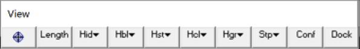
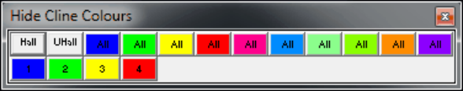

## 5.2.4.1 Hide All

This allows you to hide all construction lines with the selected colour.

This toolbar can be changed to a vertical orientation by dragging is against either the right or left hand edge of the main window.

It can be changed back to a horizontal orientation by dragging is against either the top or bottom edge of the main window.

Selecting the button on the View toolbar activates the Hide Cline Colours toolbar.

View > Hide Cline Colours > Hide All   Hide all construction lines.

View > Hide Cline Colours > Unhide All   Unhide all currently hidden construction lines.

The first row hide and un-hides all clines with the associated colour.

The remaining buttons are labelled with the associated cline colour number and are used to hide these.

Note that the toolbar is scrollable and re-sizable.

To change the size simply grab any edge or corner and drag it to the desired size and shape. Scroll bars only appear if there are too many buttons to display with the current size and shape.
