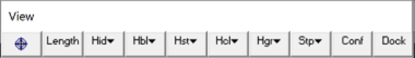
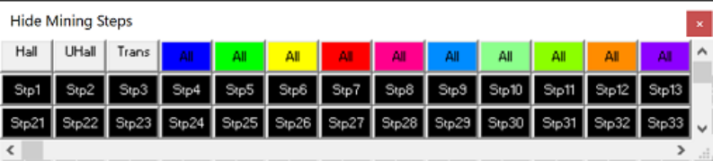

## 5.2.3.1 Hide All

This allows you to hides all blocks that are excavated at the specified step.

This toolbar can be changed to a vertical orientation by dragging is against either the right or left hand edge of the main window.

It can be changed back to a horizontal orientation by dragging is against either the top or bottom edge of the main window.

#### Selecting the

button on the View toolbar activates the Hide Excavation Steps toolbar.

View > Hide Block Colours > Hide All   Hide all block surfaces.

View > Hide Block Colours > Unhide All   Unhide all currently hidden surfaces.

The first row hide and un-hides all blocks with the associated colour.

The remaining buttons are labelled with excavation step numbers and are used to hide those excavation steps.

Note that the toolbar is scrollable and re-sizable.

To change the size simply grab any edge or corner and drag it to the desired size and shape. Scroll bars only appear if there are too many buttons to display with the current size and shape.
