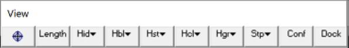
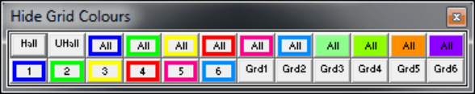

## 5.2.5.1 Hide All

This allow you to hides all grids with the selected colour.

This toolbar can be changed to a vertical orientation by dragging is against either the right or left hand edge of the main window.

It can be changed back to a horizontal orientation by dragging is against either the top or bottom edge of the main window.

Selecting the button activates the Hide Grid Colours toolbar.

View > Hide Grid Colours > Hide All   Hide all grids.

View > Hide Grid Colours > Unhide All   Unhide all currently hidden grids.

The first row hide and un-hides all grids with the associated colour.

The buttons labelled with the associated grid colour number and are used to hide these. The grid name associated with each colour number is displayed in the tooltip and on the menu list.

The remaining buttons are used to hide individual grids just in Grid Selection.

Note that the toolbar is scrollable and re-sizable.

To change the size simply grab any edge or corner and drag it to the desired size and shape. Scroll bars only appear if there are too many buttons to display with the current size and shape.
