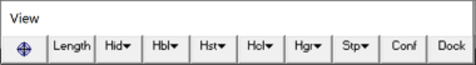
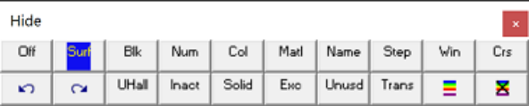

- **5.2.1.1** **Off**

These tools are used to make it easy to hide various portions of the geometry.

Selecting the button on the View toolbar activates the Hide toolbar

Note that if the button is not on the View toolbar it can be added by using the button then selecting Hide > Hide More.

View > Hide > Off   Turns off the hide function.

View > Hide > Surfaces   Hides surfaces by picking one at a time.

View > Hide > Blocks   Hides all surfaces that make up the selected block.

View > Hide > Numbers   Hide all surfaces with the selected block colour number.

View > Hide > Colour   Hide all surfaces with the selected colour.

View > Hide > Materials   Hides all surfaces with the selected material number. The same block may have different materials in it depending on the currently active mining step.

When using this later function, make sure to select the appropriate mining step

File > Mining Step

View > Hide > Names   Hide all surfaces with the selected block name.

View > Hide > Steps   Hide all surfaces that are mined in the selected step.

View > Hide > Window   Hides all surfaces within the selected window. Entities will only be selected if the entire entity is contained within the window.

View > Hide > Crossing   Hides all surfaces within the crossing window. Entities will be selected if even a part of the entity is within the window.

View > Hide > Undo last Hide   Undo the last hide operation (maximum of 10 are currently saved).

View > Hide > Redo last Hide   Redo the previous hide operation (maximum of 10 are currently saved).

View > Hide > Unhide All   Unhide all currently hidden surfaces.

View > Hide > Inactive   When activated, inactive elements are displayed. Inactive surfaces are used to display features that are to be included for visualization purposes only and not to be used for the actual stress analysis

#### CAD > Edit > Entity Properties

View > Hide > Solids   When activated, solids are hidden. Solids are 3D blocks or DD planes that are not excavated.

As the mining sequence progresses

#### File > Mining Step

different blocks will be excavated. To display only excavations, turn this option on.

View > Hide > Excavations   When activated, excavations are hidden.

View > Hide > Unused   When activated, unused elements are hidden. Unused elements are 3D block surfaces or DD planes that are not used in the analysis. Such elements exist where a fault cuts through an excavation, or where a material with a lower material number resides within a zone with a higher material number (e.g. a dyke cutting through an ore zone).

As the mining sequence progresses

#### File > Mining Step

this may change. To hide unused surfaces, turn this option on. Refer to

Analysis > Options > Closure

#### Constructing Alternate Material Zones

for additional discussion.

View > Hide > Translucent   When activated, hidden surfaces as displayed translucent.

View > Hide > Show Errors   Hide/display errors (when activated, show only element errors). Note that this option can be used with the View > Hide > Translucent option.

View > Hide > Hide Errors   Hide/display errors (when activated, do not show element

#### errors).

At the CAD stage the various colours indicate the following problems:

- Purple - gaps have been found and filled, thus fixing this problem. This message does not indicate an error and is given as user information.

- Green - duplicate blocks have been found and deleted, thus fixing this problem. This message does not indicate an error and is given as user information.

- Blue - narrow gaps have been detected. These gaps do not indicate an error and are not necessarily a problem, however if problems arise during the intersection analysis or BEM analysis, these locations are the most likely causes. This message does not indicate an error and is given as user warning.

- White - edges that link the wrong way have been detected. Closed blocks must have all edges linking in a consistent manner so that the inside and outside of a block can be consistently determined. White edges do not satisfy this requirement. This message does indicate an error which should be fixed before proceeding with the analysis.

- Orange - edges that do not link to other edges have been detected. Closed blocks must have all edges linking to one other edge to form a closed block. Orange edges do not satisfy this requirement. This message does indicate an error which should be fixed before proceeding with the analysis.

- Yellow - edges that link to more than one other edge have been detected. Closed blocks must have all edges linking to only one other edge to form a closed block. Yellow edges do not satisfy this requirement. This message does indicate an error which should be fixed before proceeding with the analysis.

- Red - highlights Visco-Plastic zones with invalid hex shapes. In Map3D Visco-Plastic, plastic zones are only permitted to have hexahedron shapes (4 corners at the top and 4 corners at the bottom) or some degeneration of this shape such as tetrahedron.

At the INTERSECTION stage the various colours indicate the following problems:

- Purple - a surface has been disabled due to an unresolvable contact. When the contacts been various block surfaces was analyzed, the way that this surface interfaced with another surface could not be resolved so the surface was disabled and hence will not be used in the BEM stress analysis. The most likely cause of this problem is a very odd shape such as an extremely narrow triangle. Although this is an error, such errors can normally be ignored since extremely narrow shapes contribute little to the analysis results.

- Green - a surface has been disabled due to an unresolvable closure. When the closure of a block was analyzed, the way that this surface interfaced with the block could not be resolved so the surface was disabled and hence will not be used in the BEM stress analysis. The most likely cause of this problem is a very odd shape such as an extremely narrow triangle. Although this is an error, such errors can normally be ignored since extremely narrow shapes contribute little to the analysis results.

- Blue - narrow gaps have been detected. These gaps do not indicate an error and are not necessarily a problem, however if problems arise during the intersection analysis or BEM analysis, these locations are the most likely causes. This message does not indicate an error and is given as user warning.

- White - unclosed surfaces have been detected. When the closure of a block was analyzed it was found that the interior and exterior of the block could not be consistently determined. This message does indicate an error which should be fixed before proceeding with the analysis.

- Orange - edges that do not link to other edges have been detected. Closed blocks must have all edges linking to one other edge to form a closed block. Orange edges do not satisfy this requirement. This message does indicate an error which should be fixed before proceeding with the analysis.

- Yellow - a surface has been disabled due to an unresolvable shape. The most likely cause of this problem is a very odd shape such as an extremely narrow triangle. Although this is an error, such errors can normally be ignored since extremely narrow shapes contribute little to the analysis results.
