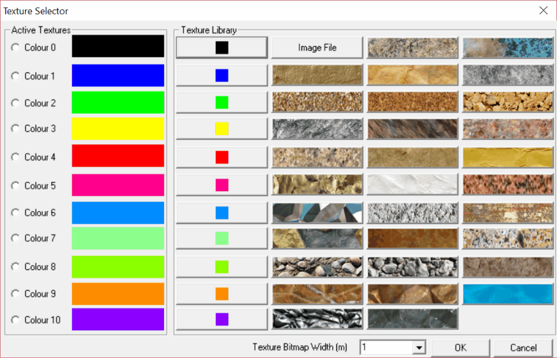

## 5.2.6.1 Block Outlines

Sets up rendering options for the model.

View > Render > Block Outlines - blocks are drawn with outlines showing the edges of the blocks.

View > Render > Grid Lines - blocks are drawn with lines at regular grid intervals. You are prompted for the grid interval when you activate this feature.

View > Render > Block Colours - blocks are drawn with colour shading. Turn this feature off for a wireframe view.

View > Render > Material Numbers - blocks are coloured corresponding to the material property inserted in the block. The same block may have different materials in it depending on the currently active mining step.

When using this function, make sure to select the appropriate mining step

#### File > Mining Step

View > Render > Mining Step Numbers - blocks are coloured corresponding to the mining step at which they are excavated.

View > Render > Dark Shading - blocks are drawn with a dark light-source shading model. You are prompted for an edge radius when you activate this feature. The edge radius is used to shade edges and corners to give them a rounded appearance. The edge radius should be specified as a fraction of the block thickness. Shading can considerably slow down the refresh rate.

View > Render > Bright Shading - blocks are drawn with a bright light-source shading model. You are prompted for an edge radius when you activate this feature. The edge radius is used to shade edges and corners to give them a rounded appearance. The edge radius should be specified as a fraction of the block thickness. Shading can considerably slow down the refresh rate.

View > Render > Texture Rendering - Toggles texture rendering on/off. Texture rendering allow you to colour surfaces with a bitmap image instead of a solid colour.Refer to Assign Bock Textures

View > Render > Block Numbers - blocks are drawn with numbers on their surfaces. These numbers correspond to the currently selected render mode: Block Colours, Material Numbers, or Mining Step Numbers.

View > Render > Block Names - blocks are drawn with the block names on their surfaces.

View > Render > Coordinate Numbers - blocks are drawn with the block names on their surfaces.

View > Render > Backfacing Surfaces - when activated, back-facing surfaces of 3D FF blocks are drawn. Generally the user does not need or want to see these surfaces.

View > Render > Fixed With Spacing - when activated, surfaces with specified fixed width discretization will be rendered showing the discretization.

View > Render > Discretize - Toggles the display of discretized and non-discretized views of the model. View > Render > Perspective - Toggles the display of perspective or orthogonal viewing. In orthogonal mode, all dimensions are drawn to true scale. In perspective view, entities further from the observer are drawn smaller in size.

View > Render > Clines Dot Radius - specifies the radius of dots that will be drawn at all corner points along construction lines. This significantly slows the drawing operation and should only be used if needed. A zero value indicates that no dots will be drawn.

View > Render > Point Size - specifies the radius of dots that will be drawn at all corner points during selection.

View > Render > Line Width - specifies the width of the block outlines and contour lines.

## 5.2.6.9 Assign Block Textures

Texture rendering allow you to colour surfaces with a bitmap image instead of a solid colour. To achieve this, do the following:

1. select which colour number you want to assign the texture to (eg. Colour 0, Colour 1 ...)

2. select one of the pre-defined bitmaps, or select your own bitmap using "Image File".

3. In order to map the bitmap image onto each surface you must specify the "Texture Bitmap With" The "Texture Bitmap With" scales the specified bitmap so that the pattern repeated at the geometric width specified.

For example if you specify 1m as the width, then the bitmap will be scaled such that it is drawn with a width of 1m on your block surfaces.

## 5.2.6.10 Small Block Numbers

Sets up rendering options for the model.

View > Render > Block Outlines - blocks are drawn with outlines showing the edges of the blocks.

View > Render > Grid Lines - blocks are drawn with lines at regular grid intervals. You are prompted for the grid interval when you activate this feature.

View > Render > Block Colours - blocks are drawn with colour shading. Turn this feature off for a wireframe view.

View > Render > Material Numbers - blocks are coloured corresponding to the material property inserted in the block. The same block may have different materials in it depending on the currently active mining step.

When using this function, make sure to select the appropriate mining step

#### File > Mining Step

View > Render > Mining Step Numbers - blocks are coloured corresponding to the mining step at which they are excavated.

View > Render > Dark Shading - blocks are drawn with a dark light-source shading model. You are prompted for an edge radius when you activate this feature. The edge radius is used to shade edges and corners to give them a rounded appearance. The edge radius should be specified as a fraction of the block thickness. Shading can considerably slow down the refresh rate.

View > Render > Bright Shading - blocks are drawn with a bright light-source shading model. You are prompted for an edge radius when you activate this feature. The edge radius is used to shade edges and corners to give them a rounded appearance. The edge radius should be specified as a fraction of the block thickness. Shading can considerably slow down the refresh rate.

View > Render > Texture Rendering - Toggles texture rendering on/off. Texture rendering allow you to colour surfaces with a bitmap image instead of a solid colour.Refer to Assign Bock Textures

View > Render > Block Numbers - blocks are drawn with numbers on their surfaces. These numbers correspond to the currently selected render mode: Block Colours, Material Numbers, or Mining Step Numbers.

View > Render > Block Names - blocks are drawn with the block names on their surfaces.

View > Render > Coordinate Numbers - blocks are drawn with the block names on their surfaces.

View > Render > Backfacing Surfaces - when activated, back-facing surfaces of 3D FF blocks are drawn. Generally the user does not need or want to see these surfaces.

View > Render > Fixed With Spacing - when activated, surfaces with specified fixed width discretization will be rendered showing the discretization.

View > Render > Discretize - Toggles the display of discretized and non-discretized views of the model. View > Render > Perspective - Toggles the display of perspective or orthogonal viewing. In orthogonal mode, all dimensions are drawn to true scale. In perspective view, entities further from the observer are drawn smaller in size.

View > Render > Clines Dot Radius - specifies the radius of dots that will be drawn at all corner points along construction lines. This significantly slows the drawing operation and should only be used if needed. A zero value indicates that no dots will be drawn.

View > Render > Point Size - specifies the radius of dots that will be drawn at all corner points during selection.

View > Render > Line Width - specifies the width of the block outlines and contour lines.
