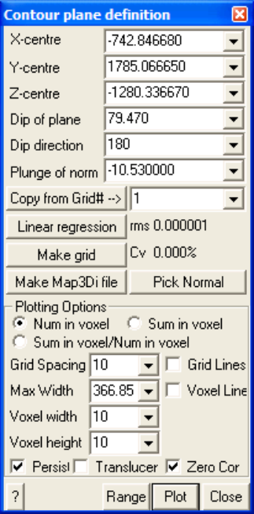
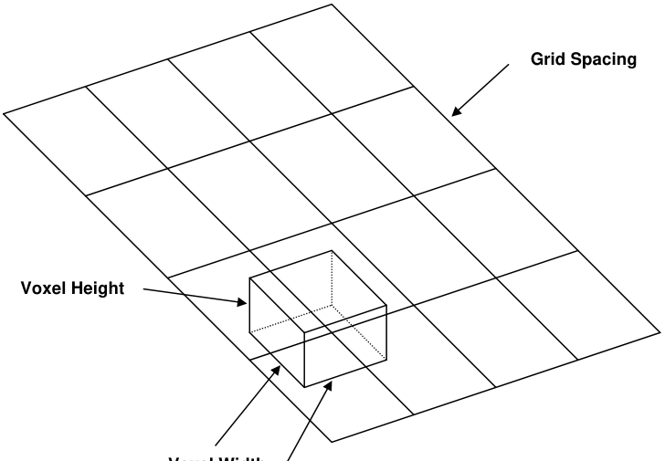
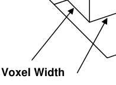

Enables setup of the plane used for contouring of visualization point data (see Visualization).

**X-centre** – the x-coordinate value of the centre of the contour plane.

**Y-centre** – the y-coordinate value of the centre of the contour plane. **Z-centre** – the z-coordinate value of the centre of the contour plane. **Dip of plane** – the dip of the contour plane.

**Dip direction** – the dip direction of the contour plane.

**Dip of normal** – the dip of the normal to the contour plane (this value is 90° from the dip of the plane).

**Pick Normal** - activates the cursor allowing interactive selection of a surface. The centre, dip and dip direction of the contour plane will be set parallel to the selected surface.

**Copy from Grid#** – copies the location and orientation parameters from a model grid plane. **Linear regression** – finds a best fit plane through the seismic data by minimizing the normal

distance from all points to the plane.

**Make Grid** – creates a model grid plane from the contour plane.

**Make Map3Di file** – generates a data file from the contoured data to be used for seismic loading in a **Map3Di** analysis (more on this below).

#### Contour Plane Options:

**Num in voxel** – the count of the number of points within each voxel is contoured. **Sum in voxel** – the sum of the plot equation values for all points located in the voxel is contoured.

**Sum/Num in voxel** – the quotient of the two values is contoured.

- **Grid spacing** – the grid spacing used to contour the seismic data. Since the voxel is centred at each grid corner, this parameter controls the density of the voxels. Note that if the grid spacing is smaller than the voxel width, adjacent voxels will overlap.

**Voxel width** – the voxel width is measured parallel to the edges of the grid plane.

**Voxel height** – the voxel height is measured perpendicular to the grid plane. This allows the user to

limit the distance from the grid plane within which data will be included in the contouring.

**Outlines** – draws the actual voxel outlines.

- **Persist** – when checked, the points will be re-plotted each time the model is reoriented, translated or zoomed. Since this may be time consuming for large models this option may not always be desired.

**Translucent** - draws the points as translucent spheres.

**Zero Contour** - when unchecked, contours below the minimum contour range are not drawn. This

is useful for displaying contours where only the upper part of the contour range is important. **Range** – specifies the minimum, maximum and interval for radius scaling and contouring.

- Plot regenerates the plot. This button can be placed on either the View Toolbar (Tools >

- View Toolbar Configure) or the Contour Toolbar (Tools > Contour Toolbar Configure).

#### Linear Regression:

The linear regression is conducted by finding the plane that has the minimum **_rms_** value (the root mean square, or mean distance of all points to the fitted plane).

Standard theory on correlation coefficient is not suitable as a measure of goodness of fit in this case. This is because we are not interested in the "measure of the degree of association between variables" but rather we want a measure of how well the fitted plane represents out data. Note that if all data lies in a single horizontal plane, we have a perfect plane fit. By definition however there is zero correlation

(and hence the correlation coefficient equals zero) because the z value does not depend on the x or y values. This is not what we want.

Here a parameter similar to a coefficient of variation (a measure of the variability divided by the magnitude) is defined. **_Cv_** is simply defined as the **_rms_** value (the mean distance of all points to the fitted plane) divided by the mean distance of all points to the centroid. This measures how well the plane represents the data. This ratio is usually expressed as a percentage. Defined like this, random data gives a **Cv** =100% (100% variability). A perfect fit gives a **_Cv_** =0 (0% variability). Note that it is possible for **_Cv_** to exceed 100%. You can think of this parameter as the ratio of the variability around the plane divided by the physical width of the data set.

This is very similar to the formal definition of coefficient of variation which is standard deviation divided by the mean. Most geologic materials have properties with **_Cv_** on the order of 20 to 30%. **_Cv_** could be turned into an equivalent correlation coefficient using

**_r_ = (1-** **_Cv_ ²)****½**

but this is not really the correct parameter to use and there are problems in definition for cases where **_Cv_** exceeds 1.

Both the **rms** and **_Cv_** are displayed for the current plane whenever data is plotted.

#### Make Map3Di file:

In order to make a Map3Di loading file one must determine the shear displacement distribution (ride) indicated by the seismicity. This requires several assumptions (refer to A. McGarr, "Some Applications of Seismic Source Mechanism Studies to Assessing Underground Hazard", Proc. 1st International Symposium on Rockbursts and Seismicity in Mines, SAIMM, Johannesburg, 1984, pp. 199-208, and Hoffman, G, R. Sewjee and G. van Aswegan, "First steps in the integration of numerical modelling and seismic monitoring", 5th International Symposium on Rockburst and Seismicity in Mines, SAIMM, Johannesburg, 2000, pp. 397-404.) which are outlined here:

1) Assuming a slip model. Here we can consider either an elliptic crack model (Brune) or an asperity model with soft edges due to creep (Walsh, J.J. and J. Waterson, "Distribution of cumulative displacements and seismic slip on a single normal fault surface", J. Struct. Geol., V. 9, 1987, pp. 1039-1046). Generally a circular (penny) shape will be used unless the user has some way to define an alternate shape.

2) The average value of slip can be determined from the seismic moment **_Mo_ =** m **_AD_** where m is the modulus of rigidity, **_A_** is the source area (determined from the source radius), and **_D_** is the average slip across the fault. This can also be determined from the determined from the "Seismic Strain Drop".

3) The slip surface radius can be estimated from the Brune radius as the shear wave velocity and **_fo_** is the corner frequency. For an asperity model, the radius **_a_ = 2.34** b **/(2** p **_fo_ )** , where b is determined from the radius of the "Apparent Volume" is probably more appropriate.

4) The orientation of slip can be determined from the seismic moment tensor if available, or from the stress state from modelling.

From these 4 items you can determine the slip profile indicated by the seismic event.

For an elliptic profile, the shear displacement (ride) distribution is given by

**1.50** **_D_ (1-** **_r_ ²/** **_a_ ²)****½**

For an asperity profile, the shear displacement (ride) distribution is given by

#### 2.89 _D_ (1- _r_ / _a_ )(1+2 _r_ / _a_ -3 _r_ ²/ _a_ ²)½

A seismic loading file can be generated for Map3Di as follows:

- 1) Construct a seismic data file with as a series of points:

**x1 y1 z1 f1 f2 … x2 y2 z2 f1 f2 … x3 y3 z3 f1 f2 … ...**

where **xi yi zi** represent the coordinates of each point,

**f1** indicates the average slip **_D_** , and **f2** indicates the source radius **_a_** .

- 2) Using the Visualization routine, for an elliptic profile specify the plot equation as

   - **1.50*f1*sqrt(1-rip^2/f2^2)**

For an asperity profile use

#### 2.89*f1*(1-rip/f2)*sqrt(1+2*rip/f2-3*rip^2/f2^2)

3) Choose your desired plane, grid spacing, set the desired voxel height and width. The voxel height can be used to clip out of plane events. It is important to choose the voxel width equal to the largest desired event radius in order to distribute the shear displacement (ride) over all affected voxels.

- 4) Set Plotting Options to "Sum in Voxel" and Plot.

- 5) Make Map3Di file.

- 6) View Map3Di file using CAD > Properties > Map3Di Setup and view the f2 parameter.

Refer to **CAD > Properties > Map3Di** for details concerning the data format.
